## 후속 연구 — followup-v2

갱신: **2026-11-04 13:33 KST**. 이 절은 새 단계별 측정 파일에서 생성되었습니다.

| 단계 | 실험 | 실행 상태 | 가설 판정 |
|---|---|---|---|
| F0 | [새 benchmark와 기존 결과 보존](reports/followup-v2/F0_REPORT.md) | MEASURED | SUPPORTED |
| F1 | [5개 독립 초기화 학습과 calibration 전용 형식 선택](reports/followup-v2/F1_REPORT.md) | MEASURED | INCONCLUSIVE |
| F2 | [정확한 뉴런 순열의 양성 대조군](reports/followup-v2/F2_REPORT.md) | MEASURED | SUPPORTED |
| F3 | [독립 시드·이종 계열의 두 위치 정렬과 학습 궤적](reports/followup-v2/F3_REPORT.md) | MEASURED | INCONCLUSIVE |
| F4 | [Single/group causal effects and dose response](reports/followup-v2/F4_REPORT.md) | PENDING | INCONCLUSIVE |
| F5 | [Transplantation and selective merging](reports/followup-v2/F5_REPORT.md) | PENDING | INCONCLUSIVE |
| F6 | [Global statistics, replay and preservation audit](reports/followup-v2/F6_REPORT.md) | PENDING | INCONCLUSIVE |

실행 완료와 가설 지지는 별개입니다. 모델이 해당 과제를 학습했는지 먼저 확인하며, 낮은 능력의 대응 실패를 보존 가설의 반증으로 바꾸지 않습니다. 새 데이터·프로토콜·후보·검정 범위를 기록하고 기존 pilot-v1 결과를 보존합니다. 군집·모델 seed·매칭 seed·다중검정 범위가 다른 수치를 임의로 합치지 않습니다. 인과 효과 일치도 이식이나 병합의 유효성을 자동으로 보장하지 않습니다.

### F0 — 새 benchmark와 기존 결과 보존

**MEASURED · SUPPORTED**. 20,224문항의 정답 oracle·분할 중복·짝별 단서 균형 검증을 통과했다. 이는 명시한 단서의 차단을 확인하며 모든 shortcut의 부재를 뜻하지 않는다. 기존 파일 261개의 SHA256을 보존했다.

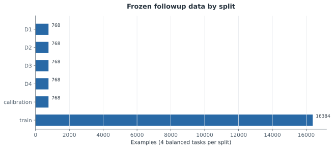


[그림 데이터](artifacts/followup-v2/figures/f0_f0_dataset.json)

[F0 측정값·불확실성·원본](reports/followup-v2/F0_REPORT.md)

### F1 — 5개 독립 초기화 학습과 calibration 전용 형식 선택

**MEASURED · INCONCLUSIVE**. 서로 다른 초기 파라미터 해시의 모델 5개 학습과 8개 모델의 calibration 형식 고정을 완료했다. 선택한 형식의 calibration 과제 셀 32개 중 14개가 사전 능력 기준을 충족했다. 이는 형식 선택에 사용한 표본의 진단이며 독립 D3/D4 일반화 결과가 아니다.

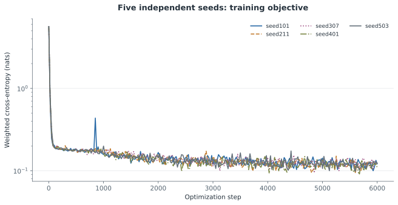

Training loss is not held-out competence. No D3/D4 outcomes are used in this figure.

[그림 데이터](artifacts/followup-v2/figures/f1_five_seed_training.json)

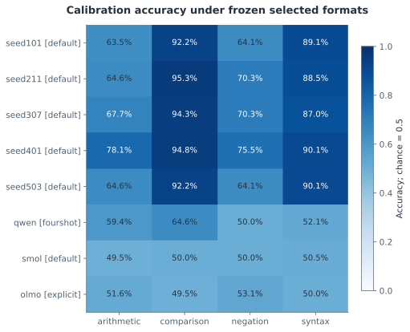

Selected on calibration itself; this is an in-sample readiness diagnostic, not final test accuracy.

[그림 데이터](artifacts/followup-v2/figures/f1_selected_calibration_accuracy.json)

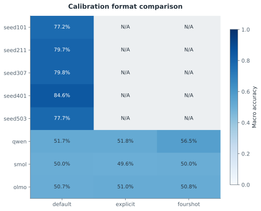

Byte-tokenizer models use default only; unevaluated formats are N/A. One format is frozen per model.

[그림 데이터](artifacts/followup-v2/figures/f1_calibration_variant_comparison.json)

[F1 측정값·불확실성·원본](reports/followup-v2/F1_REPORT.md)

### F2 — 정확한 뉴런 순열의 양성 대조군

**MEASURED · SUPPORTED**. 등록한 모델 내부 순열 대칭 대조군의 정렬·개입 검증을 통과했다. 이는 측정 파이프라인의 해당 회복 성질을 검사하며, 독립적으로 학습된 모델의 의미 보존을 입증하지 않는다.

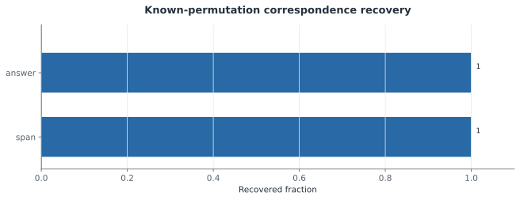


[그림 데이터](artifacts/followup-v2/figures/f2_permutation_recovery.json)

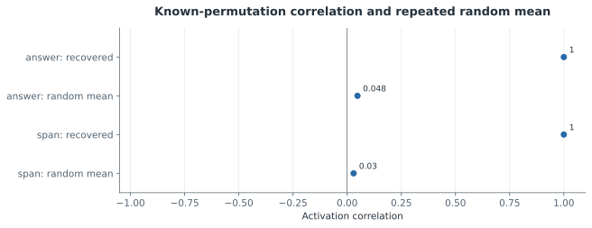

Random baseline has 100 realizations; its SD is reported separately and is not labeled a confidence interval.

[그림 데이터](artifacts/followup-v2/figures/f2_permutation_vs_random.json)

[F2 측정값·불확실성·원본](reports/followup-v2/F2_REPORT.md)

### F3 — 독립 시드·이종 계열의 두 위치 정렬과 학습 궤적

**MEASURED · INCONCLUSIVE**. 등록한 최종 모델 비교26개와 초기·중간 체크포인트 비교40개를 완료했다. 두 위치의 최종 모델쌍×과제 셀 중 52개에서 양쪽 모델의 능력 조건을 충족했다. 전체 과제 결과와 능력 조건을 구분하며, 학습 전 대응과 반복 무작위 매칭을 함께 공개한다. 확인 검정의 전역 BH는 F6에서 적용한다. 이종 계열은 calibration으로 고정한 서로 다른 프롬프트 접두 맥락을 사용하므로 동일 전체 입력의 비교가 아니며, 낮은 과제 능력에서 기능 보존의 부재를 결론내릴 수 없다. 사후 괄호 스트레스 분석에서 독립 학습 모델의 정확도는 인접 종류 불일치가 있는 pair 집합에서 93.4%–100.0%(n=166), 없는 집합에서 50.0%–61.5%(n=26)였다. 작은 사후 부분집합과 내용 차이를 포함한 연관성이므로 인과적 shortcut 사용 증거는 아니지만, 전체 정확도 능력 gate만으로 재귀적·구조적 이해를 입증할 수 없음을 보여 준다. 수 비교·부정 과제의 측정과는 구분한다.

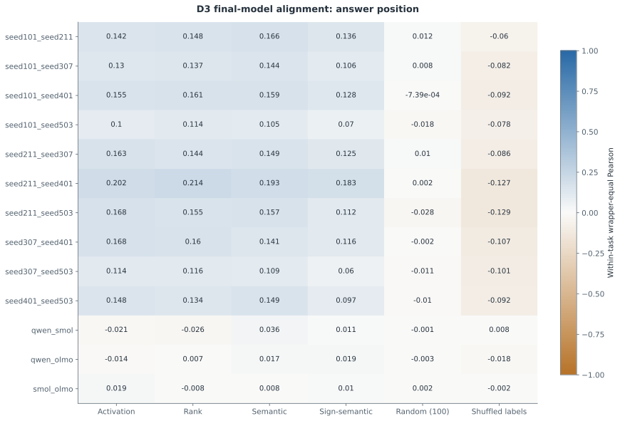

All task rows retained; competence-qualified strata are reported in the source. Random baseline averages100 frozen maps.

[그림 데이터](artifacts/followup-v2/figures/f3_final_answer.json)

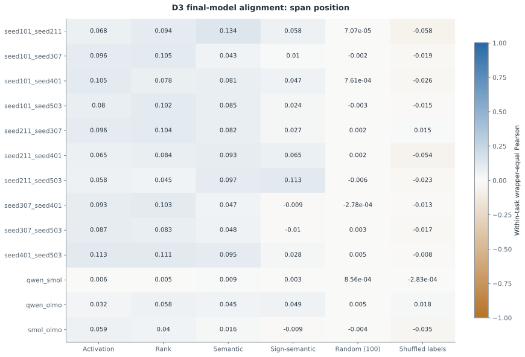

All task rows retained; competence-qualified strata are reported in the source. Random baseline averages100 frozen maps.

[그림 데이터](artifacts/followup-v2/figures/f3_final_span.json)

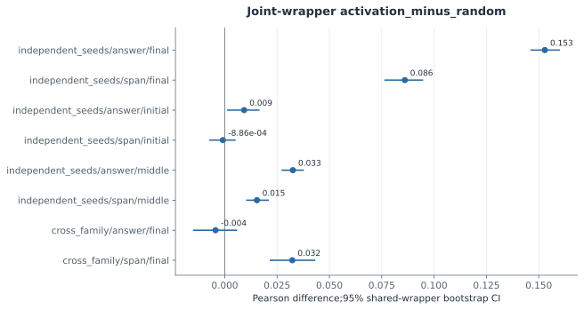

All observed pairs remain together inside each resampled wrapper; these intervals are conditional on the fixed model collection, not unseen model seeds.

[그림 데이터](artifacts/followup-v2/figures/f3_activation_minus_random.json)

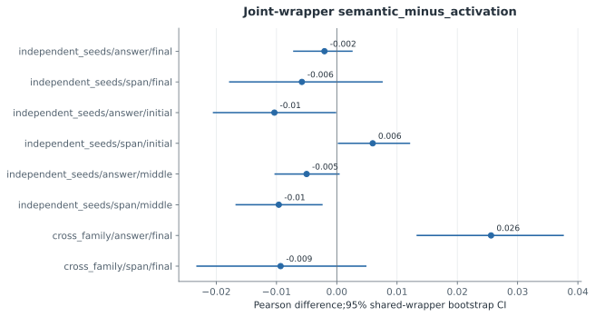

All observed pairs remain together inside each resampled wrapper; these intervals are conditional on the fixed model collection, not unseen model seeds.

[그림 데이터](artifacts/followup-v2/figures/f3_semantic_minus_activation.json)

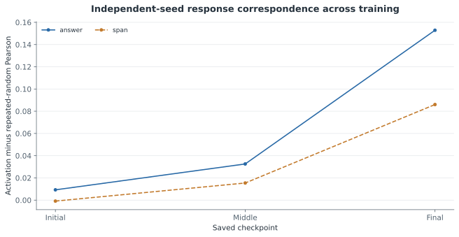

The same final-D1 neurons and final-D2 maps are reused at all checkpoints. This is descriptive tracking, not checkpoint-specific feature discovery.

[그림 데이터](artifacts/followup-v2/figures/f3_independent_seed_trajectory.json)

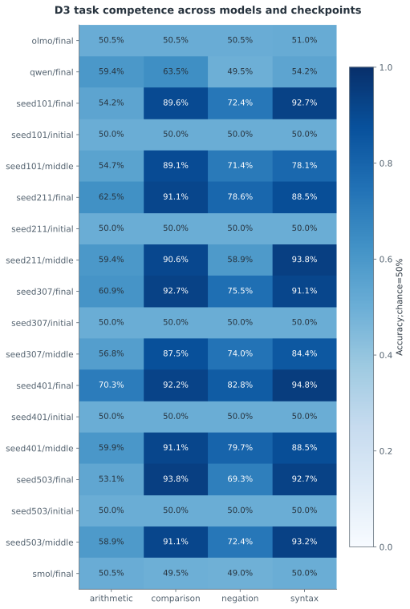

D3 was collected only after the registered D2 maps were frozen. Initial/middle/final are not independent model replications.

[그림 데이터](artifacts/followup-v2/figures/f3_trajectory_competence.json)

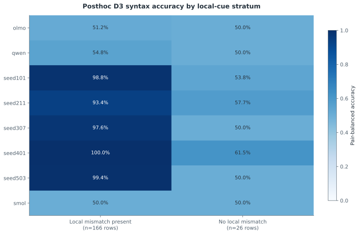

Exploratory cuts chosen after D3; both true/false pair members retained. N counts rows. Unequal content and small n=26 stratum confound differences; no causal cue-use claim or confirmatory test.

[그림 데이터](artifacts/followup-v2/figures/f3_posthoc_syntax_local_cue.json)

[F3 측정값·불확실성·원본](reports/followup-v2/F3_REPORT.md)

### 보충 검증 — 새 hard syntax 문항

사후 D3 진단에서 동기를 얻어 새 hard syntax768문항(참·거짓 각384,24wrappers)을 구성·동결한 뒤18개 모델/체크포인트 측정을 완료했다. 학습 완료5개 모델의 정확도는 50.26%–56.12%였고, 원래 D3 괄호 정확도는 88.54%–94.79%였다. 새 문항에서 이 모델들의 yes 응답률은 76.17%–99.22%로, 균형 정확도와 함께 응답 편향을 확인해야 한다. 두 집합은 내용·구조 분포가 달라 점수 차이가 shortcut 사용의 인과적 증거는 아니다. 이 결과는 전체 정확도 gate만으로 재귀 이해를 입증할 수 없음을 강조하며, 새로운 독립 확증 검정이나 원래 주 분석의 변경으로 취급하지 않는다.

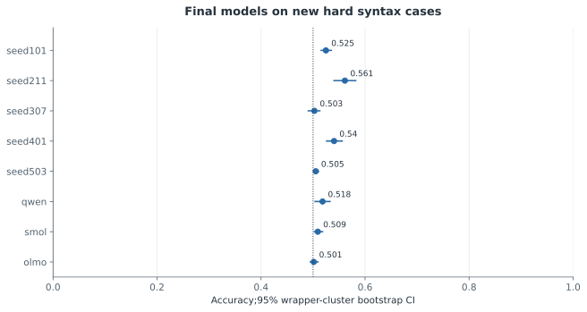

768 balanced rows in24 wrappers; dotted line marks chance50%. These are posthoc-motivated new cases, frozen before inference, outside the110 primary tests.

[그림 데이터](artifacts/followup-v2/figures/supplement_hard_final_accuracy.json)

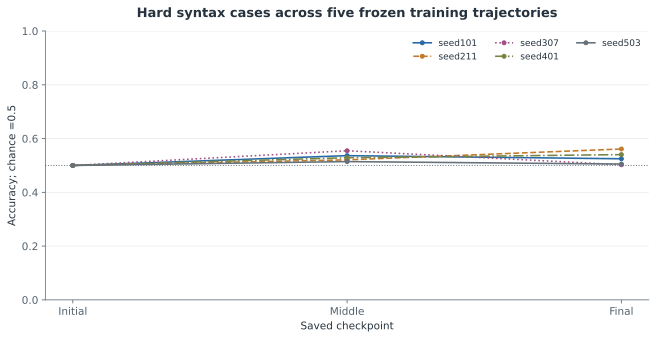

Five separately initialized models; each line reuses one model across checkpoints. No retraining or checkpoint selection. This is not independent replication at each point.

[그림 데이터](artifacts/followup-v2/figures/supplement_hard_checkpoint_trajectory.json)

[18개 전체 측정·신뢰구간·응답 편향·출처](reports/followup-v2/HARD_STRESS_REPORT.md)

[연구 해석 한계와 비판](reports/followup-v2/RESEARCH_CRITIQUE.md)


---

# Preserved pilot-v1 results

# Native Neuron Conservation Pilot

독립적으로 학습된 모델에서 원본 뉴런의 **활성 반응·의미 proxy·인과 역할**이 보존되는지를 검증합니다. [MASTER.md](MASTER.md)에 따른 연구이며, 결과는 각 단계의 실제 측정 파일에서 자동 생성됩니다.

갱신: **2026-11-04 11:13 KST**. 정렬 평가 결과가 있는 단계: **E1, E2, E3, E4**.

## 실험 결과

| Experiment | Hypothesis | Main Metric | Baseline | Proposed | Improvement | CI | Verdict |
|---|---|---|---:|---:|---:|---|---|
| E1 | 독립 초기화 모델의 기능 대응 | D3 response agreement | -0.077 | 0.289 | 0.366 | [0.296, 0.443] | INCONCLUSIVE |
| E2 | 이종 Base 모델의 기능 대응 | D3 response agreement | 모델 쌍별 | 모델 쌍별 | 모델 쌍별 | 상세 표 참조 | INCONCLUSIVE |
| E3 | 의미 정렬의 독립 입력 일반화 | D3 response agreement | 모델 쌍별 | 모델 쌍별 | 모델 쌍별 | 상세 표 참조 | NOT SUPPORTED |
| E4 | 독립 인과 효과 일치 | D4 causal effect agreement | 모델 쌍별 | 모델 쌍별 | 모델 쌍별 | 상세 표 참조 | INCONCLUSIVE |

이 연구는 제한된 합성 참·거짓 과제의 파일럿입니다. 학습·탐색·정렬·독립 반응 평가·독립 인과 평가를 분리했지만 의미 문법은 공유합니다. 여섯 wrapper 군집의 부트스트랩 신뢰구간과 무작위화 검정은 탐색적입니다. 뉴런 개수를 독립 표본 수로 사용하지 않습니다. BH q는 모델 쌍별 비교군 안에서 보정한 값이며 연구 전체의 다중검정 보정이 아닙니다. Random 기준선은 쌍당 한 번 고정한 매칭으로, 그 무작위 매칭 자체의 변동은 CI에 포함되지 않습니다. 모델의 과제 능력이 낮으면 대응 실패를 기능 보존의 기각으로 해석하지 않습니다. 활성값 유사성·의미 설명·인과 효과 일치를 구분하며, 긍정적 결과도 뉴런 복사나 모델 병합의 안전성을 보장하지 않습니다.

- **E1: INCONCLUSIVE** — 학습 전 모델도 유의한 활성 대응을 보이며, 학습 모델의 일부 과제 능력과 시드 반복 수가 부족합니다. 활성 상관만으로 학습된 기능 보존을 확정할 수 없습니다.
- **E2: INCONCLUSIVE** — 이종 모델 간 반응 대응은 관찰되지만 여러 과제에서 정답률이 우연 수준에 가깝습니다. 의미 기능의 보존과 입력·답변 형식의 공통 반응을 구분할 근거가 부족합니다.
- **E3: NOT SUPPORTED** — 이 파일럿의 네 모델 쌍 모두에서 참·거짓 대비 기반 의미 proxy의 평균 D3 점수가 활성 정렬보다 낮았습니다. 이 특정 방법의 우월성은 지지되지 않으며 Goodfire 가설 전체의 반증을 뜻하지 않습니다.
- **E4: INCONCLUSIVE** — 모델 쌍별 독립 인과 효과 결과를 보고하되, 낮은 과제 능력·공통 yes/no 출력·적은 템플릿 수와 개입 후보 수 때문에 보편적인 기능적 인과 보존을 확정하지 않습니다.

**재현성 수정 공개:** 레이블 셔플 대조군에서 Python 해시 순서에 따른 재현성 오류를 최종 감사 중 발견했습니다. 정렬 효과의 원래 수치와 저장 매핑은 보존했으며, 기존 결과를 새 대조군으로 덮어쓰지 않았습니다. E1/E3의 같은 주요 효과·보정 전 p에도 대조군 실현값의 차이 때문에 BH q가 달라질 수 있습니다. 두 결과를 독립 재현으로 세지 않습니다. [오류 범위·보존 원칙·회귀 검증](reports/REPRODUCIBILITY_CORRECTION.md)을 참조하십시오.

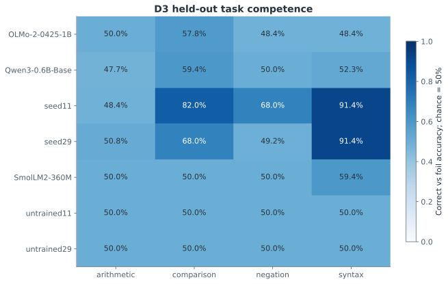

정답과 대비 답변의 전체 continuation likelihood를 비교한 D3 정확도입니다. 우연 수준은 50%입니다.

### E1 — Independent Seed Neuron Conservation

- **seed11_seed29**: activation_minus_random Δ=0.366, Δ 95% CI [0.296, 0.443], q=0.0521. 양의 차이가 관찰됨; BH 보정 후 유의 기준 q<0.05 미충족.
- **untrained11_untrained29**: activation_minus_random Δ=0.135, Δ 95% CI [0.104, 0.173], q=0.0391. 양의 차이가 관찰됨; BH 보정 후 유의 기준 q<0.05 충족.
학습 전 대조군에서도 대응이 나타나면 공유된 아키텍처·표면 패턴만으로 상관이 생길 수 있습니다. 학습 모델의 산술·부정 과제 능력이 약한 조건도 있으므로 H1의 일반적 기능 보존 주장은 판단을 보류합니다.

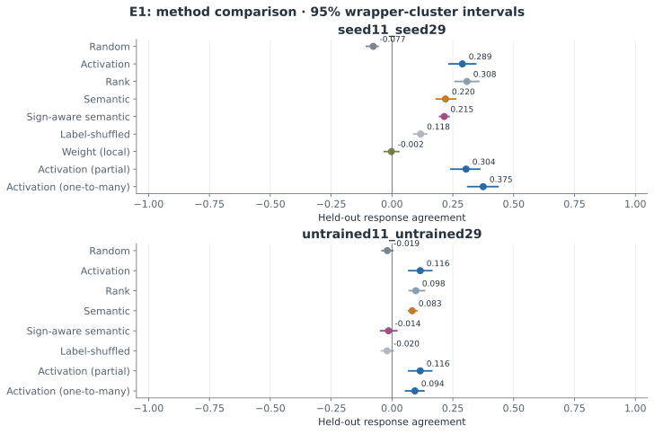

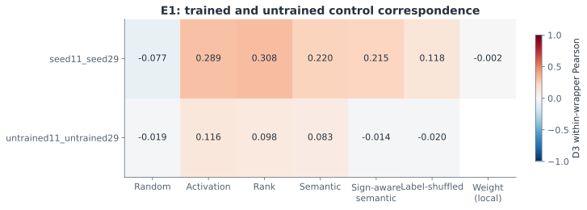

[E1 방법·원본 데이터·통계](reports/E1_report.md)

### E2 — Cross-Family Neuron Conservation

- **qwen_olmo**: activation_minus_random Δ=0.118, Δ 95% CI [0.062, 0.172], q=0.0781. 양의 차이가 관찰됨; BH 보정 후 유의 기준 q<0.05 미충족.
- **qwen_smol**: activation_minus_random Δ=0.196, Δ 95% CI [0.143, 0.272], q=0.0312. 양의 차이가 관찰됨; BH 보정 후 유의 기준 q<0.05 충족.
- **smol_olmo**: activation_minus_random Δ=0.059, Δ 95% CI [0.010, 0.108], q=0.2344. 양의 차이가 관찰됨; BH 보정 후 유의 기준 q<0.05 미충족.
모델 쌍별 능력 차이와 같은 yes/no 답변 공간의 영향을 분리해야 합니다. 반응 상관만으로 이종 모델의 동일 의미 기능을 확정하지 않습니다.

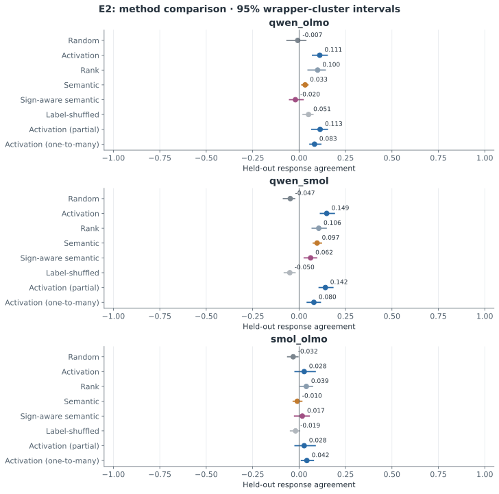

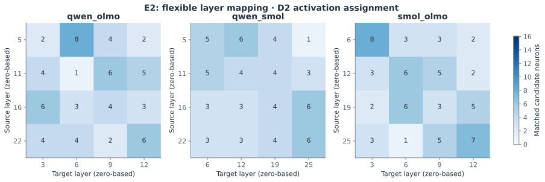

[E2 방법·원본 데이터·통계](reports/E2_report.md)

### E3 — Main-Function Semantic Alignment

- **qwen_olmo**: semantic_minus_activation Δ=-0.079, Δ 95% CI [-0.123, -0.029], q=0.0781. 제안 방법의 양의 개선이 관찰되지 않음; BH 보정 후 유의 기준 q<0.05 미충족.
- **qwen_smol**: semantic_minus_activation Δ=-0.052, Δ 95% CI [-0.090, -0.021], q=0.0312. 제안 방법의 양의 개선이 관찰되지 않음; BH 보정 후 유의 기준 q<0.05 충족.
- **seed11_seed29**: semantic_minus_activation Δ=-0.070, Δ 95% CI [-0.099, -0.040], q=0.0391. 제안 방법의 양의 개선이 관찰되지 않음; BH 보정 후 유의 기준 q<0.05 충족.
- **smol_olmo**: semantic_minus_activation Δ=-0.037, Δ 95% CI [-0.093, 0.018], q=0.3906. 제안 방법의 양의 개선이 관찰되지 않음; BH 보정 후 유의 기준 q<0.05 미충족.
주기능이라고 부르는 값은 네 합성 과제의 참·거짓 선택성 proxy입니다. 이 특정 proxy·benchmark에서 의미 정렬의 우위를 지지하지 않는다는 판단이며, Goodfire 가설 일반에 대한 반증이 아닙니다. 독립 반응 지표의 개선과 보편적 의미 해석의 개선은 별개입니다.

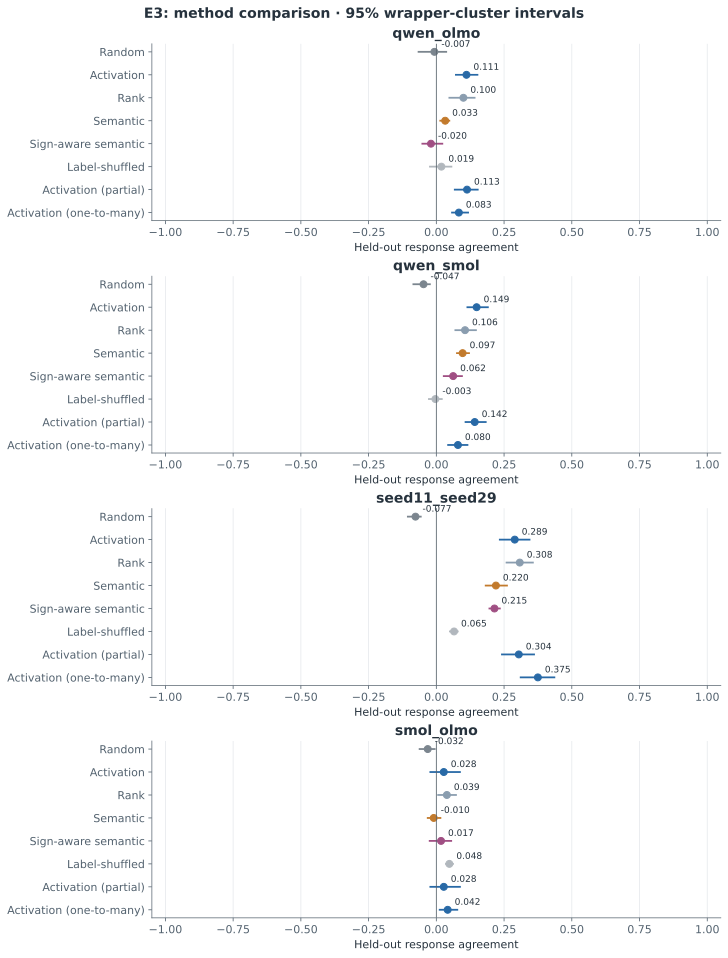

[E3 방법·원본 데이터·통계](reports/E3_report.md)

### E4 — Causal-Role Alignment

- **qwen_olmo**: semantic_causal_minus_semantic Δ=-0.026, Δ 95% CI [-0.076, 0.014], q=0.5417. 제안 방법의 양의 개선이 관찰되지 않음; BH 보정 후 유의 기준 q<0.05 미충족.
- **qwen_smol**: semantic_causal_minus_semantic Δ=0.098, Δ 95% CI [0.003, 0.174], q=0.2917. 양의 차이가 관찰됨; BH 보정 후 유의 기준 q<0.05 미충족.
- **seed11_seed29**: semantic_causal_minus_semantic Δ=0.000, Δ 95% CI [0.000, 0.000], q=1.0000. 제안 방법의 양의 개선이 관찰되지 않음; BH 보정 후 유의 기준 q<0.05 미충족.
- **smol_olmo**: semantic_causal_minus_semantic Δ=0.016, Δ 95% CI [-0.063, 0.108], q=0.7812. 양의 차이가 관찰됨; BH 보정 후 유의 기준 q<0.05 미충족.
각 모델 내부 개입의 D4 효과를 비교했습니다. 일부 모델 쌍의 개선만으로 모든 모델 계열에 일반화하지 않으며, 낮은 과제 능력과 적은 wrapper 수가 해석을 제한합니다.

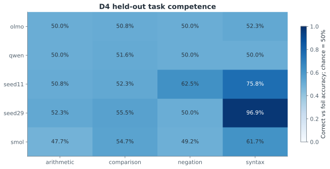

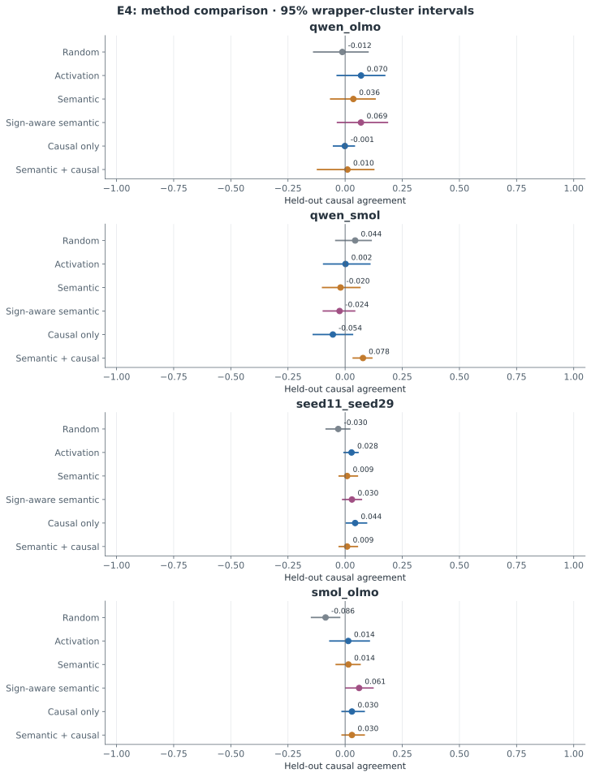

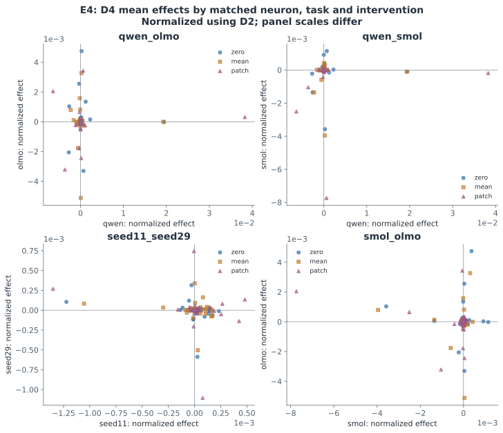

[E4 방법·원본 데이터·통계](reports/E4_report.md)

D4는 E4의 실제 인과 평가 입력입니다. D3 정확도로 D4의 능력을 대체하지 않습니다. 우연 수준에 가까운 과제의 효과 대응은 학습된 기능의 인과 보존을 입증하지 못합니다.

| 모델 | 산술 | 수 비교 | 부정 | 괄호 | 문항 수 |
|---|---:|---:|---:|---:|---:|
| olmo | 50.0% | 50.8% | 50.0% | 52.3% | 512 |
| qwen | 50.0% | 51.6% | 50.0% | 50.0% | 512 |
| seed11 | 50.8% | 52.3% | 62.5% | 75.8% | 512 |
| seed29 | 52.3% | 55.5% | 50.0% | 96.9% | 512 |
| smol | 47.7% | 54.7% | 49.2% | 61.7% | 512 |


## 독립 초기화 모델 학습

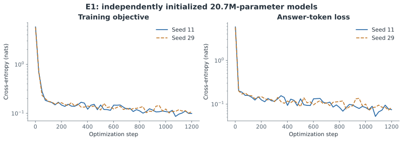

- Seed 11: 20,718,080 parameters, 1,200 steps, 32.1 s; 초기 SHA256 `1f145274bd40588b758ecf438de08824cb31b05060e919d843cdb1b8989d64c5`.
- Seed 29: 20,718,080 parameters, 1,200 steps, 24.9 s; 초기 SHA256 `0a284644080f81bc07f6965bbaa3016716092bf1b763e62d1665a0f22b9b4a5a`.

학습 손실 감소는 과제 일반화나 뉴런 보존의 증거를 대신하지 않습니다.

## 보충 문자 span·자연어 진단

합성 과제에서 이미 고정한 뉴런에 대해 D1 문장 span과 답변 경계의 반응, 별도 자연어 문헌의 top activation을 보충 측정했습니다. 이 탐색적 진단은 H1–H4의 후보 선택·매칭·가설 판정을 재학습하지 않습니다. 한 저자의 한 책에 한정되며 자연어 의미 보존의 독립 검증이 아닙니다.

| 모델 | D1 문항 | 자연어 문단 | 측정 토큰 | 잘린 문단 | 원본 |
|---|---:|---:|---:|---:|---|
| olmo | 48 | 30 | 2743 | 0 | [manifest](results/pilot-v1/diagnostics/olmo/manifest.json) |
| qwen | 48 | 30 | 2746 | 0 | [manifest](results/pilot-v1/diagnostics/qwen/manifest.json) |
| seed11 | 48 | 30 | 7518 | 25 | [manifest](results/pilot-v1/diagnostics/seed11/manifest.json) |
| seed29 | 48 | 30 | 7518 | 25 | [manifest](results/pilot-v1/diagnostics/seed29/manifest.json) |
| smol | 48 | 30 | 2806 | 0 | [manifest](results/pilot-v1/diagnostics/smol/manifest.json) |


## 재현과 자료

저장소는 측정 결과를 보존하며 대형 모델 체크포인트는 포함하지 않습니다. 새로 학습·측정하려면 기존 결과를 덮어쓰지 않는 별도 작업 폴더를 먼저 만듭니다.

```bash
python3 scripts/new_run.py ../LAB_WSP2-reproduction
cd ../LAB_WSP2-reproduction
python3 -m venv .venv
.venv/bin/pip install -e .
make smoke
make e1
make e2
make e3
make e4
make pilot
make report
```

게시된 수치만 재검산하려면 원래 저장소에서 의존성을 설치한 뒤 `python scripts/validate_results.py --require-complete`를 실행합니다. 압축된 JSONL 원자료는 `data/pilot-v1.tar.gz`와 `data/pilot-v1-cluster-corrected.tar.gz`에 있으며, 검산 코드는 동일 데이터셋을 생성해 저장 해시와 비교합니다.

각 단계의 완료 명령은 `scripts/publish_github.py`를 호출합니다. 독립 실행에서는 환경의 `GH_TOKEN` 또는 `GITHUB_TOKEN`으로 GitHub에 업로드합니다. 토큰이 없으면 **`QUEUED_NOT_UPLOADED`** 요청 파일을 남깁니다. 이는 업로드 완료를 뜻하지 않으며 연결된 GitHub 도구가 요청을 처리해야 합니다. 이번 Codex 실행의 실제 업로드는 연결된 GitHub 도구로 수행하며 저장소 commit으로 확인합니다. 비밀 토큰은 저장소에 기록하지 않습니다.

기존 결과를 그대로 재분석할 때에는 저장된 `frozen_mappings.json`을 사용하십시오. 새 구현으로 과거 레이블 셔플 대조군을 다시 생성하면 보존된 실현값과 다를 수 있습니다. 새 방법·설정·데이터를 시험하려면 별도 실험 버전으로 실행해야 합니다.

- [최종 연구 보고서](reports/FINAL_RESEARCH_REPORT.md)
- [Executive summary](reports/EXECUTIVE_SUMMARY.md)
- [비판적 검토](reports/RESEARCH_CRITIQUE.md)
- [다음 실험](reports/NEXT_EXPERIMENTS.md)
- [문헌 검토](literature_review.md)
- [데이터 설계 한계](reports/DATA_DESIGN_LIMITATIONS.md)
- [최종 검증](reports/FINAL_VALIDATION.md) · [프로토콜 변경](reports/PROTOCOL_AMENDMENTS.md)
- [재현성 수정 기록](reports/REPRODUCIBILITY_CORRECTION.md)
- [실험 코드](src/experiment.py) · [보고서 생성 코드](src/reporting.py)

각 그림 옆 JSON은 실제 그림 값과 원본 파일 경로를 보존합니다. 모델 가중치와 캐시는 저장소에 업로드하지 않고, 정확한 revision과 데이터·체크포인트 해시로 추적합니다. 유료 외부 API는 사용하지 않습니다.


[결과물 manifest](results/pilot-v1/deliverables/manifest.json)에서 MASTER 지정 출력 파일과 해시를 확인할 수 있습니다.
