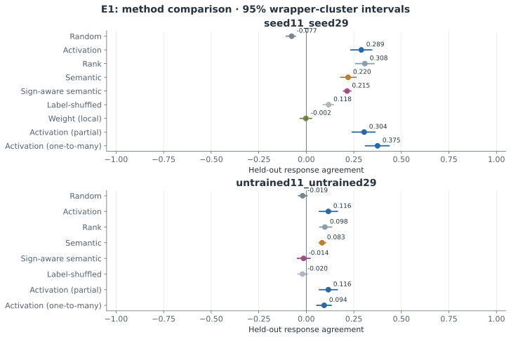
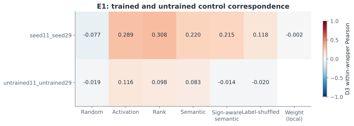
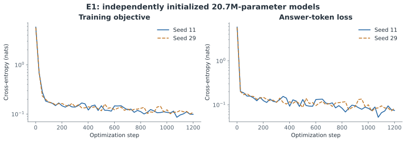

# E1: Independent Seed Neuron Conservation

갱신: 2026-11-04 10:59 KST. 상태: **실제 결과 파일 확보**. 가설 판단: **INCONCLUSIVE**.

연구 질문: 독립 초기화 모델의 기능 대응.

[측정 원본](../results/pilot-v1/E1)

- **seed11_seed29**: activation_minus_random Δ=0.366, Δ 95% CI [0.296, 0.443], q=0.0521. 양의 차이가 관찰됨; BH 보정 후 유의 기준 q<0.05 미충족.
- **untrained11_untrained29**: activation_minus_random Δ=0.135, Δ 95% CI [0.104, 0.173], q=0.0391. 양의 차이가 관찰됨; BH 보정 후 유의 기준 q<0.05 충족.
학습 전 대조군에서도 대응이 나타나면 공유된 아키텍처·표면 패턴만으로 상관이 생길 수 있습니다. 학습 모델의 산술·부정 과제 능력이 약한 조건도 있으므로 H1의 일반적 기능 보존 주장은 판단을 보류합니다.

| 모델 쌍 | 방법 | 독립 평가 평균 | 95% CI | 후보 coverage |
|---|---|---:|---|---:|
| seed11_seed29 | Random | -0.077 | [-0.105, -0.058] | 1.000 |
| seed11_seed29 | Activation | 0.289 | [0.234, 0.344] | 1.000 |
| seed11_seed29 | Rank | 0.308 | [0.259, 0.356] | 1.000 |
| seed11_seed29 | Semantic | 0.220 | [0.182, 0.261] | 1.000 |
| seed11_seed29 | Sign-aware semantic | 0.215 | [0.196, 0.234] | 1.000 |
| seed11_seed29 | Label-shuffled | 0.118 | [0.089, 0.143] | 1.000 |
| seed11_seed29 | Weight (local) | -0.002 | [-0.031, 0.028] | 1.000 |
| seed11_seed29 | Activation (partial) | 0.304 | [0.242, 0.361] | 0.953 |
| seed11_seed29 | Activation (one-to-many) | 0.375 | [0.311, 0.436] | 1.000 |
| untrained11_untrained29 | Random | -0.019 | [-0.041, 0.004] | 1.000 |
| untrained11_untrained29 | Activation | 0.116 | [0.069, 0.163] | 1.000 |
| untrained11_untrained29 | Rank | 0.098 | [0.070, 0.133] | 1.000 |
| untrained11_untrained29 | Semantic | 0.083 | [0.068, 0.102] | 1.000 |
| untrained11_untrained29 | Sign-aware semantic | -0.014 | [-0.046, 0.020] | 1.000 |
| untrained11_untrained29 | Label-shuffled | -0.020 | [-0.044, 0.005] | 1.000 |
| untrained11_untrained29 | Activation (partial) | 0.116 | [0.069, 0.163] | 1.000 |
| untrained11_untrained29 | Activation (one-to-many) | 0.094 | [0.056, 0.131] | 1.000 |

## 대응 차이 검정

| 모델 쌍 | 방법 차이 | Δ | Δ 95% CI | p | BH q |
|---|---|---:|---|---:|---:|
| seed11_seed29 | activation_minus_random | 0.366 | [0.296, 0.443] | 0.0312 | 0.0521 |
| seed11_seed29 | rank_minus_random | 0.385 | [0.325, 0.452] | 0.0312 | 0.0521 |
| seed11_seed29 | semantic_minus_activation | -0.070 | [-0.099, -0.040] | 0.0312 | 0.0521 |
| seed11_seed29 | sign_semantic_minus_activation | -0.075 | [-0.114, -0.029] | 0.0625 | 0.0625 |
| seed11_seed29 | semantic_minus_label_shuffled | 0.102 | [0.051, 0.146] | 0.0625 | 0.0625 |
| untrained11_untrained29 | activation_minus_random | 0.135 | [0.104, 0.173] | 0.0312 | 0.0391 |
| untrained11_untrained29 | rank_minus_random | 0.117 | [0.097, 0.144] | 0.0312 | 0.0391 |
| untrained11_untrained29 | semantic_minus_activation | -0.033 | [-0.075, 0.008] | 0.2188 | 0.2188 |
| untrained11_untrained29 | sign_semantic_minus_activation | -0.130 | [-0.174, -0.093] | 0.0312 | 0.0391 |
| untrained11_untrained29 | semantic_minus_label_shuffled | 0.103 | [0.076, 0.126] | 0.0312 | 0.0391 |

## 방법과 해석

- **E1:** 서로 다른 초기 가중치로 학습한 소형 RMSNorm·RoPE·SwiGLU decoder 두 개. 초기/중간/최종 체크포인트와 학습 로그를 보존합니다.
- **E2:** 공개 Base 모델의 같은 원문에 대한 모델별 토큰화를 사용합니다. 약 20/40/60/80% 깊이에서 gate, up, SwiGLU product, 부호 구간과 down 기여를 관찰합니다.
- **E3:** random, activation, rank, semantic, sign-aware semantic, label-shuffled 기준선을 비교합니다. D1에서 후보 선택, D2에서 정렬을 고정하고 D3에서 독립 반응을 평가합니다.
- **E4:** 동일 모델 내부 zero/mean/matched-patch 개입의 정답–대비 답변 sequence log-likelihood margin 변화를 측정합니다. D2로 정렬·결합을 결정하고 D4에서 평가합니다. 인과 효과와 통계는 FP32 이상으로 처리합니다.
- **통계:** 동일 wrapper의 모든 개념을 함께 재표집합니다. 개별 뉴런의 수를 연구 반복 수로 해석하지 않습니다. 보고서의 수치는 저장된 JSON/NPZ/Parquet에서 자동 생성됩니다.

이 연구는 제한된 합성 참·거짓 과제의 파일럿입니다. 학습·탐색·정렬·독립 반응 평가·독립 인과 평가를 분리했지만 의미 문법은 공유합니다. 여섯 wrapper 군집의 부트스트랩 신뢰구간과 무작위화 검정은 탐색적입니다. 뉴런 개수를 독립 표본 수로 사용하지 않습니다. 모델의 과제 능력이 낮으면 대응 실패를 기능 보존의 기각으로 해석하지 않습니다. 활성값 유사성·의미 설명·인과 효과 일치를 구분하며, 긍정적 결과도 뉴런 복사나 모델 병합의 안전성을 보장하지 않습니다.

## 검증·다음 단계

[데이터 설계와 shortcut 한계](DATA_DESIGN_LIMITATIONS.md), [선행연구](../literature_review.md), [재현 소스](../src/experiment.py)를 함께 확인해야 합니다. 낮은 능력, 부호별 차이, 미매칭 및 부정적 결과를 포함해 다음 단계의 독립 평가 가능성을 판단합니다.

## 실제 학습 기록

- Seed 11: 20,718,080 parameters, 1,200 steps, 32.1 s; 초기 SHA256 `1f145274bd40588b758ecf438de08824cb31b05060e919d843cdb1b8989d64c5`.
- Seed 29: 20,718,080 parameters, 1,200 steps, 24.9 s; 초기 SHA256 `0a284644080f81bc07f6965bbaa3016716092bf1b763e62d1665a0f22b9b4a5a`.

