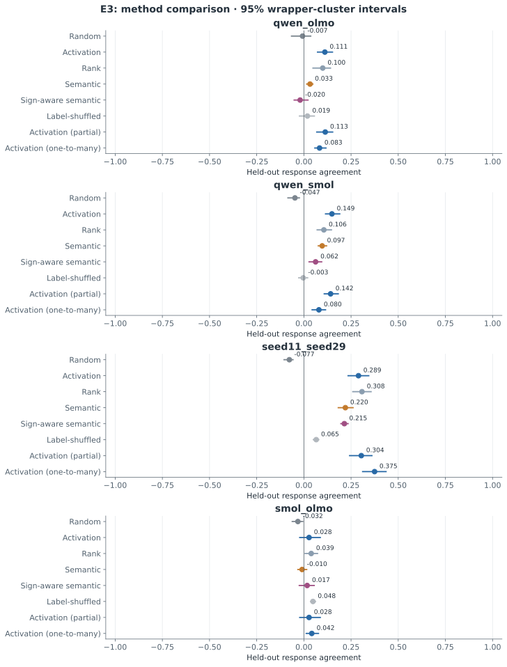

# E3: Main-Function Semantic Alignment

갱신: 2026-11-04 11:13 KST. 상태: **실제 결과 파일 확보**. 가설 판단: **NOT SUPPORTED**.

연구 질문: 의미 정렬의 독립 입력 일반화.

[측정 원본](../results/pilot-v1/E3)

- **qwen_olmo**: semantic_minus_activation Δ=-0.079, Δ 95% CI [-0.123, -0.029], q=0.0781. 제안 방법의 양의 개선이 관찰되지 않음; BH 보정 후 유의 기준 q<0.05 미충족.
- **qwen_smol**: semantic_minus_activation Δ=-0.052, Δ 95% CI [-0.090, -0.021], q=0.0312. 제안 방법의 양의 개선이 관찰되지 않음; BH 보정 후 유의 기준 q<0.05 충족.
- **seed11_seed29**: semantic_minus_activation Δ=-0.070, Δ 95% CI [-0.099, -0.040], q=0.0391. 제안 방법의 양의 개선이 관찰되지 않음; BH 보정 후 유의 기준 q<0.05 충족.
- **smol_olmo**: semantic_minus_activation Δ=-0.037, Δ 95% CI [-0.093, 0.018], q=0.3906. 제안 방법의 양의 개선이 관찰되지 않음; BH 보정 후 유의 기준 q<0.05 미충족.
주기능이라고 부르는 값은 네 합성 과제의 참·거짓 선택성 proxy입니다. 이 특정 proxy·benchmark에서 의미 정렬의 우위를 지지하지 않는다는 판단이며, Goodfire 가설 일반에 대한 반증이 아닙니다. 독립 반응 지표의 개선과 보편적 의미 해석의 개선은 별개입니다.

| 모델 쌍 | 방법 | 독립 평가 평균 | 95% CI | 후보 coverage |
|---|---|---:|---|---:|
| qwen_olmo | Random | -0.007 | [-0.066, 0.036] | 1.000 |
| qwen_olmo | Activation | 0.111 | [0.072, 0.152] | 1.000 |
| qwen_olmo | Rank | 0.100 | [0.048, 0.141] | 1.000 |
| qwen_olmo | Semantic | 0.033 | [0.015, 0.048] | 1.000 |
| qwen_olmo | Sign-aware semantic | -0.020 | [-0.052, 0.022] | 1.000 |
| qwen_olmo | Label-shuffled | 0.019 | [-0.023, 0.056] | 1.000 |
| qwen_olmo | Activation (partial) | 0.113 | [0.068, 0.153] | 0.984 |
| qwen_olmo | Activation (one-to-many) | 0.083 | [0.058, 0.117] | 1.000 |
| qwen_smol | Random | -0.047 | [-0.085, -0.024] | 1.000 |
| qwen_smol | Activation | 0.149 | [0.115, 0.190] | 1.000 |
| qwen_smol | Rank | 0.106 | [0.070, 0.146] | 1.000 |
| qwen_smol | Semantic | 0.097 | [0.076, 0.121] | 1.000 |
| qwen_smol | Sign-aware semantic | 0.062 | [0.027, 0.094] | 1.000 |
| qwen_smol | Label-shuffled | -0.003 | [-0.027, 0.020] | 1.000 |
| qwen_smol | Activation (partial) | 0.142 | [0.108, 0.182] | 0.984 |
| qwen_smol | Activation (one-to-many) | 0.080 | [0.044, 0.115] | 1.000 |
| seed11_seed29 | Random | -0.077 | [-0.105, -0.058] | 1.000 |
| seed11_seed29 | Activation | 0.289 | [0.234, 0.344] | 1.000 |
| seed11_seed29 | Rank | 0.308 | [0.259, 0.356] | 1.000 |
| seed11_seed29 | Semantic | 0.220 | [0.182, 0.261] | 1.000 |
| seed11_seed29 | Sign-aware semantic | 0.215 | [0.196, 0.234] | 1.000 |
| seed11_seed29 | Label-shuffled | 0.065 | [0.050, 0.079] | 1.000 |
| seed11_seed29 | Activation (partial) | 0.304 | [0.242, 0.361] | 0.953 |
| seed11_seed29 | Activation (one-to-many) | 0.375 | [0.311, 0.436] | 1.000 |
| smol_olmo | Random | -0.032 | [-0.062, -0.006] | 1.000 |
| smol_olmo | Activation | 0.028 | [-0.022, 0.087] | 1.000 |
| smol_olmo | Rank | 0.039 | [0.007, 0.073] | 1.000 |
| smol_olmo | Semantic | -0.010 | [-0.032, 0.015] | 1.000 |
| smol_olmo | Sign-aware semantic | 0.017 | [-0.024, 0.055] | 1.000 |
| smol_olmo | Label-shuffled | 0.048 | [0.036, 0.061] | 1.000 |
| smol_olmo | Activation (partial) | 0.028 | [-0.022, 0.087] | 1.000 |
| smol_olmo | Activation (one-to-many) | 0.042 | [0.012, 0.077] | 1.000 |

## 대응 차이 검정

| 모델 쌍 | 방법 차이 | Δ | Δ 95% CI | p | BH q |
|---|---|---:|---|---:|---:|
| qwen_olmo | activation_minus_random | 0.118 | [0.062, 0.172] | 0.0312 | 0.0781 |
| qwen_olmo | rank_minus_random | 0.107 | [0.036, 0.174] | 0.0625 | 0.0781 |
| qwen_olmo | semantic_minus_activation | -0.079 | [-0.123, -0.029] | 0.0625 | 0.0781 |
| qwen_olmo | sign_semantic_minus_activation | -0.131 | [-0.191, -0.054] | 0.0625 | 0.0781 |
| qwen_olmo | semantic_minus_label_shuffled | 0.014 | [-0.034, 0.068] | 0.6562 | 0.6562 |
| qwen_smol | activation_minus_random | 0.196 | [0.143, 0.272] | 0.0312 | 0.0312 |
| qwen_smol | rank_minus_random | 0.153 | [0.100, 0.229] | 0.0312 | 0.0312 |
| qwen_smol | semantic_minus_activation | -0.052 | [-0.090, -0.021] | 0.0312 | 0.0312 |
| qwen_smol | sign_semantic_minus_activation | -0.087 | [-0.138, -0.037] | 0.0312 | 0.0312 |
| qwen_smol | semantic_minus_label_shuffled | 0.100 | [0.072, 0.131] | 0.0312 | 0.0312 |
| seed11_seed29 | activation_minus_random | 0.366 | [0.296, 0.443] | 0.0312 | 0.0391 |
| seed11_seed29 | rank_minus_random | 0.385 | [0.325, 0.452] | 0.0312 | 0.0391 |
| seed11_seed29 | semantic_minus_activation | -0.070 | [-0.099, -0.040] | 0.0312 | 0.0391 |
| seed11_seed29 | sign_semantic_minus_activation | -0.075 | [-0.114, -0.029] | 0.0625 | 0.0625 |
| seed11_seed29 | semantic_minus_label_shuffled | 0.154 | [0.118, 0.187] | 0.0312 | 0.0391 |
| smol_olmo | activation_minus_random | 0.059 | [0.010, 0.108] | 0.0938 | 0.1562 |
| smol_olmo | rank_minus_random | 0.071 | [0.028, 0.109] | 0.0625 | 0.1562 |
| smol_olmo | semantic_minus_activation | -0.037 | [-0.093, 0.018] | 0.3125 | 0.3906 |
| smol_olmo | sign_semantic_minus_activation | -0.010 | [-0.071, 0.066] | 0.8125 | 0.8125 |
| smol_olmo | semantic_minus_label_shuffled | -0.058 | [-0.091, -0.025] | 0.0625 | 0.1562 |

## 방법과 해석

- **E1:** 서로 다른 초기 가중치로 학습한 소형 RMSNorm·RoPE·SwiGLU decoder 두 개. 초기/중간/최종 체크포인트와 학습 로그를 보존합니다.
- **E2:** 공개 Base 모델의 같은 원문에 대한 모델별 토큰화를 사용합니다. 약 20/40/60/80% 깊이에서 gate, up, SwiGLU product, 부호 구간과 down 기여를 관찰합니다.
- **E3:** random, activation, rank, semantic, sign-aware semantic, label-shuffled 기준선을 비교합니다. D1에서 후보 선택, D2에서 정렬을 고정하고 D3에서 독립 반응을 평가합니다.
- **E4:** 동일 모델 내부 zero/mean/matched-patch 개입의 정답–대비 답변 sequence log-likelihood margin 변화를 측정합니다. D2로 정렬·결합을 결정하고 D4에서 평가합니다. 인과 효과와 통계는 FP32 이상으로 처리합니다.
- **통계:** 동일 wrapper의 모든 개념을 함께 재표집합니다. 개별 뉴런의 수를 연구 반복 수로 해석하지 않습니다. 보고서의 수치는 저장된 JSON/NPZ/Parquet에서 자동 생성됩니다.

이 연구는 제한된 합성 참·거짓 과제의 파일럿입니다. 학습·탐색·정렬·독립 반응 평가·독립 인과 평가를 분리했지만 의미 문법은 공유합니다. 여섯 wrapper 군집의 부트스트랩 신뢰구간과 무작위화 검정은 탐색적입니다. 뉴런 개수를 독립 표본 수로 사용하지 않습니다. BH q는 모델 쌍별 비교군 안에서 보정한 값이며 연구 전체의 다중검정 보정이 아닙니다. Random 기준선은 쌍당 한 번 고정한 매칭으로, 그 무작위 매칭 자체의 변동은 CI에 포함되지 않습니다. 모델의 과제 능력이 낮으면 대응 실패를 기능 보존의 기각으로 해석하지 않습니다. 활성값 유사성·의미 설명·인과 효과 일치를 구분하며, 긍정적 결과도 뉴런 복사나 모델 병합의 안전성을 보장하지 않습니다.

## 검증·다음 단계

[데이터 설계와 shortcut 한계](DATA_DESIGN_LIMITATIONS.md), [선행연구](../literature_review.md), [재현 소스](../src/experiment.py)를 함께 확인해야 합니다. 낮은 능력, 부호별 차이, 미매칭 및 부정적 결과를 포함해 다음 단계의 독립 평가 가능성을 판단합니다.

## 가설 판정 범위

이 파일럿의 네 모델 쌍 모두에서 참·거짓 대비 기반 의미 proxy의 평균 D3 점수가 활성 정렬보다 낮았습니다. 이 특정 방법의 우월성은 지지되지 않으며 Goodfire 가설 전체의 반증을 뜻하지 않습니다.

## 재현성 수정 공개

레이블 셔플 대조군에서 Python 해시 순서에 따른 재현성 오류를 최종 감사 중 발견했습니다. 정렬 효과의 원래 수치와 저장 매핑은 보존했으며, 기존 결과를 새 대조군으로 덮어쓰지 않았습니다. E1/E3의 같은 주요 효과·보정 전 p에도 대조군 실현값의 차이 때문에 BH q가 달라질 수 있습니다. 두 결과를 독립 재현으로 세지 않습니다. [오류 범위·보존 원칙·회귀 검증](REPRODUCIBILITY_CORRECTION.md)을 참조하십시오.
