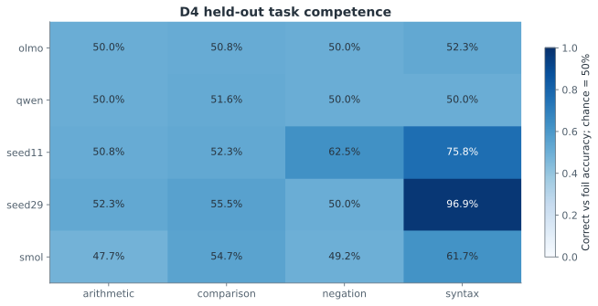
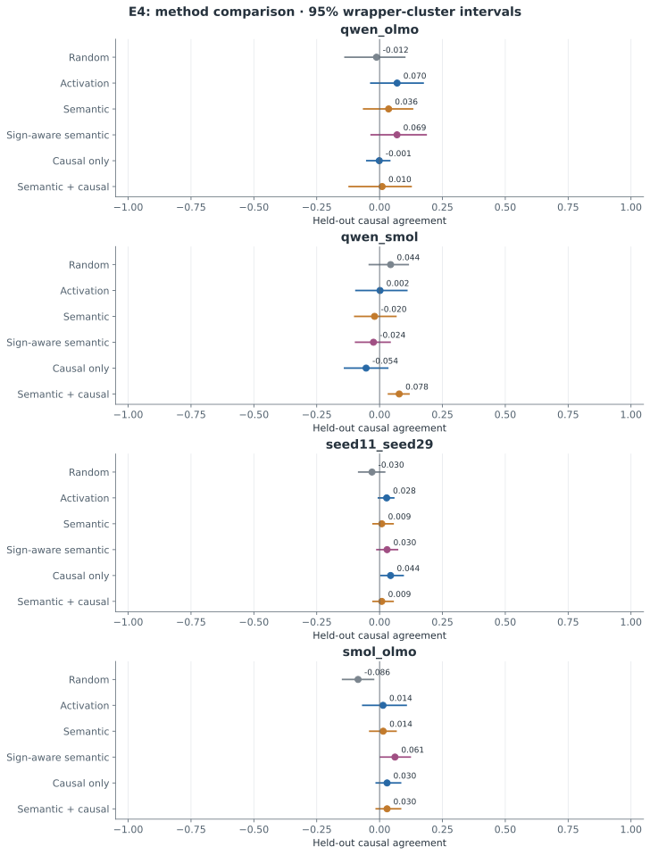
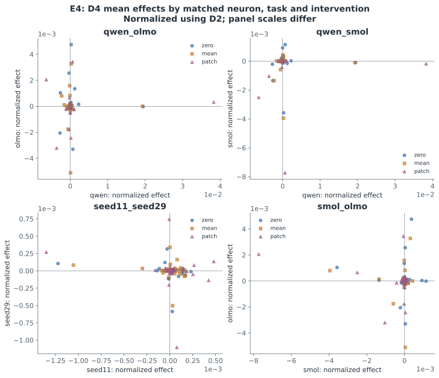

# E4: Causal-Role Alignment

갱신: 2026-11-04 11:13 KST. 상태: **실제 결과 파일 확보**. 가설 판단: **INCONCLUSIVE**.

연구 질문: 독립 인과 효과 일치.

[측정 원본](../results/pilot-v1/E4)

- **qwen_olmo**: semantic_causal_minus_semantic Δ=-0.026, Δ 95% CI [-0.076, 0.014], q=0.5417. 제안 방법의 양의 개선이 관찰되지 않음; BH 보정 후 유의 기준 q<0.05 미충족.
- **qwen_smol**: semantic_causal_minus_semantic Δ=0.098, Δ 95% CI [0.003, 0.174], q=0.2917. 양의 차이가 관찰됨; BH 보정 후 유의 기준 q<0.05 미충족.
- **seed11_seed29**: semantic_causal_minus_semantic Δ=0.000, Δ 95% CI [0.000, 0.000], q=1.0000. 제안 방법의 양의 개선이 관찰되지 않음; BH 보정 후 유의 기준 q<0.05 미충족.
- **smol_olmo**: semantic_causal_minus_semantic Δ=0.016, Δ 95% CI [-0.063, 0.108], q=0.7812. 양의 차이가 관찰됨; BH 보정 후 유의 기준 q<0.05 미충족.
각 모델 내부 개입의 D4 효과를 비교했습니다. 일부 모델 쌍의 개선만으로 모든 모델 계열에 일반화하지 않으며, 낮은 과제 능력과 적은 wrapper 수가 해석을 제한합니다.

| 모델 쌍 | 방법 | 독립 평가 평균 | 95% CI | 후보 coverage |
|---|---|---:|---|---:|
| qwen_olmo | Random | -0.012 | [-0.137, 0.100] | 1.000 |
| qwen_olmo | Activation | 0.070 | [-0.035, 0.173] | 1.000 |
| qwen_olmo | Semantic | 0.036 | [-0.063, 0.131] | 1.000 |
| qwen_olmo | Sign-aware semantic | 0.069 | [-0.033, 0.185] | 1.000 |
| qwen_olmo | Causal only | -0.001 | [-0.051, 0.040] | 1.000 |
| qwen_olmo | Semantic + causal | 0.010 | [-0.121, 0.125] | 1.000 |
| qwen_smol | Random | 0.044 | [-0.041, 0.114] | 1.000 |
| qwen_smol | Activation | 0.002 | [-0.094, 0.108] | 1.000 |
| qwen_smol | Semantic | -0.020 | [-0.099, 0.065] | 1.000 |
| qwen_smol | Sign-aware semantic | -0.024 | [-0.095, 0.042] | 1.000 |
| qwen_smol | Causal only | -0.054 | [-0.139, 0.032] | 1.000 |
| qwen_smol | Semantic + causal | 0.078 | [0.035, 0.117] | 1.000 |
| seed11_seed29 | Random | -0.030 | [-0.083, 0.020] | 1.000 |
| seed11_seed29 | Activation | 0.028 | [-0.004, 0.056] | 1.000 |
| seed11_seed29 | Semantic | 0.009 | [-0.026, 0.054] | 1.000 |
| seed11_seed29 | Sign-aware semantic | 0.030 | [-0.011, 0.071] | 1.000 |
| seed11_seed29 | Causal only | 0.044 | [0.005, 0.094] | 1.000 |
| seed11_seed29 | Semantic + causal | 0.009 | [-0.026, 0.054] | 1.000 |
| smol_olmo | Random | -0.086 | [-0.147, -0.024] | 1.000 |
| smol_olmo | Activation | 0.014 | [-0.067, 0.106] | 1.000 |
| smol_olmo | Semantic | 0.014 | [-0.039, 0.065] | 1.000 |
| smol_olmo | Sign-aware semantic | 0.061 | [0.003, 0.122] | 1.000 |
| smol_olmo | Causal only | 0.030 | [-0.013, 0.083] | 1.000 |
| smol_olmo | Semantic + causal | 0.030 | [-0.013, 0.083] | 1.000 |

## 대응 차이 검정

| 모델 쌍 | 방법 차이 | Δ | Δ 95% CI | p | BH q |
|---|---|---:|---|---:|---:|
| qwen_olmo | causal_minus_semantic | -0.037 | [-0.172, 0.098] | 0.6562 | 0.6562 |
| qwen_olmo | semantic_causal_minus_semantic | -0.026 | [-0.076, 0.014] | 0.2812 | 0.5417 |
| qwen_olmo | semantic_causal_minus_activation | -0.060 | [-0.146, 0.053] | 0.3438 | 0.5417 |
| qwen_olmo | semantic_minus_random | 0.048 | [-0.074, 0.146] | 0.4062 | 0.5417 |
| qwen_smol | causal_minus_semantic | -0.034 | [-0.153, 0.057] | 0.7188 | 0.7188 |
| qwen_smol | semantic_causal_minus_semantic | 0.098 | [0.003, 0.174] | 0.1250 | 0.2917 |
| qwen_smol | semantic_causal_minus_activation | 0.076 | [-0.024, 0.176] | 0.2188 | 0.2917 |
| qwen_smol | semantic_minus_random | -0.064 | [-0.134, -0.000] | 0.1562 | 0.2917 |
| seed11_seed29 | causal_minus_semantic | 0.035 | [-0.041, 0.111] | 0.4375 | 0.8750 |
| seed11_seed29 | semantic_causal_minus_semantic | 0.000 | [0.000, 0.000] | 1.0000 | 1.0000 |
| seed11_seed29 | semantic_causal_minus_activation | -0.019 | [-0.067, 0.054] | 0.6562 | 0.8750 |
| seed11_seed29 | semantic_minus_random | 0.039 | [-0.034, 0.128] | 0.4688 | 0.8750 |
| smol_olmo | causal_minus_semantic | 0.016 | [-0.063, 0.108] | 0.7812 | 0.7812 |
| smol_olmo | semantic_causal_minus_semantic | 0.016 | [-0.063, 0.108] | 0.7812 | 0.7812 |
| smol_olmo | semantic_causal_minus_activation | 0.016 | [-0.028, 0.061] | 0.5625 | 0.7812 |
| smol_olmo | semantic_minus_random | 0.100 | [0.024, 0.171] | 0.1250 | 0.5000 |

## 방법과 해석

- **E1:** 서로 다른 초기 가중치로 학습한 소형 RMSNorm·RoPE·SwiGLU decoder 두 개. 초기/중간/최종 체크포인트와 학습 로그를 보존합니다.
- **E2:** 공개 Base 모델의 같은 원문에 대한 모델별 토큰화를 사용합니다. 약 20/40/60/80% 깊이에서 gate, up, SwiGLU product, 부호 구간과 down 기여를 관찰합니다.
- **E3:** random, activation, rank, semantic, sign-aware semantic, label-shuffled 기준선을 비교합니다. D1에서 후보 선택, D2에서 정렬을 고정하고 D3에서 독립 반응을 평가합니다.
- **E4:** 동일 모델 내부 zero/mean/matched-patch 개입의 정답–대비 답변 sequence log-likelihood margin 변화를 측정합니다. D2로 정렬·결합을 결정하고 D4에서 평가합니다. 인과 효과와 통계는 FP32 이상으로 처리합니다.
- **통계:** 동일 wrapper의 모든 개념을 함께 재표집합니다. 개별 뉴런의 수를 연구 반복 수로 해석하지 않습니다. 보고서의 수치는 저장된 JSON/NPZ/Parquet에서 자동 생성됩니다.

이 연구는 제한된 합성 참·거짓 과제의 파일럿입니다. 학습·탐색·정렬·독립 반응 평가·독립 인과 평가를 분리했지만 의미 문법은 공유합니다. 여섯 wrapper 군집의 부트스트랩 신뢰구간과 무작위화 검정은 탐색적입니다. 뉴런 개수를 독립 표본 수로 사용하지 않습니다. BH q는 모델 쌍별 비교군 안에서 보정한 값이며 연구 전체의 다중검정 보정이 아닙니다. Random 기준선은 쌍당 한 번 고정한 매칭으로, 그 무작위 매칭 자체의 변동은 CI에 포함되지 않습니다. 모델의 과제 능력이 낮으면 대응 실패를 기능 보존의 기각으로 해석하지 않습니다. 활성값 유사성·의미 설명·인과 효과 일치를 구분하며, 긍정적 결과도 뉴런 복사나 모델 병합의 안전성을 보장하지 않습니다.

## 검증·다음 단계

[데이터 설계와 shortcut 한계](DATA_DESIGN_LIMITATIONS.md), [선행연구](../literature_review.md), [재현 소스](../src/experiment.py)를 함께 확인해야 합니다. 낮은 능력, 부호별 차이, 미매칭 및 부정적 결과를 포함해 다음 단계의 독립 평가 가능성을 판단합니다.

## 가설 판정 범위

모델 쌍별 독립 인과 효과 결과를 보고하되, 낮은 과제 능력·공통 yes/no 출력·적은 템플릿 수와 개입 후보 수 때문에 보편적인 기능적 인과 보존을 확정하지 않습니다.

## D4에서의 과제 수행 능력

D4는 E4의 실제 인과 평가 입력입니다. D3 정확도로 D4의 능력을 대체하지 않습니다. 우연 수준에 가까운 과제의 효과 대응은 학습된 기능의 인과 보존을 입증하지 못합니다.

| 모델 | 산술 | 수 비교 | 부정 | 괄호 | 문항 수 |
|---|---:|---:|---:|---:|---:|
| olmo | 50.0% | 50.8% | 50.0% | 52.3% | 512 |
| qwen | 50.0% | 51.6% | 50.0% | 50.0% | 512 |
| seed11 | 50.8% | 52.3% | 62.5% | 75.8% | 512 |
| seed29 | 52.3% | 55.5% | 50.0% | 96.9% | 512 |
| smol | 47.7% | 54.7% | 49.2% | 61.7% | 512 |
