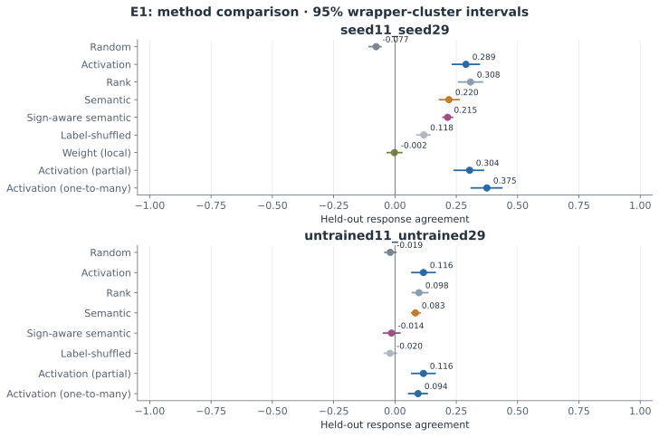
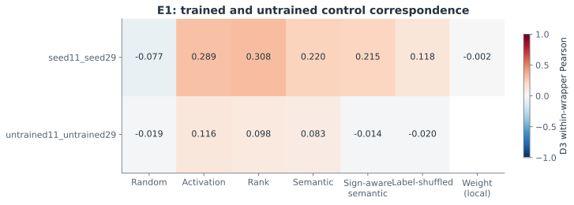
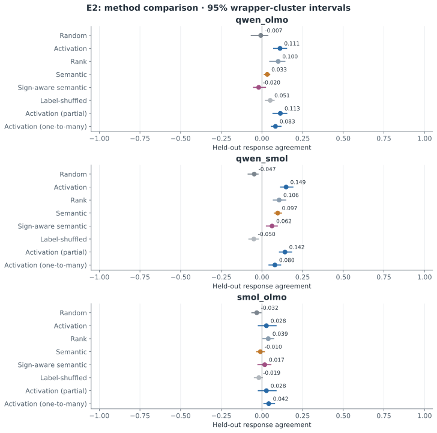
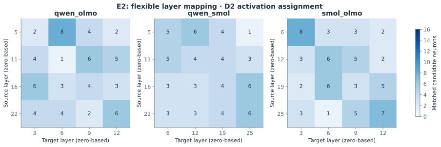
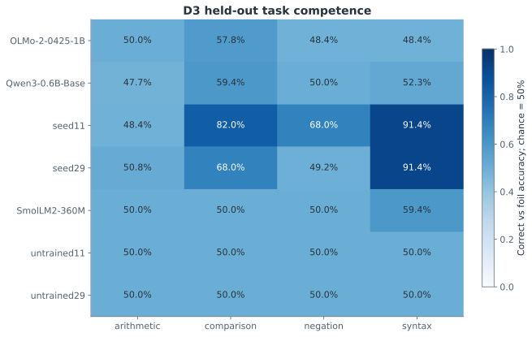

# Final Research Report — Native Neuron Conservation

갱신: 2026-11-04 10:59 KST. 결과 파일이 확인된 단계: **E1, E2**. 미완료 단계의 가설 판단은 `INCONCLUSIVE`이며 구현 완료를 실제 실행 완료로 해석하지 않습니다.

## 연구 배경

Goodfire의 [Neural Networks Are Already Clean](https://already-clean.goodfire.com/)을 검증 대상 작업 가설로 삼습니다. 원본 SwiGLU 뉴런의 활성·주기능 proxy·독립 인과 효과가 모델 간에 어떻게 대응하는지를 별개로 평가합니다. [선행연구 검토](../literature_review.md)는 ARM·LED-Merging·HeteroFusion·Git Re-Basin·Rosetta·SAE와의 차이를 기록합니다.

## 가설별 결과

| Experiment | Hypothesis | Main Metric | Baseline | Proposed | Improvement | CI | Verdict |
|---|---|---|---:|---:|---:|---|---|
| E1 | 독립 초기화 모델의 기능 대응 | D3 response agreement | -0.077 | 0.289 | 0.366 | [0.296, 0.443] | INCONCLUSIVE |
| E2 | 이종 Base 모델의 기능 대응 | D3 response agreement | 모델 쌍별 | 모델 쌍별 | 모델 쌍별 | 상세 표 참조 | INCONCLUSIVE |
| E3 | 의미 정렬의 독립 입력 일반화 | D3 response agreement | 미측정 | 미측정 | 미측정 | 미측정 | INCONCLUSIVE |
| E4 | 독립 인과 효과 일치 | D4 causal effect agreement | 미측정 | 미측정 | 미측정 | 미측정 | INCONCLUSIVE |

## 모델·데이터·방법

- **E1:** 서로 다른 초기 가중치로 학습한 소형 RMSNorm·RoPE·SwiGLU decoder 두 개. 초기/중간/최종 체크포인트와 학습 로그를 보존합니다.
- **E2:** 공개 Base 모델의 같은 원문에 대한 모델별 토큰화를 사용합니다. 약 20/40/60/80% 깊이에서 gate, up, SwiGLU product, 부호 구간과 down 기여를 관찰합니다.
- **E3:** random, activation, rank, semantic, sign-aware semantic, label-shuffled 기준선을 비교합니다. D1에서 후보 선택, D2에서 정렬을 고정하고 D3에서 독립 반응을 평가합니다.
- **E4:** 동일 모델 내부 zero/mean/matched-patch 개입의 정답–대비 답변 sequence log-likelihood margin 변화를 측정합니다. D2로 정렬·결합을 결정하고 D4에서 평가합니다. 인과 효과와 통계는 FP32 이상으로 처리합니다.
- **통계:** 동일 wrapper의 모든 개념을 함께 재표집합니다. 개별 뉴런의 수를 연구 반복 수로 해석하지 않습니다. 보고서의 수치는 저장된 JSON/NPZ/Parquet에서 자동 생성됩니다.

- Seed 11: 20,718,080 parameters, 1,200 steps, 32.1 s; 초기 SHA256 `1f145274bd40588b758ecf438de08824cb31b05060e919d843cdb1b8989d64c5`.
- Seed 29: 20,718,080 parameters, 1,200 steps, 24.9 s; 초기 SHA256 `0a284644080f81bc07f6965bbaa3016716092bf1b763e62d1665a0f22b9b4a5a`.

실제 모델 revision·라이선스는 [모델 manifest](../configs/models.json), 데이터 생성 규칙은 [데이터 protocol](../configs/data_protocol.json), 사전 설정은 [pilot config](../configs/pilot.json)에 기록합니다.

## 결과와 시각자료

### E1

[E1 보고서](E1_report.md)

| 모델 쌍 | 방법 | 독립 평가 평균 | 95% CI | 후보 coverage |
|---|---|---:|---|---:|
| seed11_seed29 | Random | -0.077 | [-0.105, -0.058] | 1.000 |
| seed11_seed29 | Activation | 0.289 | [0.234, 0.344] | 1.000 |
| seed11_seed29 | Rank | 0.308 | [0.259, 0.356] | 1.000 |
| seed11_seed29 | Semantic | 0.220 | [0.182, 0.261] | 1.000 |
| seed11_seed29 | Sign-aware semantic | 0.215 | [0.196, 0.234] | 1.000 |
| seed11_seed29 | Label-shuffled | 0.118 | [0.089, 0.143] | 1.000 |
| seed11_seed29 | Weight (local) | -0.002 | [-0.031, 0.028] | 1.000 |
| seed11_seed29 | Activation (partial) | 0.304 | [0.242, 0.361] | 0.953 |
| seed11_seed29 | Activation (one-to-many) | 0.375 | [0.311, 0.436] | 1.000 |
| untrained11_untrained29 | Random | -0.019 | [-0.041, 0.004] | 1.000 |
| untrained11_untrained29 | Activation | 0.116 | [0.069, 0.163] | 1.000 |
| untrained11_untrained29 | Rank | 0.098 | [0.070, 0.133] | 1.000 |
| untrained11_untrained29 | Semantic | 0.083 | [0.068, 0.102] | 1.000 |
| untrained11_untrained29 | Sign-aware semantic | -0.014 | [-0.046, 0.020] | 1.000 |
| untrained11_untrained29 | Label-shuffled | -0.020 | [-0.044, 0.005] | 1.000 |
| untrained11_untrained29 | Activation (partial) | 0.116 | [0.069, 0.163] | 1.000 |
| untrained11_untrained29 | Activation (one-to-many) | 0.094 | [0.056, 0.131] | 1.000 |

### E2

[E2 보고서](E2_report.md)

| 모델 쌍 | 방법 | 독립 평가 평균 | 95% CI | 후보 coverage |
|---|---|---:|---|---:|
| qwen_olmo | Random | -0.007 | [-0.066, 0.036] | 1.000 |
| qwen_olmo | Activation | 0.111 | [0.072, 0.152] | 1.000 |
| qwen_olmo | Rank | 0.100 | [0.048, 0.141] | 1.000 |
| qwen_olmo | Semantic | 0.033 | [0.015, 0.048] | 1.000 |
| qwen_olmo | Sign-aware semantic | -0.020 | [-0.052, 0.022] | 1.000 |
| qwen_olmo | Label-shuffled | 0.051 | [0.021, 0.075] | 1.000 |
| qwen_olmo | Activation (partial) | 0.113 | [0.068, 0.153] | 0.984 |
| qwen_olmo | Activation (one-to-many) | 0.083 | [0.058, 0.117] | 1.000 |
| qwen_smol | Random | -0.047 | [-0.085, -0.024] | 1.000 |
| qwen_smol | Activation | 0.149 | [0.115, 0.190] | 1.000 |
| qwen_smol | Rank | 0.106 | [0.070, 0.146] | 1.000 |
| qwen_smol | Semantic | 0.097 | [0.076, 0.121] | 1.000 |
| qwen_smol | Sign-aware semantic | 0.062 | [0.027, 0.094] | 1.000 |
| qwen_smol | Label-shuffled | -0.050 | [-0.080, -0.022] | 1.000 |
| qwen_smol | Activation (partial) | 0.142 | [0.108, 0.182] | 0.984 |
| qwen_smol | Activation (one-to-many) | 0.080 | [0.044, 0.115] | 1.000 |
| smol_olmo | Random | -0.032 | [-0.062, -0.006] | 1.000 |
| smol_olmo | Activation | 0.028 | [-0.022, 0.087] | 1.000 |
| smol_olmo | Rank | 0.039 | [0.007, 0.073] | 1.000 |
| smol_olmo | Semantic | -0.010 | [-0.032, 0.015] | 1.000 |
| smol_olmo | Sign-aware semantic | 0.017 | [-0.024, 0.055] | 1.000 |
| smol_olmo | Label-shuffled | -0.019 | [-0.047, 0.003] | 1.000 |
| smol_olmo | Activation (partial) | 0.028 | [-0.022, 0.087] | 1.000 |
| smol_olmo | Activation (one-to-many) | 0.042 | [0.012, 0.077] | 1.000 |

### E3

[E3 보고서](E3_report.md)

정렬 평가가 아직 완료되지 않아 측정값을 제시하지 않습니다.

### E4

[E4 보고서](E4_report.md)

정렬 평가가 아직 완료되지 않아 측정값을 제시하지 않습니다.

## 해석과 한계

이 연구는 제한된 합성 참·거짓 과제의 파일럿입니다. 학습·탐색·정렬·독립 반응 평가·독립 인과 평가를 분리했지만 의미 문법은 공유합니다. 여섯 wrapper 군집의 부트스트랩 신뢰구간과 무작위화 검정은 탐색적입니다. 뉴런 개수를 독립 표본 수로 사용하지 않습니다. 모델의 과제 능력이 낮으면 대응 실패를 기능 보존의 기각으로 해석하지 않습니다. 활성값 유사성·의미 설명·인과 효과 일치를 구분하며, 긍정적 결과도 뉴런 복사나 모델 병합의 안전성을 보장하지 않습니다.

[상세 비판](RESEARCH_CRITIQUE.md)과 [후속 실험 우선순위](NEXT_EXPERIMENTS.md)를 참조합니다.

## 대응 비교의 통계와 판단 근거

### E1

- **seed11_seed29**: activation_minus_random Δ=0.366, Δ 95% CI [0.296, 0.443], q=0.0521. 양의 차이가 관찰됨; BH 보정 후 유의 기준 q<0.05 미충족.
- **untrained11_untrained29**: activation_minus_random Δ=0.135, Δ 95% CI [0.104, 0.173], q=0.0391. 양의 차이가 관찰됨; BH 보정 후 유의 기준 q<0.05 충족.
학습 전 대조군에서도 대응이 나타나면 공유된 아키텍처·표면 패턴만으로 상관이 생길 수 있습니다. 학습 모델의 산술·부정 과제 능력이 약한 조건도 있으므로 H1의 일반적 기능 보존 주장은 판단을 보류합니다.

| 모델 쌍 | 방법 차이 | Δ | Δ 95% CI | p | BH q |
|---|---|---:|---|---:|---:|
| seed11_seed29 | activation_minus_random | 0.366 | [0.296, 0.443] | 0.0312 | 0.0521 |
| seed11_seed29 | rank_minus_random | 0.385 | [0.325, 0.452] | 0.0312 | 0.0521 |
| seed11_seed29 | semantic_minus_activation | -0.070 | [-0.099, -0.040] | 0.0312 | 0.0521 |
| seed11_seed29 | sign_semantic_minus_activation | -0.075 | [-0.114, -0.029] | 0.0625 | 0.0625 |
| seed11_seed29 | semantic_minus_label_shuffled | 0.102 | [0.051, 0.146] | 0.0625 | 0.0625 |
| untrained11_untrained29 | activation_minus_random | 0.135 | [0.104, 0.173] | 0.0312 | 0.0391 |
| untrained11_untrained29 | rank_minus_random | 0.117 | [0.097, 0.144] | 0.0312 | 0.0391 |
| untrained11_untrained29 | semantic_minus_activation | -0.033 | [-0.075, 0.008] | 0.2188 | 0.2188 |
| untrained11_untrained29 | sign_semantic_minus_activation | -0.130 | [-0.174, -0.093] | 0.0312 | 0.0391 |
| untrained11_untrained29 | semantic_minus_label_shuffled | 0.103 | [0.076, 0.126] | 0.0312 | 0.0391 |

### E2

- **qwen_olmo**: activation_minus_random Δ=0.118, Δ 95% CI [0.062, 0.172], q=0.0781. 양의 차이가 관찰됨; BH 보정 후 유의 기준 q<0.05 미충족.
- **qwen_smol**: activation_minus_random Δ=0.196, Δ 95% CI [0.143, 0.272], q=0.0312. 양의 차이가 관찰됨; BH 보정 후 유의 기준 q<0.05 충족.
- **smol_olmo**: activation_minus_random Δ=0.059, Δ 95% CI [0.010, 0.108], q=0.2344. 양의 차이가 관찰됨; BH 보정 후 유의 기준 q<0.05 미충족.
모델 쌍별 능력 차이와 같은 yes/no 답변 공간의 영향을 분리해야 합니다. 반응 상관만으로 이종 모델의 동일 의미 기능을 확정하지 않습니다.

| 모델 쌍 | 방법 차이 | Δ | Δ 95% CI | p | BH q |
|---|---|---:|---|---:|---:|
| qwen_olmo | activation_minus_random | 0.118 | [0.062, 0.172] | 0.0312 | 0.0781 |
| qwen_olmo | rank_minus_random | 0.107 | [0.036, 0.174] | 0.0625 | 0.0781 |
| qwen_olmo | semantic_minus_activation | -0.079 | [-0.123, -0.029] | 0.0625 | 0.0781 |
| qwen_olmo | sign_semantic_minus_activation | -0.131 | [-0.191, -0.054] | 0.0625 | 0.0781 |
| qwen_olmo | semantic_minus_label_shuffled | -0.018 | [-0.043, 0.001] | 0.2500 | 0.2500 |
| qwen_smol | activation_minus_random | 0.196 | [0.143, 0.272] | 0.0312 | 0.0312 |
| qwen_smol | rank_minus_random | 0.153 | [0.100, 0.229] | 0.0312 | 0.0312 |
| qwen_smol | semantic_minus_activation | -0.052 | [-0.090, -0.021] | 0.0312 | 0.0312 |
| qwen_smol | sign_semantic_minus_activation | -0.087 | [-0.138, -0.037] | 0.0312 | 0.0312 |
| qwen_smol | semantic_minus_label_shuffled | 0.147 | [0.108, 0.188] | 0.0312 | 0.0312 |
| smol_olmo | activation_minus_random | 0.059 | [0.010, 0.108] | 0.0938 | 0.2344 |
| smol_olmo | rank_minus_random | 0.071 | [0.028, 0.109] | 0.0625 | 0.2344 |
| smol_olmo | semantic_minus_activation | -0.037 | [-0.093, 0.018] | 0.3125 | 0.5208 |
| smol_olmo | sign_semantic_minus_activation | -0.010 | [-0.071, 0.066] | 0.8125 | 0.8125 |
| smol_olmo | semantic_minus_label_shuffled | 0.009 | [-0.029, 0.053] | 0.7188 | 0.8125 |

### E3

이 단계의 최종 정렬 평가가 아직 완료되지 않았습니다.

대응 차이 검정은 아직 미측정입니다.

### E4

이 단계의 최종 정렬 평가가 아직 완료되지 않았습니다.

대응 차이 검정은 아직 미측정입니다.

## 실행 환경과 재현성

GPU: **NVIDIA RTX PRO 6000 Blackwell Max-Q Workstation Edition**. Python 3.12.3, PyTorch 2.15.0, CUDA runtime 13.2. [실제 환경 원본](../results/pilot-v1/environment.json)에 패키지 버전·디스크·초기 Git commit을 기록했습니다.

## 모델별 과제 능력

정답과 대비 답변 중 더 높은 전체 continuation likelihood를 가지는 후보를 선택했습니다. 우연 수준은 50%이며 낮은 능력의 과제도 대조군으로 보존합니다.
