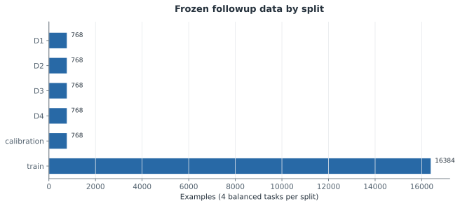

# F0 — 새 benchmark와 기존 결과 보존

갱신: 2026-11-04 12:14 KST. 실행 상태: **MEASURED**. 가설 판정: **SUPPORTED**.

연구 질문: 기존 단순 단서와 표본·보존 문제를 보완했는가?

20,224문항의 정답 oracle·분할 중복·짝별 단서 균형 검증을 통과했다. 이는 명시한 단서의 차단을 확인하며 모든 shortcut의 부재를 뜻하지 않는다. 기존 파일 261개의 SHA256을 보존했다.

## 실제 측정

| 지표 | 조건·방법 | 측정값 | CI | 단위 | n / 군집 |
|---|---|---:|---|---|---|
| Rows | D1 | 768 | 미측정 | examples | 24 |
| Rows | D2 | 768 | 미측정 | examples | 24 |
| Rows | D3 | 768 | 미측정 | examples | 24 |
| Rows | D4 | 768 | 미측정 | examples | 24 |
| Rows | calibration | 768 | 미측정 | examples | 24 |
| Rows | train | 16384 | 미측정 | examples | 24 |

## 비교와 불확실성

대응 차이에 대한 확인 검정은 아직 보고되지 않았습니다.

[그림 수치와 출처](../../artifacts/followup-v2/figures/f0_f0_dataset.json)

## 해석 한계

- Task grammars shared across splits despite distinct wrappers.
- Logic AST family is finite; numeric arithmetic restricted to addition.
- Invalid bracket arrangements can have local order cues; multiset balance does not establish recursive parsing.
- Generation seeds do not substitute for model seeds.
- 24 prompt wrappers are manually authored and not random draws from all language.

## 다음 단계

F1 five independent training runs and calibration-only prompt selection.

## 원본과 재현

- [results/followup-v2/stages/F0.json](../../results/followup-v2/stages/F0.json)
- [data/followup-v2/manifest.json](../../data/followup-v2/manifest.json)
- [reports/followup-v2/PROTOCOL.md](../../reports/followup-v2/PROTOCOL.md)
- [results/followup-v2/preservation_before.json](../../results/followup-v2/preservation_before.json)
