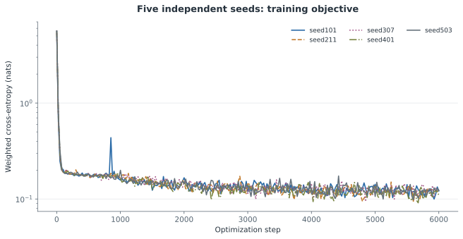
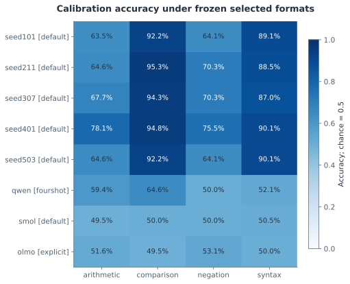
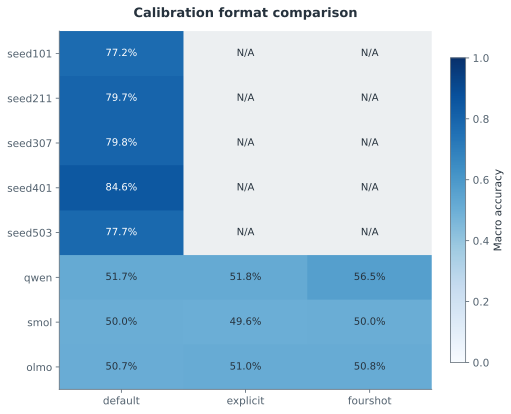

# F1 — 5개 독립 초기화 학습과 calibration 전용 형식 선택

갱신: 2026-11-04 14:46 KST. 실행 상태: **MEASURED**. 가설 판정: **INCONCLUSIVE**.

연구 질문: 독립 학습 모델을 확보하고 테스트셋을 보지 않고 평가 형식을 고정했는가?

서로 다른 초기 파라미터 해시의 모델 5개 학습과 8개 모델의 calibration 형식 고정을 완료했다. 선택한 형식의 calibration 과제 셀 32개 중 14개가 사전 능력 기준을 충족했다. 이는 형식 선택에 사용한 표본의 진단이며 독립 D3/D4 일반화 결과가 아니다.

## 과제 능력 조건

{
  "rule": "task accuracy >=0.70 and Wilson95 lower >0.50; paired analysis requires both models",
  "role": "Calibration diagnostic only; D3 and D4 competence assessed separately after mappings frozen",
  "eligible_calibration_cells": 14,
  "total_calibration_cells": 32,
  "selected_formats": [
    "seed101: default",
    "seed211: default",
    "seed307: default",
    "seed401: default",
    "seed503: default",
    "qwen: fourshot",
    "smol: default",
    "olmo: explicit"
  ]
}

## 실제 측정

| 지표 | 조건·방법 | 측정값 | CI | 단위 | n / 군집 |
|---|---|---:|---|---|---|
| Optimization steps | seed101 | 6000 | 미측정 | steps |  |
| Training elapsed | seed101 | 121.935 | 미측정 | seconds |  |
| Optimization steps | seed211 | 6000 | 미측정 | steps |  |
| Training elapsed | seed211 | 119.6758 | 미측정 | seconds |  |
| Optimization steps | seed307 | 6000 | 미측정 | steps |  |
| Training elapsed | seed307 | 119.7038 | 미측정 | seconds |  |
| Optimization steps | seed401 | 6000 | 미측정 | steps |  |
| Training elapsed | seed401 | 121.6665 | 미측정 | seconds |  |
| Optimization steps | seed503 | 6000 | 미측정 | steps |  |
| Training elapsed | seed503 | 122.902 | 미측정 | seconds |  |
| Calibration macro accuracy | seed101 / default / calibration | 0.7721 | 미측정 | fraction | 768 |
| Selected-format calibration accuracy | seed101 / default / arithmetic / calibration | 0.6354 | [0.5653, 0.7002] | fraction | 192 |
| Selected-format calibration accuracy | seed101 / default / comparison / calibration | 0.9219 | [0.8751, 0.9521] | fraction | 192 |
| Selected-format calibration accuracy | seed101 / default / negation / calibration | 0.6406 | [0.5706, 0.7051] | fraction | 192 |
| Selected-format calibration accuracy | seed101 / default / syntax / calibration | 0.8906 | [0.8386, 0.9273] | fraction | 192 |
| Calibration yes preference | seed101 / default / calibration | 0.5924 | 미측정 | fraction | 768 |
| Calibration macro accuracy | seed211 / default / calibration | 0.7969 | 미측정 | fraction | 768 |
| Selected-format calibration accuracy | seed211 / default / arithmetic / calibration | 0.6458 | [0.5759, 0.71] | fraction | 192 |
| Selected-format calibration accuracy | seed211 / default / comparison / calibration | 0.9531 | [0.9133, 0.9751] | fraction | 192 |
| Selected-format calibration accuracy | seed211 / default / negation / calibration | 0.7031 | [0.635, 0.7633] | fraction | 192 |
| Selected-format calibration accuracy | seed211 / default / syntax / calibration | 0.8854 | [0.8326, 0.9231] | fraction | 192 |
| Calibration yes preference | seed211 / default / calibration | 0.4141 | 미측정 | fraction | 768 |
| Calibration macro accuracy | seed307 / default / calibration | 0.7982 | 미측정 | fraction | 768 |
| Selected-format calibration accuracy | seed307 / default / arithmetic / calibration | 0.6771 | [0.608, 0.7392] | fraction | 192 |
| Selected-format calibration accuracy | seed307 / default / comparison / calibration | 0.9427 | [0.9003, 0.9677] | fraction | 192 |
| Selected-format calibration accuracy | seed307 / default / negation / calibration | 0.7031 | [0.635, 0.7633] | fraction | 192 |
| Selected-format calibration accuracy | seed307 / default / syntax / calibration | 0.8698 | [0.8149, 0.9102] | fraction | 192 |
| Calibration yes preference | seed307 / default / calibration | 0.5794 | 미측정 | fraction | 768 |
| Calibration macro accuracy | seed401 / default / calibration | 0.8464 | 미측정 | fraction | 768 |
| Selected-format calibration accuracy | seed401 / default / arithmetic / calibration | 0.7812 | [0.7176, 0.8339] | fraction | 192 |
| Selected-format calibration accuracy | seed401 / default / comparison / calibration | 0.9479 | [0.9068, 0.9715] | fraction | 192 |
| Selected-format calibration accuracy | seed401 / default / negation / calibration | 0.7552 | [0.6898, 0.8106] | fraction | 192 |
| Selected-format calibration accuracy | seed401 / default / syntax / calibration | 0.901 | [0.8506, 0.9357] | fraction | 192 |
| Calibration yes preference | seed401 / default / calibration | 0.5469 | 미측정 | fraction | 768 |
| Calibration macro accuracy | seed503 / default / calibration | 0.7773 | 미측정 | fraction | 768 |
| Selected-format calibration accuracy | seed503 / default / arithmetic / calibration | 0.6458 | [0.5759, 0.71] | fraction | 192 |
| Selected-format calibration accuracy | seed503 / default / comparison / calibration | 0.9219 | [0.8751, 0.9521] | fraction | 192 |
| Selected-format calibration accuracy | seed503 / default / negation / calibration | 0.6406 | [0.5706, 0.7051] | fraction | 192 |
| Selected-format calibration accuracy | seed503 / default / syntax / calibration | 0.901 | [0.8506, 0.9357] | fraction | 192 |
| Calibration yes preference | seed503 / default / calibration | 0.5039 | 미측정 | fraction | 768 |
| Calibration macro accuracy | qwen / default / calibration | 0.5169 | 미측정 | fraction | 768 |
| Calibration macro accuracy | qwen / explicit / calibration | 0.5182 | 미측정 | fraction | 768 |
| Calibration macro accuracy | qwen / fourshot / calibration | 0.5651 | 미측정 | fraction | 768 |
| Selected-format calibration accuracy | qwen / fourshot / arithmetic / calibration | 0.5938 | [0.5231, 0.6607] | fraction | 192 |
| Selected-format calibration accuracy | qwen / fourshot / comparison / calibration | 0.6458 | [0.5759, 0.71] | fraction | 192 |
| Selected-format calibration accuracy | qwen / fourshot / negation / calibration | 0.5 | [0.43, 0.57] | fraction | 192 |
| Selected-format calibration accuracy | qwen / fourshot / syntax / calibration | 0.5208 | [0.4505, 0.5904] | fraction | 192 |
| Calibration yes preference | qwen / fourshot / calibration | 0.8281 | 미측정 | fraction | 768 |
| Calibration macro accuracy | smol / default / calibration | 0.5 | 미측정 | fraction | 768 |
| Calibration macro accuracy | smol / explicit / calibration | 0.4961 | 미측정 | fraction | 768 |
| Calibration macro accuracy | smol / fourshot / calibration | 0.5 | 미측정 | fraction | 768 |
| Selected-format calibration accuracy | smol / default / arithmetic / calibration | 0.4948 | [0.4249, 0.5649] | fraction | 192 |
| Selected-format calibration accuracy | smol / default / comparison / calibration | 0.5 | [0.43, 0.57] | fraction | 192 |
| Selected-format calibration accuracy | smol / default / negation / calibration | 0.5 | [0.43, 0.57] | fraction | 192 |
| Selected-format calibration accuracy | smol / default / syntax / calibration | 0.5052 | [0.4351, 0.5751] | fraction | 192 |
| Calibration yes preference | smol / default / calibration | 0.6641 | 미측정 | fraction | 768 |
| Calibration macro accuracy | olmo / default / calibration | 0.5065 | 미측정 | fraction | 768 |
| Calibration macro accuracy | olmo / explicit / calibration | 0.5104 | 미측정 | fraction | 768 |
| Calibration macro accuracy | olmo / fourshot / calibration | 0.5078 | 미측정 | fraction | 768 |
| Selected-format calibration accuracy | olmo / explicit / arithmetic / calibration | 0.5156 | [0.4453, 0.5853] | fraction | 192 |
| Selected-format calibration accuracy | olmo / explicit / comparison / calibration | 0.4948 | [0.4249, 0.5649] | fraction | 192 |
| Selected-format calibration accuracy | olmo / explicit / negation / calibration | 0.5312 | [0.4607, 0.6005] | fraction | 192 |
| Selected-format calibration accuracy | olmo / explicit / syntax / calibration | 0.5 | [0.43, 0.57] | fraction | 192 |
| Calibration yes preference | olmo / explicit / calibration | 0.6432 | 미측정 | fraction | 768 |

## 비교와 불확실성

대응 차이에 대한 확인 검정은 아직 보고되지 않았습니다.

Training loss is not held-out competence. No D3/D4 outcomes are used in this figure.

[그림 수치와 출처](../../artifacts/followup-v2/figures/f1_five_seed_training.json)

Selected on calibration itself; this is an in-sample readiness diagnostic, not final test accuracy.

[그림 수치와 출처](../../artifacts/followup-v2/figures/f1_selected_calibration_accuracy.json)

Byte-tokenizer models use default only; unevaluated formats are N/A. One format is frozen per model.

[그림 수치와 출처](../../artifacts/followup-v2/figures/f1_calibration_variant_comparison.json)

## 해석 한계

- Calibration format-selection scores are optimistic and are not final generalization estimates.
- Wilson intervals are operational competence gates; they do not replace wrapper-cluster research intervals.
- Five initialization seeds still represent one small architecture and one training distribution.
- No D3 or D4 measurement is loaded by this stage builder.

## 다음 단계

F2 constructed permutation control, then frozen D2 alignment before any F3 held-out evaluation.

## 원본과 재현

- [results/followup-v2/stages/F1.json](../../results/followup-v2/stages/F1.json)
- [results/followup-v2/training/seed_101/manifest.json](../../results/followup-v2/training/seed_101/manifest.json)
- [results/followup-v2/training/seed_211/manifest.json](../../results/followup-v2/training/seed_211/manifest.json)
- [results/followup-v2/training/seed_307/manifest.json](../../results/followup-v2/training/seed_307/manifest.json)
- [results/followup-v2/training/seed_401/manifest.json](../../results/followup-v2/training/seed_401/manifest.json)
- [results/followup-v2/training/seed_503/manifest.json](../../results/followup-v2/training/seed_503/manifest.json)
- [results/followup-v2/calibration/seed101/summary.json](../../results/followup-v2/calibration/seed101/summary.json)
- [results/followup-v2/calibration/seed211/summary.json](../../results/followup-v2/calibration/seed211/summary.json)
- [results/followup-v2/calibration/seed307/summary.json](../../results/followup-v2/calibration/seed307/summary.json)
- [results/followup-v2/calibration/seed401/summary.json](../../results/followup-v2/calibration/seed401/summary.json)
- [results/followup-v2/calibration/seed503/summary.json](../../results/followup-v2/calibration/seed503/summary.json)
- [results/followup-v2/calibration/qwen/summary.json](../../results/followup-v2/calibration/qwen/summary.json)
- [results/followup-v2/calibration/smol/summary.json](../../results/followup-v2/calibration/smol/summary.json)
- [results/followup-v2/calibration/olmo/summary.json](../../results/followup-v2/calibration/olmo/summary.json)
- [results/followup-v2/calibration/seed101/lock.json](../../results/followup-v2/calibration/seed101/lock.json)
- [results/followup-v2/calibration/seed211/lock.json](../../results/followup-v2/calibration/seed211/lock.json)
- [results/followup-v2/calibration/seed307/lock.json](../../results/followup-v2/calibration/seed307/lock.json)
- [results/followup-v2/calibration/seed401/lock.json](../../results/followup-v2/calibration/seed401/lock.json)
- [results/followup-v2/calibration/seed503/lock.json](../../results/followup-v2/calibration/seed503/lock.json)
- [results/followup-v2/calibration/qwen/lock.json](../../results/followup-v2/calibration/qwen/lock.json)
- [results/followup-v2/calibration/smol/lock.json](../../results/followup-v2/calibration/smol/lock.json)
- [results/followup-v2/calibration/olmo/lock.json](../../results/followup-v2/calibration/olmo/lock.json)
