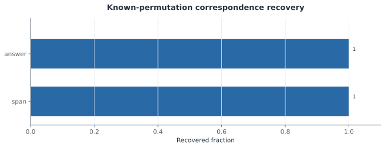
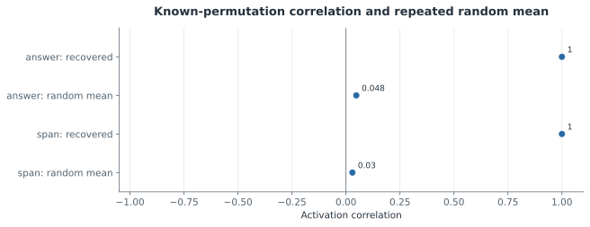

# F2 — 정확한 뉴런 순열의 양성 대조군

갱신: 2026-11-04 14:46 KST. 실행 상태: **MEASURED**. 가설 판정: **SUPPORTED**.

연구 질문: 의도적으로 만든 기능 보존 순열과 개입을 회복하는가?

등록한 모델 내부 순열 대칭 대조군의 정렬·개입 검증을 통과했다. 이는 측정 파이프라인의 해당 회복 성질을 검사하며, 독립적으로 학습된 모델의 의미 보존을 입증하지 않는다.

## 실제 측정

| 지표 | 조건·방법 | 측정값 | CI | 단위 | n / 군집 |
|---|---|---:|---|---|---|
| Permutation recovered fraction | answer | 1 | 미측정 | fraction of candidate neurons | 32 |
| Matched correlation | answer | 1 | 미측정 | value | 768 |
| Repeated random mean correlation | answer | 0.0477 | 미측정 | value | 768 |
| Repeated random SD | answer | 0.0497 | 미측정 | value | 768 |
| Maximum activation error | answer | 1.88e-05 | 미측정 | value | 768 |
| Baseline maximum logit discrepancy | answer | 5.63e-05 | 미측정 | logit |  |
| Mapped intervention maximum effect discrepancy | answer/zero | 3.24e-05 | 미측정 | logit |  |
| Mapped intervention maximum effect discrepancy | answer/mean | 3.86e-05 | 미측정 | logit |  |
| Mapped intervention maximum effect discrepancy | answer/patch | 2.43e-05 | 미측정 | logit |  |
| Mapped intervention maximum effect discrepancy | answer/scale_0 | 3.24e-05 | 미측정 | logit |  |
| Mapped intervention maximum effect discrepancy | answer/scale_0.5 | 2.43e-05 | 미측정 | logit |  |
| Mapped intervention maximum effect discrepancy | answer/scale_1 | 0 | 미측정 | logit |  |
| Mapped intervention maximum effect discrepancy | answer/scale_1.5 | 2.62e-05 | 미측정 | logit |  |
| Mapped intervention maximum effect discrepancy | answer/scale_2 | 2.15e-05 | 미측정 | logit |  |
| Wrong identity mapping maximum logit discrepancy | answer | 0.0314 | 미측정 | logit |  |
| Permutation recovered fraction | span | 1 | 미측정 | fraction of candidate neurons | 32 |
| Matched correlation | span | 1 | 미측정 | value | 768 |
| Repeated random mean correlation | span | 0.0298 | 미측정 | value | 768 |
| Repeated random SD | span | 0.0537 | 미측정 | value | 768 |
| Maximum activation error | span | 1.48e-06 | 미측정 | value | 768 |
| Baseline maximum logit discrepancy | span | 5.63e-05 | 미측정 | logit |  |
| Mapped intervention maximum effect discrepancy | span/zero | 5.72e-05 | 미측정 | logit |  |
| Mapped intervention maximum effect discrepancy | span/mean | 4.53e-05 | 미측정 | logit |  |
| Mapped intervention maximum effect discrepancy | span/patch | 4.86e-05 | 미측정 | logit |  |
| Mapped intervention maximum effect discrepancy | span/scale_0 | 5.72e-05 | 미측정 | logit |  |
| Mapped intervention maximum effect discrepancy | span/scale_0.5 | 3.24e-05 | 미측정 | logit |  |
| Mapped intervention maximum effect discrepancy | span/scale_1 | 0 | 미측정 | logit |  |
| Mapped intervention maximum effect discrepancy | span/scale_1.5 | 4.10e-05 | 미측정 | logit |  |
| Mapped intervention maximum effect discrepancy | span/scale_2 | 4.96e-05 | 미측정 | logit |  |
| Wrong identity mapping maximum logit discrepancy | span | 0.58 | 미측정 | logit |  |

## 비교와 불확실성

대응 차이에 대한 확인 검정은 아직 보고되지 않았습니다.

[그림 수치와 출처](../../artifacts/followup-v2/figures/f2_permutation_recovery.json)

Random baseline has 100 realizations; its SD is reported separately and is not labeled a confidence interval.

[그림 수치와 출처](../../artifacts/followup-v2/figures/f2_permutation_vs_random.json)

## 해석 한계

- constructed within-model permutation symmetry; not independently learned conservation
- Recovery fraction uses 32 candidate neurons; correlations use 768 input examples.
- Logit equality uses the stored absolute plus relative tolerance, not absolute tolerance alone.
- A constructed within-model permutation is not independent seed evidence.
- Only the registered control and selected neuron/position coverage are tested.

## 원본과 재현

- [results/followup-v2/stages/F2.json](../../results/followup-v2/stages/F2.json)
- [results/followup-v2/positive_control/summary.json](../../results/followup-v2/positive_control/summary.json)
- [results/followup-v2/positive_control/mapping.json](../../results/followup-v2/positive_control/mapping.json)
