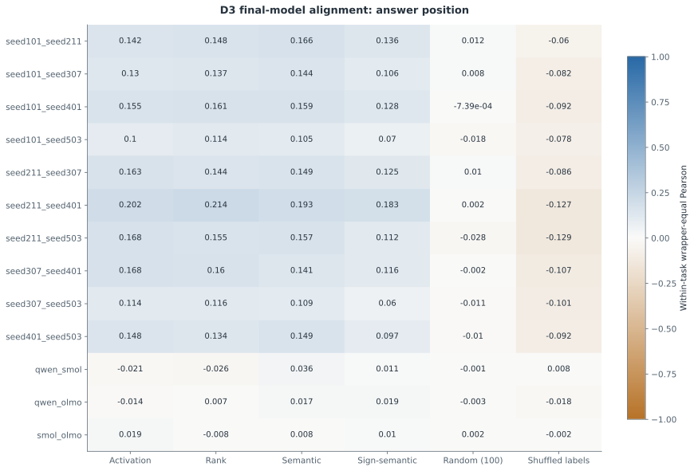
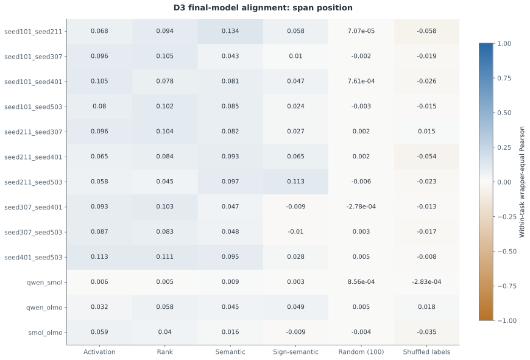
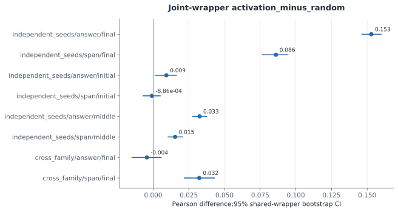
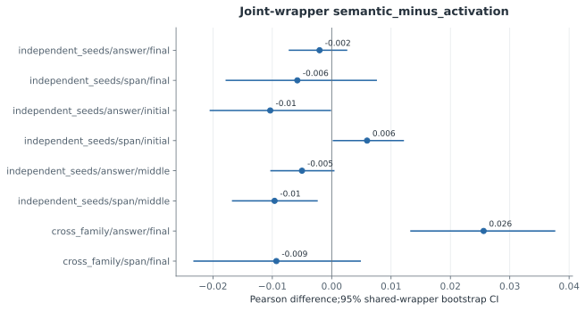
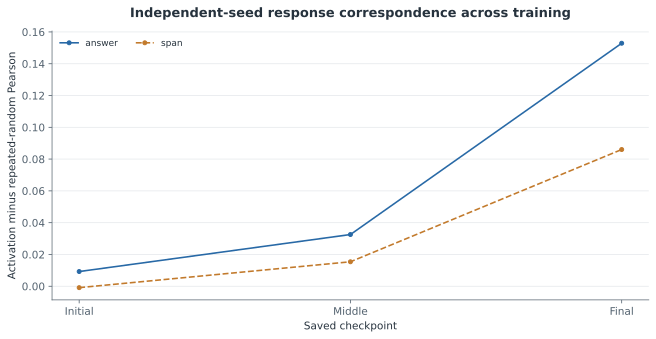
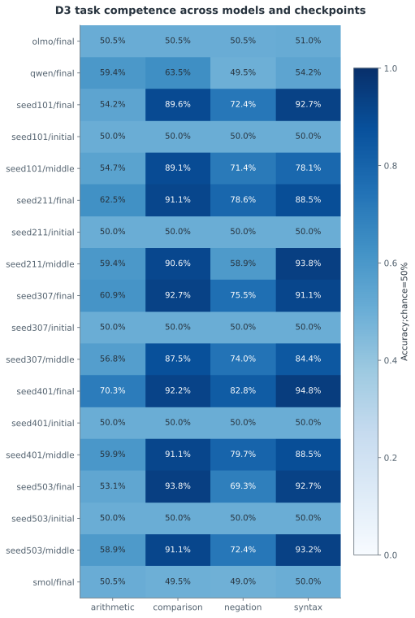
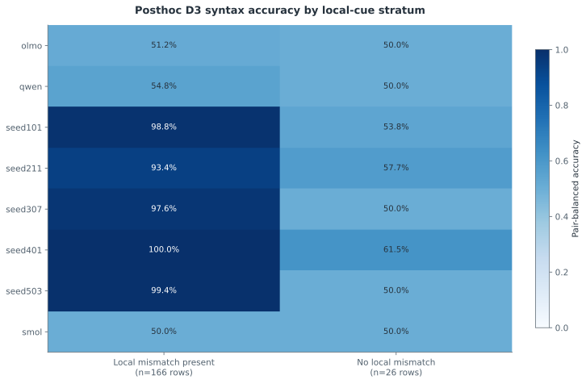

# F3 — 독립 시드·이종 계열의 두 위치 정렬과 학습 궤적

갱신: 2026-11-04 15:08 KST. 실행 상태: **MEASURED**. 가설 판정: **INCONCLUSIVE**.

연구 질문: 반복 무작위·학습 전 대조군을 통제한 독립 입력 대응이 존재하며 확장 의미 proxy가 개선하는가?

등록한 최종 모델 비교26개와 초기·중간 체크포인트 비교40개를 완료했다. 두 위치의 최종 모델쌍×과제 셀 중 52개에서 양쪽 모델의 능력 조건을 충족했다. 전체 과제 결과와 능력 조건을 구분하며, 학습 전 대응과 반복 무작위 매칭을 함께 공개한다. 확인 검정의 q값은 F6의 단일110개 BH family에서 가져왔다. 이종 계열은 calibration으로 고정한 서로 다른 프롬프트 접두 맥락을 사용하므로 동일 전체 입력의 비교가 아니며, 낮은 과제 능력에서 기능 보존의 부재를 결론내릴 수 없다. 사후 괄호 스트레스 분석에서 독립 학습 모델의 정확도는 인접 종류 불일치가 있는 pair 집합에서 93.4%–100.0%(n=166), 없는 집합에서 50.0%–61.5%(n=26)였다. 작은 사후 부분집합과 내용 차이를 포함한 연관성이므로 인과적 shortcut 사용 증거는 아니지만, 전체 정확도 능력 gate만으로 재귀적·구조적 이해를 입증할 수 없음을 보여 준다. 수 비교·부정 과제의 측정과는 구분한다.

## 과제 능력 조건

{
  "rule": "Both models accuracy>=0.70 and Wilson95 lower>0.50 per task",
  "passed_final_pair_position_task_cells": 52,
  "total_final_pair_position_task_cells": 104,
  "role": "Reporting strata only; no refitting or model selection using D3"
}

## 실제 측정

| 지표 | 조건·방법 | 측정값 | CI | 단위 | n / 군집 |
|---|---|---:|---|---|---|
| D3 response agreement | seed101_seed211 / answer/Activation / D3 | 0.1415 | 미측정 | Pearson | 24 |
| D3 response agreement | seed101_seed211 / answer/Rank / D3 | 0.1485 | 미측정 | Pearson | 24 |
| D3 response agreement | seed101_seed211 / answer/Semantic / D3 | 0.1656 | 미측정 | Pearson | 24 |
| D3 response agreement | seed101_seed211 / answer/Sign-semantic / D3 | 0.1364 | 미측정 | Pearson | 24 |
| D3 response agreement | seed101_seed211 / answer/Random (100) / D3 | 0.0116 | 미측정 | Pearson | 24 |
| D3 response agreement | seed101_seed211 / answer/Shuffled labels / D3 | -0.0599 | 미측정 | Pearson | 24 |
| D3 response agreement | seed101_seed211 / span/Activation / D3 | 0.0678 | 미측정 | Pearson | 24 |
| D3 response agreement | seed101_seed211 / span/Rank / D3 | 0.094 | 미측정 | Pearson | 24 |
| D3 response agreement | seed101_seed211 / span/Semantic / D3 | 0.134 | 미측정 | Pearson | 24 |
| D3 response agreement | seed101_seed211 / span/Sign-semantic / D3 | 0.0577 | 미측정 | Pearson | 24 |
| D3 response agreement | seed101_seed211 / span/Random (100) / D3 | 7.07e-05 | 미측정 | Pearson | 24 |
| D3 response agreement | seed101_seed211 / span/Shuffled labels / D3 | -0.0579 | 미측정 | Pearson | 24 |
| D3 response agreement | seed101_seed307 / answer/Activation / D3 | 0.1305 | 미측정 | Pearson | 24 |
| D3 response agreement | seed101_seed307 / answer/Rank / D3 | 0.1367 | 미측정 | Pearson | 24 |
| D3 response agreement | seed101_seed307 / answer/Semantic / D3 | 0.1436 | 미측정 | Pearson | 24 |
| D3 response agreement | seed101_seed307 / answer/Sign-semantic / D3 | 0.106 | 미측정 | Pearson | 24 |
| D3 response agreement | seed101_seed307 / answer/Random (100) / D3 | 0.0084 | 미측정 | Pearson | 24 |
| D3 response agreement | seed101_seed307 / answer/Shuffled labels / D3 | -0.0816 | 미측정 | Pearson | 24 |
| D3 response agreement | seed101_seed307 / span/Activation / D3 | 0.0965 | 미측정 | Pearson | 24 |
| D3 response agreement | seed101_seed307 / span/Rank / D3 | 0.1052 | 미측정 | Pearson | 24 |
| D3 response agreement | seed101_seed307 / span/Semantic / D3 | 0.0431 | 미측정 | Pearson | 24 |
| D3 response agreement | seed101_seed307 / span/Sign-semantic / D3 | 0.01 | 미측정 | Pearson | 24 |
| D3 response agreement | seed101_seed307 / span/Random (100) / D3 | -0.0016 | 미측정 | Pearson | 24 |
| D3 response agreement | seed101_seed307 / span/Shuffled labels / D3 | -0.0187 | 미측정 | Pearson | 24 |
| D3 response agreement | seed101_seed401 / answer/Activation / D3 | 0.1548 | 미측정 | Pearson | 24 |
| D3 response agreement | seed101_seed401 / answer/Rank / D3 | 0.1615 | 미측정 | Pearson | 24 |
| D3 response agreement | seed101_seed401 / answer/Semantic / D3 | 0.1592 | 미측정 | Pearson | 24 |
| D3 response agreement | seed101_seed401 / answer/Sign-semantic / D3 | 0.128 | 미측정 | Pearson | 24 |
| D3 response agreement | seed101_seed401 / answer/Random (100) / D3 | -0.0007 | 미측정 | Pearson | 24 |
| D3 response agreement | seed101_seed401 / answer/Shuffled labels / D3 | -0.0919 | 미측정 | Pearson | 24 |
| D3 response agreement | seed101_seed401 / span/Activation / D3 | 0.1048 | 미측정 | Pearson | 24 |
| D3 response agreement | seed101_seed401 / span/Rank / D3 | 0.078 | 미측정 | Pearson | 24 |
| D3 response agreement | seed101_seed401 / span/Semantic / D3 | 0.0809 | 미측정 | Pearson | 24 |
| D3 response agreement | seed101_seed401 / span/Sign-semantic / D3 | 0.0472 | 미측정 | Pearson | 24 |
| D3 response agreement | seed101_seed401 / span/Random (100) / D3 | 0.0008 | 미측정 | Pearson | 24 |
| D3 response agreement | seed101_seed401 / span/Shuffled labels / D3 | -0.0258 | 미측정 | Pearson | 24 |
| D3 response agreement | seed101_seed503 / answer/Activation / D3 | 0.1003 | 미측정 | Pearson | 24 |
| D3 response agreement | seed101_seed503 / answer/Rank / D3 | 0.1139 | 미측정 | Pearson | 24 |
| D3 response agreement | seed101_seed503 / answer/Semantic / D3 | 0.1047 | 미측정 | Pearson | 24 |
| D3 response agreement | seed101_seed503 / answer/Sign-semantic / D3 | 0.0702 | 미측정 | Pearson | 24 |
| D3 response agreement | seed101_seed503 / answer/Random (100) / D3 | -0.0182 | 미측정 | Pearson | 24 |
| D3 response agreement | seed101_seed503 / answer/Shuffled labels / D3 | -0.078 | 미측정 | Pearson | 24 |
| D3 response agreement | seed101_seed503 / span/Activation / D3 | 0.0802 | 미측정 | Pearson | 24 |
| D3 response agreement | seed101_seed503 / span/Rank / D3 | 0.1016 | 미측정 | Pearson | 24 |
| D3 response agreement | seed101_seed503 / span/Semantic / D3 | 0.0852 | 미측정 | Pearson | 24 |
| D3 response agreement | seed101_seed503 / span/Sign-semantic / D3 | 0.024 | 미측정 | Pearson | 24 |
| D3 response agreement | seed101_seed503 / span/Random (100) / D3 | -0.0026 | 미측정 | Pearson | 24 |
| D3 response agreement | seed101_seed503 / span/Shuffled labels / D3 | -0.0151 | 미측정 | Pearson | 24 |
| D3 response agreement | seed211_seed307 / answer/Activation / D3 | 0.1631 | 미측정 | Pearson | 24 |
| D3 response agreement | seed211_seed307 / answer/Rank / D3 | 0.1439 | 미측정 | Pearson | 24 |
| D3 response agreement | seed211_seed307 / answer/Semantic / D3 | 0.1488 | 미측정 | Pearson | 24 |
| D3 response agreement | seed211_seed307 / answer/Sign-semantic / D3 | 0.1248 | 미측정 | Pearson | 24 |
| D3 response agreement | seed211_seed307 / answer/Random (100) / D3 | 0.0103 | 미측정 | Pearson | 24 |
| D3 response agreement | seed211_seed307 / answer/Shuffled labels / D3 | -0.0865 | 미측정 | Pearson | 24 |
| D3 response agreement | seed211_seed307 / span/Activation / D3 | 0.0961 | 미측정 | Pearson | 24 |
| D3 response agreement | seed211_seed307 / span/Rank / D3 | 0.1043 | 미측정 | Pearson | 24 |
| D3 response agreement | seed211_seed307 / span/Semantic / D3 | 0.0818 | 미측정 | Pearson | 24 |
| D3 response agreement | seed211_seed307 / span/Sign-semantic / D3 | 0.0266 | 미측정 | Pearson | 24 |
| D3 response agreement | seed211_seed307 / span/Random (100) / D3 | 0.0015 | 미측정 | Pearson | 24 |
| D3 response agreement | seed211_seed307 / span/Shuffled labels / D3 | 0.0152 | 미측정 | Pearson | 24 |
| D3 response agreement | seed211_seed401 / answer/Activation / D3 | 0.2021 | 미측정 | Pearson | 24 |
| D3 response agreement | seed211_seed401 / answer/Rank / D3 | 0.2135 | 미측정 | Pearson | 24 |
| D3 response agreement | seed211_seed401 / answer/Semantic / D3 | 0.1927 | 미측정 | Pearson | 24 |
| D3 response agreement | seed211_seed401 / answer/Sign-semantic / D3 | 0.1835 | 미측정 | Pearson | 24 |
| D3 response agreement | seed211_seed401 / answer/Random (100) / D3 | 0.0016 | 미측정 | Pearson | 24 |
| D3 response agreement | seed211_seed401 / answer/Shuffled labels / D3 | -0.1267 | 미측정 | Pearson | 24 |
| D3 response agreement | seed211_seed401 / span/Activation / D3 | 0.0653 | 미측정 | Pearson | 24 |
| D3 response agreement | seed211_seed401 / span/Rank / D3 | 0.0838 | 미측정 | Pearson | 24 |
| D3 response agreement | seed211_seed401 / span/Semantic / D3 | 0.0933 | 미측정 | Pearson | 24 |
| D3 response agreement | seed211_seed401 / span/Sign-semantic / D3 | 0.0651 | 미측정 | Pearson | 24 |
| D3 response agreement | seed211_seed401 / span/Random (100) / D3 | 0.0019 | 미측정 | Pearson | 24 |
| D3 response agreement | seed211_seed401 / span/Shuffled labels / D3 | -0.0542 | 미측정 | Pearson | 24 |
| D3 response agreement | seed211_seed503 / answer/Activation / D3 | 0.1683 | 미측정 | Pearson | 24 |
| D3 response agreement | seed211_seed503 / answer/Rank / D3 | 0.1547 | 미측정 | Pearson | 24 |
| D3 response agreement | seed211_seed503 / answer/Semantic / D3 | 0.1574 | 미측정 | Pearson | 24 |
| D3 response agreement | seed211_seed503 / answer/Sign-semantic / D3 | 0.112 | 미측정 | Pearson | 24 |
| D3 response agreement | seed211_seed503 / answer/Random (100) / D3 | -0.0283 | 미측정 | Pearson | 24 |
| D3 response agreement | seed211_seed503 / answer/Shuffled labels / D3 | -0.1285 | 미측정 | Pearson | 24 |
| D3 response agreement | seed211_seed503 / span/Activation / D3 | 0.0584 | 미측정 | Pearson | 24 |
| D3 response agreement | seed211_seed503 / span/Rank / D3 | 0.0447 | 미측정 | Pearson | 24 |
| D3 response agreement | seed211_seed503 / span/Semantic / D3 | 0.0972 | 미측정 | Pearson | 24 |
| D3 response agreement | seed211_seed503 / span/Sign-semantic / D3 | 0.1128 | 미측정 | Pearson | 24 |
| D3 response agreement | seed211_seed503 / span/Random (100) / D3 | -0.0056 | 미측정 | Pearson | 24 |
| D3 response agreement | seed211_seed503 / span/Shuffled labels / D3 | -0.0228 | 미측정 | Pearson | 24 |
| D3 response agreement | seed307_seed401 / answer/Activation / D3 | 0.168 | 미측정 | Pearson | 24 |
| D3 response agreement | seed307_seed401 / answer/Rank / D3 | 0.1604 | 미측정 | Pearson | 24 |
| D3 response agreement | seed307_seed401 / answer/Semantic / D3 | 0.1405 | 미측정 | Pearson | 24 |
| D3 response agreement | seed307_seed401 / answer/Sign-semantic / D3 | 0.1163 | 미측정 | Pearson | 24 |
| D3 response agreement | seed307_seed401 / answer/Random (100) / D3 | -0.0018 | 미측정 | Pearson | 24 |
| D3 response agreement | seed307_seed401 / answer/Shuffled labels / D3 | -0.1066 | 미측정 | Pearson | 24 |
| D3 response agreement | seed307_seed401 / span/Activation / D3 | 0.0927 | 미측정 | Pearson | 24 |
| D3 response agreement | seed307_seed401 / span/Rank / D3 | 0.1033 | 미측정 | Pearson | 24 |
| D3 response agreement | seed307_seed401 / span/Semantic / D3 | 0.0465 | 미측정 | Pearson | 24 |
| D3 response agreement | seed307_seed401 / span/Sign-semantic / D3 | -0.0089 | 미측정 | Pearson | 24 |
| D3 response agreement | seed307_seed401 / span/Random (100) / D3 | -0.0003 | 미측정 | Pearson | 24 |
| D3 response agreement | seed307_seed401 / span/Shuffled labels / D3 | -0.0129 | 미측정 | Pearson | 24 |
| D3 response agreement | seed307_seed503 / answer/Activation / D3 | 0.1138 | 미측정 | Pearson | 24 |
| D3 response agreement | seed307_seed503 / answer/Rank / D3 | 0.1162 | 미측정 | Pearson | 24 |
| D3 response agreement | seed307_seed503 / answer/Semantic / D3 | 0.1091 | 미측정 | Pearson | 24 |
| D3 response agreement | seed307_seed503 / answer/Sign-semantic / D3 | 0.0595 | 미측정 | Pearson | 24 |
| D3 response agreement | seed307_seed503 / answer/Random (100) / D3 | -0.0113 | 미측정 | Pearson | 24 |
| D3 response agreement | seed307_seed503 / answer/Shuffled labels / D3 | -0.1007 | 미측정 | Pearson | 24 |
| D3 response agreement | seed307_seed503 / span/Activation / D3 | 0.0875 | 미측정 | Pearson | 24 |
| D3 response agreement | seed307_seed503 / span/Rank / D3 | 0.0829 | 미측정 | Pearson | 24 |
| D3 response agreement | seed307_seed503 / span/Semantic / D3 | 0.0478 | 미측정 | Pearson | 24 |
| D3 response agreement | seed307_seed503 / span/Sign-semantic / D3 | -0.0097 | 미측정 | Pearson | 24 |
| D3 response agreement | seed307_seed503 / span/Random (100) / D3 | 0.0035 | 미측정 | Pearson | 24 |
| D3 response agreement | seed307_seed503 / span/Shuffled labels / D3 | -0.0171 | 미측정 | Pearson | 24 |
| D3 response agreement | seed401_seed503 / answer/Activation / D3 | 0.1483 | 미측정 | Pearson | 24 |
| D3 response agreement | seed401_seed503 / answer/Rank / D3 | 0.1343 | 미측정 | Pearson | 24 |
| D3 response agreement | seed401_seed503 / answer/Semantic / D3 | 0.1487 | 미측정 | Pearson | 24 |
| D3 response agreement | seed401_seed503 / answer/Sign-semantic / D3 | 0.0975 | 미측정 | Pearson | 24 |
| D3 response agreement | seed401_seed503 / answer/Random (100) / D3 | -0.0099 | 미측정 | Pearson | 24 |
| D3 response agreement | seed401_seed503 / answer/Shuffled labels / D3 | -0.0915 | 미측정 | Pearson | 24 |
| D3 response agreement | seed401_seed503 / span/Activation / D3 | 0.1135 | 미측정 | Pearson | 24 |
| D3 response agreement | seed401_seed503 / span/Rank / D3 | 0.1111 | 미측정 | Pearson | 24 |
| D3 response agreement | seed401_seed503 / span/Semantic / D3 | 0.095 | 미측정 | Pearson | 24 |
| D3 response agreement | seed401_seed503 / span/Sign-semantic / D3 | 0.0283 | 미측정 | Pearson | 24 |
| D3 response agreement | seed401_seed503 / span/Random (100) / D3 | 0.005 | 미측정 | Pearson | 24 |
| D3 response agreement | seed401_seed503 / span/Shuffled labels / D3 | -0.0082 | 미측정 | Pearson | 24 |
| D3 response agreement | qwen_smol / answer/Activation / D3 | -0.0209 | 미측정 | Pearson | 24 |
| D3 response agreement | qwen_smol / answer/Rank / D3 | -0.0264 | 미측정 | Pearson | 24 |
| D3 response agreement | qwen_smol / answer/Semantic / D3 | 0.0365 | 미측정 | Pearson | 24 |
| D3 response agreement | qwen_smol / answer/Sign-semantic / D3 | 0.0111 | 미측정 | Pearson | 24 |
| D3 response agreement | qwen_smol / answer/Random (100) / D3 | -0.0012 | 미측정 | Pearson | 24 |
| D3 response agreement | qwen_smol / answer/Shuffled labels / D3 | 0.0078 | 미측정 | Pearson | 24 |
| D3 response agreement | qwen_smol / span/Activation / D3 | 0.0064 | 미측정 | Pearson | 24 |
| D3 response agreement | qwen_smol / span/Rank / D3 | 0.0048 | 미측정 | Pearson | 24 |
| D3 response agreement | qwen_smol / span/Semantic / D3 | 0.0089 | 미측정 | Pearson | 24 |
| D3 response agreement | qwen_smol / span/Sign-semantic / D3 | 0.0026 | 미측정 | Pearson | 24 |
| D3 response agreement | qwen_smol / span/Random (100) / D3 | 0.0009 | 미측정 | Pearson | 24 |
| D3 response agreement | qwen_smol / span/Shuffled labels / D3 | -0.0003 | 미측정 | Pearson | 24 |
| D3 response agreement | qwen_olmo / answer/Activation / D3 | -0.0138 | 미측정 | Pearson | 24 |
| D3 response agreement | qwen_olmo / answer/Rank / D3 | 0.0074 | 미측정 | Pearson | 24 |
| D3 response agreement | qwen_olmo / answer/Semantic / D3 | 0.0173 | 미측정 | Pearson | 24 |
| D3 response agreement | qwen_olmo / answer/Sign-semantic / D3 | 0.0187 | 미측정 | Pearson | 24 |
| D3 response agreement | qwen_olmo / answer/Random (100) / D3 | -0.0031 | 미측정 | Pearson | 24 |
| D3 response agreement | qwen_olmo / answer/Shuffled labels / D3 | -0.0183 | 미측정 | Pearson | 24 |
| D3 response agreement | qwen_olmo / span/Activation / D3 | 0.0324 | 미측정 | Pearson | 24 |
| D3 response agreement | qwen_olmo / span/Rank / D3 | 0.0576 | 미측정 | Pearson | 24 |
| D3 response agreement | qwen_olmo / span/Semantic / D3 | 0.0452 | 미측정 | Pearson | 24 |
| D3 response agreement | qwen_olmo / span/Sign-semantic / D3 | 0.0485 | 미측정 | Pearson | 24 |
| D3 response agreement | qwen_olmo / span/Random (100) / D3 | 0.0049 | 미측정 | Pearson | 24 |
| D3 response agreement | qwen_olmo / span/Shuffled labels / D3 | 0.0185 | 미측정 | Pearson | 24 |
| D3 response agreement | smol_olmo / answer/Activation / D3 | 0.0191 | 미측정 | Pearson | 24 |
| D3 response agreement | smol_olmo / answer/Rank / D3 | -0.0076 | 미측정 | Pearson | 24 |
| D3 response agreement | smol_olmo / answer/Semantic / D3 | 0.0076 | 미측정 | Pearson | 24 |
| D3 response agreement | smol_olmo / answer/Sign-semantic / D3 | 0.0102 | 미측정 | Pearson | 24 |
| D3 response agreement | smol_olmo / answer/Random (100) / D3 | 0.002 | 미측정 | Pearson | 24 |
| D3 response agreement | smol_olmo / answer/Shuffled labels / D3 | -0.002 | 미측정 | Pearson | 24 |
| D3 response agreement | smol_olmo / span/Activation / D3 | 0.0594 | 미측정 | Pearson | 24 |
| D3 response agreement | smol_olmo / span/Rank / D3 | 0.0398 | 미측정 | Pearson | 24 |
| D3 response agreement | smol_olmo / span/Semantic / D3 | 0.0162 | 미측정 | Pearson | 24 |
| D3 response agreement | smol_olmo / span/Sign-semantic / D3 | -0.0092 | 미측정 | Pearson | 24 |
| D3 response agreement | smol_olmo / span/Random (100) / D3 | -0.0044 | 미측정 | Pearson | 24 |
| D3 response agreement | smol_olmo / span/Shuffled labels / D3 | -0.0352 | 미측정 | Pearson | 24 |
| Joint-wrapper activation_minus_random | independent_seeds / answer/final | 0.1529 | [0.1463, 0.1598] | Pearson difference | 24 |
| Joint-wrapper semantic_minus_activation | independent_seeds / answer/final | -0.002 | [-0.0071, 0.0025] | Pearson difference | 24 |
| Joint-wrapper activation_minus_random | independent_seeds / span/final | 0.086 | [0.0766, 0.0945] | Pearson difference | 24 |
| Joint-wrapper semantic_minus_activation | independent_seeds / span/final | -0.0058 | [-0.0178, 0.0075] | Pearson difference | 24 |
| Joint-wrapper activation_minus_random | independent_seeds / answer/initial | 0.0093 | [0.0014, 0.0163] | Pearson difference | 24 |
| Joint-wrapper semantic_minus_activation | independent_seeds / answer/initial | -0.0104 | [-0.0204, -0.0002] | Pearson difference | 24 |
| Joint-wrapper activation_minus_random | independent_seeds / span/initial | -0.0009 | [-0.0071, 0.0049] | Pearson difference | 24 |
| Joint-wrapper semantic_minus_activation | independent_seeds / span/initial | 0.006 | [0.0003, 0.0121] | Pearson difference | 24 |
| Joint-wrapper activation_minus_random | independent_seeds / answer/middle | 0.0325 | [0.0275, 0.0375] | Pearson difference | 24 |
| Joint-wrapper semantic_minus_activation | independent_seeds / answer/middle | -0.005 | [-0.0102, 0.0004] | Pearson difference | 24 |
| Joint-wrapper activation_minus_random | independent_seeds / span/middle | 0.0154 | [0.0105, 0.0207] | Pearson difference | 24 |
| Joint-wrapper semantic_minus_activation | independent_seeds / span/middle | -0.0096 | [-0.0167, -0.0025] | Pearson difference | 24 |
| Joint-wrapper activation_minus_random | cross_family / answer/final | -0.0044 | [-0.0148, 0.0056] | Pearson difference | 24 |
| Joint-wrapper semantic_minus_activation | cross_family / answer/final | 0.0256 | [0.0134, 0.0375] | Pearson difference | 24 |
| Joint-wrapper activation_minus_random | cross_family / span/final | 0.0323 | [0.0218, 0.0429] | Pearson difference | 24 |
| Joint-wrapper semantic_minus_activation | cross_family / span/final | -0.0093 | [-0.0232, 0.0048] | Pearson difference | 24 |
| Posthoc syntax cue-stratum accuracy | olmo / adjacent_mismatch_present / syntax / D3 exploratory | 0.512 | 미측정 | fraction | 166 / 24 |
| Posthoc syntax cue-stratum accuracy | olmo / no_adjacent_mismatch / syntax / D3 exploratory | 0.5 | 미측정 | fraction | 26 / 10 |
| Posthoc syntax cue-stratum accuracy | qwen / adjacent_mismatch_present / syntax / D3 exploratory | 0.5482 | 미측정 | fraction | 166 / 24 |
| Posthoc syntax cue-stratum accuracy | qwen / no_adjacent_mismatch / syntax / D3 exploratory | 0.5 | 미측정 | fraction | 26 / 10 |
| Posthoc syntax cue-stratum accuracy | seed101 / adjacent_mismatch_present / syntax / D3 exploratory | 0.988 | 미측정 | fraction | 166 / 24 |
| Posthoc syntax cue-stratum accuracy | seed101 / no_adjacent_mismatch / syntax / D3 exploratory | 0.5385 | 미측정 | fraction | 26 / 10 |
| Posthoc syntax cue-stratum accuracy | seed211 / adjacent_mismatch_present / syntax / D3 exploratory | 0.9337 | 미측정 | fraction | 166 / 24 |
| Posthoc syntax cue-stratum accuracy | seed211 / no_adjacent_mismatch / syntax / D3 exploratory | 0.5769 | 미측정 | fraction | 26 / 10 |
| Posthoc syntax cue-stratum accuracy | seed307 / adjacent_mismatch_present / syntax / D3 exploratory | 0.9759 | 미측정 | fraction | 166 / 24 |
| Posthoc syntax cue-stratum accuracy | seed307 / no_adjacent_mismatch / syntax / D3 exploratory | 0.5 | 미측정 | fraction | 26 / 10 |
| Posthoc syntax cue-stratum accuracy | seed401 / adjacent_mismatch_present / syntax / D3 exploratory | 1 | 미측정 | fraction | 166 / 24 |
| Posthoc syntax cue-stratum accuracy | seed401 / no_adjacent_mismatch / syntax / D3 exploratory | 0.6154 | 미측정 | fraction | 26 / 10 |
| Posthoc syntax cue-stratum accuracy | seed503 / adjacent_mismatch_present / syntax / D3 exploratory | 0.994 | 미측정 | fraction | 166 / 24 |
| Posthoc syntax cue-stratum accuracy | seed503 / no_adjacent_mismatch / syntax / D3 exploratory | 0.5 | 미측정 | fraction | 26 / 10 |
| Posthoc syntax cue-stratum accuracy | smol / adjacent_mismatch_present / syntax / D3 exploratory | 0.5 | 미측정 | fraction | 166 / 24 |
| Posthoc syntax cue-stratum accuracy | smol / no_adjacent_mismatch / syntax / D3 exploratory | 0.5 | 미측정 | fraction | 26 / 10 |
| Competence-qualified descriptive activation | independent_seeds / answer / arithmetic | 미측정 | 미측정 | Pearson or difference | 0 |
| Competence-qualified descriptive semantic | independent_seeds / answer / arithmetic | 미측정 | 미측정 | Pearson or difference | 0 |
| Competence-qualified descriptive random | independent_seeds / answer / arithmetic | 미측정 | 미측정 | Pearson or difference | 0 |
| Competence-qualified descriptive activation_minus_random | independent_seeds / answer / arithmetic | 미측정 | 미측정 | Pearson or difference | 0 |
| Competence-qualified descriptive semantic_minus_activation | independent_seeds / answer / arithmetic | 미측정 | 미측정 | Pearson or difference | 0 |
| Competence-qualified descriptive activation | independent_seeds / answer / comparison | 0.2132 | 미측정 | Pearson or difference | 10 |
| Competence-qualified descriptive semantic | independent_seeds / answer / comparison | 0.2115 | 미측정 | Pearson or difference | 10 |
| Competence-qualified descriptive random | independent_seeds / answer / comparison | -0.0044 | 미측정 | Pearson or difference | 10 |
| Competence-qualified descriptive activation_minus_random | independent_seeds / answer / comparison | 0.2176 | 미측정 | Pearson or difference | 10 |
| Competence-qualified descriptive semantic_minus_activation | independent_seeds / answer / comparison | -0.0017 | 미측정 | Pearson or difference | 10 |
| Competence-qualified descriptive activation | independent_seeds / answer / negation | 0.0876 | 미측정 | Pearson or difference | 6 |
| Competence-qualified descriptive semantic | independent_seeds / answer / negation | 0.0729 | 미측정 | Pearson or difference | 6 |
| Competence-qualified descriptive random | independent_seeds / answer / negation | 0.0014 | 미측정 | Pearson or difference | 6 |
| Competence-qualified descriptive activation_minus_random | independent_seeds / answer / negation | 0.0863 | 미측정 | Pearson or difference | 6 |
| Competence-qualified descriptive semantic_minus_activation | independent_seeds / answer / negation | -0.0147 | 미측정 | Pearson or difference | 6 |
| Competence-qualified descriptive activation | independent_seeds / answer / syntax | 0.2719 | 미측정 | Pearson or difference | 10 |
| Competence-qualified descriptive semantic | independent_seeds / answer / syntax | 0.2786 | 미측정 | Pearson or difference | 10 |
| Competence-qualified descriptive random | independent_seeds / answer / syntax | -0.0119 | 미측정 | Pearson or difference | 10 |
| Competence-qualified descriptive activation_minus_random | independent_seeds / answer / syntax | 0.2838 | 미측정 | Pearson or difference | 10 |
| Competence-qualified descriptive semantic_minus_activation | independent_seeds / answer / syntax | 0.0067 | 미측정 | Pearson or difference | 10 |
| Competence-qualified descriptive activation | independent_seeds / span / arithmetic | 미측정 | 미측정 | Pearson or difference | 0 |
| Competence-qualified descriptive semantic | independent_seeds / span / arithmetic | 미측정 | 미측정 | Pearson or difference | 0 |
| Competence-qualified descriptive random | independent_seeds / span / arithmetic | 미측정 | 미측정 | Pearson or difference | 0 |
| Competence-qualified descriptive activation_minus_random | independent_seeds / span / arithmetic | 미측정 | 미측정 | Pearson or difference | 0 |
| Competence-qualified descriptive semantic_minus_activation | independent_seeds / span / arithmetic | 미측정 | 미측정 | Pearson or difference | 0 |
| Competence-qualified descriptive activation | independent_seeds / span / comparison | 0.1719 | 미측정 | Pearson or difference | 10 |
| Competence-qualified descriptive semantic | independent_seeds / span / comparison | 0.1164 | 미측정 | Pearson or difference | 10 |
| Competence-qualified descriptive random | independent_seeds / span / comparison | -0.0017 | 미측정 | Pearson or difference | 10 |
| Competence-qualified descriptive activation_minus_random | independent_seeds / span / comparison | 0.1736 | 미측정 | Pearson or difference | 10 |
| Competence-qualified descriptive semantic_minus_activation | independent_seeds / span / comparison | -0.0555 | 미측정 | Pearson or difference | 10 |
| Competence-qualified descriptive activation | independent_seeds / span / negation | 0.0028 | 미측정 | Pearson or difference | 6 |
| Competence-qualified descriptive semantic | independent_seeds / span / negation | 0.0497 | 미측정 | Pearson or difference | 6 |
| Competence-qualified descriptive random | independent_seeds / span / negation | -0.0038 | 미측정 | Pearson or difference | 6 |
| Competence-qualified descriptive activation_minus_random | independent_seeds / span / negation | 0.0065 | 미측정 | Pearson or difference | 6 |
| Competence-qualified descriptive semantic_minus_activation | independent_seeds / span / negation | 0.0469 | 미측정 | Pearson or difference | 6 |
| Competence-qualified descriptive activation | independent_seeds / span / syntax | 0.039 | 미측정 | Pearson or difference | 10 |
| Competence-qualified descriptive semantic | independent_seeds / span / syntax | 0.1154 | 미측정 | Pearson or difference | 10 |
| Competence-qualified descriptive random | independent_seeds / span / syntax | 0.0055 | 미측정 | Pearson or difference | 10 |
| Competence-qualified descriptive activation_minus_random | independent_seeds / span / syntax | 0.0335 | 미측정 | Pearson or difference | 10 |
| Competence-qualified descriptive semantic_minus_activation | independent_seeds / span / syntax | 0.0764 | 미측정 | Pearson or difference | 10 |
| Competence-qualified descriptive activation | cross_family / answer / arithmetic | 미측정 | 미측정 | Pearson or difference | 0 |
| Competence-qualified descriptive semantic | cross_family / answer / arithmetic | 미측정 | 미측정 | Pearson or difference | 0 |
| Competence-qualified descriptive random | cross_family / answer / arithmetic | 미측정 | 미측정 | Pearson or difference | 0 |
| Competence-qualified descriptive activation_minus_random | cross_family / answer / arithmetic | 미측정 | 미측정 | Pearson or difference | 0 |
| Competence-qualified descriptive semantic_minus_activation | cross_family / answer / arithmetic | 미측정 | 미측정 | Pearson or difference | 0 |
| Competence-qualified descriptive activation | cross_family / answer / comparison | 미측정 | 미측정 | Pearson or difference | 0 |
| Competence-qualified descriptive semantic | cross_family / answer / comparison | 미측정 | 미측정 | Pearson or difference | 0 |
| Competence-qualified descriptive random | cross_family / answer / comparison | 미측정 | 미측정 | Pearson or difference | 0 |
| Competence-qualified descriptive activation_minus_random | cross_family / answer / comparison | 미측정 | 미측정 | Pearson or difference | 0 |
| Competence-qualified descriptive semantic_minus_activation | cross_family / answer / comparison | 미측정 | 미측정 | Pearson or difference | 0 |
| Competence-qualified descriptive activation | cross_family / answer / negation | 미측정 | 미측정 | Pearson or difference | 0 |
| Competence-qualified descriptive semantic | cross_family / answer / negation | 미측정 | 미측정 | Pearson or difference | 0 |
| Competence-qualified descriptive random | cross_family / answer / negation | 미측정 | 미측정 | Pearson or difference | 0 |
| Competence-qualified descriptive activation_minus_random | cross_family / answer / negation | 미측정 | 미측정 | Pearson or difference | 0 |
| Competence-qualified descriptive semantic_minus_activation | cross_family / answer / negation | 미측정 | 미측정 | Pearson or difference | 0 |
| Competence-qualified descriptive activation | cross_family / answer / syntax | 미측정 | 미측정 | Pearson or difference | 0 |
| Competence-qualified descriptive semantic | cross_family / answer / syntax | 미측정 | 미측정 | Pearson or difference | 0 |
| Competence-qualified descriptive random | cross_family / answer / syntax | 미측정 | 미측정 | Pearson or difference | 0 |
| Competence-qualified descriptive activation_minus_random | cross_family / answer / syntax | 미측정 | 미측정 | Pearson or difference | 0 |
| Competence-qualified descriptive semantic_minus_activation | cross_family / answer / syntax | 미측정 | 미측정 | Pearson or difference | 0 |
| Competence-qualified descriptive activation | cross_family / span / arithmetic | 미측정 | 미측정 | Pearson or difference | 0 |
| Competence-qualified descriptive semantic | cross_family / span / arithmetic | 미측정 | 미측정 | Pearson or difference | 0 |
| Competence-qualified descriptive random | cross_family / span / arithmetic | 미측정 | 미측정 | Pearson or difference | 0 |
| Competence-qualified descriptive activation_minus_random | cross_family / span / arithmetic | 미측정 | 미측정 | Pearson or difference | 0 |
| Competence-qualified descriptive semantic_minus_activation | cross_family / span / arithmetic | 미측정 | 미측정 | Pearson or difference | 0 |
| Competence-qualified descriptive activation | cross_family / span / comparison | 미측정 | 미측정 | Pearson or difference | 0 |
| Competence-qualified descriptive semantic | cross_family / span / comparison | 미측정 | 미측정 | Pearson or difference | 0 |
| Competence-qualified descriptive random | cross_family / span / comparison | 미측정 | 미측정 | Pearson or difference | 0 |
| Competence-qualified descriptive activation_minus_random | cross_family / span / comparison | 미측정 | 미측정 | Pearson or difference | 0 |
| Competence-qualified descriptive semantic_minus_activation | cross_family / span / comparison | 미측정 | 미측정 | Pearson or difference | 0 |
| Competence-qualified descriptive activation | cross_family / span / negation | 미측정 | 미측정 | Pearson or difference | 0 |
| Competence-qualified descriptive semantic | cross_family / span / negation | 미측정 | 미측정 | Pearson or difference | 0 |
| Competence-qualified descriptive random | cross_family / span / negation | 미측정 | 미측정 | Pearson or difference | 0 |
| Competence-qualified descriptive activation_minus_random | cross_family / span / negation | 미측정 | 미측정 | Pearson or difference | 0 |
| Competence-qualified descriptive semantic_minus_activation | cross_family / span / negation | 미측정 | 미측정 | Pearson or difference | 0 |
| Competence-qualified descriptive activation | cross_family / span / syntax | 미측정 | 미측정 | Pearson or difference | 0 |
| Competence-qualified descriptive semantic | cross_family / span / syntax | 미측정 | 미측정 | Pearson or difference | 0 |
| Competence-qualified descriptive random | cross_family / span / syntax | 미측정 | 미측정 | Pearson or difference | 0 |
| Competence-qualified descriptive activation_minus_random | cross_family / span / syntax | 미측정 | 미측정 | Pearson or difference | 0 |
| Competence-qualified descriptive semantic_minus_activation | cross_family / span / syntax | 미측정 | 미측정 | Pearson or difference | 0 |

## 비교와 불확실성

| 비교 | Δ | CI | p | q | 보정 범위 |
|---|---:|---|---:|---:|---|
| F3/seed101_seed211/answer/activation_minus_random | 0.1299 | [0.1174, 0.1419] | 5.00e-05 | 0.0002 | Final single110-member BH family; conditional dependent-pair estimates |
| F3/seed101_seed211/answer/semantic_minus_activation | 0.0241 | [0.0088, 0.0392] | 0.0052 | 0.0117 | Final single110-member BH family; conditional dependent-pair estimates |
| F3/seed101_seed211/span/activation_minus_random | 0.0678 | [0.0522, 0.0843] | 5.00e-05 | 0.0002 | Final single110-member BH family; conditional dependent-pair estimates |
| F3/seed101_seed211/span/semantic_minus_activation | 0.0662 | [0.0444, 0.0876] | 5.00e-05 | 0.0002 | Final single110-member BH family; conditional dependent-pair estimates |
| F3/seed101_seed307/answer/activation_minus_random | 0.1221 | [0.1054, 0.1398] | 5.00e-05 | 0.0002 | Final single110-member BH family; conditional dependent-pair estimates |
| F3/seed101_seed307/answer/semantic_minus_activation | 0.0131 | [-0.0066, 0.0324] | 0.2106 | 0.3358 | Final single110-member BH family; conditional dependent-pair estimates |
| F3/seed101_seed307/span/activation_minus_random | 0.0981 | [0.0756, 0.119] | 5.00e-05 | 0.0002 | Final single110-member BH family; conditional dependent-pair estimates |
| F3/seed101_seed307/span/semantic_minus_activation | -0.0534 | [-0.0766, -0.0281] | 0.0006 | 0.0018 | Final single110-member BH family; conditional dependent-pair estimates |
| F3/seed101_seed401/answer/activation_minus_random | 0.1556 | [0.1429, 0.1684] | 5.00e-05 | 0.0002 | Final single110-member BH family; conditional dependent-pair estimates |
| F3/seed101_seed401/answer/semantic_minus_activation | 0.0043 | [-0.0179, 0.0257] | 0.7067 | 0.8638 | Final single110-member BH family; conditional dependent-pair estimates |
| F3/seed101_seed401/span/activation_minus_random | 0.104 | [0.0873, 0.1186] | 5.00e-05 | 0.0002 | Final single110-member BH family; conditional dependent-pair estimates |
| F3/seed101_seed401/span/semantic_minus_activation | -0.0239 | [-0.0488, 0.001] | 0.0712 | 0.1285 | Final single110-member BH family; conditional dependent-pair estimates |
| F3/seed101_seed503/answer/activation_minus_random | 0.1185 | [0.1036, 0.1327] | 5.00e-05 | 0.0002 | Final single110-member BH family; conditional dependent-pair estimates |
| F3/seed101_seed503/answer/semantic_minus_activation | 0.0044 | [-0.0098, 0.0191] | 0.5719 | 0.7401 | Final single110-member BH family; conditional dependent-pair estimates |
| F3/seed101_seed503/span/activation_minus_random | 0.0829 | [0.0596, 0.1043] | 5.00e-05 | 0.0002 | Final single110-member BH family; conditional dependent-pair estimates |
| F3/seed101_seed503/span/semantic_minus_activation | 0.005 | [-0.0253, 0.0364] | 0.7557 | 0.9036 | Final single110-member BH family; conditional dependent-pair estimates |
| F3/seed211_seed307/answer/activation_minus_random | 0.1528 | [0.1381, 0.1666] | 5.00e-05 | 0.0002 | Final single110-member BH family; conditional dependent-pair estimates |
| F3/seed211_seed307/answer/semantic_minus_activation | -0.0143 | [-0.032, 0.0049] | 0.1442 | 0.2478 | Final single110-member BH family; conditional dependent-pair estimates |
| F3/seed211_seed307/span/activation_minus_random | 0.0945 | [0.0782, 0.1117] | 5.00e-05 | 0.0002 | Final single110-member BH family; conditional dependent-pair estimates |
| F3/seed211_seed307/span/semantic_minus_activation | -0.0143 | [-0.0333, 0.0051] | 0.1704 | 0.284 | Final single110-member BH family; conditional dependent-pair estimates |
| F3/seed211_seed401/answer/activation_minus_random | 0.2005 | [0.1867, 0.213] | 5.00e-05 | 0.0002 | Final single110-member BH family; conditional dependent-pair estimates |
| F3/seed211_seed401/answer/semantic_minus_activation | -0.0094 | [-0.0283, 0.0104] | 0.3591 | 0.5065 | Final single110-member BH family; conditional dependent-pair estimates |
| F3/seed211_seed401/span/activation_minus_random | 0.0634 | [0.0423, 0.0832] | 5.00e-05 | 0.0002 | Final single110-member BH family; conditional dependent-pair estimates |
| F3/seed211_seed401/span/semantic_minus_activation | 0.028 | [0.0052, 0.0527] | 0.0255 | 0.0488 | Final single110-member BH family; conditional dependent-pair estimates |
| F3/seed211_seed503/answer/activation_minus_random | 0.1966 | [0.1748, 0.2191] | 5.00e-05 | 0.0002 | Final single110-member BH family; conditional dependent-pair estimates |
| F3/seed211_seed503/answer/semantic_minus_activation | -0.0109 | [-0.0305, 0.0082] | 0.294 | 0.4312 | Final single110-member BH family; conditional dependent-pair estimates |
| F3/seed211_seed503/span/activation_minus_random | 0.0641 | [0.0513, 0.0772] | 5.00e-05 | 0.0002 | Final single110-member BH family; conditional dependent-pair estimates |
| F3/seed211_seed503/span/semantic_minus_activation | 0.0388 | [0.0143, 0.0635] | 0.0042 | 0.0104 | Final single110-member BH family; conditional dependent-pair estimates |
| F3/seed307_seed401/answer/activation_minus_random | 0.1698 | [0.1529, 0.1863] | 5.00e-05 | 0.0002 | Final single110-member BH family; conditional dependent-pair estimates |
| F3/seed307_seed401/answer/semantic_minus_activation | -0.0275 | [-0.0447, -0.0108] | 0.0039 | 0.0097 | Final single110-member BH family; conditional dependent-pair estimates |
| F3/seed307_seed401/span/activation_minus_random | 0.093 | [0.0766, 0.1096] | 5.00e-05 | 0.0002 | Final single110-member BH family; conditional dependent-pair estimates |
| F3/seed307_seed401/span/semantic_minus_activation | -0.0462 | [-0.0738, -0.0187] | 0.0045 | 0.0105 | Final single110-member BH family; conditional dependent-pair estimates |
| F3/seed307_seed503/answer/activation_minus_random | 0.125 | [0.1122, 0.1381] | 5.00e-05 | 0.0002 | Final single110-member BH family; conditional dependent-pair estimates |
| F3/seed307_seed503/answer/semantic_minus_activation | -0.0047 | [-0.0218, 0.0113] | 0.5959 | 0.7622 | Final single110-member BH family; conditional dependent-pair estimates |
| F3/seed307_seed503/span/activation_minus_random | 0.084 | [0.0678, 0.1008] | 5.00e-05 | 0.0002 | Final single110-member BH family; conditional dependent-pair estimates |
| F3/seed307_seed503/span/semantic_minus_activation | -0.0396 | [-0.0623, -0.0183] | 0.0019 | 0.0051 | Final single110-member BH family; conditional dependent-pair estimates |
| F3/seed401_seed503/answer/activation_minus_random | 0.1582 | [0.1443, 0.1715] | 5.00e-05 | 0.0002 | Final single110-member BH family; conditional dependent-pair estimates |
| F3/seed401_seed503/answer/semantic_minus_activation | 0.0004 | [-0.0135, 0.014] | 0.9501 | 1 | Final single110-member BH family; conditional dependent-pair estimates |
| F3/seed401_seed503/span/activation_minus_random | 0.1085 | [0.0961, 0.1201] | 5.00e-05 | 0.0002 | Final single110-member BH family; conditional dependent-pair estimates |
| F3/seed401_seed503/span/semantic_minus_activation | -0.0185 | [-0.0419, 0.003] | 0.1333 | 0.2327 | Final single110-member BH family; conditional dependent-pair estimates |
| F3/qwen_smol/answer/activation_minus_random | -0.0197 | [-0.0356, -0.0028] | 0.0257 | 0.0488 | Final single110-member BH family; conditional dependent-pair estimates |
| F3/qwen_smol/answer/semantic_minus_activation | 0.0573 | [0.0365, 0.076] | 0.0001 | 0.0005 | Final single110-member BH family; conditional dependent-pair estimates |
| F3/qwen_smol/span/activation_minus_random | 0.0056 | [-0.0074, 0.019] | 0.4328 | 0.5951 | Final single110-member BH family; conditional dependent-pair estimates |
| F3/qwen_smol/span/semantic_minus_activation | 0.0024 | [-0.021, 0.0273] | 0.8522 | 1 | Final single110-member BH family; conditional dependent-pair estimates |
| F3/qwen_olmo/answer/activation_minus_random | -0.0107 | [-0.0289, 0.0067] | 0.2625 | 0.401 | Final single110-member BH family; conditional dependent-pair estimates |
| F3/qwen_olmo/answer/semantic_minus_activation | 0.0311 | [0.0113, 0.0533] | 0.0063 | 0.0137 | Final single110-member BH family; conditional dependent-pair estimates |
| F3/qwen_olmo/span/activation_minus_random | 0.0275 | [0.0095, 0.0439] | 0.0055 | 0.0121 | Final single110-member BH family; conditional dependent-pair estimates |
| F3/qwen_olmo/span/semantic_minus_activation | 0.0128 | [-0.0038, 0.0297] | 0.162 | 0.2742 | Final single110-member BH family; conditional dependent-pair estimates |
| F3/smol_olmo/answer/activation_minus_random | 0.0171 | [0.0006, 0.0325] | 0.0514 | 0.0942 | Final single110-member BH family; conditional dependent-pair estimates |
| F3/smol_olmo/answer/semantic_minus_activation | -0.0116 | [-0.0318, 0.0101] | 0.3096 | 0.4481 | Final single110-member BH family; conditional dependent-pair estimates |
| F3/smol_olmo/span/activation_minus_random | 0.0638 | [0.0426, 0.0852] | 0.0002 | 0.0008 | Final single110-member BH family; conditional dependent-pair estimates |
| F3/smol_olmo/span/semantic_minus_activation | -0.0432 | [-0.066, -0.0208] | 0.0012 | 0.0035 | Final single110-member BH family; conditional dependent-pair estimates |

All task rows retained; competence-qualified strata are reported in the source. Random baseline averages100 frozen maps.

[그림 수치와 출처](../../artifacts/followup-v2/figures/f3_final_answer.json)

All task rows retained; competence-qualified strata are reported in the source. Random baseline averages100 frozen maps.

[그림 수치와 출처](../../artifacts/followup-v2/figures/f3_final_span.json)

All observed pairs remain together inside each resampled wrapper; these intervals are conditional on the fixed model collection, not unseen model seeds.

[그림 수치와 출처](../../artifacts/followup-v2/figures/f3_activation_minus_random.json)

All observed pairs remain together inside each resampled wrapper; these intervals are conditional on the fixed model collection, not unseen model seeds.

[그림 수치와 출처](../../artifacts/followup-v2/figures/f3_semantic_minus_activation.json)

The same final-D1 neurons and final-D2 maps are reused at all checkpoints. This is descriptive tracking, not checkpoint-specific feature discovery.

[그림 수치와 출처](../../artifacts/followup-v2/figures/f3_independent_seed_trajectory.json)

D3 was collected only after the registered D2 maps were frozen. Initial/middle/final are not independent model replications.

[그림 수치와 출처](../../artifacts/followup-v2/figures/f3_trajectory_competence.json)

Exploratory cuts chosen after D3; both true/false pair members retained. N counts rows. Unequal content and small n=26 stratum confound differences; no causal cue-use claim or confirmatory test.

[그림 수치와 출처](../../artifacts/followup-v2/figures/f3_posthoc_syntax_local_cue.json)

## 해석 한계

- Five seeds produce ten dependent pairs, not ten independent replications.
- Final-D1 candidate selection and final-D2 maps are reused across checkpoint trajectories.
- Expanded semantic labels remain input-task/subtype truth-contrast proxies with UNKNOWN permitted.
- Final q values use the single110-member global BH family. Raw p values and original primary measurements are preserved.
- A positive response correlation does not establish equal causal roles.
- Cross-family prompts use calibration-selected formats: Qwen fourshot, Smol default, OLMo explicit. The target statement and row identity are shared, but prefix contexts differ; this is a calibrated-use comparison, not an identical-full-context test. Native character-span alignment does not remove the prefix confound.
- All three pretrained families fall below the0.70 calibration competence threshold. D3 competence must be judged separately; low-competence failures cannot establish absence of functional conservation.
- Overall syntax accuracy above the operational competence threshold does not prove recursive parsing or structural understanding. The posthoc no-adjacent-mismatch stratum is small and content-confounded; its gap is not a controlled causal effect.
- Syntax shortcut findings do not substitute for separate construct validation of comparison, negation, or arithmetic. Frozen primary mappings, thresholds and tests are unchanged.

## 원본과 재현

- [results/followup-v2/stages/F3.json](../../results/followup-v2/stages/F3.json)
- [results/followup-v2/alignment/seed101_seed211/answer/eval.json](../../results/followup-v2/alignment/seed101_seed211/answer/eval.json)
- [results/followup-v2/alignment/seed101_seed211/span/eval.json](../../results/followup-v2/alignment/seed101_seed211/span/eval.json)
- [results/followup-v2/alignment/seed101_seed307/answer/eval.json](../../results/followup-v2/alignment/seed101_seed307/answer/eval.json)
- [results/followup-v2/alignment/seed101_seed307/span/eval.json](../../results/followup-v2/alignment/seed101_seed307/span/eval.json)
- [results/followup-v2/alignment/seed101_seed401/answer/eval.json](../../results/followup-v2/alignment/seed101_seed401/answer/eval.json)
- [results/followup-v2/alignment/seed101_seed401/span/eval.json](../../results/followup-v2/alignment/seed101_seed401/span/eval.json)
- [results/followup-v2/alignment/seed101_seed503/answer/eval.json](../../results/followup-v2/alignment/seed101_seed503/answer/eval.json)
- [results/followup-v2/alignment/seed101_seed503/span/eval.json](../../results/followup-v2/alignment/seed101_seed503/span/eval.json)
- [results/followup-v2/alignment/seed211_seed307/answer/eval.json](../../results/followup-v2/alignment/seed211_seed307/answer/eval.json)
- [results/followup-v2/alignment/seed211_seed307/span/eval.json](../../results/followup-v2/alignment/seed211_seed307/span/eval.json)
- [results/followup-v2/alignment/seed211_seed401/answer/eval.json](../../results/followup-v2/alignment/seed211_seed401/answer/eval.json)
- [results/followup-v2/alignment/seed211_seed401/span/eval.json](../../results/followup-v2/alignment/seed211_seed401/span/eval.json)
- [results/followup-v2/alignment/seed211_seed503/answer/eval.json](../../results/followup-v2/alignment/seed211_seed503/answer/eval.json)
- [results/followup-v2/alignment/seed211_seed503/span/eval.json](../../results/followup-v2/alignment/seed211_seed503/span/eval.json)
- [results/followup-v2/alignment/seed307_seed401/answer/eval.json](../../results/followup-v2/alignment/seed307_seed401/answer/eval.json)
- [results/followup-v2/alignment/seed307_seed401/span/eval.json](../../results/followup-v2/alignment/seed307_seed401/span/eval.json)
- [results/followup-v2/alignment/seed307_seed503/answer/eval.json](../../results/followup-v2/alignment/seed307_seed503/answer/eval.json)
- [results/followup-v2/alignment/seed307_seed503/span/eval.json](../../results/followup-v2/alignment/seed307_seed503/span/eval.json)
- [results/followup-v2/alignment/seed401_seed503/answer/eval.json](../../results/followup-v2/alignment/seed401_seed503/answer/eval.json)
- [results/followup-v2/alignment/seed401_seed503/span/eval.json](../../results/followup-v2/alignment/seed401_seed503/span/eval.json)
- [results/followup-v2/alignment/qwen_smol/answer/eval.json](../../results/followup-v2/alignment/qwen_smol/answer/eval.json)
- [results/followup-v2/alignment/qwen_smol/span/eval.json](../../results/followup-v2/alignment/qwen_smol/span/eval.json)
- [results/followup-v2/alignment/qwen_olmo/answer/eval.json](../../results/followup-v2/alignment/qwen_olmo/answer/eval.json)
- [results/followup-v2/alignment/qwen_olmo/span/eval.json](../../results/followup-v2/alignment/qwen_olmo/span/eval.json)
- [results/followup-v2/alignment/smol_olmo/answer/eval.json](../../results/followup-v2/alignment/smol_olmo/answer/eval.json)
- [results/followup-v2/alignment/smol_olmo/span/eval.json](../../results/followup-v2/alignment/smol_olmo/span/eval.json)
- [results/followup-v2/alignment/summary.json](../../results/followup-v2/alignment/summary.json)
- [results/followup-v2/exploratory/stress_D3.json](../../results/followup-v2/exploratory/stress_D3.json)
- [results/followup-v2/alignment/competence_descriptive.json](../../results/followup-v2/alignment/competence_descriptive.json)
- [results/followup-v2/statistics/global_tests.json](../../results/followup-v2/statistics/global_tests.json)
- [results/followup-v2/alignment/fit_manifest.json](../../results/followup-v2/alignment/fit_manifest.json)
- [reports/followup-v2/F3_ALL_METHODS.md](../../reports/followup-v2/F3_ALL_METHODS.md)
- [reports/followup-v2/STRESS_ANALYSIS.md](../../reports/followup-v2/STRESS_ANALYSIS.md)
