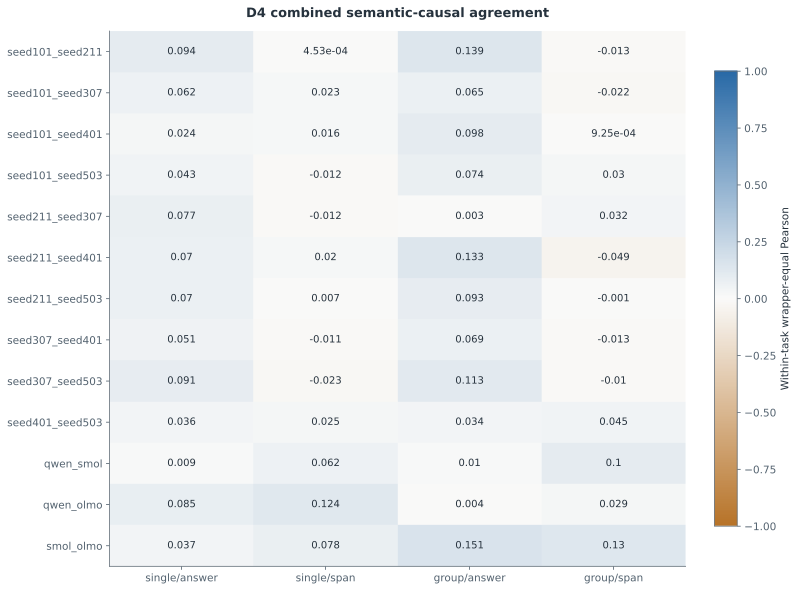
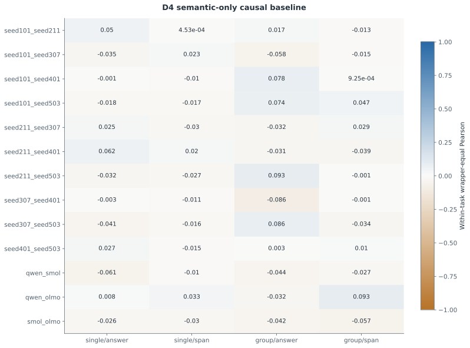
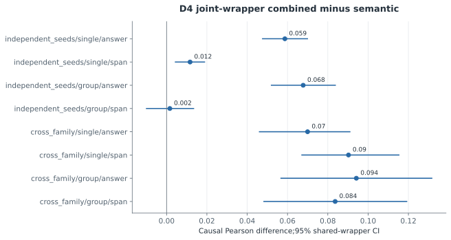
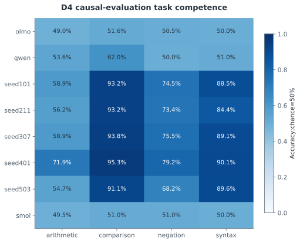
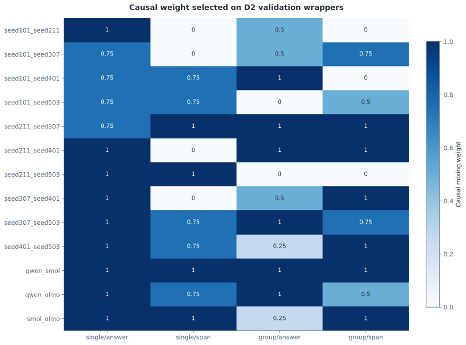
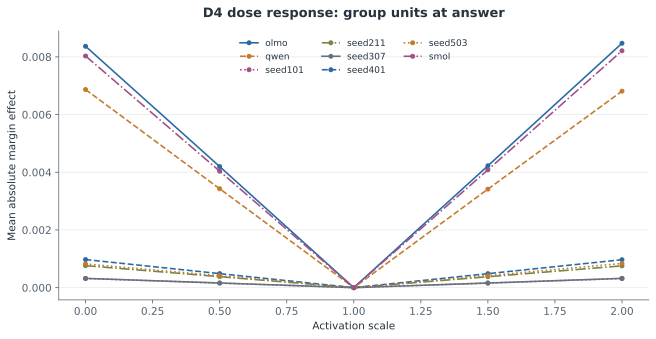
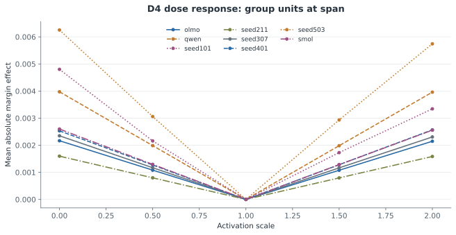
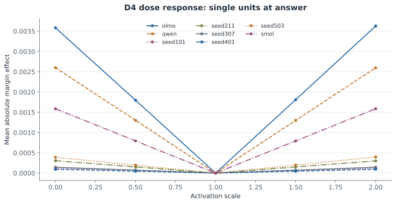
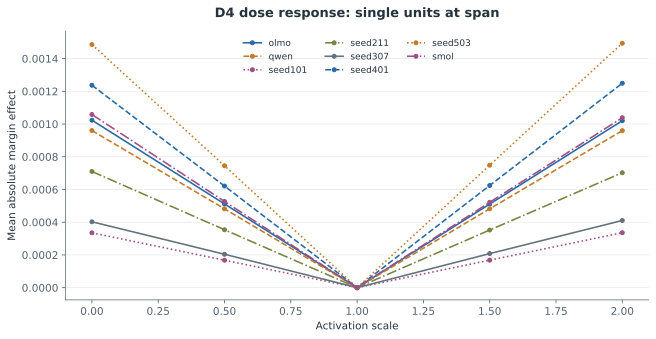

# F4 — 단일·그룹 뉴런 인과 정렬과 dose-response

갱신: 2026-11-04 14:46 KST. 실행 상태: **MEASURED**. 가설 판정: **INCONCLUSIVE**.

연구 질문: 독립 D4에서 의미·인과 결합 정렬이 의미 정렬보다 효과를 더 잘 예측하는가?

등록한 모델쌍·단위 종류26개에서 D4의 zero/mean/patch 인과 효과를 비교했다. 모델쌍×단위종류×과제 셀104개 중 52개가 양쪽 모델의 과제 능력 기준을 충족했다. 단일 뉴런과 그룹을 분리하며 dose-response는 주 정렬과 별도의 기술 진단으로 보존한다. 전역 다중검정과 전체 판정은 F6에서 완료한다. 이종 계열은 같은 목표 문장에도 서로 다른 calibration 선택 접두 맥락을 사용한다. 위치 정렬은 이 맥락 차이를 제거하지 않으며, 낮은 D4 능력에서는 기능 보존의 부재를 판정할 수 없다. 과제별 전체 쌍과 양측 능력 조건을 충족한 쌍의 인과 대응·누락 범위를 별도 기술 표로 공개한다. D4 결과에 따른 부분집합 구분이며 추가 검정이나 재학습이 아니다. 괄호 정확도 gate 통과만으로 재귀적·구조적 이해를 보장하지 않는다. 주 F4의 activation 매칭 대조군 누락은 별도의 사후 보충 분석으로 점검했다. D2에서만 맞춘 raw activation과 task-centered activation을 모두 보존·공개하며, 이 분석을 사전 등록된 주 결과나 새로운 확증 검정으로 취급하지 않는다. 별도 응답 방향 진단에서 이종 계열 answer 위치의 combined 상관은 truth → yes → within-label 순서로 single 0.04353 → 0.00030 → -0.00013, group 0.05507 → 0.00070 → 0.00830였다. 유효 셀 범위가 달라질 수 있는 탐색적 진단이며 응답 방향 혼입 가능성을 점검한다. 낮은 과제 능력과 함께 읽어야 하며 혼입의 유일한 원인을 입증하지 않는다.

## 과제 능력 조건

{
  "rule": "Both models accuracy>=0.70 and Wilson95 lower>0.50 on D4",
  "passed_pair_kind_task_cells": 52,
  "total_pair_kind_task_cells": 104,
  "role": "Reporting strata only; never refit or select mappings using D4"
}

## 실제 측정

| 지표 | 조건·방법 | 측정값 | CI | 단위 | n / 군집 |
|---|---|---:|---|---|---|
| D4 causal agreement | seed101_seed211 / single/answer/semantic / D4 | 0.0497 | 미측정 | Pearson | 24 |
| D4 causal agreement | seed101_seed211 / single/answer/causal / D4 | 0.094 | 미측정 | Pearson | 24 |
| D4 causal agreement | seed101_seed211 / single/answer/combined / D4 | 0.094 | 미측정 | Pearson | 24 |
| D4 causal agreement | seed101_seed211 / single/answer/random / D4 | 0.0332 | 미측정 | Pearson | 24 |
| D4 causal agreement | seed101_seed211 / single/span/semantic / D4 | 0.0005 | 미측정 | Pearson | 24 |
| D4 causal agreement | seed101_seed211 / single/span/causal / D4 | -0.0074 | 미측정 | Pearson | 24 |
| D4 causal agreement | seed101_seed211 / single/span/combined / D4 | 0.0005 | 미측정 | Pearson | 24 |
| D4 causal agreement | seed101_seed211 / single/span/random / D4 | -0.001 | 미측정 | Pearson | 24 |
| D4 causal agreement | seed101_seed211 / group/answer/semantic / D4 | 0.017 | 미측정 | Pearson | 24 |
| D4 causal agreement | seed101_seed211 / group/answer/causal / D4 | 0.1389 | 미측정 | Pearson | 24 |
| D4 causal agreement | seed101_seed211 / group/answer/combined / D4 | 0.1389 | 미측정 | Pearson | 24 |
| D4 causal agreement | seed101_seed211 / group/answer/random / D4 | 0.0699 | 미측정 | Pearson | 24 |
| D4 causal agreement | seed101_seed211 / group/span/semantic / D4 | -0.0131 | 미측정 | Pearson | 24 |
| D4 causal agreement | seed101_seed211 / group/span/causal / D4 | -0.0488 | 미측정 | Pearson | 24 |
| D4 causal agreement | seed101_seed211 / group/span/combined / D4 | -0.0131 | 미측정 | Pearson | 24 |
| D4 causal agreement | seed101_seed211 / group/span/random / D4 | -0.0031 | 미측정 | Pearson | 24 |
| D4 causal agreement | seed101_seed307 / single/answer/semantic / D4 | -0.0349 | 미측정 | Pearson | 24 |
| D4 causal agreement | seed101_seed307 / single/answer/causal / D4 | 0.0235 | 미측정 | Pearson | 24 |
| D4 causal agreement | seed101_seed307 / single/answer/combined / D4 | 0.0624 | 미측정 | Pearson | 24 |
| D4 causal agreement | seed101_seed307 / single/answer/random / D4 | 0.0014 | 미측정 | Pearson | 24 |
| D4 causal agreement | seed101_seed307 / single/span/semantic / D4 | 0.0226 | 미측정 | Pearson | 24 |
| D4 causal agreement | seed101_seed307 / single/span/causal / D4 | 0.0157 | 미측정 | Pearson | 24 |
| D4 causal agreement | seed101_seed307 / single/span/combined / D4 | 0.0226 | 미측정 | Pearson | 24 |
| D4 causal agreement | seed101_seed307 / single/span/random / D4 | 0.0069 | 미측정 | Pearson | 24 |
| D4 causal agreement | seed101_seed307 / group/answer/semantic / D4 | -0.0581 | 미측정 | Pearson | 24 |
| D4 causal agreement | seed101_seed307 / group/answer/causal / D4 | 0.0242 | 미측정 | Pearson | 24 |
| D4 causal agreement | seed101_seed307 / group/answer/combined / D4 | 0.0654 | 미측정 | Pearson | 24 |
| D4 causal agreement | seed101_seed307 / group/answer/random / D4 | -0.0047 | 미측정 | Pearson | 24 |
| D4 causal agreement | seed101_seed307 / group/span/semantic / D4 | -0.0149 | 미측정 | Pearson | 24 |
| D4 causal agreement | seed101_seed307 / group/span/causal / D4 | -0.0247 | 미측정 | Pearson | 24 |
| D4 causal agreement | seed101_seed307 / group/span/combined / D4 | -0.0225 | 미측정 | Pearson | 24 |
| D4 causal agreement | seed101_seed307 / group/span/random / D4 | 0.0033 | 미측정 | Pearson | 24 |
| D4 causal agreement | seed101_seed401 / single/answer/semantic / D4 | -0.0011 | 미측정 | Pearson | 24 |
| D4 causal agreement | seed101_seed401 / single/answer/causal / D4 | 0.0275 | 미측정 | Pearson | 24 |
| D4 causal agreement | seed101_seed401 / single/answer/combined / D4 | 0.0244 | 미측정 | Pearson | 24 |
| D4 causal agreement | seed101_seed401 / single/answer/random / D4 | -0.0102 | 미측정 | Pearson | 24 |
| D4 causal agreement | seed101_seed401 / single/span/semantic / D4 | -0.0103 | 미측정 | Pearson | 24 |
| D4 causal agreement | seed101_seed401 / single/span/causal / D4 | 0.0099 | 미측정 | Pearson | 24 |
| D4 causal agreement | seed101_seed401 / single/span/combined / D4 | 0.0161 | 미측정 | Pearson | 24 |
| D4 causal agreement | seed101_seed401 / single/span/random / D4 | 0.0046 | 미측정 | Pearson | 24 |
| D4 causal agreement | seed101_seed401 / group/answer/semantic / D4 | 0.0784 | 미측정 | Pearson | 24 |
| D4 causal agreement | seed101_seed401 / group/answer/causal / D4 | 0.0981 | 미측정 | Pearson | 24 |
| D4 causal agreement | seed101_seed401 / group/answer/combined / D4 | 0.0981 | 미측정 | Pearson | 24 |
| D4 causal agreement | seed101_seed401 / group/answer/random / D4 | 0.0499 | 미측정 | Pearson | 24 |
| D4 causal agreement | seed101_seed401 / group/span/semantic / D4 | 0.0009 | 미측정 | Pearson | 24 |
| D4 causal agreement | seed101_seed401 / group/span/causal / D4 | 0.0101 | 미측정 | Pearson | 24 |
| D4 causal agreement | seed101_seed401 / group/span/combined / D4 | 0.0009 | 미측정 | Pearson | 24 |
| D4 causal agreement | seed101_seed401 / group/span/random / D4 | 0.0012 | 미측정 | Pearson | 24 |
| D4 causal agreement | seed101_seed503 / single/answer/semantic / D4 | -0.0179 | 미측정 | Pearson | 24 |
| D4 causal agreement | seed101_seed503 / single/answer/causal / D4 | 0.0495 | 미측정 | Pearson | 24 |
| D4 causal agreement | seed101_seed503 / single/answer/combined / D4 | 0.0435 | 미측정 | Pearson | 24 |
| D4 causal agreement | seed101_seed503 / single/answer/random / D4 | -0.0046 | 미측정 | Pearson | 24 |
| D4 causal agreement | seed101_seed503 / single/span/semantic / D4 | -0.017 | 미측정 | Pearson | 24 |
| D4 causal agreement | seed101_seed503 / single/span/causal / D4 | -0.0039 | 미측정 | Pearson | 24 |
| D4 causal agreement | seed101_seed503 / single/span/combined / D4 | -0.0124 | 미측정 | Pearson | 24 |
| D4 causal agreement | seed101_seed503 / single/span/random / D4 | -0.0027 | 미측정 | Pearson | 24 |
| D4 causal agreement | seed101_seed503 / group/answer/semantic / D4 | 0.0739 | 미측정 | Pearson | 24 |
| D4 causal agreement | seed101_seed503 / group/answer/causal / D4 | 0.0566 | 미측정 | Pearson | 24 |
| D4 causal agreement | seed101_seed503 / group/answer/combined / D4 | 0.0739 | 미측정 | Pearson | 24 |
| D4 causal agreement | seed101_seed503 / group/answer/random / D4 | 0.0415 | 미측정 | Pearson | 24 |
| D4 causal agreement | seed101_seed503 / group/span/semantic / D4 | 0.0465 | 미측정 | Pearson | 24 |
| D4 causal agreement | seed101_seed503 / group/span/causal / D4 | 0.0036 | 미측정 | Pearson | 24 |
| D4 causal agreement | seed101_seed503 / group/span/combined / D4 | 0.0298 | 미측정 | Pearson | 24 |
| D4 causal agreement | seed101_seed503 / group/span/random / D4 | 0.0164 | 미측정 | Pearson | 24 |
| D4 causal agreement | seed211_seed307 / single/answer/semantic / D4 | 0.0251 | 미측정 | Pearson | 24 |
| D4 causal agreement | seed211_seed307 / single/answer/causal / D4 | 0.0776 | 미측정 | Pearson | 24 |
| D4 causal agreement | seed211_seed307 / single/answer/combined / D4 | 0.0774 | 미측정 | Pearson | 24 |
| D4 causal agreement | seed211_seed307 / single/answer/random / D4 | -0.005 | 미측정 | Pearson | 24 |
| D4 causal agreement | seed211_seed307 / single/span/semantic / D4 | -0.0299 | 미측정 | Pearson | 24 |
| D4 causal agreement | seed211_seed307 / single/span/causal / D4 | -0.0115 | 미측정 | Pearson | 24 |
| D4 causal agreement | seed211_seed307 / single/span/combined / D4 | -0.0115 | 미측정 | Pearson | 24 |
| D4 causal agreement | seed211_seed307 / single/span/random / D4 | -0.0056 | 미측정 | Pearson | 24 |
| D4 causal agreement | seed211_seed307 / group/answer/semantic / D4 | -0.032 | 미측정 | Pearson | 24 |
| D4 causal agreement | seed211_seed307 / group/answer/causal / D4 | 0.0031 | 미측정 | Pearson | 24 |
| D4 causal agreement | seed211_seed307 / group/answer/combined / D4 | 0.0031 | 미측정 | Pearson | 24 |
| D4 causal agreement | seed211_seed307 / group/answer/random / D4 | -0.0221 | 미측정 | Pearson | 24 |
| D4 causal agreement | seed211_seed307 / group/span/semantic / D4 | 0.0291 | 미측정 | Pearson | 24 |
| D4 causal agreement | seed211_seed307 / group/span/causal / D4 | 0.032 | 미측정 | Pearson | 24 |
| D4 causal agreement | seed211_seed307 / group/span/combined / D4 | 0.032 | 미측정 | Pearson | 24 |
| D4 causal agreement | seed211_seed307 / group/span/random / D4 | -0.0054 | 미측정 | Pearson | 24 |
| D4 causal agreement | seed211_seed401 / single/answer/semantic / D4 | 0.0621 | 미측정 | Pearson | 24 |
| D4 causal agreement | seed211_seed401 / single/answer/causal / D4 | 0.0699 | 미측정 | Pearson | 24 |
| D4 causal agreement | seed211_seed401 / single/answer/combined / D4 | 0.0699 | 미측정 | Pearson | 24 |
| D4 causal agreement | seed211_seed401 / single/answer/random / D4 | -0.0053 | 미측정 | Pearson | 24 |
| D4 causal agreement | seed211_seed401 / single/span/semantic / D4 | 0.0204 | 미측정 | Pearson | 24 |
| D4 causal agreement | seed211_seed401 / single/span/causal / D4 | 0.0072 | 미측정 | Pearson | 24 |
| D4 causal agreement | seed211_seed401 / single/span/combined / D4 | 0.0204 | 미측정 | Pearson | 24 |
| D4 causal agreement | seed211_seed401 / single/span/random / D4 | 0.0062 | 미측정 | Pearson | 24 |
| D4 causal agreement | seed211_seed401 / group/answer/semantic / D4 | -0.0314 | 미측정 | Pearson | 24 |
| D4 causal agreement | seed211_seed401 / group/answer/causal / D4 | 0.1331 | 미측정 | Pearson | 24 |
| D4 causal agreement | seed211_seed401 / group/answer/combined / D4 | 0.1331 | 미측정 | Pearson | 24 |
| D4 causal agreement | seed211_seed401 / group/answer/random / D4 | 0.0183 | 미측정 | Pearson | 24 |
| D4 causal agreement | seed211_seed401 / group/span/semantic / D4 | -0.039 | 미측정 | Pearson | 24 |
| D4 causal agreement | seed211_seed401 / group/span/causal / D4 | -0.0487 | 미측정 | Pearson | 24 |
| D4 causal agreement | seed211_seed401 / group/span/combined / D4 | -0.0487 | 미측정 | Pearson | 24 |
| D4 causal agreement | seed211_seed401 / group/span/random / D4 | -0.0158 | 미측정 | Pearson | 24 |
| D4 causal agreement | seed211_seed503 / single/answer/semantic / D4 | -0.0323 | 미측정 | Pearson | 24 |
| D4 causal agreement | seed211_seed503 / single/answer/causal / D4 | 0.07 | 미측정 | Pearson | 24 |
| D4 causal agreement | seed211_seed503 / single/answer/combined / D4 | 0.07 | 미측정 | Pearson | 24 |
| D4 causal agreement | seed211_seed503 / single/answer/random / D4 | -0.0142 | 미측정 | Pearson | 24 |
| D4 causal agreement | seed211_seed503 / single/span/semantic / D4 | -0.027 | 미측정 | Pearson | 24 |
| D4 causal agreement | seed211_seed503 / single/span/causal / D4 | 0.0065 | 미측정 | Pearson | 24 |
| D4 causal agreement | seed211_seed503 / single/span/combined / D4 | 0.0065 | 미측정 | Pearson | 24 |
| D4 causal agreement | seed211_seed503 / single/span/random / D4 | -0.004 | 미측정 | Pearson | 24 |
| D4 causal agreement | seed211_seed503 / group/answer/semantic / D4 | 0.0935 | 미측정 | Pearson | 24 |
| D4 causal agreement | seed211_seed503 / group/answer/causal / D4 | 0.1083 | 미측정 | Pearson | 24 |
| D4 causal agreement | seed211_seed503 / group/answer/combined / D4 | 0.0935 | 미측정 | Pearson | 24 |
| D4 causal agreement | seed211_seed503 / group/answer/random / D4 | -0.0183 | 미측정 | Pearson | 24 |
| D4 causal agreement | seed211_seed503 / group/span/semantic / D4 | -0.0015 | 미측정 | Pearson | 24 |
| D4 causal agreement | seed211_seed503 / group/span/causal / D4 | 0.0537 | 미측정 | Pearson | 24 |
| D4 causal agreement | seed211_seed503 / group/span/combined / D4 | -0.0015 | 미측정 | Pearson | 24 |
| D4 causal agreement | seed211_seed503 / group/span/random / D4 | 0.0089 | 미측정 | Pearson | 24 |
| D4 causal agreement | seed307_seed401 / single/answer/semantic / D4 | -0.0034 | 미측정 | Pearson | 24 |
| D4 causal agreement | seed307_seed401 / single/answer/causal / D4 | 0.0511 | 미측정 | Pearson | 24 |
| D4 causal agreement | seed307_seed401 / single/answer/combined / D4 | 0.0511 | 미측정 | Pearson | 24 |
| D4 causal agreement | seed307_seed401 / single/answer/random / D4 | -0.0046 | 미측정 | Pearson | 24 |
| D4 causal agreement | seed307_seed401 / single/span/semantic / D4 | -0.0109 | 미측정 | Pearson | 24 |
| D4 causal agreement | seed307_seed401 / single/span/causal / D4 | 0.0287 | 미측정 | Pearson | 24 |
| D4 causal agreement | seed307_seed401 / single/span/combined / D4 | -0.0109 | 미측정 | Pearson | 24 |
| D4 causal agreement | seed307_seed401 / single/span/random / D4 | 7.25e-05 | 미측정 | Pearson | 24 |
| D4 causal agreement | seed307_seed401 / group/answer/semantic / D4 | -0.086 | 미측정 | Pearson | 24 |
| D4 causal agreement | seed307_seed401 / group/answer/causal / D4 | 0.0686 | 미측정 | Pearson | 24 |
| D4 causal agreement | seed307_seed401 / group/answer/combined / D4 | 0.0686 | 미측정 | Pearson | 24 |
| D4 causal agreement | seed307_seed401 / group/answer/random / D4 | -0.0046 | 미측정 | Pearson | 24 |
| D4 causal agreement | seed307_seed401 / group/span/semantic / D4 | -0.0013 | 미측정 | Pearson | 24 |
| D4 causal agreement | seed307_seed401 / group/span/causal / D4 | -0.013 | 미측정 | Pearson | 24 |
| D4 causal agreement | seed307_seed401 / group/span/combined / D4 | -0.013 | 미측정 | Pearson | 24 |
| D4 causal agreement | seed307_seed401 / group/span/random / D4 | 0.0009 | 미측정 | Pearson | 24 |
| D4 causal agreement | seed307_seed503 / single/answer/semantic / D4 | -0.0411 | 미측정 | Pearson | 24 |
| D4 causal agreement | seed307_seed503 / single/answer/causal / D4 | 0.0911 | 미측정 | Pearson | 24 |
| D4 causal agreement | seed307_seed503 / single/answer/combined / D4 | 0.0911 | 미측정 | Pearson | 24 |
| D4 causal agreement | seed307_seed503 / single/answer/random / D4 | 0.0048 | 미측정 | Pearson | 24 |
| D4 causal agreement | seed307_seed503 / single/span/semantic / D4 | -0.0163 | 미측정 | Pearson | 24 |
| D4 causal agreement | seed307_seed503 / single/span/causal / D4 | 0.007 | 미측정 | Pearson | 24 |
| D4 causal agreement | seed307_seed503 / single/span/combined / D4 | -0.0229 | 미측정 | Pearson | 24 |
| D4 causal agreement | seed307_seed503 / single/span/random / D4 | -0.0064 | 미측정 | Pearson | 24 |
| D4 causal agreement | seed307_seed503 / group/answer/semantic / D4 | 0.0858 | 미측정 | Pearson | 24 |
| D4 causal agreement | seed307_seed503 / group/answer/causal / D4 | 0.1132 | 미측정 | Pearson | 24 |
| D4 causal agreement | seed307_seed503 / group/answer/combined / D4 | 0.1132 | 미측정 | Pearson | 24 |
| D4 causal agreement | seed307_seed503 / group/answer/random / D4 | 0.0163 | 미측정 | Pearson | 24 |
| D4 causal agreement | seed307_seed503 / group/span/semantic / D4 | -0.0335 | 미측정 | Pearson | 24 |
| D4 causal agreement | seed307_seed503 / group/span/causal / D4 | -0.0245 | 미측정 | Pearson | 24 |
| D4 causal agreement | seed307_seed503 / group/span/combined / D4 | -0.0104 | 미측정 | Pearson | 24 |
| D4 causal agreement | seed307_seed503 / group/span/random / D4 | -0.0039 | 미측정 | Pearson | 24 |
| D4 causal agreement | seed401_seed503 / single/answer/semantic / D4 | 0.0267 | 미측정 | Pearson | 24 |
| D4 causal agreement | seed401_seed503 / single/answer/causal / D4 | 0.0362 | 미측정 | Pearson | 24 |
| D4 causal agreement | seed401_seed503 / single/answer/combined / D4 | 0.0362 | 미측정 | Pearson | 24 |
| D4 causal agreement | seed401_seed503 / single/answer/random / D4 | 0.0008 | 미측정 | Pearson | 24 |
| D4 causal agreement | seed401_seed503 / single/span/semantic / D4 | -0.0149 | 미측정 | Pearson | 24 |
| D4 causal agreement | seed401_seed503 / single/span/causal / D4 | 0.021 | 미측정 | Pearson | 24 |
| D4 causal agreement | seed401_seed503 / single/span/combined / D4 | 0.0253 | 미측정 | Pearson | 24 |
| D4 causal agreement | seed401_seed503 / single/span/random / D4 | -0.0002 | 미측정 | Pearson | 24 |
| D4 causal agreement | seed401_seed503 / group/answer/semantic / D4 | 0.0029 | 미측정 | Pearson | 24 |
| D4 causal agreement | seed401_seed503 / group/answer/causal / D4 | 0.0698 | 미측정 | Pearson | 24 |
| D4 causal agreement | seed401_seed503 / group/answer/combined / D4 | 0.0341 | 미측정 | Pearson | 24 |
| D4 causal agreement | seed401_seed503 / group/answer/random / D4 | 0.0161 | 미측정 | Pearson | 24 |
| D4 causal agreement | seed401_seed503 / group/span/semantic / D4 | 0.0096 | 미측정 | Pearson | 24 |
| D4 causal agreement | seed401_seed503 / group/span/causal / D4 | 0.0455 | 미측정 | Pearson | 24 |
| D4 causal agreement | seed401_seed503 / group/span/combined / D4 | 0.0455 | 미측정 | Pearson | 24 |
| D4 causal agreement | seed401_seed503 / group/span/random / D4 | 0.0116 | 미측정 | Pearson | 24 |
| D4 causal agreement | qwen_smol / single/answer/semantic / D4 | -0.0611 | 미측정 | Pearson | 24 |
| D4 causal agreement | qwen_smol / single/answer/causal / D4 | 0.0089 | 미측정 | Pearson | 24 |
| D4 causal agreement | qwen_smol / single/answer/combined / D4 | 0.0089 | 미측정 | Pearson | 24 |
| D4 causal agreement | qwen_smol / single/answer/random / D4 | 0.0055 | 미측정 | Pearson | 24 |
| D4 causal agreement | qwen_smol / single/span/semantic / D4 | -0.0101 | 미측정 | Pearson | 24 |
| D4 causal agreement | qwen_smol / single/span/causal / D4 | 0.0618 | 미측정 | Pearson | 24 |
| D4 causal agreement | qwen_smol / single/span/combined / D4 | 0.0618 | 미측정 | Pearson | 24 |
| D4 causal agreement | qwen_smol / single/span/random / D4 | -0.0041 | 미측정 | Pearson | 24 |
| D4 causal agreement | qwen_smol / group/answer/semantic / D4 | -0.0437 | 미측정 | Pearson | 24 |
| D4 causal agreement | qwen_smol / group/answer/causal / D4 | 0.0099 | 미측정 | Pearson | 24 |
| D4 causal agreement | qwen_smol / group/answer/combined / D4 | 0.0099 | 미측정 | Pearson | 24 |
| D4 causal agreement | qwen_smol / group/answer/random / D4 | -0.0371 | 미측정 | Pearson | 24 |
| D4 causal agreement | qwen_smol / group/span/semantic / D4 | -0.0271 | 미측정 | Pearson | 24 |
| D4 causal agreement | qwen_smol / group/span/causal / D4 | 0.0999 | 미측정 | Pearson | 24 |
| D4 causal agreement | qwen_smol / group/span/combined / D4 | 0.0999 | 미측정 | Pearson | 24 |
| D4 causal agreement | qwen_smol / group/span/random / D4 | 0.0137 | 미측정 | Pearson | 24 |
| D4 causal agreement | qwen_olmo / single/answer/semantic / D4 | 0.0081 | 미측정 | Pearson | 24 |
| D4 causal agreement | qwen_olmo / single/answer/causal / D4 | 0.085 | 미측정 | Pearson | 24 |
| D4 causal agreement | qwen_olmo / single/answer/combined / D4 | 0.085 | 미측정 | Pearson | 24 |
| D4 causal agreement | qwen_olmo / single/answer/random / D4 | -0.0076 | 미측정 | Pearson | 24 |
| D4 causal agreement | qwen_olmo / single/span/semantic / D4 | 0.0332 | 미측정 | Pearson | 24 |
| D4 causal agreement | qwen_olmo / single/span/causal / D4 | 0.1243 | 미측정 | Pearson | 24 |
| D4 causal agreement | qwen_olmo / single/span/combined / D4 | 0.1243 | 미측정 | Pearson | 24 |
| D4 causal agreement | qwen_olmo / single/span/random / D4 | 0.0068 | 미측정 | Pearson | 24 |
| D4 causal agreement | qwen_olmo / group/answer/semantic / D4 | -0.0319 | 미측정 | Pearson | 24 |
| D4 causal agreement | qwen_olmo / group/answer/causal / D4 | 0.0041 | 미측정 | Pearson | 24 |
| D4 causal agreement | qwen_olmo / group/answer/combined / D4 | 0.0041 | 미측정 | Pearson | 24 |
| D4 causal agreement | qwen_olmo / group/answer/random / D4 | -0.0106 | 미측정 | Pearson | 24 |
| D4 causal agreement | qwen_olmo / group/span/semantic / D4 | 0.0925 | 미측정 | Pearson | 24 |
| D4 causal agreement | qwen_olmo / group/span/causal / D4 | 0.0292 | 미측정 | Pearson | 24 |
| D4 causal agreement | qwen_olmo / group/span/combined / D4 | 0.0292 | 미측정 | Pearson | 24 |
| D4 causal agreement | qwen_olmo / group/span/random / D4 | 0.012 | 미측정 | Pearson | 24 |
| D4 causal agreement | smol_olmo / single/answer/semantic / D4 | -0.0263 | 미측정 | Pearson | 24 |
| D4 causal agreement | smol_olmo / single/answer/causal / D4 | 0.0367 | 미측정 | Pearson | 24 |
| D4 causal agreement | smol_olmo / single/answer/combined / D4 | 0.0367 | 미측정 | Pearson | 24 |
| D4 causal agreement | smol_olmo / single/answer/random / D4 | 0.0006 | 미측정 | Pearson | 24 |
| D4 causal agreement | smol_olmo / single/span/semantic / D4 | -0.0299 | 미측정 | Pearson | 24 |
| D4 causal agreement | smol_olmo / single/span/causal / D4 | 0.0779 | 미측정 | Pearson | 24 |
| D4 causal agreement | smol_olmo / single/span/combined / D4 | 0.0779 | 미측정 | Pearson | 24 |
| D4 causal agreement | smol_olmo / single/span/random / D4 | -0.0054 | 미측정 | Pearson | 24 |
| D4 causal agreement | smol_olmo / group/answer/semantic / D4 | -0.0417 | 미측정 | Pearson | 24 |
| D4 causal agreement | smol_olmo / group/answer/causal / D4 | 0.119 | 미측정 | Pearson | 24 |
| D4 causal agreement | smol_olmo / group/answer/combined / D4 | 0.1512 | 미측정 | Pearson | 24 |
| D4 causal agreement | smol_olmo / group/answer/random / D4 | 0.0114 | 미측정 | Pearson | 24 |
| D4 causal agreement | smol_olmo / group/span/semantic / D4 | -0.057 | 미측정 | Pearson | 24 |
| D4 causal agreement | smol_olmo / group/span/causal / D4 | 0.1303 | 미측정 | Pearson | 24 |
| D4 causal agreement | smol_olmo / group/span/combined / D4 | 0.1303 | 미측정 | Pearson | 24 |
| D4 causal agreement | smol_olmo / group/span/random / D4 | -0.0263 | 미측정 | Pearson | 24 |
| Identity scale1 maximum effect | olmo / group | 0 | 미측정 | log-likelihood margin |  |
| Zero vs scale0 maximum discrepancy | olmo / group | 0 | 미측정 | log-likelihood margin |  |
| Identity scale1 maximum effect | olmo / single | 0 | 미측정 | log-likelihood margin |  |
| Zero vs scale0 maximum discrepancy | olmo / single | 0 | 미측정 | log-likelihood margin |  |
| Identity scale1 maximum effect | qwen / group | 0 | 미측정 | log-likelihood margin |  |
| Zero vs scale0 maximum discrepancy | qwen / group | 0 | 미측정 | log-likelihood margin |  |
| Identity scale1 maximum effect | qwen / single | 0 | 미측정 | log-likelihood margin |  |
| Zero vs scale0 maximum discrepancy | qwen / single | 0 | 미측정 | log-likelihood margin |  |
| Identity scale1 maximum effect | seed101 / group | 0 | 미측정 | log-likelihood margin |  |
| Zero vs scale0 maximum discrepancy | seed101 / group | 0 | 미측정 | log-likelihood margin |  |
| Identity scale1 maximum effect | seed101 / single | 0 | 미측정 | log-likelihood margin |  |
| Zero vs scale0 maximum discrepancy | seed101 / single | 0 | 미측정 | log-likelihood margin |  |
| Identity scale1 maximum effect | seed211 / group | 0 | 미측정 | log-likelihood margin |  |
| Zero vs scale0 maximum discrepancy | seed211 / group | 0 | 미측정 | log-likelihood margin |  |
| Identity scale1 maximum effect | seed211 / single | 0 | 미측정 | log-likelihood margin |  |
| Zero vs scale0 maximum discrepancy | seed211 / single | 0 | 미측정 | log-likelihood margin |  |
| Identity scale1 maximum effect | seed307 / group | 0 | 미측정 | log-likelihood margin |  |
| Zero vs scale0 maximum discrepancy | seed307 / group | 0 | 미측정 | log-likelihood margin |  |
| Identity scale1 maximum effect | seed307 / single | 0 | 미측정 | log-likelihood margin |  |
| Zero vs scale0 maximum discrepancy | seed307 / single | 0 | 미측정 | log-likelihood margin |  |
| Identity scale1 maximum effect | seed401 / group | 0 | 미측정 | log-likelihood margin |  |
| Zero vs scale0 maximum discrepancy | seed401 / group | 0 | 미측정 | log-likelihood margin |  |
| Identity scale1 maximum effect | seed401 / single | 0 | 미측정 | log-likelihood margin |  |
| Zero vs scale0 maximum discrepancy | seed401 / single | 0 | 미측정 | log-likelihood margin |  |
| Identity scale1 maximum effect | seed503 / group | 0 | 미측정 | log-likelihood margin |  |
| Zero vs scale0 maximum discrepancy | seed503 / group | 0 | 미측정 | log-likelihood margin |  |
| Identity scale1 maximum effect | seed503 / single | 0 | 미측정 | log-likelihood margin |  |
| Zero vs scale0 maximum discrepancy | seed503 / single | 0 | 미측정 | log-likelihood margin |  |
| Identity scale1 maximum effect | smol / group | 0 | 미측정 | log-likelihood margin |  |
| Zero vs scale0 maximum discrepancy | smol / group | 0 | 미측정 | log-likelihood margin |  |
| Identity scale1 maximum effect | smol / single | 0 | 미측정 | log-likelihood margin |  |
| Zero vs scale0 maximum discrepancy | smol / single | 0 | 미측정 | log-likelihood margin |  |

## 비교와 불확실성

| 비교 | Δ | CI | p | q | 보정 범위 |
|---|---:|---|---:|---:|---|
| F4/seed101_seed211/answer/single/combined_minus_semantic | 0.0443 | [0.0205, 0.0697] | 0.0015 | 미측정 | Predeclared F4 family member; global BH pending F6 |
| F4/seed101_seed211/span/single/combined_minus_semantic | 0 | [0, 0] | 1 | 미측정 | Predeclared F4 family member; global BH pending F6 |
| F4/seed101_seed211/answer/group/combined_minus_semantic | 0.1219 | [0.0776, 0.1652] | 1.00e-04 | 미측정 | Predeclared F4 family member; global BH pending F6 |
| F4/seed101_seed211/span/group/combined_minus_semantic | 0 | [0, 0] | 1 | 미측정 | Predeclared F4 family member; global BH pending F6 |
| F4/seed101_seed307/answer/single/combined_minus_semantic | 0.0973 | [0.0617, 0.1341] | 1.00e-04 | 미측정 | Predeclared F4 family member; global BH pending F6 |
| F4/seed101_seed307/span/single/combined_minus_semantic | 0 | [0, 0] | 1 | 미측정 | Predeclared F4 family member; global BH pending F6 |
| F4/seed101_seed307/answer/group/combined_minus_semantic | 0.1235 | [0.0856, 0.1624] | 5.00e-05 | 미측정 | Predeclared F4 family member; global BH pending F6 |
| F4/seed101_seed307/span/group/combined_minus_semantic | -0.0076 | [-0.0387, 0.0251] | 0.6435 | 미측정 | Predeclared F4 family member; global BH pending F6 |
| F4/seed101_seed401/answer/single/combined_minus_semantic | 0.0255 | [0.0094, 0.0417] | 0.0079 | 미측정 | Predeclared F4 family member; global BH pending F6 |
| F4/seed101_seed401/span/single/combined_minus_semantic | 0.0264 | [0.0109, 0.042] | 0.0044 | 미측정 | Predeclared F4 family member; global BH pending F6 |
| F4/seed101_seed401/answer/group/combined_minus_semantic | 0.0196 | [-0.0171, 0.0538] | 0.2893 | 미측정 | Predeclared F4 family member; global BH pending F6 |
| F4/seed101_seed401/span/group/combined_minus_semantic | 0 | [0, 0] | 1 | 미측정 | Predeclared F4 family member; global BH pending F6 |
| F4/seed101_seed503/answer/single/combined_minus_semantic | 0.0614 | [0.0303, 0.0902] | 0.0011 | 미측정 | Predeclared F4 family member; global BH pending F6 |
| F4/seed101_seed503/span/single/combined_minus_semantic | 0.0046 | [-0.0209, 0.0314] | 0.7338 | 미측정 | Predeclared F4 family member; global BH pending F6 |
| F4/seed101_seed503/answer/group/combined_minus_semantic | 0 | [0, 0] | 1 | 미측정 | Predeclared F4 family member; global BH pending F6 |
| F4/seed101_seed503/span/group/combined_minus_semantic | -0.0167 | [-0.0641, 0.0356] | 0.5218 | 미측정 | Predeclared F4 family member; global BH pending F6 |
| F4/seed211_seed307/answer/single/combined_minus_semantic | 0.0523 | [0.0315, 0.0744] | 0.0001 | 미측정 | Predeclared F4 family member; global BH pending F6 |
| F4/seed211_seed307/span/single/combined_minus_semantic | 0.0184 | [-0.0117, 0.0484] | 0.2528 | 미측정 | Predeclared F4 family member; global BH pending F6 |
| F4/seed211_seed307/answer/group/combined_minus_semantic | 0.0351 | [-0.013, 0.0825] | 0.179 | 미측정 | Predeclared F4 family member; global BH pending F6 |
| F4/seed211_seed307/span/group/combined_minus_semantic | 0.0029 | [-0.0436, 0.0517] | 0.9087 | 미측정 | Predeclared F4 family member; global BH pending F6 |
| F4/seed211_seed401/answer/single/combined_minus_semantic | 0.0078 | [-0.0184, 0.0331] | 0.5711 | 미측정 | Predeclared F4 family member; global BH pending F6 |
| F4/seed211_seed401/span/single/combined_minus_semantic | 0 | [0, 0] | 1 | 미측정 | Predeclared F4 family member; global BH pending F6 |
| F4/seed211_seed401/answer/group/combined_minus_semantic | 0.1645 | [0.126, 0.2061] | 5.00e-05 | 미측정 | Predeclared F4 family member; global BH pending F6 |
| F4/seed211_seed401/span/group/combined_minus_semantic | -0.0097 | [-0.0499, 0.028] | 0.6325 | 미측정 | Predeclared F4 family member; global BH pending F6 |
| F4/seed211_seed503/answer/single/combined_minus_semantic | 0.1023 | [0.0742, 0.13] | 5.00e-05 | 미측정 | Predeclared F4 family member; global BH pending F6 |
| F4/seed211_seed503/span/single/combined_minus_semantic | 0.0335 | [-0.0159, 0.0834] | 0.1896 | 미측정 | Predeclared F4 family member; global BH pending F6 |
| F4/seed211_seed503/answer/group/combined_minus_semantic | 0 | [0, 0] | 1 | 미측정 | Predeclared F4 family member; global BH pending F6 |
| F4/seed211_seed503/span/group/combined_minus_semantic | 0 | [0, 0] | 1 | 미측정 | Predeclared F4 family member; global BH pending F6 |
| F4/seed307_seed401/answer/single/combined_minus_semantic | 0.0544 | [0.0332, 0.0765] | 0.0001 | 미측정 | Predeclared F4 family member; global BH pending F6 |
| F4/seed307_seed401/span/single/combined_minus_semantic | 0 | [0, 0] | 1 | 미측정 | Predeclared F4 family member; global BH pending F6 |
| F4/seed307_seed401/answer/group/combined_minus_semantic | 0.1546 | [0.1136, 0.1956] | 5.00e-05 | 미측정 | Predeclared F4 family member; global BH pending F6 |
| F4/seed307_seed401/span/group/combined_minus_semantic | -0.0117 | [-0.0369, 0.0121] | 0.3754 | 미측정 | Predeclared F4 family member; global BH pending F6 |
| F4/seed307_seed503/answer/single/combined_minus_semantic | 0.1321 | [0.1065, 0.1579] | 5.00e-05 | 미측정 | Predeclared F4 family member; global BH pending F6 |
| F4/seed307_seed503/span/single/combined_minus_semantic | -0.0066 | [-0.0346, 0.0232] | 0.6722 | 미측정 | Predeclared F4 family member; global BH pending F6 |
| F4/seed307_seed503/answer/group/combined_minus_semantic | 0.0274 | [-0.0186, 0.075] | 0.2694 | 미측정 | Predeclared F4 family member; global BH pending F6 |
| F4/seed307_seed503/span/group/combined_minus_semantic | 0.0231 | [-0.0332, 0.0844] | 0.473 | 미측정 | Predeclared F4 family member; global BH pending F6 |
| F4/seed401_seed503/answer/single/combined_minus_semantic | 0.0095 | [-0.0172, 0.0362] | 0.5054 | 미측정 | Predeclared F4 family member; global BH pending F6 |
| F4/seed401_seed503/span/single/combined_minus_semantic | 0.0402 | [0.0129, 0.0663] | 0.0078 | 미측정 | Predeclared F4 family member; global BH pending F6 |
| F4/seed401_seed503/answer/group/combined_minus_semantic | 0.0311 | [-0.0017, 0.0673] | 0.098 | 미측정 | Predeclared F4 family member; global BH pending F6 |
| F4/seed401_seed503/span/group/combined_minus_semantic | 0.0359 | [-0.0184, 0.091] | 0.2241 | 미측정 | Predeclared F4 family member; global BH pending F6 |
| F4/qwen_smol/answer/single/combined_minus_semantic | 0.07 | [0.0222, 0.1192] | 0.0116 | 미측정 | Predeclared F4 family member; global BH pending F6 |
| F4/qwen_smol/span/single/combined_minus_semantic | 0.0719 | [0.0365, 0.1077] | 0.001 | 미측정 | Predeclared F4 family member; global BH pending F6 |
| F4/qwen_smol/answer/group/combined_minus_semantic | 0.0536 | [0.004, 0.106] | 0.046 | 미측정 | Predeclared F4 family member; global BH pending F6 |
| F4/qwen_smol/span/group/combined_minus_semantic | 0.1269 | [0.0584, 0.1901] | 0.002 | 미측정 | Predeclared F4 family member; global BH pending F6 |
| F4/qwen_olmo/answer/single/combined_minus_semantic | 0.0769 | [0.0314, 0.127] | 0.0047 | 미측정 | Predeclared F4 family member; global BH pending F6 |
| F4/qwen_olmo/span/single/combined_minus_semantic | 0.0911 | [0.0458, 0.1404] | 0.0016 | 미측정 | Predeclared F4 family member; global BH pending F6 |
| F4/qwen_olmo/answer/group/combined_minus_semantic | 0.036 | [-0.0308, 0.1035] | 0.3141 | 미측정 | Predeclared F4 family member; global BH pending F6 |
| F4/qwen_olmo/span/group/combined_minus_semantic | -0.0633 | [-0.1038, -0.0183] | 0.0095 | 미측정 | Predeclared F4 family member; global BH pending F6 |
| F4/smol_olmo/answer/single/combined_minus_semantic | 0.0629 | [0.0186, 0.1062] | 0.0135 | 미측정 | Predeclared F4 family member; global BH pending F6 |
| F4/smol_olmo/span/single/combined_minus_semantic | 0.1078 | [0.0553, 0.1728] | 0.0002 | 미측정 | Predeclared F4 family member; global BH pending F6 |
| F4/smol_olmo/answer/group/combined_minus_semantic | 0.193 | [0.1405, 0.2436] | 5.00e-05 | 미측정 | Predeclared F4 family member; global BH pending F6 |
| F4/smol_olmo/span/group/combined_minus_semantic | 0.1873 | [0.11, 0.2687] | 1.00e-04 | 미측정 | Predeclared F4 family member; global BH pending F6 |

## 과제별 전체 쌍과 능력 조건을 충족한 쌍

Saved D4 by-task results split into all pairs and pairs passing both operational task gates. Descriptive only: no new confidence intervals, p-values, refits or primary-family changes. Eligibility conditions on D4 outcomes; different subsets and missing-wrapper support must not be treated as a controlled causal comparison. Passing the syntax accuracy gate does not establish recursive or structural understanding.

| Cohort / unit / position | Task | All-pair combined r | Available/all pairs | Eligible combined r | Available/eligible pairs | Eligible wrapper coverage |
|---|---|---:|---:|---:|---:|---:|
| independent_seeds/single/answer | arithmetic | 0.014 | 10/10 | N/A | 0/0 | N/A |
| independent_seeds/single/answer | comparison | 0.0911 | 10/10 | 0.0911 | 10/10 | 1 |
| independent_seeds/single/answer | negation | 0.0117 | 10/10 | 0.0175 | 6/6 | 1 |
| independent_seeds/single/answer | syntax | 0.1312 | 10/10 | 0.1312 | 10/10 | 1 |
| independent_seeds/single/span | arithmetic | 0.0084 | 10/10 | N/A | 0/0 | N/A |
| independent_seeds/single/span | comparison | 0.0099 | 10/10 | 0.0099 | 10/10 | 1 |
| independent_seeds/single/span | negation | -0.0092 | 10/10 | -0.0154 | 6/6 | 1 |
| independent_seeds/single/span | syntax | 0.0044 | 10/10 | 0.0044 | 10/10 | 1 |
| independent_seeds/group/answer | arithmetic | 0.0083 | 10/10 | N/A | 0/0 | N/A |
| independent_seeds/group/answer | comparison | 0.1378 | 10/10 | 0.1378 | 10/10 | 1 |
| independent_seeds/group/answer | negation | 0.029 | 10/10 | 0.04 | 6/6 | 1 |
| independent_seeds/group/answer | syntax | 0.1536 | 10/10 | 0.1536 | 10/10 | 1 |
| independent_seeds/group/span | arithmetic | -0.0062 | 10/10 | N/A | 0/0 | N/A |
| independent_seeds/group/span | comparison | 0.017 | 10/10 | 0.017 | 10/10 | 1 |
| independent_seeds/group/span | negation | -0.023 | 10/10 | -0.0339 | 6/6 | 1 |
| independent_seeds/group/span | syntax | 0.0117 | 10/10 | 0.0117 | 10/10 | 1 |
| cross_family/single/answer | arithmetic | 0.0299 | 3/3 | N/A | 0/0 | N/A |
| cross_family/single/answer | comparison | 0.0553 | 3/3 | N/A | 0/0 | N/A |
| cross_family/single/answer | negation | 0.0349 | 3/3 | N/A | 0/0 | N/A |
| cross_family/single/answer | syntax | 0.0541 | 3/3 | N/A | 0/0 | N/A |
| cross_family/single/span | arithmetic | 0.0206 | 3/3 | N/A | 0/0 | N/A |
| cross_family/single/span | comparison | 0.088 | 3/3 | N/A | 0/0 | N/A |
| cross_family/single/span | negation | 0.1912 | 3/3 | N/A | 0/0 | N/A |
| cross_family/single/span | syntax | 0.0523 | 3/3 | N/A | 0/0 | N/A |
| cross_family/group/answer | arithmetic | 0.0192 | 3/3 | N/A | 0/0 | N/A |
| cross_family/group/answer | comparison | 0.0607 | 3/3 | N/A | 0/0 | N/A |
| cross_family/group/answer | negation | 0.1082 | 3/3 | N/A | 0/0 | N/A |
| cross_family/group/answer | syntax | 0.0322 | 3/3 | N/A | 0/0 | N/A |
| cross_family/group/span | arithmetic | 0.033 | 3/3 | N/A | 0/0 | N/A |
| cross_family/group/span | comparison | 0.0352 | 3/3 | N/A | 0/0 | N/A |
| cross_family/group/span | negation | 0.182 | 3/3 | N/A | 0/0 | N/A |
| cross_family/group/span | syntax | 0.0957 | 3/3 | N/A | 0/0 | N/A |

No eligible pairs or unidentifiable cells remain N/A; zero is not substituted. The linked report contains every semantic/causal/combined/random mean, missing pair count and wrapper support.

[모든 방법과 누락 범위](../../reports/followup-v2/CAUSAL_COMPETENCE.md) · [수치 원본](../../results/followup-v2/causal_alignment/competence_descriptive.json)

## 누락된 activation 기준선의 사후 보충 비교

The primary F4 comparison omitted an activation-based causal matching baseline. This separate gap check was added after some tiny-model D4 outcomes had been observed. Both activation_raw and activation_task_centered maps were fitted only on the first12 D2 wrappers; fitting read no D4 values. Raw activation follows the F3 raw-correlation matching family; task-centered activation is an additional control. Both are retained without selecting a winner. The comparison is descriptive and posthoc: no new p/q/CI, no110-family change, no automatic conservation support. Means equally weight finite observed pair means; missing pair/wrapper coverage must be compared. Shared-model pairs are dependent.

Cells: mean [available/total pairs; valid/possible wrapper cells].

| Cohort / unit / position | Semantic | Combined | Random | Raw activation | Task-centered activation |
|---|---:|---:|---:|---:|---:|
| cross_family/group/answer | -0.0391 [3/3; 72/72] | 0.0551 [3/3; 72/72] | -0.0121 [3/3; 72/72] | -0.021 [3/3; 72/72] | -0.0297 [3/3; 72/72] |
| cross_family/group/span | 0.0028 [3/3; 72/72] | 0.0865 [3/3; 72/72] | -0.0002 [3/3; 72/72] | -0.0568 [3/3; 72/72] | 0.0318 [3/3; 72/72] |
| cross_family/single/answer | -0.0264 [3/3; 72/72] | 0.0435 [3/3; 72/72] | -0.0005 [3/3; 72/72] | -0.0209 [3/3; 72/72] | -0.0277 [3/3; 72/72] |
| cross_family/single/span | -0.0023 [3/3; 72/72] | 0.088 [3/3; 72/72] | -0.0009 [3/3; 72/72] | -0.0035 [3/3; 72/72] | -0.024 [3/3; 72/72] |
| independent_seeds/group/answer | 0.0144 [10/10; 240/240] | 0.0822 [10/10; 240/240] | 0.0162 [10/10; 240/240] | 0.0111 [10/10; 240/240] | 0.0267 [10/10; 240/240] |
| independent_seeds/group/span | -0.0017 [10/10; 240/240] | -0.0001 [10/10; 240/240] | 0.0014 [10/10; 240/240] | 0.0015 [10/10; 240/240] | -0.0095 [10/10; 240/240] |
| independent_seeds/single/answer | 0.0033 [10/10; 240/240] | 0.062 [10/10; 240/240] | -0.0004 [10/10; 240/240] | 0.0114 [10/10; 240/240] | 0.0038 [10/10; 240/240] |
| independent_seeds/single/span | -0.0083 [10/10; 240/240] | 0.0034 [10/10; 240/240] | -0.0002 [10/10; 240/240] | 0.0059 [10/10; 240/240] | -0.0016 [10/10; 240/240] |

[상세 범위와 모든 원본](../../reports/followup-v2/CAUSAL_ACTIVATION_BASELINES.md) · [측정 요약](../../results/followup-v2/supplemental_causal_activation/summary.json)

## 응답 방향에 따른 보조 인과 대응

Same frozen maps and zero/mean/patch effects, viewed as truth-oriented, yes-oriented, and within-label correlations. This is an exploratory answer-bias diagnostic, not a new primary endpoint or refit. Different views can have different identifiable cell support; attenuation is consistent with answer-orientation confounding but does not prove its exclusive cause. Undefined views remain N/A.

| Cohort / unit / position | Truth-oriented | Yes-oriented | Within-label |
|---|---:|---:|---:|
| independent_seeds/single/answer | 0.06199 | 0.02338 | 0.01726 |
| independent_seeds/single/span | 0.00337 | 0.00287 | 0.00105 |
| independent_seeds/group/answer | 0.08218 | 0.05609 | 0.03797 |
| independent_seeds/group/span | -0.0001 | 0.00604 | -0.00434 |
| cross_family/single/answer | 0.04353 | 0.0003 | -0.00013 |
| cross_family/single/span | 0.08802 | 0.01295 | 0.00505 |
| cross_family/group/answer | 0.05507 | 0.0007 | 0.0083 |
| cross_family/group/span | 0.08647 | 0.02531 | 0.01591 |

[모든 방법·유효 셀 범위·원본 경로](../../results/followup-v2/exploratory_causal_diagnostics/summary.json)

Primary evaluation uses zero/mean/patch only. Dose modes are supplementary; no trivial scale=1 identity enters matching.

[그림 수치와 출처](../../artifacts/followup-v2/figures/f4_combined_causal_agreement.json)

[그림 수치와 출처](../../artifacts/followup-v2/figures/f4_semantic_causal_baseline.json)

Observed pairs are retained jointly inside wrappers; global BH is deferred to F6.

[그림 수치와 출처](../../artifacts/followup-v2/figures/f4_combined_minus_semantic.json)

D4 competence is measured separately from D3. Low competence is retained as a control, not interpreted as evidence against an unlearned function.

[그림 수치와 출처](../../artifacts/followup-v2/figures/f4_d4_competence.json)

[그림 수치와 출처](../../artifacts/followup-v2/figures/f4_frozen_causal_weights.json)

Descriptive mean over fixed units and examples; no uncertainty or model-population inference is attached. These dose modes never select the primary matching.

[그림 수치와 출처](../../artifacts/followup-v2/figures/f4_dose_group_answer.json)

Descriptive mean over fixed units and examples; no uncertainty or model-population inference is attached. These dose modes never select the primary matching.

[그림 수치와 출처](../../artifacts/followup-v2/figures/f4_dose_group_span.json)

Descriptive mean over fixed units and examples; no uncertainty or model-population inference is attached. These dose modes never select the primary matching.

[그림 수치와 출처](../../artifacts/followup-v2/figures/f4_dose_single_answer.json)

Descriptive mean over fixed units and examples; no uncertainty or model-population inference is attached. These dose modes never select the primary matching.

[그림 수치와 출처](../../artifacts/followup-v2/figures/f4_dose_single_span.json)

## 해석 한계

- All model pairs sharing a seed are dependent; inference is conditional on the observed model collection.
- Groups contain fixed D1 candidates; the results do not imply full circuit recovery.
- Zero/mean/patch can alter activation distributions; dose response is supplementary.
- Exact-zero or constant effects are not evidence of causal agreement.
- No D4 outcome changes the frozen maps or D2-selected mixing weights.
- Cross-family causal comparisons retain each calibration-selected prompt format: Qwen fourshot, Smol default, OLMo explicit. The same target statements have different prefix contexts. Character-span alignment cannot remove this context confound; conclusions concern calibrated-use conditions, not identical full inputs.
- Pretrained calibration competence is below0.70. D4 competence is evaluated independently; low competence cannot falsify conservation of a function not established in the tested model.
- Saved D4 by-task results split into all pairs and pairs passing both operational task gates. Descriptive only: no new confidence intervals, p-values, refits or primary-family changes. Eligibility conditions on D4 outcomes; different subsets and missing-wrapper support must not be treated as a controlled causal comparison. Passing the syntax accuracy gate does not establish recursive or structural understanding.
- The primary F4 comparison omitted an activation-based causal matching baseline. This separate gap check was added after some tiny-model D4 outcomes had been observed. Both activation_raw and activation_task_centered maps were fitted only on the first12 D2 wrappers; fitting read no D4 values. Raw activation follows the F3 raw-correlation matching family; task-centered activation is an additional control. Both are retained without selecting a winner. The comparison is descriptive and posthoc: no new p/q/CI, no110-family change, no automatic conservation support. Means equally weight finite observed pair means; missing pair/wrapper coverage must be compared. Shared-model pairs are dependent.
- Same frozen maps and zero/mean/patch effects, viewed as truth-oriented, yes-oriented, and within-label correlations. This is an exploratory answer-bias diagnostic, not a new primary endpoint or refit. Different views can have different identifiable cell support; attenuation is consistent with answer-orientation confounding but does not prove its exclusive cause. Undefined views remain N/A.

## 원본과 재현

- [results/followup-v2/stages/F4.json](../../results/followup-v2/stages/F4.json)
- [results/followup-v2/causal_alignment/seed101_seed211/single/eval.json](../../results/followup-v2/causal_alignment/seed101_seed211/single/eval.json)
- [results/followup-v2/causal_alignment/seed101_seed211/group/eval.json](../../results/followup-v2/causal_alignment/seed101_seed211/group/eval.json)
- [results/followup-v2/causal_alignment/seed101_seed307/single/eval.json](../../results/followup-v2/causal_alignment/seed101_seed307/single/eval.json)
- [results/followup-v2/causal_alignment/seed101_seed307/group/eval.json](../../results/followup-v2/causal_alignment/seed101_seed307/group/eval.json)
- [results/followup-v2/causal_alignment/seed101_seed401/single/eval.json](../../results/followup-v2/causal_alignment/seed101_seed401/single/eval.json)
- [results/followup-v2/causal_alignment/seed101_seed401/group/eval.json](../../results/followup-v2/causal_alignment/seed101_seed401/group/eval.json)
- [results/followup-v2/causal_alignment/seed101_seed503/single/eval.json](../../results/followup-v2/causal_alignment/seed101_seed503/single/eval.json)
- [results/followup-v2/causal_alignment/seed101_seed503/group/eval.json](../../results/followup-v2/causal_alignment/seed101_seed503/group/eval.json)
- [results/followup-v2/causal_alignment/seed211_seed307/single/eval.json](../../results/followup-v2/causal_alignment/seed211_seed307/single/eval.json)
- [results/followup-v2/causal_alignment/seed211_seed307/group/eval.json](../../results/followup-v2/causal_alignment/seed211_seed307/group/eval.json)
- [results/followup-v2/causal_alignment/seed211_seed401/single/eval.json](../../results/followup-v2/causal_alignment/seed211_seed401/single/eval.json)
- [results/followup-v2/causal_alignment/seed211_seed401/group/eval.json](../../results/followup-v2/causal_alignment/seed211_seed401/group/eval.json)
- [results/followup-v2/causal_alignment/seed211_seed503/single/eval.json](../../results/followup-v2/causal_alignment/seed211_seed503/single/eval.json)
- [results/followup-v2/causal_alignment/seed211_seed503/group/eval.json](../../results/followup-v2/causal_alignment/seed211_seed503/group/eval.json)
- [results/followup-v2/causal_alignment/seed307_seed401/single/eval.json](../../results/followup-v2/causal_alignment/seed307_seed401/single/eval.json)
- [results/followup-v2/causal_alignment/seed307_seed401/group/eval.json](../../results/followup-v2/causal_alignment/seed307_seed401/group/eval.json)
- [results/followup-v2/causal_alignment/seed307_seed503/single/eval.json](../../results/followup-v2/causal_alignment/seed307_seed503/single/eval.json)
- [results/followup-v2/causal_alignment/seed307_seed503/group/eval.json](../../results/followup-v2/causal_alignment/seed307_seed503/group/eval.json)
- [results/followup-v2/causal_alignment/seed401_seed503/single/eval.json](../../results/followup-v2/causal_alignment/seed401_seed503/single/eval.json)
- [results/followup-v2/causal_alignment/seed401_seed503/group/eval.json](../../results/followup-v2/causal_alignment/seed401_seed503/group/eval.json)
- [results/followup-v2/causal_alignment/qwen_smol/single/eval.json](../../results/followup-v2/causal_alignment/qwen_smol/single/eval.json)
- [results/followup-v2/causal_alignment/qwen_smol/group/eval.json](../../results/followup-v2/causal_alignment/qwen_smol/group/eval.json)
- [results/followup-v2/causal_alignment/qwen_olmo/single/eval.json](../../results/followup-v2/causal_alignment/qwen_olmo/single/eval.json)
- [results/followup-v2/causal_alignment/qwen_olmo/group/eval.json](../../results/followup-v2/causal_alignment/qwen_olmo/group/eval.json)
- [results/followup-v2/causal_alignment/smol_olmo/single/eval.json](../../results/followup-v2/causal_alignment/smol_olmo/single/eval.json)
- [results/followup-v2/causal_alignment/smol_olmo/group/eval.json](../../results/followup-v2/causal_alignment/smol_olmo/group/eval.json)
- [results/followup-v2/causal_alignment/summary.json](../../results/followup-v2/causal_alignment/summary.json)
- [results/followup-v2/causal_alignment/fit_manifest.json](../../results/followup-v2/causal_alignment/fit_manifest.json)
- [results/followup-v2/causal_alignment/competence_descriptive.json](../../results/followup-v2/causal_alignment/competence_descriptive.json)
- [reports/followup-v2/CAUSAL_COMPETENCE.md](../../reports/followup-v2/CAUSAL_COMPETENCE.md)
- [reports/followup-v2/CAUSAL_ACTIVATION_BASELINES.md](../../reports/followup-v2/CAUSAL_ACTIVATION_BASELINES.md)
- [results/followup-v2/supplemental_causal_activation/summary.json](../../results/followup-v2/supplemental_causal_activation/summary.json)
- [results/followup-v2/supplemental_causal_activation/fit_manifest.json](../../results/followup-v2/supplemental_causal_activation/fit_manifest.json)
- [results/followup-v2/exploratory_causal_diagnostics/summary.json](../../results/followup-v2/exploratory_causal_diagnostics/summary.json)
