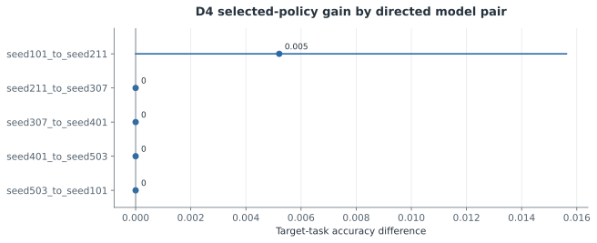
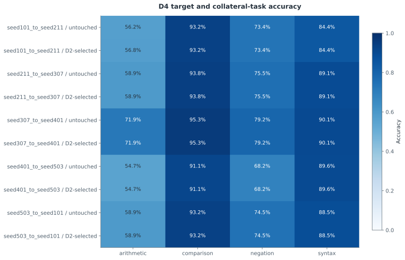
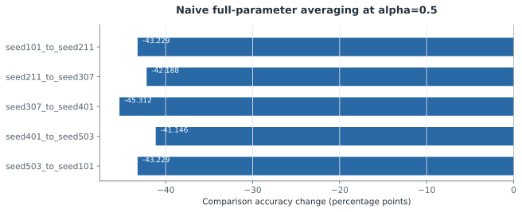

# F5 — 뉴런 이식과 선택적 보간 병합

갱신: 2026-11-04 15:08 KST. 실행 상태: **MEASURED**. 가설 판정: **NOT SUPPORTED (선택 정책의 유용한 전이 개선은 확립되지 않음)**.

원본 단계 스냅샷의 잠정 판정은 **INCONCLUSIVE**로 보존되어 있습니다. 위 표시는 전역 보정 후의 [최종 과학 검토](../../results/followup-v2/scientific_review.json)가 정한 제한된 범위의 판정입니다. 원본 측정과 단계 JSON은 수정하지 않았습니다.

연구 질문: D2에서 고정한 이식 정책이 D4 목표 과제와 부수 과제를 보존·개선하는가?

등록한 방향성 모델 쌍 5개의 D2 정책과 D4 평가를 완료했다. 1개 쌍에서 이식 정책을 선택했고 나머지는 미수정 모델을 유지했다. 선택 정책의 목표 과제 평균 변화는 +0.1042 percentage points(95% wrapper CI [0.0000, 0.3125], p=1.0000)였다. 주요 비교는 관측 모델들을 wrapper 안에서 함께 평균한 선택 정책 대 원래 모델의 차이이며, F6의 단일110개 BH family 보정값을 함께 보고하며, 효과와 과제 능력·설계 한계를 종합해 해석한다. 선택하지 않은 대조군을 포함한 쌍당24개 조건을 모두 공개한다. Naive 전체 파라미터 평균 alpha=0.5의 comparison 정확도 변화는 -45.31–-41.15 percentage points였다. Alpha=1은 donor 전체 교체이며 병합 성공으로 해석하지 않는다. 최종 과학 검토: 선택 정책의 D4 목표 과제 평균 변화는 +0.1042 percentage points, 95% wrapper CI [0, +0.3125] percentage points, p=q=1이었다. 한 쌍의 한 wrapper에서 192문항 중 정답 한 개가 늘었고 네 쌍은 정책을 선택하지 않았다. 유용한 전이 개선이 확립되지 않았다는 판정이며 효과가 정확히 0이거나 모든 병합이 불가능하다는 뜻은 아니다. Naive 50% 전체 평균은 comparison 정확도를 41.15–45.31 percentage points 낮췄고, alpha=1은 donor 전체 교체이므로 병합 성공으로 해석하지 않는다. 적용 범위: 선택 정책의 유용한 전이 개선은 확립되지 않음.

## 실제 측정

| 지표 | 조건·방법 | 측정값 | CI | 단위 | n / 군집 |
|---|---|---:|---|---|---|
| Selected policy target-task gain | seed101_to_seed211 / arithmetic | 0.0052 | [0, 0.0156] | accuracy difference | 24 |
| Selected policy target-task gain | seed211_to_seed307 / negation | 0 | [0, 0] | accuracy difference | 24 |
| Selected policy target-task gain | seed307_to_seed401 / comparison | 0 | [0, 0] | accuracy difference | 24 |
| Selected policy target-task gain | seed401_to_seed503 / arithmetic | 0 | [0, 0] | accuracy difference | 24 |
| Selected policy target-task gain | seed503_to_seed101 / arithmetic | 0 | [0, 0] | accuracy difference | 24 |

## 비교와 불확실성

| 비교 | Δ | CI | p | q | 보정 범위 |
|---|---:|---|---:|---:|---|
| D2-selected policy minus untouched target, aggregate target-task accuracy | 0.001 | [0, 0.0031] | 1 | 1 | Final single110-member BH family; conditional dependent-pair estimates |

Pair intervals are descriptive; five pairs reuse models. The registered primary test averages pairs within wrappers.

[그림 수치와 출처](../../artifacts/followup-v2/figures/f5_selected_policy_gain.json)

Only the D2-selected policy and untouched target are contrasted here; D4 does not choose a policy.

[그림 수치와 출처](../../artifacts/followup-v2/figures/f5_target_and_collateral_accuracy.json)

Descriptive unselected control; D2 policy is unchanged. Every pair has192 comparison rows. Alpha=1 is full donor replacement, not merging success. All24 conditions per pair are reported in F5_ALL_CONDITIONS.md.

[그림 수치와 출처](../../artifacts/followup-v2/figures/f5_naive_half_comparison_retention.json)

## 해석 한계

- D2 jointly selects task, mapping, and interpolation weight; its gains are in-sample.
- Random donors preserve target units/group size but not donor activation magnitude.
- Native parameter interpolation does not establish circuit-preserving model merging.
- Naive alpha=1 replaces the target with the full donor; it is not evidence of successful model merging. The alpha0.5 failure is a descriptive observed control, not a universal impossibility result.
- Directed pairs reuse seeds; pair tests are descriptive and not five independent replications.

## 원본과 재현

- [results/followup-v2/stages/F5.json](../../results/followup-v2/stages/F5.json)
- [results/followup-v2/transfers/summary.json](../../results/followup-v2/transfers/summary.json)
- [results/followup-v2/statistics/global_tests.json](../../results/followup-v2/statistics/global_tests.json)
- [results/followup-v2/transfers/seed101_to_seed211/policy.json](../../results/followup-v2/transfers/seed101_to_seed211/policy.json)
- [results/followup-v2/transfers/seed101_to_seed211/summary.json](../../results/followup-v2/transfers/seed101_to_seed211/summary.json)
- [results/followup-v2/transfers/seed211_to_seed307/policy.json](../../results/followup-v2/transfers/seed211_to_seed307/policy.json)
- [results/followup-v2/transfers/seed211_to_seed307/summary.json](../../results/followup-v2/transfers/seed211_to_seed307/summary.json)
- [results/followup-v2/transfers/seed307_to_seed401/policy.json](../../results/followup-v2/transfers/seed307_to_seed401/policy.json)
- [results/followup-v2/transfers/seed307_to_seed401/summary.json](../../results/followup-v2/transfers/seed307_to_seed401/summary.json)
- [results/followup-v2/transfers/seed401_to_seed503/policy.json](../../results/followup-v2/transfers/seed401_to_seed503/policy.json)
- [results/followup-v2/transfers/seed401_to_seed503/summary.json](../../results/followup-v2/transfers/seed401_to_seed503/summary.json)
- [results/followup-v2/transfers/seed503_to_seed101/policy.json](../../results/followup-v2/transfers/seed503_to_seed101/policy.json)
- [results/followup-v2/transfers/seed503_to_seed101/summary.json](../../results/followup-v2/transfers/seed503_to_seed101/summary.json)
- [reports/followup-v2/F5_ALL_CONDITIONS.md](../../reports/followup-v2/F5_ALL_CONDITIONS.md)
- [results/followup-v2/scientific_review.json](../../results/followup-v2/scientific_review.json)
