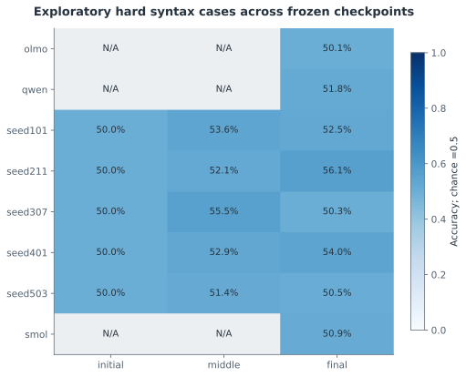
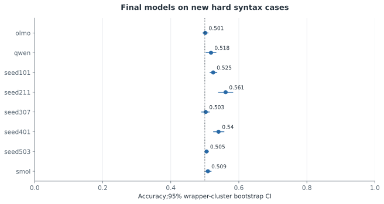
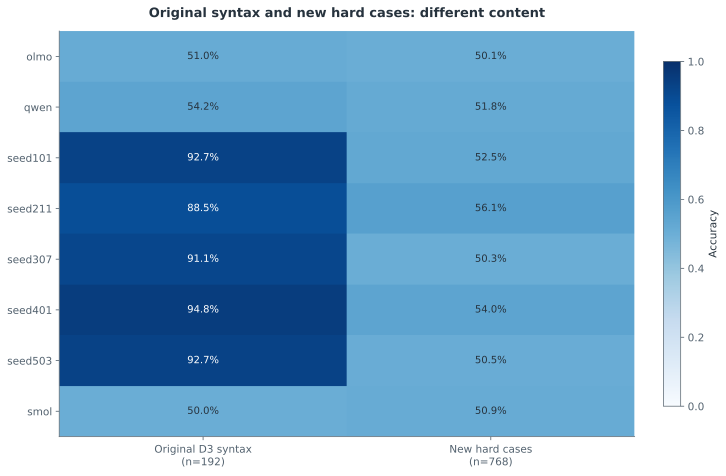
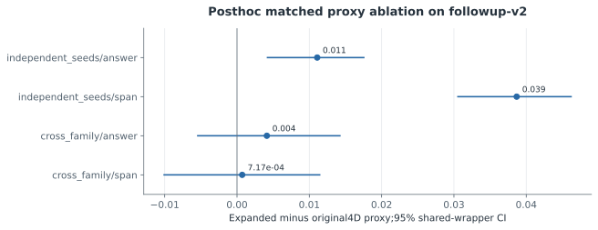
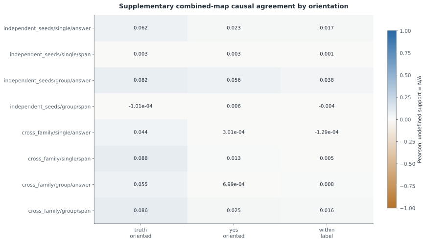
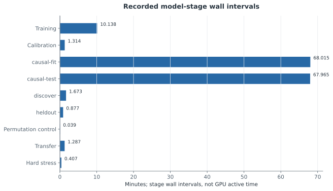

# F6 — 전역 보정·재현 검증과 최종 연구 판정

갱신: 2026-11-04 15:08 KST. 실행 상태: **MEASURED**. 가설 판정: **INCONCLUSIVE**.

연구 질문: 원래 결과를 보존한 후속 측정에서 어떤 대응과 한계를 확인했는가?

원래 pilot 결과와 원래 README 사본을 보존하고 검증했다(로컬 검증261개). 독립 학습 모델의 activation−random 평균 대응 차이는 answer 0.1529, span 0.0860였고, semantic−activation 차이는 각각 -0.0020, -0.0058였다. 독립 시드의 인과 결합−의미 단독 차이는 single/answer +0.0587, single/span +0.0117, group/answer +0.0678, group/span +0.0016였다. D2 선택 이식 정책의 D4 목표 과제 평균 변화는 +0.1042 percentage points였다. 새768개 hard syntax 문항에서 학습 완료5개 모델의 정확도 범위는 50.3%–56.1%였다. 전체110개 주 검정을 하나의 BH family로 보정하고170개 테스트 및 저장 수치 replay를 통과했다. 확증적 q와 기술적 cohort CI를 구분하며, 높은 합성 과제 정확도·개입 상관만으로 보편적 의미 기능 보존이나 재귀 이해를 입증하지 않는다. 네 연구 질문의 최종 판정은 별도 과학 검토의 근거와 적용 범위를 따른다. 배포 아카이브 replay 상태는 COMPLETE이며, 검증 파일 245개·생략 파일 16개의 범위를 따로 기록했다. 과제별 전체 쌍과 양측 능력 조건을 충족한 쌍의 인과 대응·누락 범위를 별도 기술 표로 공개한다. D4 결과에 따른 부분집합 구분이며 추가 검정이나 재학습이 아니다. 괄호 정확도 gate 통과만으로 재귀적·구조적 이해를 보장하지 않는다. 주 F4의 activation 매칭 대조군 누락은 별도의 사후 보충 분석으로 점검했다. D2에서만 맞춘 raw activation과 task-centered activation을 모두 보존·공개하며, 이 분석을 사전 등록된 주 결과나 새로운 확증 검정으로 취급하지 않는다.

## 네 연구 질문의 최종 검토

**Q1 — 독립 초기화로 학습한 같은 구조 모델 사이에 원본 뉴런의 기능적 대응이 보존되는가? · INCONCLUSIVE**

독립 학습 모델의 activation−random 차이는 answer +0.15289 (95% wrapper CI [+0.14632, +0.15982]), span +0.08602 (95% wrapper CI [+0.07660, +0.09445])였다. 반복 무작위 대조군을 넘는 반응 대응은 관찰됐지만, 이것만으로 같은 의미 계산이나 원본 뉴런의 주기능 보존을 확정할 수 없다. 새 hard syntax 문항의 최종 정확도 50.26–56.12%와 응답 방향 진단은 과제 정답률·효과 상관의 구성 타당성에 한계를 드러냈다. 서로 내용·구조 분포가 다른 스트레스 집합의 성능 차이를 특정 shortcut 사용의 인과적 증명으로 해석하지 않는다.

적용 범위: 이 다섯 모델에서 반응 대응은 관찰됐으나 의미 계산의 보존은 미확립

근거: [summary.json](../../results/followup-v2/alignment/summary.json) · [summary.json](../../results/followup-v2/hard_stress/summary.json) · [summary.json](../../results/followup-v2/exploratory_causal_diagnostics/summary.json)

**Q2 — 서로 다른 LLM 계열에서도 원본 뉴런의 주기능이 보존·수렴하는가? · INCONCLUSIVE**

세 공개 모델 계열의 어느 D4 과제에서도 양쪽 모델이 동시에 능력 기준을 통과한 쌍이 없었다. 단일 뉴런 answer combined 상관은 truth-oriented 0.04353, yes-oriented 0.00030, within-label −0.00013이었다. 프롬프트 접두 맥락도 Qwen fourshot·Smol default·OLMo explicit로 다르다. 이 결과는 테스트한 조건에서의 개입 반응이며, 학습된 과제 기능의 계열 간 보존이나 부재를 확정하지 못한다.

적용 범위: 능력 미달과 다른 접두 맥락을 가진 세 공개 계열의 제한된 비교

근거: [summary.json](../../results/followup-v2/causal_alignment/summary.json) · [competence_descriptive.json](../../results/followup-v2/causal_alignment/competence_descriptive.json) · [summary.json](../../results/followup-v2/exploratory_causal_diagnostics/summary.json)

**Q3 — 이번 주기능 semantic proxy 정렬이 activation 정렬보다 실제 대응을 더 잘 예측하는가? · NOT SUPPORTED**

이번 expanded input-derived semantic proxy의 activation 대비 차이는 answer -0.00204 (95% wrapper CI [-0.00712, +0.00251]), span -0.00579 (95% wrapper CI [-0.01776, +0.00750])였다. 일관된 평균 우위를 입증하지 못했으며, 이것은 열등성·동등성 검정의 통과나 모든 semantic alignment 방법의 반증이 아니다. 같은 v2 자료에서 기존 4차원 proxy보다 개선된 보충 분석은 activation 기준선보다 우월하다는 주장과 구분한다.

적용 범위: 등록한 expanded semantic proxy의 체계적 우위가 이번 실험에서 입증되지 않음

근거: [summary.json](../../results/followup-v2/alignment/summary.json) · [global_tests.json](../../results/followup-v2/statistics/global_tests.json) · [summary.json](../../results/followup-v2/exploratory_proxy_ablation/summary.json)

**Q4 — 인과 정보를 이용한 정렬이 의미 기반 정렬보다 독립 D4에서 더 높은 개입효과 대응을 제공하는가? · SUPPORTED (정답 위치의 등록된 truth-oriented 개입효과 상관 개선에 한정; 넓은 기능 보존은 판단 불가)**

고정 D2 절차를 새 D4 문항에 적용했을 때, 독립 시드 answer 위치의 combined−semantic 차이는 single +0.05870 (95% wrapper CI [+0.04763, +0.06991]), group +0.06778 (95% wrapper CI [+0.05201, +0.08372])였다. 원래 110개 검정군의 BH에서 양의 pair 효과는 single 8/10, group 4/10이고, 사후 BY 민감도에서는 7/10, 4/10이다. 이 사실은 정답 방향으로 정의된 zero/mean/patch 효과의 대응 지표에 한정한 개선을 지지한다. 위 cohort CI는 고정 모델·공유 wrapper에 조건부인 기술적 구간이며 다중검정 보정 구간이 아니다. Group span 차이는 +0.00161 (95% wrapper CI [-0.00997, +0.01340])로 일관된 span 개선을 보이지 않는다. Tiny single-answer fit 6/10과 공개 single-answer fit 3/3은 인과 가중치 1을 선택했으므로 의미·인과 정보의 시너지를 입증하지 않는다. 같은 정답끼리 비교한 tiny answer의 절대 상관은 single 0.01726, group 0.03797로 더 약하며, view 간 감소를 별도의 확증적 차이 검정으로 취급하지 않는다. Activation 기준선 대비 비교는 사후 보충 분석이다. 넓은 의미의 인과 기능 보존·회로 동등성·이식 유용성은 여전히 판단 불가다.

적용 범위: 정답 위치의 등록된 truth-oriented 개입효과 상관 개선에 한정; 넓은 기능 보존은 판단 불가

근거: [summary.json](../../results/followup-v2/causal_alignment/summary.json) · [global_tests.json](../../results/followup-v2/statistics/global_tests.json) · [dependence_sensitivity.json](../../results/followup-v2/statistics/dependence_sensitivity.json) · [summary.json](../../results/followup-v2/exploratory_causal_diagnostics/summary.json) · [summary.json](../../results/followup-v2/supplemental_causal_activation/summary.json)

## 실제 측정

| 지표 | 조건·방법 | 측정값 | CI | 단위 | n / 군집 |
|---|---|---:|---|---|---|
| Posthoc dependence sensitivity rejection count | bh | 58 | 미측정 | hypotheses at q<0.05 |  |
| Posthoc dependence sensitivity rejection count | by | 43 | 미측정 | hypotheses at q<0.05 |  |
| Posthoc dependence sensitivity rejection count | bh_only | 15 | 미측정 | hypotheses at q<0.05 |  |
| Global BH family size |  | 110 | 미측정 | tests |  |
| Full pytest passed |  | 170 | 미측정 | tests |  |
| Replay checks passed |  | 181 | 미측정 | checks |  |
| Preserved pilot artifacts verified locally |  | 261 | 미측정 | files |  |
| Locally omitted pilot artifacts |  | 0 | 미측정 | files |  |
| New hard syntax accuracy | olmo / final | 0.5013 | [0.4948, 0.5091] | fraction | 768 / 24 |
| New hard syntax accuracy | qwen / final | 0.5182 | [0.5039, 0.5326] | fraction | 768 / 24 |
| New hard syntax accuracy | seed101 / final | 0.5247 | [0.5156, 0.5352] | fraction | 768 / 24 |
| New hard syntax accuracy | seed101 / initial | 0.5 | [0.5, 0.5] | fraction | 768 / 24 |
| New hard syntax accuracy | seed101 / middle | 0.5365 | [0.5182, 0.5547] | fraction | 768 / 24 |
| New hard syntax accuracy | seed211 / final | 0.5612 | [0.5403, 0.582] | fraction | 768 / 24 |
| New hard syntax accuracy | seed211 / initial | 0.5 | [0.5, 0.5] | fraction | 768 / 24 |
| New hard syntax accuracy | seed211 / middle | 0.5208 | [0.5078, 0.5339] | fraction | 768 / 24 |
| New hard syntax accuracy | seed307 / final | 0.5026 | [0.4909, 0.513] | fraction | 768 / 24 |
| New hard syntax accuracy | seed307 / initial | 0.5 | [0.5, 0.5] | fraction | 768 / 24 |
| New hard syntax accuracy | seed307 / middle | 0.5547 | [0.5391, 0.5703] | fraction | 768 / 24 |
| New hard syntax accuracy | seed401 / final | 0.5404 | [0.526, 0.556] | fraction | 768 / 24 |
| New hard syntax accuracy | seed401 / initial | 0.5 | [0.5, 0.5] | fraction | 768 / 24 |
| New hard syntax accuracy | seed401 / middle | 0.5286 | [0.5182, 0.5404] | fraction | 768 / 24 |
| New hard syntax accuracy | seed503 / final | 0.5052 | [0.5013, 0.5104] | fraction | 768 / 24 |
| New hard syntax accuracy | seed503 / initial | 0.5 | [0.5, 0.5] | fraction | 768 / 24 |
| New hard syntax accuracy | seed503 / middle | 0.5143 | [0.5065, 0.5221] | fraction | 768 / 24 |
| New hard syntax accuracy | smol / final | 0.5091 | [0.5026, 0.5182] | fraction | 768 / 24 |
| Exploratory expanded minus four-dimensional proxy | independent_seeds/answer | 0.0111 | [0.0042, 0.0175] | Pearson difference |  |
| Exploratory expanded minus four-dimensional proxy | independent_seeds/span | 0.0387 | [0.0306, 0.0462] | Pearson difference |  |
| Exploratory expanded minus four-dimensional proxy | cross_family/answer | 0.0041 | [-0.0054, 0.0142] | Pearson difference |  |
| Exploratory expanded minus four-dimensional proxy | cross_family/span | 0.0007 | [-0.0101, 0.0114] | Pearson difference |  |
| Matched exploratory proxy ablation | seed101_seed211 / answer/old_four_dimensional | 0.1424 | 미측정 | Pearson or difference |  |
| Matched exploratory proxy ablation | seed101_seed211 / answer/expanded | 0.1656 | 미측정 | Pearson or difference |  |
| Matched exploratory proxy ablation | seed101_seed211 / answer/expanded_minus_old | 0.0231 | 미측정 | Pearson or difference |  |
| Matched exploratory proxy ablation | seed101_seed211 / span/old_four_dimensional | 0.0814 | 미측정 | Pearson or difference |  |
| Matched exploratory proxy ablation | seed101_seed211 / span/expanded | 0.134 | 미측정 | Pearson or difference |  |
| Matched exploratory proxy ablation | seed101_seed211 / span/expanded_minus_old | 0.0527 | 미측정 | Pearson or difference |  |
| Matched exploratory proxy ablation | seed101_seed307 / answer/old_four_dimensional | 0.1087 | 미측정 | Pearson or difference |  |
| Matched exploratory proxy ablation | seed101_seed307 / answer/expanded | 0.1436 | 미측정 | Pearson or difference |  |
| Matched exploratory proxy ablation | seed101_seed307 / answer/expanded_minus_old | 0.0349 | 미측정 | Pearson or difference |  |
| Matched exploratory proxy ablation | seed101_seed307 / span/old_four_dimensional | -0.0366 | 미측정 | Pearson or difference |  |
| Matched exploratory proxy ablation | seed101_seed307 / span/expanded | 0.0431 | 미측정 | Pearson or difference |  |
| Matched exploratory proxy ablation | seed101_seed307 / span/expanded_minus_old | 0.0797 | 미측정 | Pearson or difference |  |
| Matched exploratory proxy ablation | seed101_seed401 / answer/old_four_dimensional | 0.1406 | 미측정 | Pearson or difference |  |
| Matched exploratory proxy ablation | seed101_seed401 / answer/expanded | 0.1592 | 미측정 | Pearson or difference |  |
| Matched exploratory proxy ablation | seed101_seed401 / answer/expanded_minus_old | 0.0185 | 미측정 | Pearson or difference |  |
| Matched exploratory proxy ablation | seed101_seed401 / span/old_four_dimensional | 0.0479 | 미측정 | Pearson or difference |  |
| Matched exploratory proxy ablation | seed101_seed401 / span/expanded | 0.0809 | 미측정 | Pearson or difference |  |
| Matched exploratory proxy ablation | seed101_seed401 / span/expanded_minus_old | 0.033 | 미측정 | Pearson or difference |  |
| Matched exploratory proxy ablation | seed101_seed503 / answer/old_four_dimensional | 0.1045 | 미측정 | Pearson or difference |  |
| Matched exploratory proxy ablation | seed101_seed503 / answer/expanded | 0.1047 | 미측정 | Pearson or difference |  |
| Matched exploratory proxy ablation | seed101_seed503 / answer/expanded_minus_old | 0.0002 | 미측정 | Pearson or difference |  |
| Matched exploratory proxy ablation | seed101_seed503 / span/old_four_dimensional | 0.0515 | 미측정 | Pearson or difference |  |
| Matched exploratory proxy ablation | seed101_seed503 / span/expanded | 0.0852 | 미측정 | Pearson or difference |  |
| Matched exploratory proxy ablation | seed101_seed503 / span/expanded_minus_old | 0.0337 | 미측정 | Pearson or difference |  |
| Matched exploratory proxy ablation | seed211_seed307 / answer/old_four_dimensional | 0.1634 | 미측정 | Pearson or difference |  |
| Matched exploratory proxy ablation | seed211_seed307 / answer/expanded | 0.1488 | 미측정 | Pearson or difference |  |
| Matched exploratory proxy ablation | seed211_seed307 / answer/expanded_minus_old | -0.0146 | 미측정 | Pearson or difference |  |
| Matched exploratory proxy ablation | seed211_seed307 / span/old_four_dimensional | 0.0003 | 미측정 | Pearson or difference |  |
| Matched exploratory proxy ablation | seed211_seed307 / span/expanded | 0.0818 | 미측정 | Pearson or difference |  |
| Matched exploratory proxy ablation | seed211_seed307 / span/expanded_minus_old | 0.0815 | 미측정 | Pearson or difference |  |
| Matched exploratory proxy ablation | seed211_seed401 / answer/old_four_dimensional | 0.187 | 미측정 | Pearson or difference |  |
| Matched exploratory proxy ablation | seed211_seed401 / answer/expanded | 0.1927 | 미측정 | Pearson or difference |  |
| Matched exploratory proxy ablation | seed211_seed401 / answer/expanded_minus_old | 0.0057 | 미측정 | Pearson or difference |  |
| Matched exploratory proxy ablation | seed211_seed401 / span/old_four_dimensional | 0.0632 | 미측정 | Pearson or difference |  |
| Matched exploratory proxy ablation | seed211_seed401 / span/expanded | 0.0933 | 미측정 | Pearson or difference |  |
| Matched exploratory proxy ablation | seed211_seed401 / span/expanded_minus_old | 0.0301 | 미측정 | Pearson or difference |  |
| Matched exploratory proxy ablation | seed211_seed503 / answer/old_four_dimensional | 0.1571 | 미측정 | Pearson or difference |  |
| Matched exploratory proxy ablation | seed211_seed503 / answer/expanded | 0.1574 | 미측정 | Pearson or difference |  |
| Matched exploratory proxy ablation | seed211_seed503 / answer/expanded_minus_old | 0.0003 | 미측정 | Pearson or difference |  |
| Matched exploratory proxy ablation | seed211_seed503 / span/old_four_dimensional | 0.0446 | 미측정 | Pearson or difference |  |
| Matched exploratory proxy ablation | seed211_seed503 / span/expanded | 0.0972 | 미측정 | Pearson or difference |  |
| Matched exploratory proxy ablation | seed211_seed503 / span/expanded_minus_old | 0.0526 | 미측정 | Pearson or difference |  |
| Matched exploratory proxy ablation | seed307_seed401 / answer/old_four_dimensional | 0.1007 | 미측정 | Pearson or difference |  |
| Matched exploratory proxy ablation | seed307_seed401 / answer/expanded | 0.1405 | 미측정 | Pearson or difference |  |
| Matched exploratory proxy ablation | seed307_seed401 / answer/expanded_minus_old | 0.0398 | 미측정 | Pearson or difference |  |
| Matched exploratory proxy ablation | seed307_seed401 / span/old_four_dimensional | 0.0446 | 미측정 | Pearson or difference |  |
| Matched exploratory proxy ablation | seed307_seed401 / span/expanded | 0.0465 | 미측정 | Pearson or difference |  |
| Matched exploratory proxy ablation | seed307_seed401 / span/expanded_minus_old | 0.0019 | 미측정 | Pearson or difference |  |
| Matched exploratory proxy ablation | seed307_seed503 / answer/old_four_dimensional | 0.122 | 미측정 | Pearson or difference |  |
| Matched exploratory proxy ablation | seed307_seed503 / answer/expanded | 0.1091 | 미측정 | Pearson or difference |  |
| Matched exploratory proxy ablation | seed307_seed503 / answer/expanded_minus_old | -0.0129 | 미측정 | Pearson or difference |  |
| Matched exploratory proxy ablation | seed307_seed503 / span/old_four_dimensional | 0.0546 | 미측정 | Pearson or difference |  |
| Matched exploratory proxy ablation | seed307_seed503 / span/expanded | 0.0478 | 미측정 | Pearson or difference |  |
| Matched exploratory proxy ablation | seed307_seed503 / span/expanded_minus_old | -0.0067 | 미측정 | Pearson or difference |  |
| Matched exploratory proxy ablation | seed401_seed503 / answer/old_four_dimensional | 0.1329 | 미측정 | Pearson or difference |  |
| Matched exploratory proxy ablation | seed401_seed503 / answer/expanded | 0.1487 | 미측정 | Pearson or difference |  |
| Matched exploratory proxy ablation | seed401_seed503 / answer/expanded_minus_old | 0.0158 | 미측정 | Pearson or difference |  |
| Matched exploratory proxy ablation | seed401_seed503 / span/old_four_dimensional | 0.0665 | 미측정 | Pearson or difference |  |
| Matched exploratory proxy ablation | seed401_seed503 / span/expanded | 0.095 | 미측정 | Pearson or difference |  |
| Matched exploratory proxy ablation | seed401_seed503 / span/expanded_minus_old | 0.0284 | 미측정 | Pearson or difference |  |
| Matched exploratory proxy ablation | qwen_smol / answer/old_four_dimensional | 0.0289 | 미측정 | Pearson or difference |  |
| Matched exploratory proxy ablation | qwen_smol / answer/expanded | 0.0365 | 미측정 | Pearson or difference |  |
| Matched exploratory proxy ablation | qwen_smol / answer/expanded_minus_old | 0.0075 | 미측정 | Pearson or difference |  |
| Matched exploratory proxy ablation | qwen_smol / span/old_four_dimensional | 0.0081 | 미측정 | Pearson or difference |  |
| Matched exploratory proxy ablation | qwen_smol / span/expanded | 0.0089 | 미측정 | Pearson or difference |  |
| Matched exploratory proxy ablation | qwen_smol / span/expanded_minus_old | 0.0008 | 미측정 | Pearson or difference |  |
| Matched exploratory proxy ablation | qwen_olmo / answer/old_four_dimensional | 0.0079 | 미측정 | Pearson or difference |  |
| Matched exploratory proxy ablation | qwen_olmo / answer/expanded | 0.0173 | 미측정 | Pearson or difference |  |
| Matched exploratory proxy ablation | qwen_olmo / answer/expanded_minus_old | 0.0094 | 미측정 | Pearson or difference |  |
| Matched exploratory proxy ablation | qwen_olmo / span/old_four_dimensional | 0.041 | 미측정 | Pearson or difference |  |
| Matched exploratory proxy ablation | qwen_olmo / span/expanded | 0.0452 | 미측정 | Pearson or difference |  |
| Matched exploratory proxy ablation | qwen_olmo / span/expanded_minus_old | 0.0042 | 미측정 | Pearson or difference |  |
| Matched exploratory proxy ablation | smol_olmo / answer/old_four_dimensional | 0.0121 | 미측정 | Pearson or difference |  |
| Matched exploratory proxy ablation | smol_olmo / answer/expanded | 0.0076 | 미측정 | Pearson or difference |  |
| Matched exploratory proxy ablation | smol_olmo / answer/expanded_minus_old | -0.0046 | 미측정 | Pearson or difference |  |
| Matched exploratory proxy ablation | smol_olmo / span/old_four_dimensional | 0.0191 | 미측정 | Pearson or difference |  |
| Matched exploratory proxy ablation | smol_olmo / span/expanded | 0.0162 | 미측정 | Pearson or difference |  |
| Matched exploratory proxy ablation | smol_olmo / span/expanded_minus_old | -0.0029 | 미측정 | Pearson or difference |  |
| Exploratory causal orientation agreement | independent_seeds/single/answer / truth_oriented/semantic | 0.0033 | [-0.0024, 0.0089] | Pearson | 10 |
| Exploratory causal orientation agreement | independent_seeds/single/answer / truth_oriented/causal | 0.059 | [0.0503, 0.0681] | Pearson | 10 |
| Exploratory causal orientation agreement | independent_seeds/single/answer / truth_oriented/combined | 0.062 | [0.054, 0.0702] | Pearson | 10 |
| Exploratory causal orientation agreement | independent_seeds/single/answer / truth_oriented/random | -0.0004 | [-0.0032, 0.0026] | Pearson | 10 |
| Exploratory causal orientation agreement | independent_seeds/single/answer / yes_oriented/semantic | -0.0008 | [-0.0067, 0.005] | Pearson | 10 |
| Exploratory causal orientation agreement | independent_seeds/single/answer / yes_oriented/causal | 0.0226 | [0.0145, 0.0309] | Pearson | 10 |
| Exploratory causal orientation agreement | independent_seeds/single/answer / yes_oriented/combined | 0.0234 | [0.0167, 0.0305] | Pearson | 10 |
| Exploratory causal orientation agreement | independent_seeds/single/answer / yes_oriented/random | -0.0008 | [-0.0036, 0.0021] | Pearson | 10 |
| Exploratory causal orientation agreement | independent_seeds/single/answer / within_label/semantic | 0.0018 | [-0.0042, 0.0079] | Pearson | 10 |
| Exploratory causal orientation agreement | independent_seeds/single/answer / within_label/causal | 0.0166 | [0.0077, 0.026] | Pearson | 10 |
| Exploratory causal orientation agreement | independent_seeds/single/answer / within_label/combined | 0.0173 | [0.0096, 0.0252] | Pearson | 10 |
| Exploratory causal orientation agreement | independent_seeds/single/answer / within_label/random | 0.0013 | [-0.0019, 0.0046] | Pearson | 10 |
| Exploratory causal orientation agreement | independent_seeds/single/span / truth_oriented/semantic | -0.0083 | [-0.0183, 0.0009] | Pearson | 10 |
| Exploratory causal orientation agreement | independent_seeds/single/span / truth_oriented/causal | 0.0073 | [0.0013, 0.0137] | Pearson | 10 |
| Exploratory causal orientation agreement | independent_seeds/single/span / truth_oriented/combined | 0.0034 | [-0.0048, 0.0112] | Pearson | 10 |
| Exploratory causal orientation agreement | independent_seeds/single/span / truth_oriented/random | -0.0002 | [-0.0029, 0.0025] | Pearson | 10 |
| Exploratory causal orientation agreement | independent_seeds/single/span / yes_oriented/semantic | -0.0007 | [-0.0096, 0.0074] | Pearson | 10 |
| Exploratory causal orientation agreement | independent_seeds/single/span / yes_oriented/causal | 0.0053 | [-0.0025, 0.0137] | Pearson | 10 |
| Exploratory causal orientation agreement | independent_seeds/single/span / yes_oriented/combined | 0.0029 | [-0.0042, 0.0111] | Pearson | 10 |
| Exploratory causal orientation agreement | independent_seeds/single/span / yes_oriented/random | 0.0002 | [-0.0027, 0.0033] | Pearson | 10 |
| Exploratory causal orientation agreement | independent_seeds/single/span / within_label/semantic | -0.006 | [-0.0154, 0.0032] | Pearson | 10 |
| Exploratory causal orientation agreement | independent_seeds/single/span / within_label/causal | 0.0063 | [-0.0026, 0.0158] | Pearson | 10 |
| Exploratory causal orientation agreement | independent_seeds/single/span / within_label/combined | 0.0011 | [-0.0077, 0.0095] | Pearson | 10 |
| Exploratory causal orientation agreement | independent_seeds/single/span / within_label/random | -0.0002 | [-0.0035, 0.0035] | Pearson | 10 |
| Exploratory causal orientation agreement | independent_seeds/group/answer / truth_oriented/semantic | 0.0144 | [0.0063, 0.0223] | Pearson | 10 |
| Exploratory causal orientation agreement | independent_seeds/group/answer / truth_oriented/causal | 0.0814 | [0.0702, 0.0925] | Pearson | 10 |
| Exploratory causal orientation agreement | independent_seeds/group/answer / truth_oriented/combined | 0.0822 | [0.0678, 0.0975] | Pearson | 10 |
| Exploratory causal orientation agreement | independent_seeds/group/answer / truth_oriented/random | 0.0162 | [0.0096, 0.0229] | Pearson | 10 |
| Exploratory causal orientation agreement | independent_seeds/group/answer / yes_oriented/semantic | 0.011 | [0.0003, 0.0215] | Pearson | 10 |
| Exploratory causal orientation agreement | independent_seeds/group/answer / yes_oriented/causal | 0.0562 | [0.0458, 0.0667] | Pearson | 10 |
| Exploratory causal orientation agreement | independent_seeds/group/answer / yes_oriented/combined | 0.0561 | [0.0448, 0.0689] | Pearson | 10 |
| Exploratory causal orientation agreement | independent_seeds/group/answer / yes_oriented/random | 0.0175 | [0.0115, 0.0235] | Pearson | 10 |
| Exploratory causal orientation agreement | independent_seeds/group/answer / within_label/semantic | 0.0058 | [-0.0038, 0.0156] | Pearson | 10 |
| Exploratory causal orientation agreement | independent_seeds/group/answer / within_label/causal | 0.0415 | [0.0315, 0.0517] | Pearson | 10 |
| Exploratory causal orientation agreement | independent_seeds/group/answer / within_label/combined | 0.038 | [0.0271, 0.0488] | Pearson | 10 |
| Exploratory causal orientation agreement | independent_seeds/group/answer / within_label/random | 0.012 | [0.0067, 0.0176] | Pearson | 10 |
| Exploratory causal orientation agreement | independent_seeds/group/span / truth_oriented/semantic | -0.0017 | [-0.014, 0.011] | Pearson | 10 |
| Exploratory causal orientation agreement | independent_seeds/group/span / truth_oriented/causal | -0.0015 | [-0.0082, 0.0054] | Pearson | 10 |
| Exploratory causal orientation agreement | independent_seeds/group/span / truth_oriented/combined | -0.0001 | [-0.0093, 0.0091] | Pearson | 10 |
| Exploratory causal orientation agreement | independent_seeds/group/span / truth_oriented/random | 0.0014 | [-0.0048, 0.0085] | Pearson | 10 |
| Exploratory causal orientation agreement | independent_seeds/group/span / yes_oriented/semantic | -0.0059 | [-0.0193, 0.008] | Pearson | 10 |
| Exploratory causal orientation agreement | independent_seeds/group/span / yes_oriented/causal | 0.0036 | [-0.0038, 0.0112] | Pearson | 10 |
| Exploratory causal orientation agreement | independent_seeds/group/span / yes_oriented/combined | 0.006 | [-0.0039, 0.0165] | Pearson | 10 |
| Exploratory causal orientation agreement | independent_seeds/group/span / yes_oriented/random | 0.0019 | [-0.0048, 0.0095] | Pearson | 10 |
| Exploratory causal orientation agreement | independent_seeds/group/span / within_label/semantic | -0.0123 | [-0.0259, 0.0014] | Pearson | 10 |
| Exploratory causal orientation agreement | independent_seeds/group/span / within_label/causal | 0.0009 | [-0.0079, 0.0095] | Pearson | 10 |
| Exploratory causal orientation agreement | independent_seeds/group/span / within_label/combined | -0.0043 | [-0.0161, 0.0069] | Pearson | 10 |
| Exploratory causal orientation agreement | independent_seeds/group/span / within_label/random | -3.46e-05 | [-0.0058, 0.0062] | Pearson | 10 |
| Exploratory causal orientation agreement | cross_family/single/answer / truth_oriented/semantic | -0.0264 | [-0.0437, -0.0109] | Pearson | 3 |
| Exploratory causal orientation agreement | cross_family/single/answer / truth_oriented/causal | 0.0435 | [0.0183, 0.0676] | Pearson | 3 |
| Exploratory causal orientation agreement | cross_family/single/answer / truth_oriented/combined | 0.0435 | [0.0183, 0.0676] | Pearson | 3 |
| Exploratory causal orientation agreement | cross_family/single/answer / truth_oriented/random | -0.0005 | [-0.0064, 0.0051] | Pearson | 3 |
| Exploratory causal orientation agreement | cross_family/single/answer / yes_oriented/semantic | -0.0117 | [-0.027, 0.0035] | Pearson | 3 |
| Exploratory causal orientation agreement | cross_family/single/answer / yes_oriented/causal | 0.0003 | [-0.0144, 0.0154] | Pearson | 3 |
| Exploratory causal orientation agreement | cross_family/single/answer / yes_oriented/combined | 0.0003 | [-0.0144, 0.0154] | Pearson | 3 |
| Exploratory causal orientation agreement | cross_family/single/answer / yes_oriented/random | -0.0003 | [-0.0051, 0.005] | Pearson | 3 |
| Exploratory causal orientation agreement | cross_family/single/answer / within_label/semantic | -0.0043 | [-0.0197, 0.0102] | Pearson | 3 |
| Exploratory causal orientation agreement | cross_family/single/answer / within_label/causal | -0.0001 | [-0.015, 0.0159] | Pearson | 3 |
| Exploratory causal orientation agreement | cross_family/single/answer / within_label/combined | -0.0001 | [-0.015, 0.0159] | Pearson | 3 |
| Exploratory causal orientation agreement | cross_family/single/answer / within_label/random | 0.002 | [-0.0028, 0.0072] | Pearson | 3 |
| Exploratory causal orientation agreement | cross_family/single/span / truth_oriented/semantic | -0.0023 | [-0.025, 0.0189] | Pearson | 3 |
| Exploratory causal orientation agreement | cross_family/single/span / truth_oriented/causal | 0.088 | [0.0746, 0.1024] | Pearson | 3 |
| Exploratory causal orientation agreement | cross_family/single/span / truth_oriented/combined | 0.088 | [0.0746, 0.1024] | Pearson | 3 |
| Exploratory causal orientation agreement | cross_family/single/span / truth_oriented/random | -0.0009 | [-0.0073, 0.0055] | Pearson | 3 |
| Exploratory causal orientation agreement | cross_family/single/span / yes_oriented/semantic | -0.0153 | [-0.0323, 0.0009] | Pearson | 3 |
| Exploratory causal orientation agreement | cross_family/single/span / yes_oriented/causal | 0.013 | [-0.0018, 0.0282] | Pearson | 3 |
| Exploratory causal orientation agreement | cross_family/single/span / yes_oriented/combined | 0.013 | [-0.0018, 0.0282] | Pearson | 3 |
| Exploratory causal orientation agreement | cross_family/single/span / yes_oriented/random | 0.0009 | [-0.0065, 0.0092] | Pearson | 3 |
| Exploratory causal orientation agreement | cross_family/single/span / within_label/semantic | -0.0125 | [-0.0283, 0.003] | Pearson | 3 |
| Exploratory causal orientation agreement | cross_family/single/span / within_label/causal | 0.005 | [-0.0102, 0.0204] | Pearson | 3 |
| Exploratory causal orientation agreement | cross_family/single/span / within_label/combined | 0.005 | [-0.0102, 0.0204] | Pearson | 3 |
| Exploratory causal orientation agreement | cross_family/single/span / within_label/random | -0.0009 | [-0.0082, 0.0071] | Pearson | 3 |
| Exploratory causal orientation agreement | cross_family/group/answer / truth_oriented/semantic | -0.0391 | [-0.0629, -0.0163] | Pearson | 3 |
| Exploratory causal orientation agreement | cross_family/group/answer / truth_oriented/causal | 0.0443 | [0.0117, 0.0809] | Pearson | 3 |
| Exploratory causal orientation agreement | cross_family/group/answer / truth_oriented/combined | 0.0551 | [0.0269, 0.0857] | Pearson | 3 |
| Exploratory causal orientation agreement | cross_family/group/answer / truth_oriented/random | -0.0121 | [-0.0255, 0.0011] | Pearson | 3 |
| Exploratory causal orientation agreement | cross_family/group/answer / yes_oriented/semantic | 0.0073 | [-0.0104, 0.0246] | Pearson | 3 |
| Exploratory causal orientation agreement | cross_family/group/answer / yes_oriented/causal | -0.0042 | [-0.022, 0.0144] | Pearson | 3 |
| Exploratory causal orientation agreement | cross_family/group/answer / yes_oriented/combined | 0.0007 | [-0.0151, 0.0191] | Pearson | 3 |
| Exploratory causal orientation agreement | cross_family/group/answer / yes_oriented/random | 0.0002 | [-0.0092, 0.0095] | Pearson | 3 |
| Exploratory causal orientation agreement | cross_family/group/answer / within_label/semantic | 0.0091 | [-0.0117, 0.0303] | Pearson | 3 |
| Exploratory causal orientation agreement | cross_family/group/answer / within_label/causal | 0.0048 | [-0.0146, 0.0266] | Pearson | 3 |
| Exploratory causal orientation agreement | cross_family/group/answer / within_label/combined | 0.0083 | [-0.0102, 0.0296] | Pearson | 3 |
| Exploratory causal orientation agreement | cross_family/group/answer / within_label/random | 0.0068 | [-0.0042, 0.0181] | Pearson | 3 |
| Exploratory causal orientation agreement | cross_family/group/span / truth_oriented/semantic | 0.0028 | [-0.0224, 0.03] | Pearson | 3 |
| Exploratory causal orientation agreement | cross_family/group/span / truth_oriented/causal | 0.0865 | [0.0576, 0.1148] | Pearson | 3 |
| Exploratory causal orientation agreement | cross_family/group/span / truth_oriented/combined | 0.0865 | [0.0576, 0.1148] | Pearson | 3 |
| Exploratory causal orientation agreement | cross_family/group/span / truth_oriented/random | -0.0002 | [-0.0133, 0.0128] | Pearson | 3 |
| Exploratory causal orientation agreement | cross_family/group/span / yes_oriented/semantic | -0.0238 | [-0.0405, -0.0078] | Pearson | 3 |
| Exploratory causal orientation agreement | cross_family/group/span / yes_oriented/causal | 0.0253 | [0.0049, 0.0471] | Pearson | 3 |
| Exploratory causal orientation agreement | cross_family/group/span / yes_oriented/combined | 0.0253 | [0.0049, 0.0471] | Pearson | 3 |
| Exploratory causal orientation agreement | cross_family/group/span / yes_oriented/random | 0.004 | [-0.0071, 0.0154] | Pearson | 3 |
| Exploratory causal orientation agreement | cross_family/group/span / within_label/semantic | -0.0128 | [-0.032, 0.0058] | Pearson | 3 |
| Exploratory causal orientation agreement | cross_family/group/span / within_label/causal | 0.0159 | [-0.0082, 0.0411] | Pearson | 3 |
| Exploratory causal orientation agreement | cross_family/group/span / within_label/combined | 0.0159 | [-0.0082, 0.0411] | Pearson | 3 |
| Exploratory causal orientation agreement | cross_family/group/span / within_label/random | 0.0041 | [-0.0078, 0.0161] | Pearson | 3 |
| Peak recorded Torch allocated memory |  | 34.0686 | 미측정 | GiB |  |
| Named followup directory snapshot total |  | 1.4127 | 미측정 | GiB |  |
| Named directory snapshot storage | results/followup-v2 | 1.375 | 미측정 | GiB |  |
| Named directory snapshot storage | reports/followup-v2 | 0.0005 | 미측정 | GiB |  |
| Named directory snapshot storage | artifacts/followup-v2 | 0.0248 | 미측정 | GiB |  |
| Named directory snapshot storage | data/followup-v2 | 0.0119 | 미측정 | GiB |  |
| Named directory snapshot storage | data/followup-v2-hard-stress | 0.0006 | 미측정 | GiB |  |
| Recorded GPU-bearing stage wall sum |  | 9102.8785 | 미측정 | seconds |  |
| Recorded stage wall subtotal | Training | 608.2664 | 미측정 | seconds |  |
| Recorded stage wall subtotal | Calibration | 78.8338 | 미측정 | seconds |  |
| Recorded stage wall subtotal | causal-fit | 4080.9286 | 미측정 | seconds |  |
| Recorded stage wall subtotal | causal-test | 4077.9172 | 미측정 | seconds |  |
| Recorded stage wall subtotal | discover | 100.3558 | 미측정 | seconds |  |
| Recorded stage wall subtotal | heldout | 52.6455 | 미측정 | seconds |  |
| Recorded stage wall subtotal | Permutation control | 2.3121 | 미측정 | seconds |  |
| Recorded stage wall subtotal | Transfer | 77.215 | 미측정 | seconds |  |
| Recorded stage wall subtotal | Hard stress | 24.4041 | 미측정 | seconds |  |
| F3 descriptive joint-wrapper activation_minus_random | independent_seeds/answer/final | 0.1529 | [0.1463, 0.1598] | Pearson difference | 24 |
| F3 descriptive joint-wrapper semantic_minus_activation | independent_seeds/answer/final | -0.002 | [-0.0071, 0.0025] | Pearson difference | 24 |
| F3 descriptive joint-wrapper activation_minus_random | independent_seeds/span/final | 0.086 | [0.0766, 0.0945] | Pearson difference | 24 |
| F3 descriptive joint-wrapper semantic_minus_activation | independent_seeds/span/final | -0.0058 | [-0.0178, 0.0075] | Pearson difference | 24 |
| F3 descriptive joint-wrapper activation_minus_random | cross_family/answer/final | -0.0044 | [-0.0148, 0.0056] | Pearson difference | 24 |
| F3 descriptive joint-wrapper semantic_minus_activation | cross_family/answer/final | 0.0256 | [0.0134, 0.0375] | Pearson difference | 24 |
| F3 descriptive joint-wrapper activation_minus_random | cross_family/span/final | 0.0323 | [0.0218, 0.0429] | Pearson difference | 24 |
| F3 descriptive joint-wrapper semantic_minus_activation | cross_family/span/final | -0.0093 | [-0.0232, 0.0048] | Pearson difference | 24 |
| F4 descriptive joint-wrapper combined_minus_semantic | independent_seeds/single/answer | 0.0587 | [0.0476, 0.0699] | Pearson difference | 24 |
| F4 descriptive joint-wrapper combined_minus_semantic | independent_seeds/single/span | 0.0117 | [0.0044, 0.0188] | Pearson difference | 24 |
| F4 descriptive joint-wrapper combined_minus_semantic | independent_seeds/group/answer | 0.0678 | [0.052, 0.0837] | Pearson difference | 24 |
| F4 descriptive joint-wrapper combined_minus_semantic | independent_seeds/group/span | 0.0016 | [-0.01, 0.0134] | Pearson difference | 24 |
| F4 descriptive joint-wrapper combined_minus_semantic | cross_family/single/answer | 0.07 | [0.0461, 0.091] | Pearson difference | 24 |
| F4 descriptive joint-wrapper combined_minus_semantic | cross_family/single/span | 0.0903 | [0.0671, 0.1153] | Pearson difference | 24 |
| F4 descriptive joint-wrapper combined_minus_semantic | cross_family/group/answer | 0.0942 | [0.0568, 0.1316] | Pearson difference | 24 |
| F4 descriptive joint-wrapper combined_minus_semantic | cross_family/group/span | 0.0836 | [0.0483, 0.1192] | Pearson difference | 24 |

## 비교와 불확실성

| 비교 | Δ | CI | p | q | 보정 범위 |
|---|---:|---|---:|---:|---|
| F3/qwen_olmo/answer/activation_minus_random | -0.0107 | [-0.0289, 0.0067] | 0.2625 | 0.401 | Single predeclared110-member BH family; pair estimates are conditional and dependent |
| F3/qwen_olmo/answer/semantic_minus_activation | 0.0311 | [0.0113, 0.0533] | 0.0063 | 0.0137 | Single predeclared110-member BH family; pair estimates are conditional and dependent |
| F3/qwen_olmo/span/activation_minus_random | 0.0275 | [0.0095, 0.0439] | 0.0055 | 0.0121 | Single predeclared110-member BH family; pair estimates are conditional and dependent |
| F3/qwen_olmo/span/semantic_minus_activation | 0.0128 | [-0.0038, 0.0297] | 0.162 | 0.2742 | Single predeclared110-member BH family; pair estimates are conditional and dependent |
| F3/qwen_smol/answer/activation_minus_random | -0.0197 | [-0.0356, -0.0028] | 0.0257 | 0.0488 | Single predeclared110-member BH family; pair estimates are conditional and dependent |
| F3/qwen_smol/answer/semantic_minus_activation | 0.0573 | [0.0365, 0.076] | 0.0001 | 0.0005 | Single predeclared110-member BH family; pair estimates are conditional and dependent |
| F3/qwen_smol/span/activation_minus_random | 0.0056 | [-0.0074, 0.019] | 0.4328 | 0.5951 | Single predeclared110-member BH family; pair estimates are conditional and dependent |
| F3/qwen_smol/span/semantic_minus_activation | 0.0024 | [-0.021, 0.0273] | 0.8522 | 1 | Single predeclared110-member BH family; pair estimates are conditional and dependent |
| F3/seed101_seed211/answer/activation_minus_random | 0.1299 | [0.1174, 0.1419] | 5.00e-05 | 0.0002 | Single predeclared110-member BH family; pair estimates are conditional and dependent |
| F3/seed101_seed211/answer/semantic_minus_activation | 0.0241 | [0.0088, 0.0392] | 0.0052 | 0.0117 | Single predeclared110-member BH family; pair estimates are conditional and dependent |
| F3/seed101_seed211/span/activation_minus_random | 0.0678 | [0.0522, 0.0843] | 5.00e-05 | 0.0002 | Single predeclared110-member BH family; pair estimates are conditional and dependent |
| F3/seed101_seed211/span/semantic_minus_activation | 0.0662 | [0.0444, 0.0876] | 5.00e-05 | 0.0002 | Single predeclared110-member BH family; pair estimates are conditional and dependent |
| F3/seed101_seed307/answer/activation_minus_random | 0.1221 | [0.1054, 0.1398] | 5.00e-05 | 0.0002 | Single predeclared110-member BH family; pair estimates are conditional and dependent |
| F3/seed101_seed307/answer/semantic_minus_activation | 0.0131 | [-0.0066, 0.0324] | 0.2106 | 0.3358 | Single predeclared110-member BH family; pair estimates are conditional and dependent |
| F3/seed101_seed307/span/activation_minus_random | 0.0981 | [0.0756, 0.119] | 5.00e-05 | 0.0002 | Single predeclared110-member BH family; pair estimates are conditional and dependent |
| F3/seed101_seed307/span/semantic_minus_activation | -0.0534 | [-0.0766, -0.0281] | 0.0006 | 0.0018 | Single predeclared110-member BH family; pair estimates are conditional and dependent |
| F3/seed101_seed401/answer/activation_minus_random | 0.1556 | [0.1429, 0.1684] | 5.00e-05 | 0.0002 | Single predeclared110-member BH family; pair estimates are conditional and dependent |
| F3/seed101_seed401/answer/semantic_minus_activation | 0.0043 | [-0.0179, 0.0257] | 0.7067 | 0.8638 | Single predeclared110-member BH family; pair estimates are conditional and dependent |
| F3/seed101_seed401/span/activation_minus_random | 0.104 | [0.0873, 0.1186] | 5.00e-05 | 0.0002 | Single predeclared110-member BH family; pair estimates are conditional and dependent |
| F3/seed101_seed401/span/semantic_minus_activation | -0.0239 | [-0.0488, 0.001] | 0.0712 | 0.1285 | Single predeclared110-member BH family; pair estimates are conditional and dependent |
| F3/seed101_seed503/answer/activation_minus_random | 0.1185 | [0.1036, 0.1327] | 5.00e-05 | 0.0002 | Single predeclared110-member BH family; pair estimates are conditional and dependent |
| F3/seed101_seed503/answer/semantic_minus_activation | 0.0044 | [-0.0098, 0.0191] | 0.5719 | 0.7401 | Single predeclared110-member BH family; pair estimates are conditional and dependent |
| F3/seed101_seed503/span/activation_minus_random | 0.0829 | [0.0596, 0.1043] | 5.00e-05 | 0.0002 | Single predeclared110-member BH family; pair estimates are conditional and dependent |
| F3/seed101_seed503/span/semantic_minus_activation | 0.005 | [-0.0253, 0.0364] | 0.7557 | 0.9036 | Single predeclared110-member BH family; pair estimates are conditional and dependent |
| F3/seed211_seed307/answer/activation_minus_random | 0.1528 | [0.1381, 0.1666] | 5.00e-05 | 0.0002 | Single predeclared110-member BH family; pair estimates are conditional and dependent |
| F3/seed211_seed307/answer/semantic_minus_activation | -0.0143 | [-0.032, 0.0049] | 0.1442 | 0.2478 | Single predeclared110-member BH family; pair estimates are conditional and dependent |
| F3/seed211_seed307/span/activation_minus_random | 0.0945 | [0.0782, 0.1117] | 5.00e-05 | 0.0002 | Single predeclared110-member BH family; pair estimates are conditional and dependent |
| F3/seed211_seed307/span/semantic_minus_activation | -0.0143 | [-0.0333, 0.0051] | 0.1704 | 0.284 | Single predeclared110-member BH family; pair estimates are conditional and dependent |
| F3/seed211_seed401/answer/activation_minus_random | 0.2005 | [0.1867, 0.213] | 5.00e-05 | 0.0002 | Single predeclared110-member BH family; pair estimates are conditional and dependent |
| F3/seed211_seed401/answer/semantic_minus_activation | -0.0094 | [-0.0283, 0.0104] | 0.3591 | 0.5065 | Single predeclared110-member BH family; pair estimates are conditional and dependent |
| F3/seed211_seed401/span/activation_minus_random | 0.0634 | [0.0423, 0.0832] | 5.00e-05 | 0.0002 | Single predeclared110-member BH family; pair estimates are conditional and dependent |
| F3/seed211_seed401/span/semantic_minus_activation | 0.028 | [0.0052, 0.0527] | 0.0255 | 0.0488 | Single predeclared110-member BH family; pair estimates are conditional and dependent |
| F3/seed211_seed503/answer/activation_minus_random | 0.1966 | [0.1748, 0.2191] | 5.00e-05 | 0.0002 | Single predeclared110-member BH family; pair estimates are conditional and dependent |
| F3/seed211_seed503/answer/semantic_minus_activation | -0.0109 | [-0.0305, 0.0082] | 0.294 | 0.4312 | Single predeclared110-member BH family; pair estimates are conditional and dependent |
| F3/seed211_seed503/span/activation_minus_random | 0.0641 | [0.0513, 0.0772] | 5.00e-05 | 0.0002 | Single predeclared110-member BH family; pair estimates are conditional and dependent |
| F3/seed211_seed503/span/semantic_minus_activation | 0.0388 | [0.0143, 0.0635] | 0.0042 | 0.0104 | Single predeclared110-member BH family; pair estimates are conditional and dependent |
| F3/seed307_seed401/answer/activation_minus_random | 0.1698 | [0.1529, 0.1863] | 5.00e-05 | 0.0002 | Single predeclared110-member BH family; pair estimates are conditional and dependent |
| F3/seed307_seed401/answer/semantic_minus_activation | -0.0275 | [-0.0447, -0.0108] | 0.0039 | 0.0097 | Single predeclared110-member BH family; pair estimates are conditional and dependent |
| F3/seed307_seed401/span/activation_minus_random | 0.093 | [0.0766, 0.1096] | 5.00e-05 | 0.0002 | Single predeclared110-member BH family; pair estimates are conditional and dependent |
| F3/seed307_seed401/span/semantic_minus_activation | -0.0462 | [-0.0738, -0.0187] | 0.0045 | 0.0105 | Single predeclared110-member BH family; pair estimates are conditional and dependent |
| F3/seed307_seed503/answer/activation_minus_random | 0.125 | [0.1122, 0.1381] | 5.00e-05 | 0.0002 | Single predeclared110-member BH family; pair estimates are conditional and dependent |
| F3/seed307_seed503/answer/semantic_minus_activation | -0.0047 | [-0.0218, 0.0113] | 0.5959 | 0.7622 | Single predeclared110-member BH family; pair estimates are conditional and dependent |
| F3/seed307_seed503/span/activation_minus_random | 0.084 | [0.0678, 0.1008] | 5.00e-05 | 0.0002 | Single predeclared110-member BH family; pair estimates are conditional and dependent |
| F3/seed307_seed503/span/semantic_minus_activation | -0.0396 | [-0.0623, -0.0183] | 0.0019 | 0.0051 | Single predeclared110-member BH family; pair estimates are conditional and dependent |
| F3/seed401_seed503/answer/activation_minus_random | 0.1582 | [0.1443, 0.1715] | 5.00e-05 | 0.0002 | Single predeclared110-member BH family; pair estimates are conditional and dependent |
| F3/seed401_seed503/answer/semantic_minus_activation | 0.0004 | [-0.0135, 0.014] | 0.9501 | 1 | Single predeclared110-member BH family; pair estimates are conditional and dependent |
| F3/seed401_seed503/span/activation_minus_random | 0.1085 | [0.0961, 0.1201] | 5.00e-05 | 0.0002 | Single predeclared110-member BH family; pair estimates are conditional and dependent |
| F3/seed401_seed503/span/semantic_minus_activation | -0.0185 | [-0.0419, 0.003] | 0.1333 | 0.2327 | Single predeclared110-member BH family; pair estimates are conditional and dependent |
| F3/smol_olmo/answer/activation_minus_random | 0.0171 | [0.0006, 0.0325] | 0.0514 | 0.0942 | Single predeclared110-member BH family; pair estimates are conditional and dependent |
| F3/smol_olmo/answer/semantic_minus_activation | -0.0116 | [-0.0318, 0.0101] | 0.3096 | 0.4481 | Single predeclared110-member BH family; pair estimates are conditional and dependent |
| F3/smol_olmo/span/activation_minus_random | 0.0638 | [0.0426, 0.0852] | 0.0002 | 0.0008 | Single predeclared110-member BH family; pair estimates are conditional and dependent |
| F3/smol_olmo/span/semantic_minus_activation | -0.0432 | [-0.066, -0.0208] | 0.0012 | 0.0035 | Single predeclared110-member BH family; pair estimates are conditional and dependent |
| F4/qwen_olmo/answer/group/combined_minus_semantic | 0.036 | [-0.0308, 0.1035] | 0.3141 | 0.4488 | Single predeclared110-member BH family; pair estimates are conditional and dependent |
| F4/qwen_olmo/answer/single/combined_minus_semantic | 0.0769 | [0.0314, 0.127] | 0.0047 | 0.0108 | Single predeclared110-member BH family; pair estimates are conditional and dependent |
| F4/qwen_olmo/span/group/combined_minus_semantic | -0.0633 | [-0.1038, -0.0183] | 0.0095 | 0.0194 | Single predeclared110-member BH family; pair estimates are conditional and dependent |
| F4/qwen_olmo/span/single/combined_minus_semantic | 0.0911 | [0.0458, 0.1404] | 0.0016 | 0.0044 | Single predeclared110-member BH family; pair estimates are conditional and dependent |
| F4/qwen_smol/answer/group/combined_minus_semantic | 0.0536 | [0.004, 0.106] | 0.046 | 0.0859 | Single predeclared110-member BH family; pair estimates are conditional and dependent |
| F4/qwen_smol/answer/single/combined_minus_semantic | 0.07 | [0.0222, 0.1192] | 0.0116 | 0.0233 | Single predeclared110-member BH family; pair estimates are conditional and dependent |
| F4/qwen_smol/span/group/combined_minus_semantic | 0.1269 | [0.0584, 0.1901] | 0.002 | 0.0052 | Single predeclared110-member BH family; pair estimates are conditional and dependent |
| F4/qwen_smol/span/single/combined_minus_semantic | 0.0719 | [0.0365, 0.1077] | 0.001 | 0.003 | Single predeclared110-member BH family; pair estimates are conditional and dependent |
| F4/seed101_seed211/answer/group/combined_minus_semantic | 0.1219 | [0.0776, 0.1652] | 1.00e-04 | 0.0004 | Single predeclared110-member BH family; pair estimates are conditional and dependent |
| F4/seed101_seed211/answer/single/combined_minus_semantic | 0.0443 | [0.0205, 0.0697] | 0.0015 | 0.0043 | Single predeclared110-member BH family; pair estimates are conditional and dependent |
| F4/seed101_seed211/span/group/combined_minus_semantic | 0 | [0, 0] | 1 | 1 | Single predeclared110-member BH family; pair estimates are conditional and dependent |
| F4/seed101_seed211/span/single/combined_minus_semantic | 0 | [0, 0] | 1 | 1 | Single predeclared110-member BH family; pair estimates are conditional and dependent |
| F4/seed101_seed307/answer/group/combined_minus_semantic | 0.1235 | [0.0856, 0.1624] | 5.00e-05 | 0.0002 | Single predeclared110-member BH family; pair estimates are conditional and dependent |
| F4/seed101_seed307/answer/single/combined_minus_semantic | 0.0973 | [0.0617, 0.1341] | 1.00e-04 | 0.0004 | Single predeclared110-member BH family; pair estimates are conditional and dependent |
| F4/seed101_seed307/span/group/combined_minus_semantic | -0.0076 | [-0.0387, 0.0251] | 0.6435 | 0.8043 | Single predeclared110-member BH family; pair estimates are conditional and dependent |
| F4/seed101_seed307/span/single/combined_minus_semantic | 0 | [0, 0] | 1 | 1 | Single predeclared110-member BH family; pair estimates are conditional and dependent |
| F4/seed101_seed401/answer/group/combined_minus_semantic | 0.0196 | [-0.0171, 0.0538] | 0.2893 | 0.4301 | Single predeclared110-member BH family; pair estimates are conditional and dependent |
| F4/seed101_seed401/answer/single/combined_minus_semantic | 0.0255 | [0.0094, 0.0417] | 0.0079 | 0.0165 | Single predeclared110-member BH family; pair estimates are conditional and dependent |
| F4/seed101_seed401/span/group/combined_minus_semantic | 0 | [0, 0] | 1 | 1 | Single predeclared110-member BH family; pair estimates are conditional and dependent |
| F4/seed101_seed401/span/single/combined_minus_semantic | 0.0264 | [0.0109, 0.042] | 0.0044 | 0.0105 | Single predeclared110-member BH family; pair estimates are conditional and dependent |
| F4/seed101_seed503/answer/group/combined_minus_semantic | 0 | [0, 0] | 1 | 1 | Single predeclared110-member BH family; pair estimates are conditional and dependent |
| F4/seed101_seed503/answer/single/combined_minus_semantic | 0.0614 | [0.0303, 0.0902] | 0.0011 | 0.0032 | Single predeclared110-member BH family; pair estimates are conditional and dependent |
| F4/seed101_seed503/span/group/combined_minus_semantic | -0.0167 | [-0.0641, 0.0356] | 0.5218 | 0.6915 | Single predeclared110-member BH family; pair estimates are conditional and dependent |
| F4/seed101_seed503/span/single/combined_minus_semantic | 0.0046 | [-0.0209, 0.0314] | 0.7338 | 0.887 | Single predeclared110-member BH family; pair estimates are conditional and dependent |
| F4/seed211_seed307/answer/group/combined_minus_semantic | 0.0351 | [-0.013, 0.0825] | 0.179 | 0.2939 | Single predeclared110-member BH family; pair estimates are conditional and dependent |
| F4/seed211_seed307/answer/single/combined_minus_semantic | 0.0523 | [0.0315, 0.0744] | 0.0001 | 0.0005 | Single predeclared110-member BH family; pair estimates are conditional and dependent |
| F4/seed211_seed307/span/group/combined_minus_semantic | 0.0029 | [-0.0436, 0.0517] | 0.9087 | 1 | Single predeclared110-member BH family; pair estimates are conditional and dependent |
| F4/seed211_seed307/span/single/combined_minus_semantic | 0.0184 | [-0.0117, 0.0484] | 0.2528 | 0.3916 | Single predeclared110-member BH family; pair estimates are conditional and dependent |
| F4/seed211_seed401/answer/group/combined_minus_semantic | 0.1645 | [0.126, 0.2061] | 5.00e-05 | 0.0002 | Single predeclared110-member BH family; pair estimates are conditional and dependent |
| F4/seed211_seed401/answer/single/combined_minus_semantic | 0.0078 | [-0.0184, 0.0331] | 0.5711 | 0.7401 | Single predeclared110-member BH family; pair estimates are conditional and dependent |
| F4/seed211_seed401/span/group/combined_minus_semantic | -0.0097 | [-0.0499, 0.028] | 0.6325 | 0.7997 | Single predeclared110-member BH family; pair estimates are conditional and dependent |
| F4/seed211_seed401/span/single/combined_minus_semantic | 0 | [0, 0] | 1 | 1 | Single predeclared110-member BH family; pair estimates are conditional and dependent |
| F4/seed211_seed503/answer/group/combined_minus_semantic | 0 | [0, 0] | 1 | 1 | Single predeclared110-member BH family; pair estimates are conditional and dependent |
| F4/seed211_seed503/answer/single/combined_minus_semantic | 0.1023 | [0.0742, 0.13] | 5.00e-05 | 0.0002 | Single predeclared110-member BH family; pair estimates are conditional and dependent |
| F4/seed211_seed503/span/group/combined_minus_semantic | 0 | [0, 0] | 1 | 1 | Single predeclared110-member BH family; pair estimates are conditional and dependent |
| F4/seed211_seed503/span/single/combined_minus_semantic | 0.0335 | [-0.0159, 0.0834] | 0.1896 | 0.3067 | Single predeclared110-member BH family; pair estimates are conditional and dependent |
| F4/seed307_seed401/answer/group/combined_minus_semantic | 0.1546 | [0.1136, 0.1956] | 5.00e-05 | 0.0002 | Single predeclared110-member BH family; pair estimates are conditional and dependent |
| F4/seed307_seed401/answer/single/combined_minus_semantic | 0.0544 | [0.0332, 0.0765] | 0.0001 | 0.0005 | Single predeclared110-member BH family; pair estimates are conditional and dependent |
| F4/seed307_seed401/span/group/combined_minus_semantic | -0.0117 | [-0.0369, 0.0121] | 0.3754 | 0.5228 | Single predeclared110-member BH family; pair estimates are conditional and dependent |
| F4/seed307_seed401/span/single/combined_minus_semantic | 0 | [0, 0] | 1 | 1 | Single predeclared110-member BH family; pair estimates are conditional and dependent |
| F4/seed307_seed503/answer/group/combined_minus_semantic | 0.0274 | [-0.0186, 0.075] | 0.2694 | 0.406 | Single predeclared110-member BH family; pair estimates are conditional and dependent |
| F4/seed307_seed503/answer/single/combined_minus_semantic | 0.1321 | [0.1065, 0.1579] | 5.00e-05 | 0.0002 | Single predeclared110-member BH family; pair estimates are conditional and dependent |
| F4/seed307_seed503/span/group/combined_minus_semantic | 0.0231 | [-0.0332, 0.0844] | 0.473 | 0.6423 | Single predeclared110-member BH family; pair estimates are conditional and dependent |
| F4/seed307_seed503/span/single/combined_minus_semantic | -0.0066 | [-0.0346, 0.0232] | 0.6722 | 0.8308 | Single predeclared110-member BH family; pair estimates are conditional and dependent |
| F4/seed401_seed503/answer/group/combined_minus_semantic | 0.0311 | [-0.0017, 0.0673] | 0.098 | 0.1739 | Single predeclared110-member BH family; pair estimates are conditional and dependent |
| F4/seed401_seed503/answer/single/combined_minus_semantic | 0.0095 | [-0.0172, 0.0362] | 0.5054 | 0.678 | Single predeclared110-member BH family; pair estimates are conditional and dependent |
| F4/seed401_seed503/span/group/combined_minus_semantic | 0.0359 | [-0.0184, 0.091] | 0.2241 | 0.3521 | Single predeclared110-member BH family; pair estimates are conditional and dependent |
| F4/seed401_seed503/span/single/combined_minus_semantic | 0.0402 | [0.0129, 0.0663] | 0.0078 | 0.0165 | Single predeclared110-member BH family; pair estimates are conditional and dependent |
| F4/smol_olmo/answer/group/combined_minus_semantic | 0.193 | [0.1405, 0.2436] | 5.00e-05 | 0.0002 | Single predeclared110-member BH family; pair estimates are conditional and dependent |
| F4/smol_olmo/answer/single/combined_minus_semantic | 0.0629 | [0.0186, 0.1062] | 0.0135 | 0.0265 | Single predeclared110-member BH family; pair estimates are conditional and dependent |
| F4/smol_olmo/span/group/combined_minus_semantic | 0.1873 | [0.11, 0.2687] | 1.00e-04 | 0.0004 | Single predeclared110-member BH family; pair estimates are conditional and dependent |
| F4/smol_olmo/span/single/combined_minus_semantic | 0.1078 | [0.0553, 0.1728] | 0.0002 | 0.0006 | Single predeclared110-member BH family; pair estimates are conditional and dependent |
| F5/aggregate/selected_minus_baseline | 0.001 | [0, 0.0031] | 1 | 1 | Single predeclared110-member BH family; pair estimates are conditional and dependent |
| F5/seed101_to_seed211/selected_minus_baseline | 0.0052 | [0, 0.0156] | 1 | 1 | Single predeclared110-member BH family; pair estimates are conditional and dependent |
| F5/seed211_to_seed307/selected_minus_baseline | 0 | [0, 0] | 1 | 1 | Single predeclared110-member BH family; pair estimates are conditional and dependent |
| F5/seed307_to_seed401/selected_minus_baseline | 0 | [0, 0] | 1 | 1 | Single predeclared110-member BH family; pair estimates are conditional and dependent |
| F5/seed401_to_seed503/selected_minus_baseline | 0 | [0, 0] | 1 | 1 | Single predeclared110-member BH family; pair estimates are conditional and dependent |
| F5/seed503_to_seed101/selected_minus_baseline | 0 | [0, 0] | 1 | 1 | Single predeclared110-member BH family; pair estimates are conditional and dependent |

## 과제별 전체 쌍과 능력 조건을 충족한 쌍

Saved D4 by-task results split into all pairs and pairs passing both operational task gates. Descriptive only: no new confidence intervals, p-values, refits or primary-family changes. Eligibility conditions on D4 outcomes; different subsets and missing-wrapper support must not be treated as a controlled causal comparison. Passing the syntax accuracy gate does not establish recursive or structural understanding.

| Cohort / unit / position | Task | All-pair combined r | Available/all pairs | Eligible combined r | Available/eligible pairs | Eligible wrapper coverage |
|---|---|---:|---:|---:|---:|---:|
| independent_seeds/single/answer | arithmetic | 0.014 | 10/10 | N/A | 0/0 | N/A |
| independent_seeds/single/answer | comparison | 0.0911 | 10/10 | 0.0911 | 10/10 | 1 |
| independent_seeds/single/answer | negation | 0.0117 | 10/10 | 0.0175 | 6/6 | 1 |
| independent_seeds/single/answer | syntax | 0.1312 | 10/10 | 0.1312 | 10/10 | 1 |
| independent_seeds/single/span | arithmetic | 0.0084 | 10/10 | N/A | 0/0 | N/A |
| independent_seeds/single/span | comparison | 0.0099 | 10/10 | 0.0099 | 10/10 | 1 |
| independent_seeds/single/span | negation | -0.0092 | 10/10 | -0.0154 | 6/6 | 1 |
| independent_seeds/single/span | syntax | 0.0044 | 10/10 | 0.0044 | 10/10 | 1 |
| independent_seeds/group/answer | arithmetic | 0.0083 | 10/10 | N/A | 0/0 | N/A |
| independent_seeds/group/answer | comparison | 0.1378 | 10/10 | 0.1378 | 10/10 | 1 |
| independent_seeds/group/answer | negation | 0.029 | 10/10 | 0.04 | 6/6 | 1 |
| independent_seeds/group/answer | syntax | 0.1536 | 10/10 | 0.1536 | 10/10 | 1 |
| independent_seeds/group/span | arithmetic | -0.0062 | 10/10 | N/A | 0/0 | N/A |
| independent_seeds/group/span | comparison | 0.017 | 10/10 | 0.017 | 10/10 | 1 |
| independent_seeds/group/span | negation | -0.023 | 10/10 | -0.0339 | 6/6 | 1 |
| independent_seeds/group/span | syntax | 0.0117 | 10/10 | 0.0117 | 10/10 | 1 |
| cross_family/single/answer | arithmetic | 0.0299 | 3/3 | N/A | 0/0 | N/A |
| cross_family/single/answer | comparison | 0.0553 | 3/3 | N/A | 0/0 | N/A |
| cross_family/single/answer | negation | 0.0349 | 3/3 | N/A | 0/0 | N/A |
| cross_family/single/answer | syntax | 0.0541 | 3/3 | N/A | 0/0 | N/A |
| cross_family/single/span | arithmetic | 0.0206 | 3/3 | N/A | 0/0 | N/A |
| cross_family/single/span | comparison | 0.088 | 3/3 | N/A | 0/0 | N/A |
| cross_family/single/span | negation | 0.1912 | 3/3 | N/A | 0/0 | N/A |
| cross_family/single/span | syntax | 0.0523 | 3/3 | N/A | 0/0 | N/A |
| cross_family/group/answer | arithmetic | 0.0192 | 3/3 | N/A | 0/0 | N/A |
| cross_family/group/answer | comparison | 0.0607 | 3/3 | N/A | 0/0 | N/A |
| cross_family/group/answer | negation | 0.1082 | 3/3 | N/A | 0/0 | N/A |
| cross_family/group/answer | syntax | 0.0322 | 3/3 | N/A | 0/0 | N/A |
| cross_family/group/span | arithmetic | 0.033 | 3/3 | N/A | 0/0 | N/A |
| cross_family/group/span | comparison | 0.0352 | 3/3 | N/A | 0/0 | N/A |
| cross_family/group/span | negation | 0.182 | 3/3 | N/A | 0/0 | N/A |
| cross_family/group/span | syntax | 0.0957 | 3/3 | N/A | 0/0 | N/A |

No eligible pairs or unidentifiable cells remain N/A; zero is not substituted. The linked report contains every semantic/causal/combined/random mean, missing pair count and wrapper support.

[모든 방법과 누락 범위](../../reports/followup-v2/CAUSAL_COMPETENCE.md) · [수치 원본](../../results/followup-v2/causal_alignment/competence_descriptive.json)

## 누락된 activation 기준선의 사후 보충 비교

The primary F4 comparison omitted an activation-based causal matching baseline. This separate gap check was added after some tiny-model D4 outcomes had been observed. Both activation_raw and activation_task_centered maps were fitted only on the first12 D2 wrappers; fitting read no D4 values. Raw activation follows the F3 raw-correlation matching family; task-centered activation is an additional control. Both are retained without selecting a winner. The comparison is descriptive and posthoc: no new p/q/CI, no110-family change, no automatic conservation support. Means equally weight finite observed pair means; missing pair/wrapper coverage must be compared. Shared-model pairs are dependent.

Cells: mean [available/total pairs; valid/possible wrapper cells].

| Cohort / unit / position | Semantic | Combined | Random | Raw activation | Task-centered activation |
|---|---:|---:|---:|---:|---:|
| cross_family/group/answer | -0.0391 [3/3; 72/72] | 0.0551 [3/3; 72/72] | -0.0121 [3/3; 72/72] | -0.021 [3/3; 72/72] | -0.0297 [3/3; 72/72] |
| cross_family/group/span | 0.0028 [3/3; 72/72] | 0.0865 [3/3; 72/72] | -0.0002 [3/3; 72/72] | -0.0568 [3/3; 72/72] | 0.0318 [3/3; 72/72] |
| cross_family/single/answer | -0.0264 [3/3; 72/72] | 0.0435 [3/3; 72/72] | -0.0005 [3/3; 72/72] | -0.0209 [3/3; 72/72] | -0.0277 [3/3; 72/72] |
| cross_family/single/span | -0.0023 [3/3; 72/72] | 0.088 [3/3; 72/72] | -0.0009 [3/3; 72/72] | -0.0035 [3/3; 72/72] | -0.024 [3/3; 72/72] |
| independent_seeds/group/answer | 0.0144 [10/10; 240/240] | 0.0822 [10/10; 240/240] | 0.0162 [10/10; 240/240] | 0.0111 [10/10; 240/240] | 0.0267 [10/10; 240/240] |
| independent_seeds/group/span | -0.0017 [10/10; 240/240] | -0.0001 [10/10; 240/240] | 0.0014 [10/10; 240/240] | 0.0015 [10/10; 240/240] | -0.0095 [10/10; 240/240] |
| independent_seeds/single/answer | 0.0033 [10/10; 240/240] | 0.062 [10/10; 240/240] | -0.0004 [10/10; 240/240] | 0.0114 [10/10; 240/240] | 0.0038 [10/10; 240/240] |
| independent_seeds/single/span | -0.0083 [10/10; 240/240] | 0.0034 [10/10; 240/240] | -0.0002 [10/10; 240/240] | 0.0059 [10/10; 240/240] | -0.0016 [10/10; 240/240] |

[상세 범위와 모든 원본](../../reports/followup-v2/CAUSAL_ACTIVATION_BASELINES.md) · [측정 요약](../../results/followup-v2/supplemental_causal_activation/summary.json)

## 다중검정 의존성 민감도

같은110개 원래 p값의 사후 민감도 분석에서 q<0.05 기각 수는 주 분석 BH 58개, BY 43개였다. BH 원래 값은 SciPy 독립 재계산과 일치했다. BY는 유효한 p값 사이의 임의 의존성에 대한 더 보수적인 보정이며, 기존 BH 결과·가설 수·p값을 바꾸지 않았다. 기각 수는 기능 보존 가설의 지지 수가 아니다. BY도 잘못된 p값, wrapper sign-flip의 교환가능성·대칭성 위반, 낮은 과제 능력 또는 construct confound를 고치지 않는다. [SciPy 공식 문서](https://docs.scipy.org/doc/scipy/reference/generated/scipy.stats.false_discovery_control.html)

[민감도 상세 보고서](../../reports/followup-v2/DEPENDENCE_SENSITIVITY.md) · [전체 BH/BY 수치](../../results/followup-v2/statistics/dependence_sensitivity.json)

## 실제 자원 기록과 측정 범위

기록된 모델 단계 경과시간 합계는 2.528577시간이다. 최대 기록 Torch allocated memory는 34.06857GiB이며, resource-accounting 스냅샷 당시 명시한 후속 디렉터리 합계는 1.412713GiB였다. 경과시간에는 CPU·I/O·전송 overhead가 포함되며 GPU 활성시간·이용률·프로젝트 전체 경과시간이 아니다. Torch allocated는 전체 물리 VRAM 사용량과 다르다. 디스크 합계에는 로컬 체크포인트와 재시작 chunk가 포함되지만 기존 base-model cache와 무관한 workspace 파일은 제외한다. [원본 기록](../../results/followup-v2/resource_accounting.json)

## 보조 인과 진단의 유효 셀 범위

다른 view는 유효 셀 집합이 다를 수 있습니다. 값이 정의되지 않는 셀을 0 상관으로 바꾸지 않습니다.

| Pair | 단위·위치 | View·방법 | 유효 셀 | 가능 셀 | 유효 비율 |
|---|---|---|---:|---:|---:|
| seed101_seed211 | single/answer | truth_oriented/semantic | 2304 | 2304 | 1 |
| seed101_seed211 | single/answer | truth_oriented/causal | 2304 | 2304 | 1 |
| seed101_seed211 | single/answer | truth_oriented/combined | 2304 | 2304 | 1 |
| seed101_seed211 | single/answer | yes_oriented/semantic | 2304 | 2304 | 1 |
| seed101_seed211 | single/answer | yes_oriented/causal | 2304 | 2304 | 1 |
| seed101_seed211 | single/answer | yes_oriented/combined | 2304 | 2304 | 1 |
| seed101_seed211 | single/answer | within_label/semantic | 4607 | 4608 | 0.9998 |
| seed101_seed211 | single/answer | within_label/causal | 4607 | 4608 | 0.9998 |
| seed101_seed211 | single/answer | within_label/combined | 4607 | 4608 | 0.9998 |
| seed101_seed211 | single/span | truth_oriented/semantic | 2304 | 2304 | 1 |
| seed101_seed211 | single/span | truth_oriented/causal | 2304 | 2304 | 1 |
| seed101_seed211 | single/span | truth_oriented/combined | 2304 | 2304 | 1 |
| seed101_seed211 | single/span | yes_oriented/semantic | 2304 | 2304 | 1 |
| seed101_seed211 | single/span | yes_oriented/causal | 2304 | 2304 | 1 |
| seed101_seed211 | single/span | yes_oriented/combined | 2304 | 2304 | 1 |
| seed101_seed211 | single/span | within_label/semantic | 4608 | 4608 | 1 |
| seed101_seed211 | single/span | within_label/causal | 4608 | 4608 | 1 |
| seed101_seed211 | single/span | within_label/combined | 4608 | 4608 | 1 |
| seed101_seed211 | group/answer | truth_oriented/semantic | 1152 | 1152 | 1 |
| seed101_seed211 | group/answer | truth_oriented/causal | 1152 | 1152 | 1 |
| seed101_seed211 | group/answer | truth_oriented/combined | 1152 | 1152 | 1 |
| seed101_seed211 | group/answer | yes_oriented/semantic | 1152 | 1152 | 1 |
| seed101_seed211 | group/answer | yes_oriented/causal | 1152 | 1152 | 1 |
| seed101_seed211 | group/answer | yes_oriented/combined | 1152 | 1152 | 1 |
| seed101_seed211 | group/answer | within_label/semantic | 2304 | 2304 | 1 |
| seed101_seed211 | group/answer | within_label/causal | 2304 | 2304 | 1 |
| seed101_seed211 | group/answer | within_label/combined | 2304 | 2304 | 1 |
| seed101_seed211 | group/span | truth_oriented/semantic | 1152 | 1152 | 1 |
| seed101_seed211 | group/span | truth_oriented/causal | 1152 | 1152 | 1 |
| seed101_seed211 | group/span | truth_oriented/combined | 1152 | 1152 | 1 |
| seed101_seed211 | group/span | yes_oriented/semantic | 1152 | 1152 | 1 |
| seed101_seed211 | group/span | yes_oriented/causal | 1152 | 1152 | 1 |
| seed101_seed211 | group/span | yes_oriented/combined | 1152 | 1152 | 1 |
| seed101_seed211 | group/span | within_label/semantic | 2304 | 2304 | 1 |
| seed101_seed211 | group/span | within_label/causal | 2304 | 2304 | 1 |
| seed101_seed211 | group/span | within_label/combined | 2304 | 2304 | 1 |
| seed101_seed307 | single/answer | truth_oriented/semantic | 2304 | 2304 | 1 |
| seed101_seed307 | single/answer | truth_oriented/causal | 2304 | 2304 | 1 |
| seed101_seed307 | single/answer | truth_oriented/combined | 2304 | 2304 | 1 |
| seed101_seed307 | single/answer | yes_oriented/semantic | 2304 | 2304 | 1 |
| seed101_seed307 | single/answer | yes_oriented/causal | 2304 | 2304 | 1 |
| seed101_seed307 | single/answer | yes_oriented/combined | 2304 | 2304 | 1 |
| seed101_seed307 | single/answer | within_label/semantic | 4607 | 4608 | 0.9998 |
| seed101_seed307 | single/answer | within_label/causal | 4607 | 4608 | 0.9998 |
| seed101_seed307 | single/answer | within_label/combined | 4607 | 4608 | 0.9998 |
| seed101_seed307 | single/span | truth_oriented/semantic | 2304 | 2304 | 1 |
| seed101_seed307 | single/span | truth_oriented/causal | 2304 | 2304 | 1 |
| seed101_seed307 | single/span | truth_oriented/combined | 2304 | 2304 | 1 |
| seed101_seed307 | single/span | yes_oriented/semantic | 2304 | 2304 | 1 |
| seed101_seed307 | single/span | yes_oriented/causal | 2304 | 2304 | 1 |
| seed101_seed307 | single/span | yes_oriented/combined | 2304 | 2304 | 1 |
| seed101_seed307 | single/span | within_label/semantic | 4608 | 4608 | 1 |
| seed101_seed307 | single/span | within_label/causal | 4608 | 4608 | 1 |
| seed101_seed307 | single/span | within_label/combined | 4608 | 4608 | 1 |
| seed101_seed307 | group/answer | truth_oriented/semantic | 1152 | 1152 | 1 |
| seed101_seed307 | group/answer | truth_oriented/causal | 1152 | 1152 | 1 |
| seed101_seed307 | group/answer | truth_oriented/combined | 1152 | 1152 | 1 |
| seed101_seed307 | group/answer | yes_oriented/semantic | 1152 | 1152 | 1 |
| seed101_seed307 | group/answer | yes_oriented/causal | 1152 | 1152 | 1 |
| seed101_seed307 | group/answer | yes_oriented/combined | 1152 | 1152 | 1 |
| seed101_seed307 | group/answer | within_label/semantic | 2304 | 2304 | 1 |
| seed101_seed307 | group/answer | within_label/causal | 2304 | 2304 | 1 |
| seed101_seed307 | group/answer | within_label/combined | 2304 | 2304 | 1 |
| seed101_seed307 | group/span | truth_oriented/semantic | 1152 | 1152 | 1 |
| seed101_seed307 | group/span | truth_oriented/causal | 1152 | 1152 | 1 |
| seed101_seed307 | group/span | truth_oriented/combined | 1152 | 1152 | 1 |
| seed101_seed307 | group/span | yes_oriented/semantic | 1152 | 1152 | 1 |
| seed101_seed307 | group/span | yes_oriented/causal | 1152 | 1152 | 1 |
| seed101_seed307 | group/span | yes_oriented/combined | 1152 | 1152 | 1 |
| seed101_seed307 | group/span | within_label/semantic | 2304 | 2304 | 1 |
| seed101_seed307 | group/span | within_label/causal | 2304 | 2304 | 1 |
| seed101_seed307 | group/span | within_label/combined | 2304 | 2304 | 1 |
| seed101_seed401 | single/answer | truth_oriented/semantic | 2304 | 2304 | 1 |
| seed101_seed401 | single/answer | truth_oriented/causal | 2304 | 2304 | 1 |
| seed101_seed401 | single/answer | truth_oriented/combined | 2304 | 2304 | 1 |
| seed101_seed401 | single/answer | yes_oriented/semantic | 2304 | 2304 | 1 |
| seed101_seed401 | single/answer | yes_oriented/causal | 2304 | 2304 | 1 |
| seed101_seed401 | single/answer | yes_oriented/combined | 2304 | 2304 | 1 |
| seed101_seed401 | single/answer | within_label/semantic | 4607 | 4608 | 0.9998 |
| seed101_seed401 | single/answer | within_label/causal | 4607 | 4608 | 0.9998 |
| seed101_seed401 | single/answer | within_label/combined | 4607 | 4608 | 0.9998 |
| seed101_seed401 | single/span | truth_oriented/semantic | 2304 | 2304 | 1 |
| seed101_seed401 | single/span | truth_oriented/causal | 2304 | 2304 | 1 |
| seed101_seed401 | single/span | truth_oriented/combined | 2304 | 2304 | 1 |
| seed101_seed401 | single/span | yes_oriented/semantic | 2304 | 2304 | 1 |
| seed101_seed401 | single/span | yes_oriented/causal | 2304 | 2304 | 1 |
| seed101_seed401 | single/span | yes_oriented/combined | 2304 | 2304 | 1 |
| seed101_seed401 | single/span | within_label/semantic | 4608 | 4608 | 1 |
| seed101_seed401 | single/span | within_label/causal | 4608 | 4608 | 1 |
| seed101_seed401 | single/span | within_label/combined | 4608 | 4608 | 1 |
| seed101_seed401 | group/answer | truth_oriented/semantic | 1152 | 1152 | 1 |
| seed101_seed401 | group/answer | truth_oriented/causal | 1152 | 1152 | 1 |
| seed101_seed401 | group/answer | truth_oriented/combined | 1152 | 1152 | 1 |
| seed101_seed401 | group/answer | yes_oriented/semantic | 1152 | 1152 | 1 |
| seed101_seed401 | group/answer | yes_oriented/causal | 1152 | 1152 | 1 |
| seed101_seed401 | group/answer | yes_oriented/combined | 1152 | 1152 | 1 |
| seed101_seed401 | group/answer | within_label/semantic | 2304 | 2304 | 1 |
| seed101_seed401 | group/answer | within_label/causal | 2304 | 2304 | 1 |
| seed101_seed401 | group/answer | within_label/combined | 2304 | 2304 | 1 |
| seed101_seed401 | group/span | truth_oriented/semantic | 1152 | 1152 | 1 |
| seed101_seed401 | group/span | truth_oriented/causal | 1152 | 1152 | 1 |
| seed101_seed401 | group/span | truth_oriented/combined | 1152 | 1152 | 1 |
| seed101_seed401 | group/span | yes_oriented/semantic | 1152 | 1152 | 1 |
| seed101_seed401 | group/span | yes_oriented/causal | 1152 | 1152 | 1 |
| seed101_seed401 | group/span | yes_oriented/combined | 1152 | 1152 | 1 |
| seed101_seed401 | group/span | within_label/semantic | 2304 | 2304 | 1 |
| seed101_seed401 | group/span | within_label/causal | 2304 | 2304 | 1 |
| seed101_seed401 | group/span | within_label/combined | 2304 | 2304 | 1 |
| seed101_seed503 | single/answer | truth_oriented/semantic | 2304 | 2304 | 1 |
| seed101_seed503 | single/answer | truth_oriented/causal | 2304 | 2304 | 1 |
| seed101_seed503 | single/answer | truth_oriented/combined | 2304 | 2304 | 1 |
| seed101_seed503 | single/answer | yes_oriented/semantic | 2304 | 2304 | 1 |
| seed101_seed503 | single/answer | yes_oriented/causal | 2304 | 2304 | 1 |
| seed101_seed503 | single/answer | yes_oriented/combined | 2304 | 2304 | 1 |
| seed101_seed503 | single/answer | within_label/semantic | 4607 | 4608 | 0.9998 |
| seed101_seed503 | single/answer | within_label/causal | 4607 | 4608 | 0.9998 |
| seed101_seed503 | single/answer | within_label/combined | 4607 | 4608 | 0.9998 |
| seed101_seed503 | single/span | truth_oriented/semantic | 2304 | 2304 | 1 |
| seed101_seed503 | single/span | truth_oriented/causal | 2304 | 2304 | 1 |
| seed101_seed503 | single/span | truth_oriented/combined | 2304 | 2304 | 1 |
| seed101_seed503 | single/span | yes_oriented/semantic | 2304 | 2304 | 1 |
| seed101_seed503 | single/span | yes_oriented/causal | 2304 | 2304 | 1 |
| seed101_seed503 | single/span | yes_oriented/combined | 2304 | 2304 | 1 |
| seed101_seed503 | single/span | within_label/semantic | 4608 | 4608 | 1 |
| seed101_seed503 | single/span | within_label/causal | 4608 | 4608 | 1 |
| seed101_seed503 | single/span | within_label/combined | 4608 | 4608 | 1 |
| seed101_seed503 | group/answer | truth_oriented/semantic | 1152 | 1152 | 1 |
| seed101_seed503 | group/answer | truth_oriented/causal | 1152 | 1152 | 1 |
| seed101_seed503 | group/answer | truth_oriented/combined | 1152 | 1152 | 1 |
| seed101_seed503 | group/answer | yes_oriented/semantic | 1152 | 1152 | 1 |
| seed101_seed503 | group/answer | yes_oriented/causal | 1152 | 1152 | 1 |
| seed101_seed503 | group/answer | yes_oriented/combined | 1152 | 1152 | 1 |
| seed101_seed503 | group/answer | within_label/semantic | 2304 | 2304 | 1 |
| seed101_seed503 | group/answer | within_label/causal | 2304 | 2304 | 1 |
| seed101_seed503 | group/answer | within_label/combined | 2304 | 2304 | 1 |
| seed101_seed503 | group/span | truth_oriented/semantic | 1152 | 1152 | 1 |
| seed101_seed503 | group/span | truth_oriented/causal | 1152 | 1152 | 1 |
| seed101_seed503 | group/span | truth_oriented/combined | 1152 | 1152 | 1 |
| seed101_seed503 | group/span | yes_oriented/semantic | 1152 | 1152 | 1 |
| seed101_seed503 | group/span | yes_oriented/causal | 1152 | 1152 | 1 |
| seed101_seed503 | group/span | yes_oriented/combined | 1152 | 1152 | 1 |
| seed101_seed503 | group/span | within_label/semantic | 2304 | 2304 | 1 |
| seed101_seed503 | group/span | within_label/causal | 2304 | 2304 | 1 |
| seed101_seed503 | group/span | within_label/combined | 2304 | 2304 | 1 |
| seed211_seed307 | single/answer | truth_oriented/semantic | 2304 | 2304 | 1 |
| seed211_seed307 | single/answer | truth_oriented/causal | 2304 | 2304 | 1 |
| seed211_seed307 | single/answer | truth_oriented/combined | 2304 | 2304 | 1 |
| seed211_seed307 | single/answer | yes_oriented/semantic | 2304 | 2304 | 1 |
| seed211_seed307 | single/answer | yes_oriented/causal | 2304 | 2304 | 1 |
| seed211_seed307 | single/answer | yes_oriented/combined | 2304 | 2304 | 1 |
| seed211_seed307 | single/answer | within_label/semantic | 4608 | 4608 | 1 |
| seed211_seed307 | single/answer | within_label/causal | 4608 | 4608 | 1 |
| seed211_seed307 | single/answer | within_label/combined | 4608 | 4608 | 1 |
| seed211_seed307 | single/span | truth_oriented/semantic | 2304 | 2304 | 1 |
| seed211_seed307 | single/span | truth_oriented/causal | 2304 | 2304 | 1 |
| seed211_seed307 | single/span | truth_oriented/combined | 2304 | 2304 | 1 |
| seed211_seed307 | single/span | yes_oriented/semantic | 2304 | 2304 | 1 |
| seed211_seed307 | single/span | yes_oriented/causal | 2304 | 2304 | 1 |
| seed211_seed307 | single/span | yes_oriented/combined | 2304 | 2304 | 1 |
| seed211_seed307 | single/span | within_label/semantic | 4608 | 4608 | 1 |
| seed211_seed307 | single/span | within_label/causal | 4608 | 4608 | 1 |
| seed211_seed307 | single/span | within_label/combined | 4608 | 4608 | 1 |
| seed211_seed307 | group/answer | truth_oriented/semantic | 1152 | 1152 | 1 |
| seed211_seed307 | group/answer | truth_oriented/causal | 1152 | 1152 | 1 |
| seed211_seed307 | group/answer | truth_oriented/combined | 1152 | 1152 | 1 |
| seed211_seed307 | group/answer | yes_oriented/semantic | 1152 | 1152 | 1 |
| seed211_seed307 | group/answer | yes_oriented/causal | 1152 | 1152 | 1 |
| seed211_seed307 | group/answer | yes_oriented/combined | 1152 | 1152 | 1 |
| seed211_seed307 | group/answer | within_label/semantic | 2304 | 2304 | 1 |
| seed211_seed307 | group/answer | within_label/causal | 2304 | 2304 | 1 |
| seed211_seed307 | group/answer | within_label/combined | 2304 | 2304 | 1 |
| seed211_seed307 | group/span | truth_oriented/semantic | 1152 | 1152 | 1 |
| seed211_seed307 | group/span | truth_oriented/causal | 1152 | 1152 | 1 |
| seed211_seed307 | group/span | truth_oriented/combined | 1152 | 1152 | 1 |
| seed211_seed307 | group/span | yes_oriented/semantic | 1152 | 1152 | 1 |
| seed211_seed307 | group/span | yes_oriented/causal | 1152 | 1152 | 1 |
| seed211_seed307 | group/span | yes_oriented/combined | 1152 | 1152 | 1 |
| seed211_seed307 | group/span | within_label/semantic | 2304 | 2304 | 1 |
| seed211_seed307 | group/span | within_label/causal | 2304 | 2304 | 1 |
| seed211_seed307 | group/span | within_label/combined | 2304 | 2304 | 1 |
| seed211_seed401 | single/answer | truth_oriented/semantic | 2304 | 2304 | 1 |
| seed211_seed401 | single/answer | truth_oriented/causal | 2304 | 2304 | 1 |
| seed211_seed401 | single/answer | truth_oriented/combined | 2304 | 2304 | 1 |
| seed211_seed401 | single/answer | yes_oriented/semantic | 2304 | 2304 | 1 |
| seed211_seed401 | single/answer | yes_oriented/causal | 2304 | 2304 | 1 |
| seed211_seed401 | single/answer | yes_oriented/combined | 2304 | 2304 | 1 |
| seed211_seed401 | single/answer | within_label/semantic | 4608 | 4608 | 1 |
| seed211_seed401 | single/answer | within_label/causal | 4608 | 4608 | 1 |
| seed211_seed401 | single/answer | within_label/combined | 4608 | 4608 | 1 |
| seed211_seed401 | single/span | truth_oriented/semantic | 2304 | 2304 | 1 |
| seed211_seed401 | single/span | truth_oriented/causal | 2304 | 2304 | 1 |
| seed211_seed401 | single/span | truth_oriented/combined | 2304 | 2304 | 1 |
| seed211_seed401 | single/span | yes_oriented/semantic | 2304 | 2304 | 1 |
| seed211_seed401 | single/span | yes_oriented/causal | 2304 | 2304 | 1 |
| seed211_seed401 | single/span | yes_oriented/combined | 2304 | 2304 | 1 |
| seed211_seed401 | single/span | within_label/semantic | 4608 | 4608 | 1 |
| seed211_seed401 | single/span | within_label/causal | 4608 | 4608 | 1 |
| seed211_seed401 | single/span | within_label/combined | 4608 | 4608 | 1 |
| seed211_seed401 | group/answer | truth_oriented/semantic | 1152 | 1152 | 1 |
| seed211_seed401 | group/answer | truth_oriented/causal | 1152 | 1152 | 1 |
| seed211_seed401 | group/answer | truth_oriented/combined | 1152 | 1152 | 1 |
| seed211_seed401 | group/answer | yes_oriented/semantic | 1152 | 1152 | 1 |
| seed211_seed401 | group/answer | yes_oriented/causal | 1152 | 1152 | 1 |
| seed211_seed401 | group/answer | yes_oriented/combined | 1152 | 1152 | 1 |
| seed211_seed401 | group/answer | within_label/semantic | 2304 | 2304 | 1 |
| seed211_seed401 | group/answer | within_label/causal | 2304 | 2304 | 1 |
| seed211_seed401 | group/answer | within_label/combined | 2304 | 2304 | 1 |
| seed211_seed401 | group/span | truth_oriented/semantic | 1152 | 1152 | 1 |
| seed211_seed401 | group/span | truth_oriented/causal | 1152 | 1152 | 1 |
| seed211_seed401 | group/span | truth_oriented/combined | 1152 | 1152 | 1 |
| seed211_seed401 | group/span | yes_oriented/semantic | 1152 | 1152 | 1 |
| seed211_seed401 | group/span | yes_oriented/causal | 1152 | 1152 | 1 |
| seed211_seed401 | group/span | yes_oriented/combined | 1152 | 1152 | 1 |
| seed211_seed401 | group/span | within_label/semantic | 2304 | 2304 | 1 |
| seed211_seed401 | group/span | within_label/causal | 2304 | 2304 | 1 |
| seed211_seed401 | group/span | within_label/combined | 2304 | 2304 | 1 |
| seed211_seed503 | single/answer | truth_oriented/semantic | 2304 | 2304 | 1 |
| seed211_seed503 | single/answer | truth_oriented/causal | 2304 | 2304 | 1 |
| seed211_seed503 | single/answer | truth_oriented/combined | 2304 | 2304 | 1 |
| seed211_seed503 | single/answer | yes_oriented/semantic | 2304 | 2304 | 1 |
| seed211_seed503 | single/answer | yes_oriented/causal | 2304 | 2304 | 1 |
| seed211_seed503 | single/answer | yes_oriented/combined | 2304 | 2304 | 1 |
| seed211_seed503 | single/answer | within_label/semantic | 4608 | 4608 | 1 |
| seed211_seed503 | single/answer | within_label/causal | 4608 | 4608 | 1 |
| seed211_seed503 | single/answer | within_label/combined | 4608 | 4608 | 1 |
| seed211_seed503 | single/span | truth_oriented/semantic | 2304 | 2304 | 1 |
| seed211_seed503 | single/span | truth_oriented/causal | 2304 | 2304 | 1 |
| seed211_seed503 | single/span | truth_oriented/combined | 2304 | 2304 | 1 |
| seed211_seed503 | single/span | yes_oriented/semantic | 2304 | 2304 | 1 |
| seed211_seed503 | single/span | yes_oriented/causal | 2304 | 2304 | 1 |
| seed211_seed503 | single/span | yes_oriented/combined | 2304 | 2304 | 1 |
| seed211_seed503 | single/span | within_label/semantic | 4608 | 4608 | 1 |
| seed211_seed503 | single/span | within_label/causal | 4608 | 4608 | 1 |
| seed211_seed503 | single/span | within_label/combined | 4608 | 4608 | 1 |
| seed211_seed503 | group/answer | truth_oriented/semantic | 1152 | 1152 | 1 |
| seed211_seed503 | group/answer | truth_oriented/causal | 1152 | 1152 | 1 |
| seed211_seed503 | group/answer | truth_oriented/combined | 1152 | 1152 | 1 |
| seed211_seed503 | group/answer | yes_oriented/semantic | 1152 | 1152 | 1 |
| seed211_seed503 | group/answer | yes_oriented/causal | 1152 | 1152 | 1 |
| seed211_seed503 | group/answer | yes_oriented/combined | 1152 | 1152 | 1 |
| seed211_seed503 | group/answer | within_label/semantic | 2304 | 2304 | 1 |
| seed211_seed503 | group/answer | within_label/causal | 2304 | 2304 | 1 |
| seed211_seed503 | group/answer | within_label/combined | 2304 | 2304 | 1 |
| seed211_seed503 | group/span | truth_oriented/semantic | 1152 | 1152 | 1 |
| seed211_seed503 | group/span | truth_oriented/causal | 1152 | 1152 | 1 |
| seed211_seed503 | group/span | truth_oriented/combined | 1152 | 1152 | 1 |
| seed211_seed503 | group/span | yes_oriented/semantic | 1152 | 1152 | 1 |
| seed211_seed503 | group/span | yes_oriented/causal | 1152 | 1152 | 1 |
| seed211_seed503 | group/span | yes_oriented/combined | 1152 | 1152 | 1 |
| seed211_seed503 | group/span | within_label/semantic | 2304 | 2304 | 1 |
| seed211_seed503 | group/span | within_label/causal | 2304 | 2304 | 1 |
| seed211_seed503 | group/span | within_label/combined | 2304 | 2304 | 1 |
| seed307_seed401 | single/answer | truth_oriented/semantic | 2304 | 2304 | 1 |
| seed307_seed401 | single/answer | truth_oriented/causal | 2304 | 2304 | 1 |
| seed307_seed401 | single/answer | truth_oriented/combined | 2304 | 2304 | 1 |
| seed307_seed401 | single/answer | yes_oriented/semantic | 2304 | 2304 | 1 |
| seed307_seed401 | single/answer | yes_oriented/causal | 2304 | 2304 | 1 |
| seed307_seed401 | single/answer | yes_oriented/combined | 2304 | 2304 | 1 |
| seed307_seed401 | single/answer | within_label/semantic | 4608 | 4608 | 1 |
| seed307_seed401 | single/answer | within_label/causal | 4608 | 4608 | 1 |
| seed307_seed401 | single/answer | within_label/combined | 4608 | 4608 | 1 |
| seed307_seed401 | single/span | truth_oriented/semantic | 2304 | 2304 | 1 |
| seed307_seed401 | single/span | truth_oriented/causal | 2304 | 2304 | 1 |
| seed307_seed401 | single/span | truth_oriented/combined | 2304 | 2304 | 1 |
| seed307_seed401 | single/span | yes_oriented/semantic | 2304 | 2304 | 1 |
| seed307_seed401 | single/span | yes_oriented/causal | 2304 | 2304 | 1 |
| seed307_seed401 | single/span | yes_oriented/combined | 2304 | 2304 | 1 |
| seed307_seed401 | single/span | within_label/semantic | 4608 | 4608 | 1 |
| seed307_seed401 | single/span | within_label/causal | 4608 | 4608 | 1 |
| seed307_seed401 | single/span | within_label/combined | 4608 | 4608 | 1 |
| seed307_seed401 | group/answer | truth_oriented/semantic | 1152 | 1152 | 1 |
| seed307_seed401 | group/answer | truth_oriented/causal | 1152 | 1152 | 1 |
| seed307_seed401 | group/answer | truth_oriented/combined | 1152 | 1152 | 1 |
| seed307_seed401 | group/answer | yes_oriented/semantic | 1152 | 1152 | 1 |
| seed307_seed401 | group/answer | yes_oriented/causal | 1152 | 1152 | 1 |
| seed307_seed401 | group/answer | yes_oriented/combined | 1152 | 1152 | 1 |
| seed307_seed401 | group/answer | within_label/semantic | 2304 | 2304 | 1 |
| seed307_seed401 | group/answer | within_label/causal | 2304 | 2304 | 1 |
| seed307_seed401 | group/answer | within_label/combined | 2304 | 2304 | 1 |
| seed307_seed401 | group/span | truth_oriented/semantic | 1152 | 1152 | 1 |
| seed307_seed401 | group/span | truth_oriented/causal | 1152 | 1152 | 1 |
| seed307_seed401 | group/span | truth_oriented/combined | 1152 | 1152 | 1 |
| seed307_seed401 | group/span | yes_oriented/semantic | 1152 | 1152 | 1 |
| seed307_seed401 | group/span | yes_oriented/causal | 1152 | 1152 | 1 |
| seed307_seed401 | group/span | yes_oriented/combined | 1152 | 1152 | 1 |
| seed307_seed401 | group/span | within_label/semantic | 2304 | 2304 | 1 |
| seed307_seed401 | group/span | within_label/causal | 2304 | 2304 | 1 |
| seed307_seed401 | group/span | within_label/combined | 2304 | 2304 | 1 |
| seed307_seed503 | single/answer | truth_oriented/semantic | 2304 | 2304 | 1 |
| seed307_seed503 | single/answer | truth_oriented/causal | 2304 | 2304 | 1 |
| seed307_seed503 | single/answer | truth_oriented/combined | 2304 | 2304 | 1 |
| seed307_seed503 | single/answer | yes_oriented/semantic | 2304 | 2304 | 1 |
| seed307_seed503 | single/answer | yes_oriented/causal | 2304 | 2304 | 1 |
| seed307_seed503 | single/answer | yes_oriented/combined | 2304 | 2304 | 1 |
| seed307_seed503 | single/answer | within_label/semantic | 4608 | 4608 | 1 |
| seed307_seed503 | single/answer | within_label/causal | 4608 | 4608 | 1 |
| seed307_seed503 | single/answer | within_label/combined | 4608 | 4608 | 1 |
| seed307_seed503 | single/span | truth_oriented/semantic | 2304 | 2304 | 1 |
| seed307_seed503 | single/span | truth_oriented/causal | 2304 | 2304 | 1 |
| seed307_seed503 | single/span | truth_oriented/combined | 2304 | 2304 | 1 |
| seed307_seed503 | single/span | yes_oriented/semantic | 2304 | 2304 | 1 |
| seed307_seed503 | single/span | yes_oriented/causal | 2304 | 2304 | 1 |
| seed307_seed503 | single/span | yes_oriented/combined | 2304 | 2304 | 1 |
| seed307_seed503 | single/span | within_label/semantic | 4608 | 4608 | 1 |
| seed307_seed503 | single/span | within_label/causal | 4608 | 4608 | 1 |
| seed307_seed503 | single/span | within_label/combined | 4608 | 4608 | 1 |
| seed307_seed503 | group/answer | truth_oriented/semantic | 1152 | 1152 | 1 |
| seed307_seed503 | group/answer | truth_oriented/causal | 1152 | 1152 | 1 |
| seed307_seed503 | group/answer | truth_oriented/combined | 1152 | 1152 | 1 |
| seed307_seed503 | group/answer | yes_oriented/semantic | 1152 | 1152 | 1 |
| seed307_seed503 | group/answer | yes_oriented/causal | 1152 | 1152 | 1 |
| seed307_seed503 | group/answer | yes_oriented/combined | 1152 | 1152 | 1 |
| seed307_seed503 | group/answer | within_label/semantic | 2304 | 2304 | 1 |
| seed307_seed503 | group/answer | within_label/causal | 2304 | 2304 | 1 |
| seed307_seed503 | group/answer | within_label/combined | 2304 | 2304 | 1 |
| seed307_seed503 | group/span | truth_oriented/semantic | 1152 | 1152 | 1 |
| seed307_seed503 | group/span | truth_oriented/causal | 1152 | 1152 | 1 |
| seed307_seed503 | group/span | truth_oriented/combined | 1152 | 1152 | 1 |
| seed307_seed503 | group/span | yes_oriented/semantic | 1152 | 1152 | 1 |
| seed307_seed503 | group/span | yes_oriented/causal | 1152 | 1152 | 1 |
| seed307_seed503 | group/span | yes_oriented/combined | 1152 | 1152 | 1 |
| seed307_seed503 | group/span | within_label/semantic | 2304 | 2304 | 1 |
| seed307_seed503 | group/span | within_label/causal | 2304 | 2304 | 1 |
| seed307_seed503 | group/span | within_label/combined | 2304 | 2304 | 1 |
| seed401_seed503 | single/answer | truth_oriented/semantic | 2304 | 2304 | 1 |
| seed401_seed503 | single/answer | truth_oriented/causal | 2304 | 2304 | 1 |
| seed401_seed503 | single/answer | truth_oriented/combined | 2304 | 2304 | 1 |
| seed401_seed503 | single/answer | yes_oriented/semantic | 2304 | 2304 | 1 |
| seed401_seed503 | single/answer | yes_oriented/causal | 2304 | 2304 | 1 |
| seed401_seed503 | single/answer | yes_oriented/combined | 2304 | 2304 | 1 |
| seed401_seed503 | single/answer | within_label/semantic | 4608 | 4608 | 1 |
| seed401_seed503 | single/answer | within_label/causal | 4608 | 4608 | 1 |
| seed401_seed503 | single/answer | within_label/combined | 4608 | 4608 | 1 |
| seed401_seed503 | single/span | truth_oriented/semantic | 2304 | 2304 | 1 |
| seed401_seed503 | single/span | truth_oriented/causal | 2304 | 2304 | 1 |
| seed401_seed503 | single/span | truth_oriented/combined | 2304 | 2304 | 1 |
| seed401_seed503 | single/span | yes_oriented/semantic | 2304 | 2304 | 1 |
| seed401_seed503 | single/span | yes_oriented/causal | 2304 | 2304 | 1 |
| seed401_seed503 | single/span | yes_oriented/combined | 2304 | 2304 | 1 |
| seed401_seed503 | single/span | within_label/semantic | 4608 | 4608 | 1 |
| seed401_seed503 | single/span | within_label/causal | 4608 | 4608 | 1 |
| seed401_seed503 | single/span | within_label/combined | 4608 | 4608 | 1 |
| seed401_seed503 | group/answer | truth_oriented/semantic | 1152 | 1152 | 1 |
| seed401_seed503 | group/answer | truth_oriented/causal | 1152 | 1152 | 1 |
| seed401_seed503 | group/answer | truth_oriented/combined | 1152 | 1152 | 1 |
| seed401_seed503 | group/answer | yes_oriented/semantic | 1152 | 1152 | 1 |
| seed401_seed503 | group/answer | yes_oriented/causal | 1152 | 1152 | 1 |
| seed401_seed503 | group/answer | yes_oriented/combined | 1152 | 1152 | 1 |
| seed401_seed503 | group/answer | within_label/semantic | 2304 | 2304 | 1 |
| seed401_seed503 | group/answer | within_label/causal | 2304 | 2304 | 1 |
| seed401_seed503 | group/answer | within_label/combined | 2304 | 2304 | 1 |
| seed401_seed503 | group/span | truth_oriented/semantic | 1152 | 1152 | 1 |
| seed401_seed503 | group/span | truth_oriented/causal | 1152 | 1152 | 1 |
| seed401_seed503 | group/span | truth_oriented/combined | 1152 | 1152 | 1 |
| seed401_seed503 | group/span | yes_oriented/semantic | 1152 | 1152 | 1 |
| seed401_seed503 | group/span | yes_oriented/causal | 1152 | 1152 | 1 |
| seed401_seed503 | group/span | yes_oriented/combined | 1152 | 1152 | 1 |
| seed401_seed503 | group/span | within_label/semantic | 2304 | 2304 | 1 |
| seed401_seed503 | group/span | within_label/causal | 2304 | 2304 | 1 |
| seed401_seed503 | group/span | within_label/combined | 2304 | 2304 | 1 |
| qwen_smol | single/answer | truth_oriented/semantic | 2304 | 2304 | 1 |
| qwen_smol | single/answer | truth_oriented/causal | 2304 | 2304 | 1 |
| qwen_smol | single/answer | truth_oriented/combined | 2304 | 2304 | 1 |
| qwen_smol | single/answer | yes_oriented/semantic | 2304 | 2304 | 1 |
| qwen_smol | single/answer | yes_oriented/causal | 2304 | 2304 | 1 |
| qwen_smol | single/answer | yes_oriented/combined | 2304 | 2304 | 1 |
| qwen_smol | single/answer | within_label/semantic | 4608 | 4608 | 1 |
| qwen_smol | single/answer | within_label/causal | 4608 | 4608 | 1 |
| qwen_smol | single/answer | within_label/combined | 4608 | 4608 | 1 |
| qwen_smol | single/span | truth_oriented/semantic | 2304 | 2304 | 1 |
| qwen_smol | single/span | truth_oriented/causal | 2304 | 2304 | 1 |
| qwen_smol | single/span | truth_oriented/combined | 2304 | 2304 | 1 |
| qwen_smol | single/span | yes_oriented/semantic | 2304 | 2304 | 1 |
| qwen_smol | single/span | yes_oriented/causal | 2304 | 2304 | 1 |
| qwen_smol | single/span | yes_oriented/combined | 2304 | 2304 | 1 |
| qwen_smol | single/span | within_label/semantic | 4608 | 4608 | 1 |
| qwen_smol | single/span | within_label/causal | 4608 | 4608 | 1 |
| qwen_smol | single/span | within_label/combined | 4608 | 4608 | 1 |
| qwen_smol | group/answer | truth_oriented/semantic | 1152 | 1152 | 1 |
| qwen_smol | group/answer | truth_oriented/causal | 1152 | 1152 | 1 |
| qwen_smol | group/answer | truth_oriented/combined | 1152 | 1152 | 1 |
| qwen_smol | group/answer | yes_oriented/semantic | 1152 | 1152 | 1 |
| qwen_smol | group/answer | yes_oriented/causal | 1152 | 1152 | 1 |
| qwen_smol | group/answer | yes_oriented/combined | 1152 | 1152 | 1 |
| qwen_smol | group/answer | within_label/semantic | 2304 | 2304 | 1 |
| qwen_smol | group/answer | within_label/causal | 2304 | 2304 | 1 |
| qwen_smol | group/answer | within_label/combined | 2304 | 2304 | 1 |
| qwen_smol | group/span | truth_oriented/semantic | 1152 | 1152 | 1 |
| qwen_smol | group/span | truth_oriented/causal | 1152 | 1152 | 1 |
| qwen_smol | group/span | truth_oriented/combined | 1152 | 1152 | 1 |
| qwen_smol | group/span | yes_oriented/semantic | 1152 | 1152 | 1 |
| qwen_smol | group/span | yes_oriented/causal | 1152 | 1152 | 1 |
| qwen_smol | group/span | yes_oriented/combined | 1152 | 1152 | 1 |
| qwen_smol | group/span | within_label/semantic | 2304 | 2304 | 1 |
| qwen_smol | group/span | within_label/causal | 2304 | 2304 | 1 |
| qwen_smol | group/span | within_label/combined | 2304 | 2304 | 1 |
| qwen_olmo | single/answer | truth_oriented/semantic | 2304 | 2304 | 1 |
| qwen_olmo | single/answer | truth_oriented/causal | 2304 | 2304 | 1 |
| qwen_olmo | single/answer | truth_oriented/combined | 2304 | 2304 | 1 |
| qwen_olmo | single/answer | yes_oriented/semantic | 2304 | 2304 | 1 |
| qwen_olmo | single/answer | yes_oriented/causal | 2304 | 2304 | 1 |
| qwen_olmo | single/answer | yes_oriented/combined | 2304 | 2304 | 1 |
| qwen_olmo | single/answer | within_label/semantic | 4608 | 4608 | 1 |
| qwen_olmo | single/answer | within_label/causal | 4608 | 4608 | 1 |
| qwen_olmo | single/answer | within_label/combined | 4608 | 4608 | 1 |
| qwen_olmo | single/span | truth_oriented/semantic | 2304 | 2304 | 1 |
| qwen_olmo | single/span | truth_oriented/causal | 2304 | 2304 | 1 |
| qwen_olmo | single/span | truth_oriented/combined | 2304 | 2304 | 1 |
| qwen_olmo | single/span | yes_oriented/semantic | 2304 | 2304 | 1 |
| qwen_olmo | single/span | yes_oriented/causal | 2304 | 2304 | 1 |
| qwen_olmo | single/span | yes_oriented/combined | 2304 | 2304 | 1 |
| qwen_olmo | single/span | within_label/semantic | 4608 | 4608 | 1 |
| qwen_olmo | single/span | within_label/causal | 4608 | 4608 | 1 |
| qwen_olmo | single/span | within_label/combined | 4608 | 4608 | 1 |
| qwen_olmo | group/answer | truth_oriented/semantic | 1152 | 1152 | 1 |
| qwen_olmo | group/answer | truth_oriented/causal | 1152 | 1152 | 1 |
| qwen_olmo | group/answer | truth_oriented/combined | 1152 | 1152 | 1 |
| qwen_olmo | group/answer | yes_oriented/semantic | 1152 | 1152 | 1 |
| qwen_olmo | group/answer | yes_oriented/causal | 1152 | 1152 | 1 |
| qwen_olmo | group/answer | yes_oriented/combined | 1152 | 1152 | 1 |
| qwen_olmo | group/answer | within_label/semantic | 2304 | 2304 | 1 |
| qwen_olmo | group/answer | within_label/causal | 2304 | 2304 | 1 |
| qwen_olmo | group/answer | within_label/combined | 2304 | 2304 | 1 |
| qwen_olmo | group/span | truth_oriented/semantic | 1152 | 1152 | 1 |
| qwen_olmo | group/span | truth_oriented/causal | 1152 | 1152 | 1 |
| qwen_olmo | group/span | truth_oriented/combined | 1152 | 1152 | 1 |
| qwen_olmo | group/span | yes_oriented/semantic | 1152 | 1152 | 1 |
| qwen_olmo | group/span | yes_oriented/causal | 1152 | 1152 | 1 |
| qwen_olmo | group/span | yes_oriented/combined | 1152 | 1152 | 1 |
| qwen_olmo | group/span | within_label/semantic | 2304 | 2304 | 1 |
| qwen_olmo | group/span | within_label/causal | 2304 | 2304 | 1 |
| qwen_olmo | group/span | within_label/combined | 2304 | 2304 | 1 |
| smol_olmo | single/answer | truth_oriented/semantic | 2304 | 2304 | 1 |
| smol_olmo | single/answer | truth_oriented/causal | 2304 | 2304 | 1 |
| smol_olmo | single/answer | truth_oriented/combined | 2304 | 2304 | 1 |
| smol_olmo | single/answer | yes_oriented/semantic | 2304 | 2304 | 1 |
| smol_olmo | single/answer | yes_oriented/causal | 2304 | 2304 | 1 |
| smol_olmo | single/answer | yes_oriented/combined | 2304 | 2304 | 1 |
| smol_olmo | single/answer | within_label/semantic | 4608 | 4608 | 1 |
| smol_olmo | single/answer | within_label/causal | 4608 | 4608 | 1 |
| smol_olmo | single/answer | within_label/combined | 4608 | 4608 | 1 |
| smol_olmo | single/span | truth_oriented/semantic | 2304 | 2304 | 1 |
| smol_olmo | single/span | truth_oriented/causal | 2304 | 2304 | 1 |
| smol_olmo | single/span | truth_oriented/combined | 2304 | 2304 | 1 |
| smol_olmo | single/span | yes_oriented/semantic | 2304 | 2304 | 1 |
| smol_olmo | single/span | yes_oriented/causal | 2304 | 2304 | 1 |
| smol_olmo | single/span | yes_oriented/combined | 2304 | 2304 | 1 |
| smol_olmo | single/span | within_label/semantic | 4608 | 4608 | 1 |
| smol_olmo | single/span | within_label/causal | 4608 | 4608 | 1 |
| smol_olmo | single/span | within_label/combined | 4608 | 4608 | 1 |
| smol_olmo | group/answer | truth_oriented/semantic | 1152 | 1152 | 1 |
| smol_olmo | group/answer | truth_oriented/causal | 1152 | 1152 | 1 |
| smol_olmo | group/answer | truth_oriented/combined | 1152 | 1152 | 1 |
| smol_olmo | group/answer | yes_oriented/semantic | 1152 | 1152 | 1 |
| smol_olmo | group/answer | yes_oriented/causal | 1152 | 1152 | 1 |
| smol_olmo | group/answer | yes_oriented/combined | 1152 | 1152 | 1 |
| smol_olmo | group/answer | within_label/semantic | 2304 | 2304 | 1 |
| smol_olmo | group/answer | within_label/causal | 2304 | 2304 | 1 |
| smol_olmo | group/answer | within_label/combined | 2304 | 2304 | 1 |
| smol_olmo | group/span | truth_oriented/semantic | 1152 | 1152 | 1 |
| smol_olmo | group/span | truth_oriented/causal | 1152 | 1152 | 1 |
| smol_olmo | group/span | truth_oriented/combined | 1152 | 1152 | 1 |
| smol_olmo | group/span | yes_oriented/semantic | 1152 | 1152 | 1 |
| smol_olmo | group/span | yes_oriented/causal | 1152 | 1152 | 1 |
| smol_olmo | group/span | yes_oriented/combined | 1152 | 1152 | 1 |
| smol_olmo | group/span | within_label/semantic | 2304 | 2304 | 1 |
| smol_olmo | group/span | within_label/causal | 2304 | 2304 | 1 |
| smol_olmo | group/span | within_label/combined | 2304 | 2304 | 1 |

New768-row dataset was frozen before its inference, after D3 motivated the question. No retraining/refitting; this remains posthoc exploratory evidence, outside the110 primary tests. Pretrained initial/middle checkpoints are N/A.

[그림 수치와 출처](../../artifacts/followup-v2/figures/f6_hard_stress_checkpoints.json)

Chance=.5 reference; uncertainty is conditional on these frozen models and this generated dataset.

[그림 수치와 출처](../../artifacts/followup-v2/figures/f6_hard_stress_final_intervals.json)

The datasets differ in content and construction. Their accuracy difference is not a randomized causal estimate of shortcut use and does not prove or disprove recursive parsing.

[그림 수치와 출처](../../artifacts/followup-v2/figures/f6_syntax_original_vs_hard.json)

Requested after D3 observation. Samev2 data, frozen candidates and evaluation metric; not independent confirmation or attribution of the full pilot-v1 to followup-v2 change.

[그림 수치와 출처](../../artifacts/followup-v2/figures/f6_proxy_ablation.json)

Same frozen maps and primary zero/mean/patch interventions. Views may have different identifiable cell support; constant/insufficient scores remain N/A. Within-label attenuation is consistent with answer-orientation confounding, not proof of its exclusive cause.

[그림 수치와 출처](../../artifacts/followup-v2/figures/f6_causal_answer_orientation.json)

Sum of saved serial model-stage wall intervals, including CPU/IO/transfer overhead. An upper wall-duration accounting for recorded GPU-bearing stages, not GPU utilization, active kernel time, or complete project elapsed time. CPU statistical analysis and reporting are excluded. Training is counted once via aggregate runtime; its per-seed manifests are not added again.

[그림 수치와 출처](../../artifacts/followup-v2/figures/f6_recorded_wall_intervals.json)

## 해석 한계

- Five trained seeds share one architecture/training distribution; overlapping pairs are dependent. Wrapper uncertainty is conditional on observed models, not unseen-seed population uncertainty.
- All110 predeclared tests share one BH family. Conditional pair effects and cohort confidence intervals are not independent replications; exploratory proxy, stress, and orientation diagnostics are outside that family.
- Posthoc BY sensitivity reuses the same110 original p-values; it does not replace primary BH, create new hypotheses, or repair invalid individual p-values, wrapper sign-flip assumptions, low competence or construct confounds.
- Qwen fourshot, Smol default and OLMo explicit retain different prompt-prefix contexts. Shared target statements and native span alignment do not create identical full-context comparisons.
- An operational accuracy/Wilson gate does not validate the intended construct. Syntax results can reflect remaining local cues; the posthoc small D3 stratum and new hard set have different content.
- New hard cases were frozen before their inference but designed after D3 observation; they remain exploratory, not a new confirmatory test or evidence of recursive parsing.
- Truth-oriented, yes-oriented and within-label causal views can differ in identifiable support. Attenuation is not proof that answer bias exclusively caused the original association.
- The four-dimensional versus expanded proxy comparison uses the samefollowup-v2 evidence and was requested after D3; it cannot explain every historical pilot-v1 to followup-v2 change.
- Native neuron transplantation and parameter interpolation do not establish whole-circuit-preserving model merging.
- Sum of saved serial model-stage wall intervals, including CPU/IO/transfer overhead. An upper wall-duration accounting for recorded GPU-bearing stages, not GPU utilization, active kernel time, or complete project elapsed time. CPU statistical analysis and reporting are excluded. Training is counted once via aggregate runtime; its per-seed manifests are not added again.
- Named followup directories, including local checkpoints and restart chunks; excludes preexisting base-model caches and unrelated workspace files. This is the saved accounting snapshot, not a promise that later report generation consumes zero additional bytes.
- Peak Torch allocated memory measures the framework allocator, not total physical device usage or GPU utilization.
- Only listed present files, archived member bytes, and saved README were verified; omitted weights/PNGs were not verified.
- 배포 아카이브 replay 상태는 COMPLETE이며, 검증 파일 245개·생략 파일 16개의 범위를 따로 기록했다.
- Saved-artifact replay does not establish historical execution chronology or independently regenerate excluded model weights.
- The archive replay used a relocated publication-shaped copy, not a fresh GitHub download. Final remote Git blob integrity is checked separately after publication.
- Archive coverage explicitly omits six original weight files and ten legacy PNGs; original raw dataset bytes are checked through tar members, and the original README through its saved copy.
- Saved-artifact replay does not regenerate excluded model weights, independently rerun training, or establish historical execution chronology.
- Inference is conditional on fixed models, selected native units, and authored wrapper clusters; shared model pairs are dependent.
- Saved D4 by-task results split into all pairs and pairs passing both operational task gates. Descriptive only: no new confidence intervals, p-values, refits or primary-family changes. Eligibility conditions on D4 outcomes; different subsets and missing-wrapper support must not be treated as a controlled causal comparison. Passing the syntax accuracy gate does not establish recursive or structural understanding.
- The primary F4 comparison omitted an activation-based causal matching baseline. This separate gap check was added after some tiny-model D4 outcomes had been observed. Both activation_raw and activation_task_centered maps were fitted only on the first12 D2 wrappers; fitting read no D4 values. Raw activation follows the F3 raw-correlation matching family; task-centered activation is an additional control. Both are retained without selecting a winner. The comparison is descriptive and posthoc: no new p/q/CI, no110-family change, no automatic conservation support. Means equally weight finite observed pair means; missing pair/wrapper coverage must be compared. Shared-model pairs are dependent.

## 원본과 재현

- [results/followup-v2/stages/F6.json](../../results/followup-v2/stages/F6.json)
- [results/followup-v2/statistics/dependence_sensitivity.json](../../results/followup-v2/statistics/dependence_sensitivity.json)
- [results/followup-v2/statistics/global_tests.json](../../results/followup-v2/statistics/global_tests.json)
- [results/followup-v2/final_audit.json](../../results/followup-v2/final_audit.json)
- [results/followup-v2/hard_stress/olmo/final/summary.json](../../results/followup-v2/hard_stress/olmo/final/summary.json)
- [results/followup-v2/hard_stress/qwen/final/summary.json](../../results/followup-v2/hard_stress/qwen/final/summary.json)
- [results/followup-v2/hard_stress/seed101/final/summary.json](../../results/followup-v2/hard_stress/seed101/final/summary.json)
- [results/followup-v2/hard_stress/seed101/initial/summary.json](../../results/followup-v2/hard_stress/seed101/initial/summary.json)
- [results/followup-v2/hard_stress/seed101/middle/summary.json](../../results/followup-v2/hard_stress/seed101/middle/summary.json)
- [results/followup-v2/hard_stress/seed211/final/summary.json](../../results/followup-v2/hard_stress/seed211/final/summary.json)
- [results/followup-v2/hard_stress/seed211/initial/summary.json](../../results/followup-v2/hard_stress/seed211/initial/summary.json)
- [results/followup-v2/hard_stress/seed211/middle/summary.json](../../results/followup-v2/hard_stress/seed211/middle/summary.json)
- [results/followup-v2/hard_stress/seed307/final/summary.json](../../results/followup-v2/hard_stress/seed307/final/summary.json)
- [results/followup-v2/hard_stress/seed307/initial/summary.json](../../results/followup-v2/hard_stress/seed307/initial/summary.json)
- [results/followup-v2/hard_stress/seed307/middle/summary.json](../../results/followup-v2/hard_stress/seed307/middle/summary.json)
- [results/followup-v2/hard_stress/seed401/final/summary.json](../../results/followup-v2/hard_stress/seed401/final/summary.json)
- [results/followup-v2/hard_stress/seed401/initial/summary.json](../../results/followup-v2/hard_stress/seed401/initial/summary.json)
- [results/followup-v2/hard_stress/seed401/middle/summary.json](../../results/followup-v2/hard_stress/seed401/middle/summary.json)
- [results/followup-v2/hard_stress/seed503/final/summary.json](../../results/followup-v2/hard_stress/seed503/final/summary.json)
- [results/followup-v2/hard_stress/seed503/initial/summary.json](../../results/followup-v2/hard_stress/seed503/initial/summary.json)
- [results/followup-v2/hard_stress/seed503/middle/summary.json](../../results/followup-v2/hard_stress/seed503/middle/summary.json)
- [results/followup-v2/hard_stress/smol/final/summary.json](../../results/followup-v2/hard_stress/smol/final/summary.json)
- [results/followup-v2/exploratory_proxy_ablation/summary.json](../../results/followup-v2/exploratory_proxy_ablation/summary.json)
- [results/followup-v2/exploratory_proxy_ablation/seed101_seed211/answer/comparison.json](../../results/followup-v2/exploratory_proxy_ablation/seed101_seed211/answer/comparison.json)
- [results/followup-v2/exploratory_proxy_ablation/seed101_seed211/span/comparison.json](../../results/followup-v2/exploratory_proxy_ablation/seed101_seed211/span/comparison.json)
- [results/followup-v2/exploratory_proxy_ablation/seed101_seed307/answer/comparison.json](../../results/followup-v2/exploratory_proxy_ablation/seed101_seed307/answer/comparison.json)
- [results/followup-v2/exploratory_proxy_ablation/seed101_seed307/span/comparison.json](../../results/followup-v2/exploratory_proxy_ablation/seed101_seed307/span/comparison.json)
- [results/followup-v2/exploratory_proxy_ablation/seed101_seed401/answer/comparison.json](../../results/followup-v2/exploratory_proxy_ablation/seed101_seed401/answer/comparison.json)
- [results/followup-v2/exploratory_proxy_ablation/seed101_seed401/span/comparison.json](../../results/followup-v2/exploratory_proxy_ablation/seed101_seed401/span/comparison.json)
- [results/followup-v2/exploratory_proxy_ablation/seed101_seed503/answer/comparison.json](../../results/followup-v2/exploratory_proxy_ablation/seed101_seed503/answer/comparison.json)
- [results/followup-v2/exploratory_proxy_ablation/seed101_seed503/span/comparison.json](../../results/followup-v2/exploratory_proxy_ablation/seed101_seed503/span/comparison.json)
- [results/followup-v2/exploratory_proxy_ablation/seed211_seed307/answer/comparison.json](../../results/followup-v2/exploratory_proxy_ablation/seed211_seed307/answer/comparison.json)
- [results/followup-v2/exploratory_proxy_ablation/seed211_seed307/span/comparison.json](../../results/followup-v2/exploratory_proxy_ablation/seed211_seed307/span/comparison.json)
- [results/followup-v2/exploratory_proxy_ablation/seed211_seed401/answer/comparison.json](../../results/followup-v2/exploratory_proxy_ablation/seed211_seed401/answer/comparison.json)
- [results/followup-v2/exploratory_proxy_ablation/seed211_seed401/span/comparison.json](../../results/followup-v2/exploratory_proxy_ablation/seed211_seed401/span/comparison.json)
- [results/followup-v2/exploratory_proxy_ablation/seed211_seed503/answer/comparison.json](../../results/followup-v2/exploratory_proxy_ablation/seed211_seed503/answer/comparison.json)
- [results/followup-v2/exploratory_proxy_ablation/seed211_seed503/span/comparison.json](../../results/followup-v2/exploratory_proxy_ablation/seed211_seed503/span/comparison.json)
- [results/followup-v2/exploratory_proxy_ablation/seed307_seed401/answer/comparison.json](../../results/followup-v2/exploratory_proxy_ablation/seed307_seed401/answer/comparison.json)
- [results/followup-v2/exploratory_proxy_ablation/seed307_seed401/span/comparison.json](../../results/followup-v2/exploratory_proxy_ablation/seed307_seed401/span/comparison.json)
- [results/followup-v2/exploratory_proxy_ablation/seed307_seed503/answer/comparison.json](../../results/followup-v2/exploratory_proxy_ablation/seed307_seed503/answer/comparison.json)
- [results/followup-v2/exploratory_proxy_ablation/seed307_seed503/span/comparison.json](../../results/followup-v2/exploratory_proxy_ablation/seed307_seed503/span/comparison.json)
- [results/followup-v2/exploratory_proxy_ablation/seed401_seed503/answer/comparison.json](../../results/followup-v2/exploratory_proxy_ablation/seed401_seed503/answer/comparison.json)
- [results/followup-v2/exploratory_proxy_ablation/seed401_seed503/span/comparison.json](../../results/followup-v2/exploratory_proxy_ablation/seed401_seed503/span/comparison.json)
- [results/followup-v2/exploratory_proxy_ablation/qwen_smol/answer/comparison.json](../../results/followup-v2/exploratory_proxy_ablation/qwen_smol/answer/comparison.json)
- [results/followup-v2/exploratory_proxy_ablation/qwen_smol/span/comparison.json](../../results/followup-v2/exploratory_proxy_ablation/qwen_smol/span/comparison.json)
- [results/followup-v2/exploratory_proxy_ablation/qwen_olmo/answer/comparison.json](../../results/followup-v2/exploratory_proxy_ablation/qwen_olmo/answer/comparison.json)
- [results/followup-v2/exploratory_proxy_ablation/qwen_olmo/span/comparison.json](../../results/followup-v2/exploratory_proxy_ablation/qwen_olmo/span/comparison.json)
- [results/followup-v2/exploratory_proxy_ablation/smol_olmo/answer/comparison.json](../../results/followup-v2/exploratory_proxy_ablation/smol_olmo/answer/comparison.json)
- [results/followup-v2/exploratory_proxy_ablation/smol_olmo/span/comparison.json](../../results/followup-v2/exploratory_proxy_ablation/smol_olmo/span/comparison.json)
- [results/followup-v2/exploratory_causal_diagnostics/summary.json](../../results/followup-v2/exploratory_causal_diagnostics/summary.json)
- [results/followup-v2/resource_accounting.json](../../results/followup-v2/resource_accounting.json)
- [results/followup-v2/training/runtime.json](../../results/followup-v2/training/runtime.json)
- [results/followup-v2/calibration/seed101/summary.json](../../results/followup-v2/calibration/seed101/summary.json)
- [results/followup-v2/calibration/seed211/summary.json](../../results/followup-v2/calibration/seed211/summary.json)
- [results/followup-v2/calibration/seed307/summary.json](../../results/followup-v2/calibration/seed307/summary.json)
- [results/followup-v2/calibration/seed401/summary.json](../../results/followup-v2/calibration/seed401/summary.json)
- [results/followup-v2/calibration/seed503/summary.json](../../results/followup-v2/calibration/seed503/summary.json)
- [results/followup-v2/calibration/qwen/summary.json](../../results/followup-v2/calibration/qwen/summary.json)
- [results/followup-v2/calibration/smol/summary.json](../../results/followup-v2/calibration/smol/summary.json)
- [results/followup-v2/calibration/olmo/summary.json](../../results/followup-v2/calibration/olmo/summary.json)
- [results/followup-v2/runtime/causal-fit_olmo.json](../../results/followup-v2/runtime/causal-fit_olmo.json)
- [results/followup-v2/runtime/causal-fit_qwen.json](../../results/followup-v2/runtime/causal-fit_qwen.json)
- [results/followup-v2/runtime/causal-fit_seed101.json](../../results/followup-v2/runtime/causal-fit_seed101.json)
- [results/followup-v2/runtime/causal-fit_seed211.json](../../results/followup-v2/runtime/causal-fit_seed211.json)
- [results/followup-v2/runtime/causal-fit_seed307.json](../../results/followup-v2/runtime/causal-fit_seed307.json)
- [results/followup-v2/runtime/causal-fit_seed401.json](../../results/followup-v2/runtime/causal-fit_seed401.json)
- [results/followup-v2/runtime/causal-fit_seed503.json](../../results/followup-v2/runtime/causal-fit_seed503.json)
- [results/followup-v2/runtime/causal-fit_smol.json](../../results/followup-v2/runtime/causal-fit_smol.json)
- [results/followup-v2/runtime/causal-test_olmo.json](../../results/followup-v2/runtime/causal-test_olmo.json)
- [results/followup-v2/runtime/causal-test_qwen.json](../../results/followup-v2/runtime/causal-test_qwen.json)
- [results/followup-v2/runtime/causal-test_seed101.json](../../results/followup-v2/runtime/causal-test_seed101.json)
- [results/followup-v2/runtime/causal-test_seed211.json](../../results/followup-v2/runtime/causal-test_seed211.json)
- [results/followup-v2/runtime/causal-test_seed307.json](../../results/followup-v2/runtime/causal-test_seed307.json)
- [results/followup-v2/runtime/causal-test_seed401.json](../../results/followup-v2/runtime/causal-test_seed401.json)
- [results/followup-v2/runtime/causal-test_seed503.json](../../results/followup-v2/runtime/causal-test_seed503.json)
- [results/followup-v2/runtime/causal-test_smol.json](../../results/followup-v2/runtime/causal-test_smol.json)
- [results/followup-v2/runtime/discover_olmo_final.json](../../results/followup-v2/runtime/discover_olmo_final.json)
- [results/followup-v2/runtime/discover_qwen_final.json](../../results/followup-v2/runtime/discover_qwen_final.json)
- [results/followup-v2/runtime/discover_seed101_final.json](../../results/followup-v2/runtime/discover_seed101_final.json)
- [results/followup-v2/runtime/discover_seed211_final.json](../../results/followup-v2/runtime/discover_seed211_final.json)
- [results/followup-v2/runtime/discover_seed307_final.json](../../results/followup-v2/runtime/discover_seed307_final.json)
- [results/followup-v2/runtime/discover_seed401_final.json](../../results/followup-v2/runtime/discover_seed401_final.json)
- [results/followup-v2/runtime/discover_seed503_final.json](../../results/followup-v2/runtime/discover_seed503_final.json)
- [results/followup-v2/runtime/discover_smol_final.json](../../results/followup-v2/runtime/discover_smol_final.json)
- [results/followup-v2/runtime/heldout_olmo_final.json](../../results/followup-v2/runtime/heldout_olmo_final.json)
- [results/followup-v2/runtime/heldout_qwen_final.json](../../results/followup-v2/runtime/heldout_qwen_final.json)
- [results/followup-v2/runtime/heldout_seed101_final.json](../../results/followup-v2/runtime/heldout_seed101_final.json)
- [results/followup-v2/runtime/heldout_seed101_initial.json](../../results/followup-v2/runtime/heldout_seed101_initial.json)
- [results/followup-v2/runtime/heldout_seed101_middle.json](../../results/followup-v2/runtime/heldout_seed101_middle.json)
- [results/followup-v2/runtime/heldout_seed211_final.json](../../results/followup-v2/runtime/heldout_seed211_final.json)
- [results/followup-v2/runtime/heldout_seed211_initial.json](../../results/followup-v2/runtime/heldout_seed211_initial.json)
- [results/followup-v2/runtime/heldout_seed211_middle.json](../../results/followup-v2/runtime/heldout_seed211_middle.json)
- [results/followup-v2/runtime/heldout_seed307_final.json](../../results/followup-v2/runtime/heldout_seed307_final.json)
- [results/followup-v2/runtime/heldout_seed307_initial.json](../../results/followup-v2/runtime/heldout_seed307_initial.json)
- [results/followup-v2/runtime/heldout_seed307_middle.json](../../results/followup-v2/runtime/heldout_seed307_middle.json)
- [results/followup-v2/runtime/heldout_seed401_final.json](../../results/followup-v2/runtime/heldout_seed401_final.json)
- [results/followup-v2/runtime/heldout_seed401_initial.json](../../results/followup-v2/runtime/heldout_seed401_initial.json)
- [results/followup-v2/runtime/heldout_seed401_middle.json](../../results/followup-v2/runtime/heldout_seed401_middle.json)
- [results/followup-v2/runtime/heldout_seed503_final.json](../../results/followup-v2/runtime/heldout_seed503_final.json)
- [results/followup-v2/runtime/heldout_seed503_initial.json](../../results/followup-v2/runtime/heldout_seed503_initial.json)
- [results/followup-v2/runtime/heldout_seed503_middle.json](../../results/followup-v2/runtime/heldout_seed503_middle.json)
- [results/followup-v2/runtime/heldout_smol_final.json](../../results/followup-v2/runtime/heldout_smol_final.json)
- [results/followup-v2/positive_control/summary.json](../../results/followup-v2/positive_control/summary.json)
- [results/followup-v2/transfers/seed101_to_seed211/summary.json](../../results/followup-v2/transfers/seed101_to_seed211/summary.json)
- [results/followup-v2/transfers/seed211_to_seed307/summary.json](../../results/followup-v2/transfers/seed211_to_seed307/summary.json)
- [results/followup-v2/transfers/seed307_to_seed401/summary.json](../../results/followup-v2/transfers/seed307_to_seed401/summary.json)
- [results/followup-v2/transfers/seed401_to_seed503/summary.json](../../results/followup-v2/transfers/seed401_to_seed503/summary.json)
- [results/followup-v2/transfers/seed503_to_seed101/summary.json](../../results/followup-v2/transfers/seed503_to_seed101/summary.json)
- [results/followup-v2/alignment/summary.json](../../results/followup-v2/alignment/summary.json)
- [results/followup-v2/causal_alignment/summary.json](../../results/followup-v2/causal_alignment/summary.json)
- [results/followup-v2/hard_stress/summary.json](../../results/followup-v2/hard_stress/summary.json)
- [results/followup-v2/transfers/summary.json](../../results/followup-v2/transfers/summary.json)
- [results/followup-v2/scientific_review.json](../../results/followup-v2/scientific_review.json)
- [results/followup-v2/causal_alignment/competence_descriptive.json](../../results/followup-v2/causal_alignment/competence_descriptive.json)
- [results/followup-v2/supplemental_causal_activation/summary.json](../../results/followup-v2/supplemental_causal_activation/summary.json)
- [reports/followup-v2/DEPENDENCE_SENSITIVITY.md](../../reports/followup-v2/DEPENDENCE_SENSITIVITY.md)
- [results/followup-v2/preservation_before.json](../../results/followup-v2/preservation_before.json)
- [reports/pilot-v1-README.md](../../reports/pilot-v1-README.md)
- [reports/followup-v2/CAUSAL_COMPETENCE.md](../../reports/followup-v2/CAUSAL_COMPETENCE.md)
- [reports/followup-v2/CAUSAL_ACTIVATION_BASELINES.md](../../reports/followup-v2/CAUSAL_ACTIVATION_BASELINES.md)
- [results/followup-v2/supplemental_causal_activation/fit_manifest.json](../../results/followup-v2/supplemental_causal_activation/fit_manifest.json)
- [results/followup-v2/report_inputs/F6.json](../../results/followup-v2/report_inputs/F6.json)
