# Followup-v2 research report

## 후속 연구 — followup-v2

갱신: **2026-11-04 15:08 KST**. 이 절은 새 단계별 측정 파일에서 생성되었습니다.

원래 pilot 결과와 원래 README 사본을 보존하고 검증했다(로컬 검증261개). 독립 학습 모델의 activation−random 평균 대응 차이는 answer 0.1529, span 0.0860였고, semantic−activation 차이는 각각 -0.0020, -0.0058였다. 독립 시드의 인과 결합−의미 단독 차이는 single/answer +0.0587, single/span +0.0117, group/answer +0.0678, group/span +0.0016였다. D2 선택 이식 정책의 D4 목표 과제 평균 변화는 +0.1042 percentage points였다. 새768개 hard syntax 문항에서 학습 완료5개 모델의 정확도 범위는 50.3%–56.1%였다. 전체110개 주 검정을 하나의 BH family로 보정하고170개 테스트 및 저장 수치 replay를 통과했다. 확증적 q와 기술적 cohort CI를 구분하며, 높은 합성 과제 정확도·개입 상관만으로 보편적 의미 기능 보존이나 재귀 이해를 입증하지 않는다. 네 연구 질문의 최종 판정은 별도 과학 검토의 근거와 적용 범위를 따른다. 배포 아카이브 replay 상태는 COMPLETE이며, 검증 파일 245개·생략 파일 16개의 범위를 따로 기록했다. 과제별 전체 쌍과 양측 능력 조건을 충족한 쌍의 인과 대응·누락 범위를 별도 기술 표로 공개한다. D4 결과에 따른 부분집합 구분이며 추가 검정이나 재학습이 아니다. 괄호 정확도 gate 통과만으로 재귀적·구조적 이해를 보장하지 않는다. 주 F4의 activation 매칭 대조군 누락은 별도의 사후 보충 분석으로 점검했다. D2에서만 맞춘 raw activation과 task-centered activation을 모두 보존·공개하며, 이 분석을 사전 등록된 주 결과나 새로운 확증 검정으로 취급하지 않는다.

| 단계 | 실험 | 실행 상태 | 가설 판정 |
|---|---|---|---|
| F0 | [새 benchmark와 기존 결과 보존](../../reports/followup-v2/F0_REPORT.md) | MEASURED | SUPPORTED |
| F1 | [5개 독립 초기화 학습과 calibration 전용 형식 선택](../../reports/followup-v2/F1_REPORT.md) | MEASURED | INCONCLUSIVE |
| F2 | [정확한 뉴런 순열의 양성 대조군](../../reports/followup-v2/F2_REPORT.md) | MEASURED | SUPPORTED |
| F3 | [독립 시드·이종 계열의 두 위치 정렬과 학습 궤적](../../reports/followup-v2/F3_REPORT.md) | MEASURED | INCONCLUSIVE |
| F4 | [단일·그룹 뉴런 인과 정렬과 dose-response](../../reports/followup-v2/F4_REPORT.md) | MEASURED | SUPPORTED (정답 위치의 등록된 truth-oriented 개입효과 상관 개선에 한정; 넓은 기능 보존은 판단 불가) |
| F5 | [뉴런 이식과 선택적 보간 병합](../../reports/followup-v2/F5_REPORT.md) | MEASURED | NOT SUPPORTED (선택 정책의 유용한 전이 개선은 확립되지 않음) |
| F6 | [전역 보정·재현 검증과 최종 연구 판정](../../reports/followup-v2/F6_REPORT.md) | MEASURED | INCONCLUSIVE |

실행 완료와 가설 지지는 별개입니다. 모델이 해당 과제를 학습했는지 먼저 확인하며, 낮은 능력의 대응 실패를 보존 가설의 반증으로 바꾸지 않습니다. 새 데이터·프로토콜·후보·검정 범위를 기록하고 기존 pilot-v1 결과를 보존합니다. 군집·모델 seed·매칭 seed·다중검정 범위가 다른 수치를 임의로 합치지 않습니다. 인과 효과 일치도 이식이나 병합의 유효성을 자동으로 보장하지 않습니다.

### 네 연구 질문의 최종 검토

**Q1 — 독립 초기화로 학습한 같은 구조 모델 사이에 원본 뉴런의 기능적 대응이 보존되는가? · INCONCLUSIVE**

독립 학습 모델의 activation−random 차이는 answer +0.15289 (95% wrapper CI [+0.14632, +0.15982]), span +0.08602 (95% wrapper CI [+0.07660, +0.09445])였다. 반복 무작위 대조군을 넘는 반응 대응은 관찰됐지만, 이것만으로 같은 의미 계산이나 원본 뉴런의 주기능 보존을 확정할 수 없다. 새 hard syntax 문항의 최종 정확도 50.26–56.12%와 응답 방향 진단은 과제 정답률·효과 상관의 구성 타당성에 한계를 드러냈다. 서로 내용·구조 분포가 다른 스트레스 집합의 성능 차이를 특정 shortcut 사용의 인과적 증명으로 해석하지 않는다.

적용 범위: 이 다섯 모델에서 반응 대응은 관찰됐으나 의미 계산의 보존은 미확립

근거: [summary.json](../../results/followup-v2/alignment/summary.json) · [summary.json](../../results/followup-v2/hard_stress/summary.json) · [summary.json](../../results/followup-v2/exploratory_causal_diagnostics/summary.json)

**Q2 — 서로 다른 LLM 계열에서도 원본 뉴런의 주기능이 보존·수렴하는가? · INCONCLUSIVE**

세 공개 모델 계열의 어느 D4 과제에서도 양쪽 모델이 동시에 능력 기준을 통과한 쌍이 없었다. 단일 뉴런 answer combined 상관은 truth-oriented 0.04353, yes-oriented 0.00030, within-label −0.00013이었다. 프롬프트 접두 맥락도 Qwen fourshot·Smol default·OLMo explicit로 다르다. 이 결과는 테스트한 조건에서의 개입 반응이며, 학습된 과제 기능의 계열 간 보존이나 부재를 확정하지 못한다.

적용 범위: 능력 미달과 다른 접두 맥락을 가진 세 공개 계열의 제한된 비교

근거: [summary.json](../../results/followup-v2/causal_alignment/summary.json) · [competence_descriptive.json](../../results/followup-v2/causal_alignment/competence_descriptive.json) · [summary.json](../../results/followup-v2/exploratory_causal_diagnostics/summary.json)

**Q3 — 이번 주기능 semantic proxy 정렬이 activation 정렬보다 실제 대응을 더 잘 예측하는가? · NOT SUPPORTED**

이번 expanded input-derived semantic proxy의 activation 대비 차이는 answer -0.00204 (95% wrapper CI [-0.00712, +0.00251]), span -0.00579 (95% wrapper CI [-0.01776, +0.00750])였다. 일관된 평균 우위를 입증하지 못했으며, 이것은 열등성·동등성 검정의 통과나 모든 semantic alignment 방법의 반증이 아니다. 같은 v2 자료에서 기존 4차원 proxy보다 개선된 보충 분석은 activation 기준선보다 우월하다는 주장과 구분한다.

적용 범위: 등록한 expanded semantic proxy의 체계적 우위가 이번 실험에서 입증되지 않음

근거: [summary.json](../../results/followup-v2/alignment/summary.json) · [global_tests.json](../../results/followup-v2/statistics/global_tests.json) · [summary.json](../../results/followup-v2/exploratory_proxy_ablation/summary.json)

**Q4 — 인과 정보를 이용한 정렬이 의미 기반 정렬보다 독립 D4에서 더 높은 개입효과 대응을 제공하는가? · SUPPORTED (정답 위치의 등록된 truth-oriented 개입효과 상관 개선에 한정; 넓은 기능 보존은 판단 불가)**

고정 D2 절차를 새 D4 문항에 적용했을 때, 독립 시드 answer 위치의 combined−semantic 차이는 single +0.05870 (95% wrapper CI [+0.04763, +0.06991]), group +0.06778 (95% wrapper CI [+0.05201, +0.08372])였다. 원래 110개 검정군의 BH에서 양의 pair 효과는 single 8/10, group 4/10이고, 사후 BY 민감도에서는 7/10, 4/10이다. 이 사실은 정답 방향으로 정의된 zero/mean/patch 효과의 대응 지표에 한정한 개선을 지지한다. 위 cohort CI는 고정 모델·공유 wrapper에 조건부인 기술적 구간이며 다중검정 보정 구간이 아니다. Group span 차이는 +0.00161 (95% wrapper CI [-0.00997, +0.01340])로 일관된 span 개선을 보이지 않는다. Tiny single-answer fit 6/10과 공개 single-answer fit 3/3은 인과 가중치 1을 선택했으므로 의미·인과 정보의 시너지를 입증하지 않는다. 같은 정답끼리 비교한 tiny answer의 절대 상관은 single 0.01726, group 0.03797로 더 약하며, view 간 감소를 별도의 확증적 차이 검정으로 취급하지 않는다. Activation 기준선 대비 비교는 사후 보충 분석이다. 넓은 의미의 인과 기능 보존·회로 동등성·이식 유용성은 여전히 판단 불가다.

적용 범위: 정답 위치의 등록된 truth-oriented 개입효과 상관 개선에 한정; 넓은 기능 보존은 판단 불가

근거: [summary.json](../../results/followup-v2/causal_alignment/summary.json) · [global_tests.json](../../results/followup-v2/statistics/global_tests.json) · [dependence_sensitivity.json](../../results/followup-v2/statistics/dependence_sensitivity.json) · [summary.json](../../results/followup-v2/exploratory_causal_diagnostics/summary.json) · [summary.json](../../results/followup-v2/supplemental_causal_activation/summary.json)

F4/F5의 표시는 전역 보정 후 [최종 과학 검토](../../results/followup-v2/scientific_review.json)의 제한된 범위 판정입니다. 원본 단계 스냅샷의 잠정 판정은 그대로 보존했고, 아래 단계별 설명에서 이를 구분합니다.

### F0 — 새 benchmark와 기존 결과 보존

**MEASURED · SUPPORTED**. 20,224문항의 정답 oracle·분할 중복·짝별 단서 균형 검증을 통과했다. 이는 명시한 단서의 차단을 확인하며 모든 shortcut의 부재를 뜻하지 않는다. 기존 파일 261개의 SHA256을 보존했다.

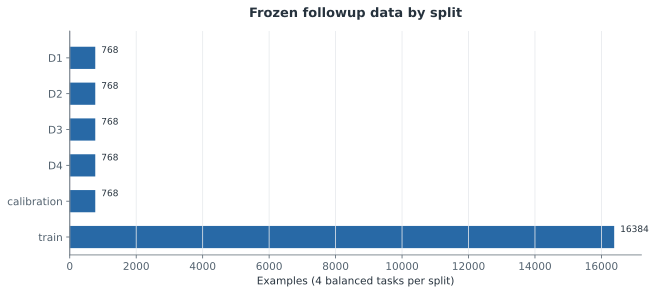

[그림 데이터](../../artifacts/followup-v2/figures/f0_f0_dataset.json)

[F0 측정값·불확실성·원본](../../reports/followup-v2/F0_REPORT.md)

### F1 — 5개 독립 초기화 학습과 calibration 전용 형식 선택

**MEASURED · INCONCLUSIVE**. 서로 다른 초기 파라미터 해시의 모델 5개 학습과 8개 모델의 calibration 형식 고정을 완료했다. 선택한 형식의 calibration 과제 셀 32개 중 14개가 사전 능력 기준을 충족했다. 이는 형식 선택에 사용한 표본의 진단이며 독립 D3/D4 일반화 결과가 아니다.

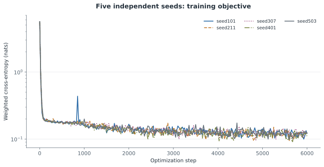

Training loss is not held-out competence. No D3/D4 outcomes are used in this figure.

[그림 데이터](../../artifacts/followup-v2/figures/f1_five_seed_training.json)

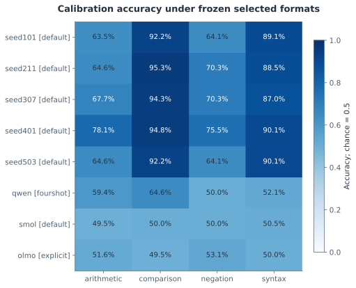

Selected on calibration itself; this is an in-sample readiness diagnostic, not final test accuracy.

[그림 데이터](../../artifacts/followup-v2/figures/f1_selected_calibration_accuracy.json)

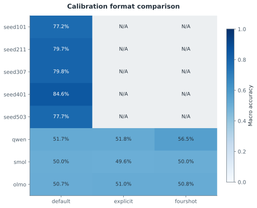

Byte-tokenizer models use default only; unevaluated formats are N/A. One format is frozen per model.

[그림 데이터](../../artifacts/followup-v2/figures/f1_calibration_variant_comparison.json)

[F1 측정값·불확실성·원본](../../reports/followup-v2/F1_REPORT.md)

### F2 — 정확한 뉴런 순열의 양성 대조군

**MEASURED · SUPPORTED**. 등록한 모델 내부 순열 대칭 대조군의 정렬·개입 검증을 통과했다. 이는 측정 파이프라인의 해당 회복 성질을 검사하며, 독립적으로 학습된 모델의 의미 보존을 입증하지 않는다.

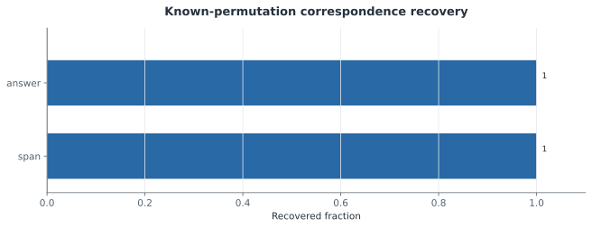

[그림 데이터](../../artifacts/followup-v2/figures/f2_permutation_recovery.json)

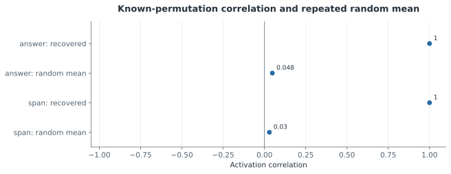

Random baseline has 100 realizations; its SD is reported separately and is not labeled a confidence interval.

[그림 데이터](../../artifacts/followup-v2/figures/f2_permutation_vs_random.json)

[F2 측정값·불확실성·원본](../../reports/followup-v2/F2_REPORT.md)

### F3 — 독립 시드·이종 계열의 두 위치 정렬과 학습 궤적

**MEASURED · INCONCLUSIVE**. 등록한 최종 모델 비교26개와 초기·중간 체크포인트 비교40개를 완료했다. 두 위치의 최종 모델쌍×과제 셀 중 52개에서 양쪽 모델의 능력 조건을 충족했다. 전체 과제 결과와 능력 조건을 구분하며, 학습 전 대응과 반복 무작위 매칭을 함께 공개한다. 확인 검정의 q값은 F6의 단일110개 BH family에서 가져왔다. 이종 계열은 calibration으로 고정한 서로 다른 프롬프트 접두 맥락을 사용하므로 동일 전체 입력의 비교가 아니며, 낮은 과제 능력에서 기능 보존의 부재를 결론내릴 수 없다. 사후 괄호 스트레스 분석에서 독립 학습 모델의 정확도는 인접 종류 불일치가 있는 pair 집합에서 93.4%–100.0%(n=166), 없는 집합에서 50.0%–61.5%(n=26)였다. 작은 사후 부분집합과 내용 차이를 포함한 연관성이므로 인과적 shortcut 사용 증거는 아니지만, 전체 정확도 능력 gate만으로 재귀적·구조적 이해를 입증할 수 없음을 보여 준다. 수 비교·부정 과제의 측정과는 구분한다.

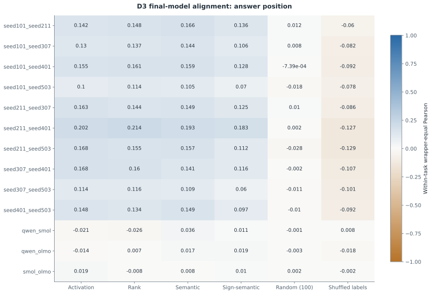

All task rows retained; competence-qualified strata are reported in the source. Random baseline averages100 frozen maps.

[그림 데이터](../../artifacts/followup-v2/figures/f3_final_answer.json)

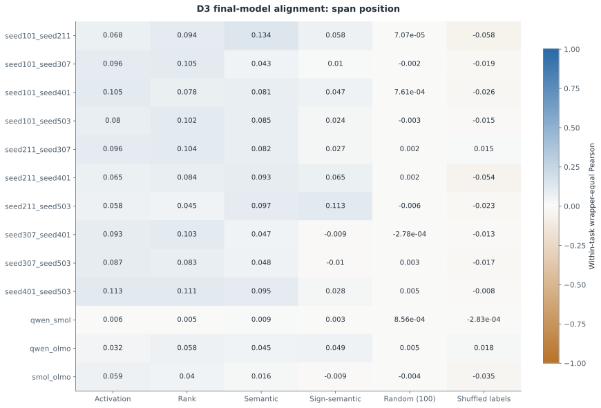

All task rows retained; competence-qualified strata are reported in the source. Random baseline averages100 frozen maps.

[그림 데이터](../../artifacts/followup-v2/figures/f3_final_span.json)

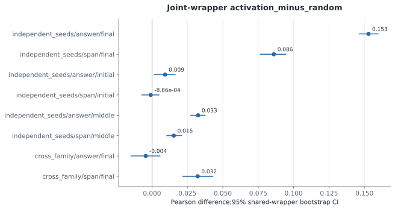

All observed pairs remain together inside each resampled wrapper; these intervals are conditional on the fixed model collection, not unseen model seeds.

[그림 데이터](../../artifacts/followup-v2/figures/f3_activation_minus_random.json)

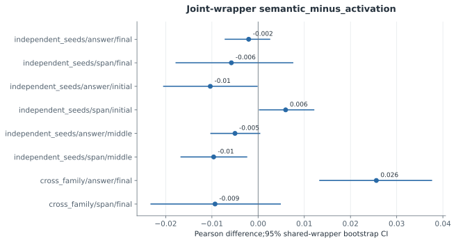

All observed pairs remain together inside each resampled wrapper; these intervals are conditional on the fixed model collection, not unseen model seeds.

[그림 데이터](../../artifacts/followup-v2/figures/f3_semantic_minus_activation.json)

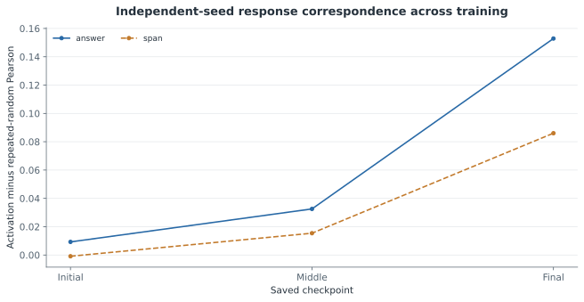

The same final-D1 neurons and final-D2 maps are reused at all checkpoints. This is descriptive tracking, not checkpoint-specific feature discovery.

[그림 데이터](../../artifacts/followup-v2/figures/f3_independent_seed_trajectory.json)

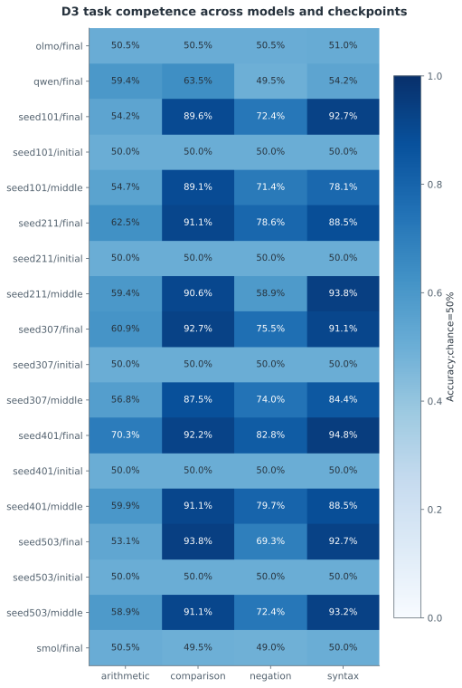

D3 was collected only after the registered D2 maps were frozen. Initial/middle/final are not independent model replications.

[그림 데이터](../../artifacts/followup-v2/figures/f3_trajectory_competence.json)

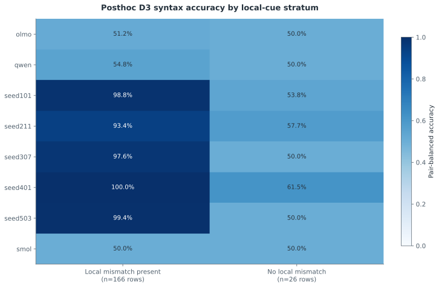

Exploratory cuts chosen after D3; both true/false pair members retained. N counts rows. Unequal content and small n=26 stratum confound differences; no causal cue-use claim or confirmatory test.

[그림 데이터](../../artifacts/followup-v2/figures/f3_posthoc_syntax_local_cue.json)

[F3 측정값·불확실성·원본](../../reports/followup-v2/F3_REPORT.md)

### F4 — 단일·그룹 뉴런 인과 정렬과 dose-response

**MEASURED · SUPPORTED (정답 위치의 등록된 truth-oriented 개입효과 상관 개선에 한정; 넓은 기능 보존은 판단 불가)**. 등록한 모델쌍·단위 종류26개에서 D4의 zero/mean/patch 인과 효과를 비교했다. 모델쌍×단위종류×과제 셀104개 중 52개가 양쪽 모델의 과제 능력 기준을 충족했다. 단일 뉴런과 그룹을 분리하며 dose-response는 주 정렬과 별도의 기술 진단으로 보존한다. 전역 다중검정은 F6의 단일110개 BH family로 완료했으며, 보정값과 해석 한계를 함께 보고한다. 이종 계열은 같은 목표 문장에도 서로 다른 calibration 선택 접두 맥락을 사용한다. 위치 정렬은 이 맥락 차이를 제거하지 않으며, 낮은 D4 능력에서는 기능 보존의 부재를 판정할 수 없다. 과제별 전체 쌍과 양측 능력 조건을 충족한 쌍의 인과 대응·누락 범위를 별도 기술 표로 공개한다. D4 결과에 따른 부분집합 구분이며 추가 검정이나 재학습이 아니다. 괄호 정확도 gate 통과만으로 재귀적·구조적 이해를 보장하지 않는다. 주 F4의 activation 매칭 대조군 누락은 별도의 사후 보충 분석으로 점검했다. D2에서만 맞춘 raw activation과 task-centered activation을 모두 보존·공개하며, 이 분석을 사전 등록된 주 결과나 새로운 확증 검정으로 취급하지 않는다. 별도 응답 방향 진단에서 이종 계열 answer 위치의 combined 상관은 truth → yes → within-label 순서로 single 0.04353 → 0.00030 → -0.00013, group 0.05507 → 0.00070 → 0.00830였다. 유효 셀 범위가 달라질 수 있는 탐색적 진단이며 응답 방향 혼입 가능성을 점검한다. 낮은 과제 능력과 함께 읽어야 하며 혼입의 유일한 원인을 입증하지 않는다. 최종 과학 검토: 고정 D2 절차를 새 D4 문항에 적용했을 때, 독립 시드 answer 위치의 combined−semantic 차이는 single +0.05870 (95% wrapper CI [+0.04763, +0.06991]), group +0.06778 (95% wrapper CI [+0.05201, +0.08372])였다. 원래 110개 검정군의 BH에서 양의 pair 효과는 single 8/10, group 4/10이고, 사후 BY 민감도에서는 7/10, 4/10이다. 이 사실은 정답 방향으로 정의된 zero/mean/patch 효과의 대응 지표에 한정한 개선을 지지한다. 위 cohort CI는 고정 모델·공유 wrapper에 조건부인 기술적 구간이며 다중검정 보정 구간이 아니다. Group span 차이는 +0.00161 (95% wrapper CI [-0.00997, +0.01340])로 일관된 span 개선을 보이지 않는다. Tiny single-answer fit 6/10과 공개 single-answer fit 3/3은 인과 가중치 1을 선택했으므로 의미·인과 정보의 시너지를 입증하지 않는다. 같은 정답끼리 비교한 tiny answer의 절대 상관은 single 0.01726, group 0.03797로 더 약하며, view 간 감소를 별도의 확증적 차이 검정으로 취급하지 않는다. Activation 기준선 대비 비교는 사후 보충 분석이다. 넓은 의미의 인과 기능 보존·회로 동등성·이식 유용성은 여전히 판단 불가다. 적용 범위: 정답 위치의 등록된 truth-oriented 개입효과 상관 개선에 한정; 넓은 기능 보존은 판단 불가.

원본 단계 스냅샷의 잠정 판정: **INCONCLUSIVE**. 현재 표시: **SUPPORTED (정답 위치의 등록된 truth-oriented 개입효과 상관 개선에 한정; 넓은 기능 보존은 판단 불가)**. [최종 검토 근거](../../results/followup-v2/scientific_review.json).

[과제별 전체/능력충족 쌍의 인과 대응과 누락 범위](../../reports/followup-v2/CAUSAL_COMPETENCE.md). 이 구분은 D4 결과를 조건으로 한 기술 통계이며, 추가 CI·p값·재학습을 포함하지 않습니다.

[Raw/task-centered activation 인과 기준선의 사후 비교](../../reports/followup-v2/CAUSAL_ACTIVATION_BASELINES.md). 두 대조군을 모두 공개하며 주110개 검정·p/q값은 바꾸지 않습니다.

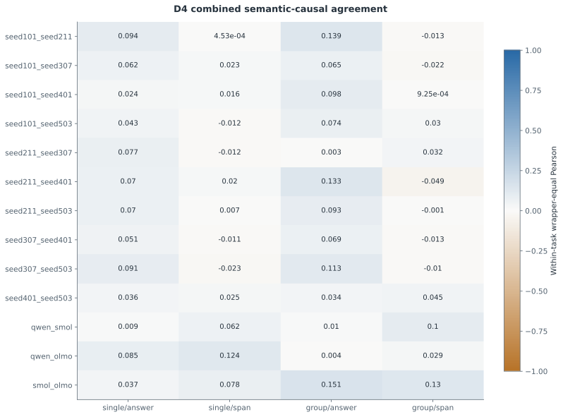

Primary evaluation uses zero/mean/patch only. Dose modes are supplementary; no trivial scale=1 identity enters matching.

[그림 데이터](../../artifacts/followup-v2/figures/f4_combined_causal_agreement.json)

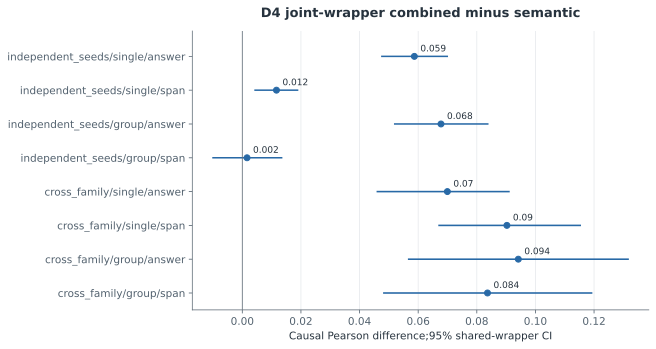

Observed pairs are retained jointly inside wrappers; q values are supplied by the final110-member global BH family.

[그림 데이터](../../artifacts/followup-v2/figures/f4_combined_minus_semantic.json)

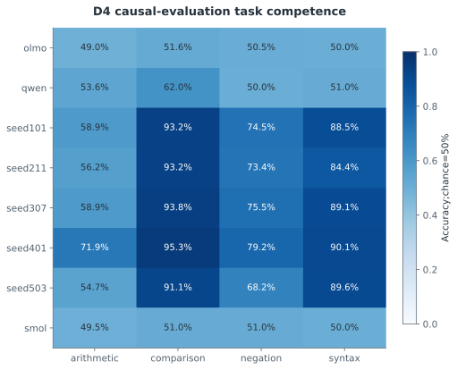

D4 competence is measured separately from D3. Low competence is retained as a control, not interpreted as evidence against an unlearned function.

[그림 데이터](../../artifacts/followup-v2/figures/f4_d4_competence.json)

[F4 측정값·불확실성·원본](../../reports/followup-v2/F4_REPORT.md)

### F5 — 뉴런 이식과 선택적 보간 병합

**MEASURED · NOT SUPPORTED (선택 정책의 유용한 전이 개선은 확립되지 않음)**. 등록한 방향성 모델 쌍 5개의 D2 정책과 D4 평가를 완료했다. 1개 쌍에서 이식 정책을 선택했고 나머지는 미수정 모델을 유지했다. 선택 정책의 목표 과제 평균 변화는 +0.1042 percentage points(95% wrapper CI [0.0000, 0.3125], p=1.0000)였다. 주요 비교는 관측 모델들을 wrapper 안에서 함께 평균한 선택 정책 대 원래 모델의 차이이며, F6의 단일110개 BH family 보정값을 함께 보고하며, 효과와 과제 능력·설계 한계를 종합해 해석한다. 선택하지 않은 대조군을 포함한 쌍당24개 조건을 모두 공개한다. Naive 전체 파라미터 평균 alpha=0.5의 comparison 정확도 변화는 -45.31–-41.15 percentage points였다. Alpha=1은 donor 전체 교체이며 병합 성공으로 해석하지 않는다. 최종 과학 검토: 선택 정책의 D4 목표 과제 평균 변화는 +0.1042 percentage points, 95% wrapper CI [0, +0.3125] percentage points, p=q=1이었다. 한 쌍의 한 wrapper에서 192문항 중 정답 한 개가 늘었고 네 쌍은 정책을 선택하지 않았다. 유용한 전이 개선이 확립되지 않았다는 판정이며 효과가 정확히 0이거나 모든 병합이 불가능하다는 뜻은 아니다. Naive 50% 전체 평균은 comparison 정확도를 41.15–45.31 percentage points 낮췄고, alpha=1은 donor 전체 교체이므로 병합 성공으로 해석하지 않는다. 적용 범위: 선택 정책의 유용한 전이 개선은 확립되지 않음.

원본 단계 스냅샷의 잠정 판정: **INCONCLUSIVE**. 현재 표시: **NOT SUPPORTED (선택 정책의 유용한 전이 개선은 확립되지 않음)**. [최종 검토 근거](../../results/followup-v2/scientific_review.json).

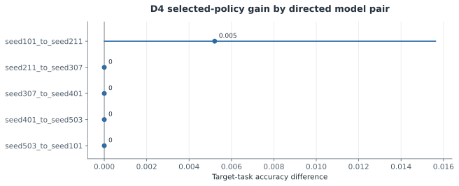

Pair intervals are descriptive; five pairs reuse models. The registered primary test averages pairs within wrappers.

[그림 데이터](../../artifacts/followup-v2/figures/f5_selected_policy_gain.json)

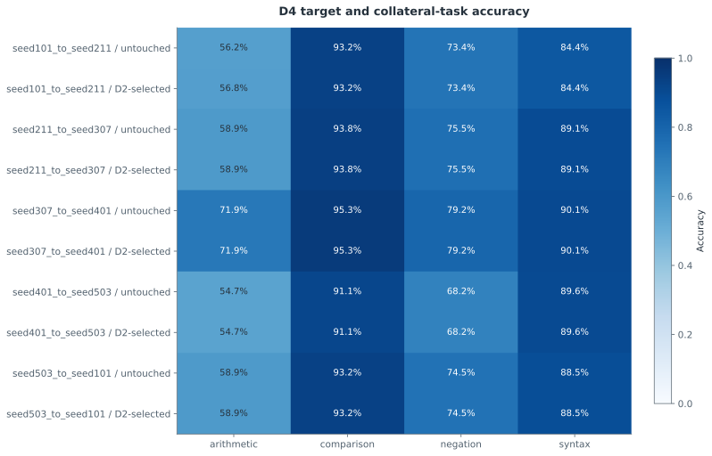

Only the D2-selected policy and untouched target are contrasted here; D4 does not choose a policy.

[그림 데이터](../../artifacts/followup-v2/figures/f5_target_and_collateral_accuracy.json)

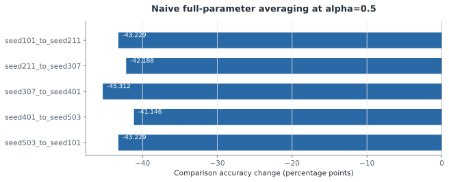

Descriptive unselected control; D2 policy is unchanged. Every pair has192 comparison rows. Alpha=1 is full donor replacement, not merging success. All24 conditions per pair are reported in F5_ALL_CONDITIONS.md.

[그림 데이터](../../artifacts/followup-v2/figures/f5_naive_half_comparison_retention.json)

[F5 측정값·불확실성·원본](../../reports/followup-v2/F5_REPORT.md)

### F6 — 전역 보정·재현 검증과 최종 연구 판정

**MEASURED · INCONCLUSIVE**. 원래 pilot 결과와 원래 README 사본을 보존하고 검증했다(로컬 검증261개). 독립 학습 모델의 activation−random 평균 대응 차이는 answer 0.1529, span 0.0860였고, semantic−activation 차이는 각각 -0.0020, -0.0058였다. 독립 시드의 인과 결합−의미 단독 차이는 single/answer +0.0587, single/span +0.0117, group/answer +0.0678, group/span +0.0016였다. D2 선택 이식 정책의 D4 목표 과제 평균 변화는 +0.1042 percentage points였다. 새768개 hard syntax 문항에서 학습 완료5개 모델의 정확도 범위는 50.3%–56.1%였다. 전체110개 주 검정을 하나의 BH family로 보정하고170개 테스트 및 저장 수치 replay를 통과했다. 확증적 q와 기술적 cohort CI를 구분하며, 높은 합성 과제 정확도·개입 상관만으로 보편적 의미 기능 보존이나 재귀 이해를 입증하지 않는다. 네 연구 질문의 최종 판정은 별도 과학 검토의 근거와 적용 범위를 따른다. 배포 아카이브 replay 상태는 COMPLETE이며, 검증 파일 245개·생략 파일 16개의 범위를 따로 기록했다. 과제별 전체 쌍과 양측 능력 조건을 충족한 쌍의 인과 대응·누락 범위를 별도 기술 표로 공개한다. D4 결과에 따른 부분집합 구분이며 추가 검정이나 재학습이 아니다. 괄호 정확도 gate 통과만으로 재귀적·구조적 이해를 보장하지 않는다. 주 F4의 activation 매칭 대조군 누락은 별도의 사후 보충 분석으로 점검했다. D2에서만 맞춘 raw activation과 task-centered activation을 모두 보존·공개하며, 이 분석을 사전 등록된 주 결과나 새로운 확증 검정으로 취급하지 않는다.

같은110개 원래 p값의 사후 민감도 분석에서 q<0.05 기각 수는 주 분석 BH 58개, BY 43개였다. BH 원래 값은 SciPy 독립 재계산과 일치했다. BY는 유효한 p값 사이의 임의 의존성에 대한 더 보수적인 보정이며, 기존 BH 결과·가설 수·p값을 바꾸지 않았다. 기각 수는 기능 보존 가설의 지지 수가 아니다. BY도 잘못된 p값, wrapper sign-flip의 교환가능성·대칭성 위반, 낮은 과제 능력 또는 construct confound를 고치지 않는다. [SciPy 공식 문서](https://docs.scipy.org/doc/scipy/reference/generated/scipy.stats.false_discovery_control.html) · [민감도 상세](../../reports/followup-v2/DEPENDENCE_SENSITIVITY.md)

기록된 모델 단계 경과시간 합계는 2.528577시간이다. 최대 기록 Torch allocated memory는 34.06857GiB이며, resource-accounting 스냅샷 당시 명시한 후속 디렉터리 합계는 1.412713GiB였다. 경과시간에는 CPU·I/O·전송 overhead가 포함되며 GPU 활성시간·이용률·프로젝트 전체 경과시간이 아니다. Torch allocated는 전체 물리 VRAM 사용량과 다르다. 디스크 합계에는 로컬 체크포인트와 재시작 chunk가 포함되지만 기존 base-model cache와 무관한 workspace 파일은 제외한다. [원본 기록](../../results/followup-v2/resource_accounting.json)

[과제별 전체/능력충족 쌍의 인과 대응과 누락 범위](../../reports/followup-v2/CAUSAL_COMPETENCE.md). 이 구분은 D4 결과를 조건으로 한 기술 통계이며, 추가 CI·p값·재학습을 포함하지 않습니다.

[Raw/task-centered activation 인과 기준선의 사후 비교](../../reports/followup-v2/CAUSAL_ACTIVATION_BASELINES.md). 두 대조군을 모두 공개하며 주110개 검정·p/q값은 바꾸지 않습니다.

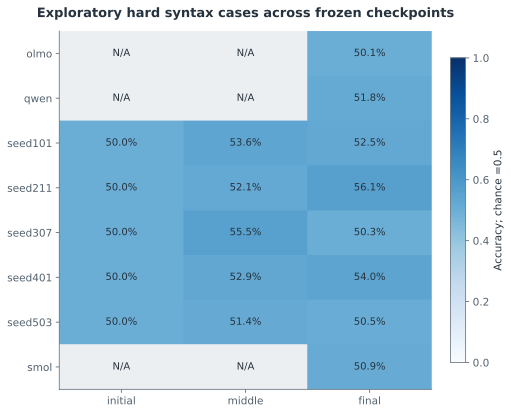

New768-row dataset was frozen before its inference, after D3 motivated the question. No retraining/refitting; this remains posthoc exploratory evidence, outside the110 primary tests. Pretrained initial/middle checkpoints are N/A.

[그림 데이터](../../artifacts/followup-v2/figures/f6_hard_stress_checkpoints.json)

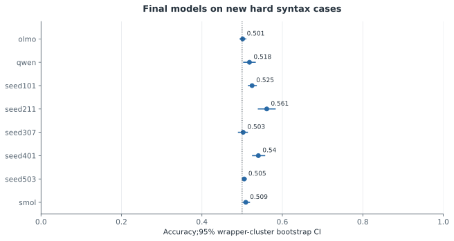

Chance=.5 reference; uncertainty is conditional on these frozen models and this generated dataset.

[그림 데이터](../../artifacts/followup-v2/figures/f6_hard_stress_final_intervals.json)

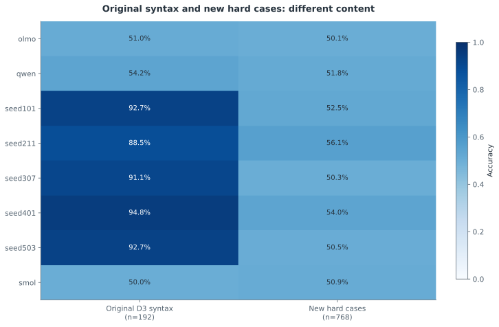

The datasets differ in content and construction. Their accuracy difference is not a randomized causal estimate of shortcut use and does not prove or disprove recursive parsing.

[그림 데이터](../../artifacts/followup-v2/figures/f6_syntax_original_vs_hard.json)

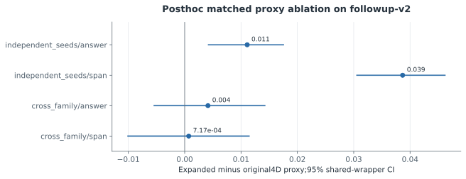

Requested after D3 observation. Samev2 data, frozen candidates and evaluation metric; not independent confirmation or attribution of the full pilot-v1 to followup-v2 change.

[그림 데이터](../../artifacts/followup-v2/figures/f6_proxy_ablation.json)

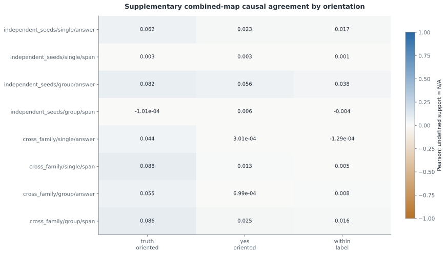

Same frozen maps and primary zero/mean/patch interventions. Views may have different identifiable cell support; constant/insufficient scores remain N/A. Within-label attenuation is consistent with answer-orientation confounding, not proof of its exclusive cause.

[그림 데이터](../../artifacts/followup-v2/figures/f6_causal_answer_orientation.json)

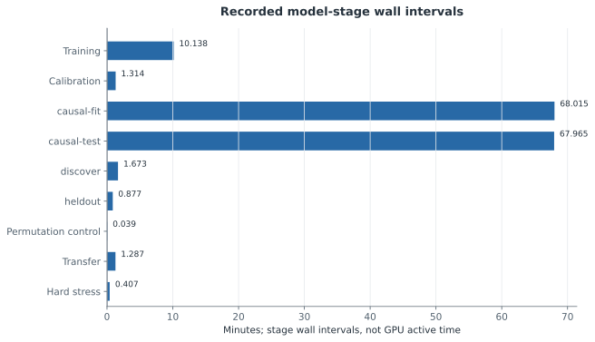

Sum of saved serial model-stage wall intervals, including CPU/IO/transfer overhead. An upper wall-duration accounting for recorded GPU-bearing stages, not GPU utilization, active kernel time, or complete project elapsed time. CPU statistical analysis and reporting are excluded. Training is counted once via aggregate runtime; its per-seed manifests are not added again.

[그림 데이터](../../artifacts/followup-v2/figures/f6_recorded_wall_intervals.json)

[F6 측정값·불확실성·원본](../../reports/followup-v2/F6_REPORT.md)

[연구 해석 한계와 비판](../../reports/followup-v2/RESEARCH_CRITIQUE.md)

