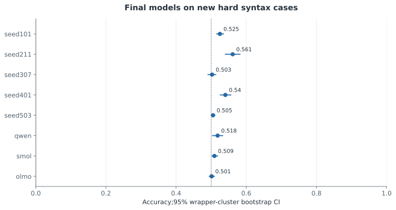
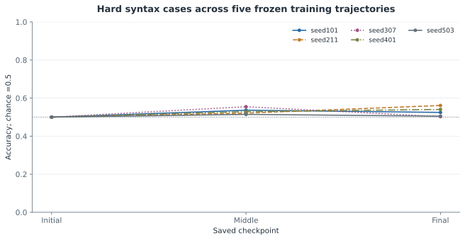

# 새 hard syntax 문항의 탐색적 검증

**COMPLETE_EXPLORATORY · 주110개 검정에 포함하지 않음.**

사후 D3 진단에서 동기를 얻어 새 hard syntax768문항(참·거짓 각384,24wrappers)을 구성·동결한 뒤18개 모델/체크포인트 측정을 완료했다. 학습 완료5개 모델의 정확도는 50.26%–56.12%였고, 원래 D3 괄호 정확도는 88.54%–94.79%였다. 새 문항에서 이 모델들의 yes 응답률은 76.17%–99.22%로, 균형 정확도와 함께 응답 편향을 확인해야 한다. 두 집합은 내용·구조 분포가 달라 점수 차이가 shortcut 사용의 인과적 증거는 아니다. 이 결과는 전체 정확도 gate만으로 재귀 이해를 입증할 수 없음을 강조하며, 새로운 독립 확증 검정이나 원래 주 분석의 변경으로 취급하지 않는다.

768 balanced rows in24 wrappers; dotted line marks chance50%. These are posthoc-motivated new cases, frozen before inference, outside the110 primary tests.

[정확한 그림 값과 출처](../../artifacts/followup-v2/figures/supplement_hard_final_accuracy.json)

Five separately initialized models; each line reuses one model across checkpoints. No retraining or checkpoint selection. This is not independent replication at each point.

[정확한 그림 값과 출처](../../artifacts/followup-v2/figures/supplement_hard_checkpoint_trajectory.json)

## 모든18개 측정과 응답 편향

| 모델 | 체크포인트 | n / wrappers | 정확도 |95% cluster CI | 참 정확도 | 거짓 정확도 | yes 비율 | tie 비율 |
|---|---|---:|---:|---|---:|---:|---:|---:|
| [seed101](../../results/followup-v2/hard_stress/seed101/initial/summary.json) | initial | 768 / 24 | 50.00% | [0.5, 0.5] | 0.00% | 100.00% | 0.00% | 0.00% |
| [seed101](../../results/followup-v2/hard_stress/seed101/middle/summary.json) | middle | 768 / 24 | 53.65% | [0.5182, 0.5547] | 86.72% | 20.57% | 83.07% | 0.00% |
| [seed101](../../results/followup-v2/hard_stress/seed101/final/summary.json) | final | 768 / 24 | 52.47% | [0.5156, 0.5352] | 99.22% | 5.73% | 96.74% | 0.00% |
| [seed211](../../results/followup-v2/hard_stress/seed211/initial/summary.json) | initial | 768 / 24 | 50.00% | [0.5, 0.5] | 0.00% | 100.00% | 0.00% | 0.00% |
| [seed211](../../results/followup-v2/hard_stress/seed211/middle/summary.json) | middle | 768 / 24 | 52.08% | [0.5078, 0.5339] | 98.18% | 5.99% | 96.09% | 0.00% |
| [seed211](../../results/followup-v2/hard_stress/seed211/final/summary.json) | final | 768 / 24 | 56.12% | [0.5403, 0.582] | 82.29% | 29.95% | 76.17% | 0.00% |
| [seed307](../../results/followup-v2/hard_stress/seed307/initial/summary.json) | initial | 768 / 24 | 50.00% | [0.5, 0.5] | 0.00% | 100.00% | 0.00% | 0.00% |
| [seed307](../../results/followup-v2/hard_stress/seed307/middle/summary.json) | middle | 768 / 24 | 55.47% | [0.5391, 0.5703] | 96.35% | 14.58% | 90.89% | 0.00% |
| [seed307](../../results/followup-v2/hard_stress/seed307/final/summary.json) | final | 768 / 24 | 50.26% | [0.4909, 0.513] | 93.23% | 7.29% | 92.97% | 0.00% |
| [seed401](../../results/followup-v2/hard_stress/seed401/initial/summary.json) | initial | 768 / 24 | 50.00% | [0.5, 0.5] | 0.00% | 100.00% | 0.00% | 0.00% |
| [seed401](../../results/followup-v2/hard_stress/seed401/middle/summary.json) | middle | 768 / 24 | 52.86% | [0.5182, 0.5404] | 100.00% | 5.73% | 97.14% | 0.00% |
| [seed401](../../results/followup-v2/hard_stress/seed401/final/summary.json) | final | 768 / 24 | 54.04% | [0.526, 0.556] | 100.00% | 8.07% | 95.96% | 0.00% |
| [seed503](../../results/followup-v2/hard_stress/seed503/initial/summary.json) | initial | 768 / 24 | 50.00% | [0.5, 0.5] | 0.00% | 100.00% | 0.00% | 0.00% |
| [seed503](../../results/followup-v2/hard_stress/seed503/middle/summary.json) | middle | 768 / 24 | 51.43% | [0.5065, 0.5221] | 99.74% | 3.12% | 98.31% | 0.00% |
| [seed503](../../results/followup-v2/hard_stress/seed503/final/summary.json) | final | 768 / 24 | 50.52% | [0.5013, 0.5104] | 99.74% | 1.30% | 99.22% | 0.00% |
| [qwen](../../results/followup-v2/hard_stress/qwen/final/summary.json) | final | 768 / 24 | 51.82% | [0.5039, 0.5326] | 80.73% | 22.92% | 78.91% | 0.00% |
| [smol](../../results/followup-v2/hard_stress/smol/final/summary.json) | final | 768 / 24 | 50.91% | [0.5026, 0.5182] | 46.88% | 54.95% | 45.96% | 0.00% |
| [olmo](../../results/followup-v2/hard_stress/olmo/final/summary.json) | final | 768 / 24 | 50.13% | [0.4948, 0.5091] | 86.72% | 13.54% | 86.59% | 0.00% |

## 원래 D3와 새 문항: 내용이 다른 기술 비교

| 모델 | 원래 D3 syntax (n=192) | 새 hard syntax (n=768) |
|---|---:|---:|
| seed101 | [92.71%](../../results/followup-v2/alignment/seed101_seed503/span/eval.json) | 52.47% |
| seed211 | [88.54%](../../results/followup-v2/alignment/seed211_seed503/span/eval.json) | 56.12% |
| seed307 | [91.15%](../../results/followup-v2/alignment/seed307_seed503/span/eval.json) | 50.26% |
| seed401 | [94.79%](../../results/followup-v2/alignment/seed401_seed503/span/eval.json) | 54.04% |
| seed503 | [92.71%](../../results/followup-v2/alignment/seed401_seed503/span/eval.json) | 50.52% |
| qwen | [54.17%](../../results/followup-v2/alignment/qwen_olmo/span/eval.json) | 51.82% |
| smol | [50.00%](../../results/followup-v2/alignment/smol_olmo/span/eval.json) | 50.91% |
| olmo | [51.04%](../../results/followup-v2/alignment/smol_olmo/span/eval.json) | 50.13% |

## 한계

- Post-hoc motivated by D3 local-cue weakness; fresh outcomes do not make it preregistered primary evidence.
- Valid strings need suitable closing runs, so their structural distribution differs from the original syntax corpus.
- Equal5..8pair length range prevents longer strings being the sole explanation; depth distribution can still differ.
- Removing adjacent type mismatches does not remove every finite-state/local cue or prove recursive parsing.
- Wrappers were already inspected in D3; only content/outcomes are new.
- All18 confidence intervals are descriptive wrapper-cluster bootstrap intervals conditional on fixed models; no global claims are inferred from overlap or individual exploratory p-values.
- Balanced true/false pairs make chance accuracy50%; yes preference and true/false accuracy can still be highly asymmetric. Ties count as incorrect.
- Different calibration-selected prefix contexts remain for Qwen, Smol and OLMo; matched target content does not mean identical full prompts.
- Original D3 and the hard set differ in content and structural distribution. Their difference is not a controlled causal effect or proof of recursive parsing.

## 원본

- [results/followup-v2/hard_stress/summary.json](../../results/followup-v2/hard_stress/summary.json)
- [results/followup-v2/hard_stress/seed101/initial/summary.json](../../results/followup-v2/hard_stress/seed101/initial/summary.json)
- [results/followup-v2/hard_stress/seed101/middle/summary.json](../../results/followup-v2/hard_stress/seed101/middle/summary.json)
- [results/followup-v2/hard_stress/seed101/final/summary.json](../../results/followup-v2/hard_stress/seed101/final/summary.json)
- [results/followup-v2/hard_stress/seed211/initial/summary.json](../../results/followup-v2/hard_stress/seed211/initial/summary.json)
- [results/followup-v2/hard_stress/seed211/middle/summary.json](../../results/followup-v2/hard_stress/seed211/middle/summary.json)
- [results/followup-v2/hard_stress/seed211/final/summary.json](../../results/followup-v2/hard_stress/seed211/final/summary.json)
- [results/followup-v2/hard_stress/seed307/initial/summary.json](../../results/followup-v2/hard_stress/seed307/initial/summary.json)
- [results/followup-v2/hard_stress/seed307/middle/summary.json](../../results/followup-v2/hard_stress/seed307/middle/summary.json)
- [results/followup-v2/hard_stress/seed307/final/summary.json](../../results/followup-v2/hard_stress/seed307/final/summary.json)
- [results/followup-v2/hard_stress/seed401/initial/summary.json](../../results/followup-v2/hard_stress/seed401/initial/summary.json)
- [results/followup-v2/hard_stress/seed401/middle/summary.json](../../results/followup-v2/hard_stress/seed401/middle/summary.json)
- [results/followup-v2/hard_stress/seed401/final/summary.json](../../results/followup-v2/hard_stress/seed401/final/summary.json)
- [results/followup-v2/hard_stress/seed503/initial/summary.json](../../results/followup-v2/hard_stress/seed503/initial/summary.json)
- [results/followup-v2/hard_stress/seed503/middle/summary.json](../../results/followup-v2/hard_stress/seed503/middle/summary.json)
- [results/followup-v2/hard_stress/seed503/final/summary.json](../../results/followup-v2/hard_stress/seed503/final/summary.json)
- [results/followup-v2/hard_stress/qwen/final/summary.json](../../results/followup-v2/hard_stress/qwen/final/summary.json)
- [results/followup-v2/hard_stress/smol/final/summary.json](../../results/followup-v2/hard_stress/smol/final/summary.json)
- [results/followup-v2/hard_stress/olmo/final/summary.json](../../results/followup-v2/hard_stress/olmo/final/summary.json)
- [data/followup-v2-hard-stress/manifest.json](../../data/followup-v2-hard-stress/manifest.json)
- [src/followup_hard_stress.py](../../src/followup_hard_stress.py)
