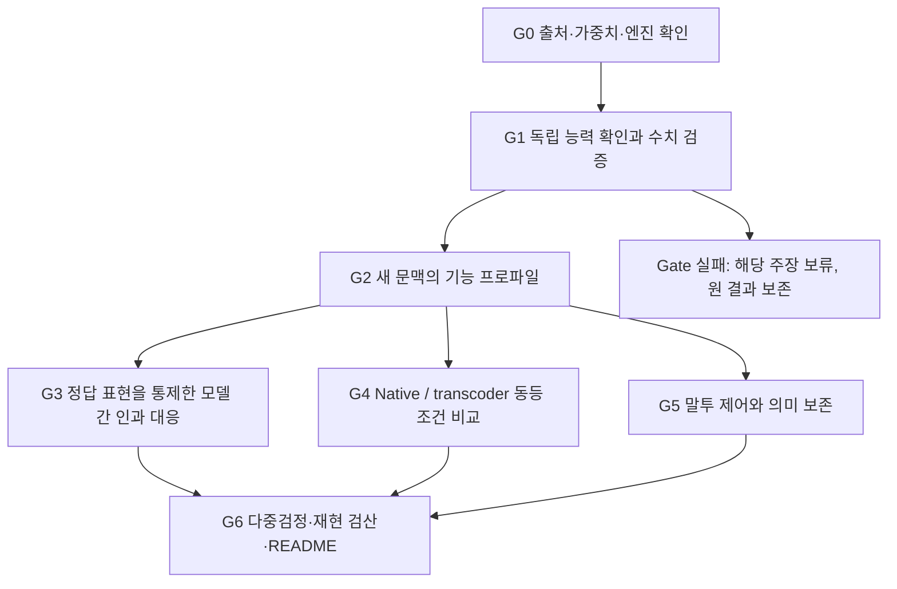

# Followup-v3: Gemma map에서 예측 가능한 인과 기능으로

상태: **DESIGNED_NOT_RUN — 설계 완료, 새 모델 실험 미실행**. 2026-11-04.

이 문서는 사용자 제공 Gemma 4 E2B neuron map과 WSP2 followup-v2를 함께 검토한 새 실험 설계다. [외부 자료 검토](REFERENCE_REVIEW.md), [기계 판독 설정](../../configs/followup_v3_gemma_map.json), [v2 최종 판정](../../results/followup-v2/scientific_review.json)을 연결한다. 기존 결과는 수정하지 않는다. 이 문서는 최종 preregistration이 아니라 **실행 전 준비 실험과 동결 절차까지 규정한 설계**다. 준비 단계에서 확정할 모델·데이터·엔진 해시가 비어 있는 동안 확증 시험을 시작하지 않는다.

## 연구 방향

우선순위는 **의미 측정의 타당성 → 선택적인 인과 효과 → 모델 간 대응 → 표현 방식 비교 → 의미를 보존하는 제어**다. 바로 더 큰 이식/병합을 수행하는 것은 우선순위에서 제외한다. v2의 이식 성과는 유의하지 않았고, 인과 반응의 상관도 기능 보존 전체를 입증하지 못했기 때문이다.

외부 지도의 top-context, 정적 lens, AI 라벨, decoder 이웃은 서로 다른 증거다. 이를 기능 정답표로 합치지 않는다. 공개 지도는 이미 관찰된 discovery 자료로만 취급하고, 모든 주요 결론은 새 문항과 고정된 평가 절차에서 얻는다.

## 기존 문제를 어떻게 보완하는가

| 확인된 문제 | 새 설계 | 성공으로 인정하지 않는 경우 |
|---|---|---|
| v2 truth-oriented 상관이 같은 정답 안에서 약해짐 | truth×답 코드×언어별 내부 효과 비교, 전체 continuation 점수, 정답 부호 곱 제거 | 정답 방향으로 다시 합쳤을 때만 높은 상관 |
| 공개 모델 양측 능력 기준 미통과 | 별도 readiness 자료로 모델·과제 적격성 결정; 시험 전체와 적격 집합을 고정해 보고 | 낮은 능력을 기능 부재의 증거로 해석 |
| semantic proxy가 activation보다 우수하지 않음 | 실제 자연어 문맥·최소 대조쌍·미설명 비율; lexical 및 raw/centered activation 대조군을 처음부터 포함 | 같은 fingerprint를 만들고 그 유사도로 다시 성능 평가 |
| 어려운 괄호 과제에서 일반화 실패 | source/template 계보 분리, 형태·어휘가 같은 의미 대조, 별도 구조 OOD | 이름이나 단어만 바꾼 변형을 독립 표본으로 계산 |
| 외부 지도 native clamp와 feature addition이 비대칭 | 공통 raw-MLP 위치에서 동일한 차분 개입과 노름 예산 적용 | 서로 다른 개입 연산의 성과를 표현 우열로 해석 |
| 정적 lens·단어 재등장과 의미 기능의 혼동 | 렌즈/활성/개입 점수 분리, 객관적 사실 슬롯 정확도 | 관련 토큰을 생성했으므로 기능을 이해했다고 주장 |
| fidelity·유창성 gate의 사후 수정 | 별도 pilot에서 규칙 확정 후 시험 동결; 이후 실패는 그대로 실패 | 같은 시험 결과를 보고 threshold나 제외 기준 변경 |

## G0 — 출처와 실행 가능성

외부 참조는 `c2dfd9e7a54c745824ffe2472ab15040ffb8048f`, WSP2 완료 기준은 `e0644b14dbdf095240e6bea3997c657e4ad55a90`로 고정한다. 원 지도 GGUF SHA256은 `740185b21d22ceb83a11c3aa62ad5842ef32c70f6096d756bbee85a1e4ec34b8`이다. 이 해시의 모델·tokenizer를 확보하고 이용 조건을 충족해야 원 지도 ID를 직접 재사용할 수 있다. 이번 작업에서는 모델을 다운로드하거나 추론하지 않았다. 작업공간 파일 검색에서는 Gemma GGUF나 transcoder 가중치를 찾지 못했으며 시스템 전체 캐시의 부재를 주장하지 않는다.

원 round3/round4의 전체 inference/training 소스와 transcoder 가중치는 현재 검토한 공개 tree에서 확인되지 않는다. 공개 JSON 재계산, 동일 모델의 독립 엔진 구현, 새 transcoder 학습을 각각 다른 재현 범주로 기록한다. 같은 계열의 다른 HF checkpoint를 쓰면 별도 모델 버전으로 새 atlas를 만들고 원 GGUF의 neuron/feature ID와 동일하다고 취급하지 않는다.

주 모델 간 비교는 **검증된 Gemma 모델 ↔ 기존 캐시의 Qwen3-0.6B-Base 한 쌍**으로 제한한다. 실제 revision과 tokenizer SHA는 G0에서 채운다. SmolLM2/OLMo는 사전 지정한 보조 비교 후보이며, readiness에서 실패하면 원시 진단만 남긴다. 여러 공개 모델 쌍을 독립적인 사전학습 반복으로 세지 않는다. Gemma를 확보하지 못하면 공개 자료 분석까지 완료하고 Gemma 추론 단계는 BLOCKED_DEPENDENCY로 남긴다. 임의 대체 모델의 성공을 Gemma 결과로 발표하지 않는다.

산출물: `source_manifest.json`, `model_manifest.json`, `engine_manifest.json`, `preservation_before.json`, `capability_and_cost_pilot.json`. G0에서 처리량·VRAM·디스크를 다시 측정하고 이후 test를 열기 전에 전체 실행량을 산정한다.

## 데이터와 동결 절차

| Split | 독립 source/scenario family 목표 수 | 용도 |
|---|---:|---|
| E: engineering pilot | 32 | 엔진·문항 생성기·parser·처리량 확인. 최종 추론에 사용하지 않음 |
| R: readiness | 64 | E에서 정한 공통 prompt를 고정한 뒤 과제 능력 gate만 평가 |
| D: discovery | 96 | 후보 단위와 개념 프로파일, 설명 후보 및 lexical 대조군 구축 |
| F: fit | 96 | 64개 family로 정렬·회귀 적합, 32개로 방법·강도·매칭 임계값 선택 |
| T: confirmatory | 320 | 한 번의 고정 평가, 가설 선택·문턱 수정 금지 |
| O: structural/domain OOD | 96 | 장문·새 구조·코드 혼합·분포 이동의 별도 탐색 평가 |

총 704 family, 각 family에 의미 상태2 × 어휘 표현2 × 답 코드2 × 한국어/영어2 = **16변형, 11,264문항 목표**다. 16변형은 표본 수를 16배 늘리지 않는다. 네 내용 축(부정, 소유/지시 대상, 시간 순서, 수 비교)을 균형 배정한다. 한국어·영어 번역쌍, paraphrase, 동일 원문에서 파생한 대조쌍은 같은 family와 split에 둔다. 하나의 문서 또는 생성 template 계보가 여러 family를 낳으면 그 상위 계보를 cluster로 사용하며 실제 독립 cluster 수를 별도 보고한다.

E/R/D/F/T/O 사이 document ID·정규화 텍스트 해시·template 계보·내용 triple을 검사한다. 외부 공개 지도에서 가져온 문맥은 D 전용이며, 기존 v2 D3/D4와 hard-stress는 새 T에 재사용하지 않는다. 테스트 family의 내용과 template은 R/D/F와 겹치지 않게 설계한다. 단어 개수·길이·답 위치·부정어 출현만으로 정답을 예측하는 text-only 기준선을 R/D/F에서 확인한다.

F는 처음부터 family 단위 64/32로 고정한다. 모든 후보 ID·레이어·matching weights·dose·scorer·가설 목록·코드·데이터 manifest를 해시로 고정한 뒤 T를 수집/개봉한다. T는 실행 중 자동 보고의 대상이 될 수 있으나, 중간 결과에 따라 설정을 바꾸지 않는다. 버그 수정이 결과 선택에 영향을 줄 수 있으면 기존 실행은 INVALID로 보존하고 새 T와 새 버전으로 재시작한다.

## G1 — 엔진과 과제 능력 확인

Gemma hook은 실제 `GELU_tanh(gate) * up`과 `ffn_down` 입력을 사용한다. PLE, KV 공유, post-FFN norm, layer scaling, output norm, softcap, BOS/EOG를 보존한다. Layer는 0-based임을 모든 파일에 기록한다. 기존 SwiGLU 모델의 단위 정의와 구분한다.

검증은 실제 사용할 길이·레이어·개입 위치에서 수행한다. 기본 logits/activation뿐 아니라 intervention Δlogits, identity/zero-dose, chunked/full forward, greedy continuation, native 차분 주입의 등가성을 확인한다. 수치 허용 오차는 E의 독립 reference 비교로 고정하며, 원 엔진과 비교하지 못한 상태를 REPRODUCED로 표시하지 않는다. 원 지도의 FP32 경로를 BF16 재현과 혼동하지 않는다.

양측 모델은 각 내용 축·언어에서 R 정확도 ≥0.75, **family bootstrap 95% 하한 >0.50**을 만족해야 한다. 동일한 raw text와 공통 prompt를 주 조건으로 사용한다. 모델별 few-shot/chat prefix 최적화는 보조 조건으로 분리한다. 같은 underlying text라도 token ID는 비교하지 않고 문자 오프셋으로 위치를 맞춘다. R을 본 뒤 적격 모델/과제 집합을 동결한다. T에서 드러난 능력 저하는 보고하되 T 정답자만 다시 골라 주 분석하지 않는다. 모든 적격 축을 함께 비교할 수 없으면 고정 가중치를 지원 축에만 적용한 범위를 명시한다. 양측 적격 축이 없으면 H1/H2는 NOT_APPLICABLE이다.

## G2 — 새 문맥에서 기능 프로파일 만들기

Gemma L5/L27에서 층당 64개 native unit, 비교 모델의 가장 가까운 상대 깊이 두 층에서도 층당 64개를 후보로 둔다. 층당 32개는 고정 seed 균등 무작위, 32개는 D의 firing 빈도 사분위에서 균등 층화 표집한다. 중복은 ID 순으로 다음 표본을 채운다. 외부 지도의 유명한 L27N1939와 최댓값 시작점은 **별도 사례 분석**으로 남기고 모집단 추정 표본과 섞지 않는다. 모든 분포 추론은 이 후보 설계에 조건부다.

각 단위에 top positive/negative context, quantile, sign regime, 개념 대조 selectivity, 같은 토큰/다른 뜻 및 다른 토큰/같은 뜻 반응, 미설명 비율을 기록한다. 고정된 내용 속성으로 semantic fingerprint를 만들고, top-context로 제안한 설명은 독립 F의 양성/음성 대조를 예측해야 한다. 설명이 예측하지 못하면 UNKNOWN으로 둔다. 외부 AI 라벨은 annotation이며 정답이나 선택 gate가 아니다. 유료 API는 사용하지 않는다. 자동 설명이나 심사를 사용하면 local model revision·prompt·판정 불일치를 공개하고 사람 검증으로 표시하지 않는다.

필수 기준선은 random matching(100회), raw activation, task/label-centered activation, rank, lexical character-feature profile, semantic, sign-aware semantic, causal-only, semantic+causal다. 신경망 성분과 정렬 방법을 혼동하지 않는다. 주 분석은 unmatched 허용 partial matching이며, one-to-one 및 one-to-many≤4는 보조 분석이다. F-validation의 paired-response 예측 오차로 임계값을 선택하고 동률에는 더 적은 대응을 선택한다. 선택값·미매칭 비율을 T 이전에 고정한다.

## G3 — 표현과 정답 부호를 통제한 인과 대응

후보 중 D에서 층별 활성의 수치 안정성이 확보된 4개 source unit을 firing 사분위별 1개씩 미리 선택한다(Gemma 총8개). Target은 같은 방식으로 층당8개(Qwen 총16개)를 D에서 고정하며 모든 주 방법은 이 작은 공통 target panel 안에서만 검색한다. 더 넓은128개 후보 정렬은 관측 보조 분석이다. 주 개입은 단일 unit의 paired counterfactual patch다. Zero와 conditional mean은 F의 필수 진단이며 T에서의 확장은 비용 gate 통과 후 개봉 전에 고정한 보조 분석으로 둔다. 조건부 mean은 D의 같은 언어·내용 축에서 추정한다. Patch donor는 같은 family의 반대 의미 상태이되 길이/서식/코드가 대응하는 항목이다. 동일 상태의 다른 어휘 donor와 동일 값 patch를 대조군으로 추가한다. 최종 source panel 선택에 T 효과를 사용하지 않는다.

주 위치는 답을 예측하기 직전 1개 위치다. 의미 span, 그룹4개, scale dose-response는 보조 분석으로 분리한다. 모든 방법이 동일한 개입 tensor를 평가하도록 수집을 공유한다. 주 인과 추론은 Gemma→Qwen의 고정 방향이며 역방향은 보조 분석이다. 인과 수집에서는 family별16변형 중 truth×code×language의8셀을 모두 유지하되 각 셀의 lexical 변형 하나를 고정 seed의 균형 schedule로 선택한다. 두 lexical 변형의 배정은 F/T 모두 같은 고정 seed의 결정적 counterbalance 규칙으로 family 사이에서 균형을 이루며 T 효과를 보지 않고 결정한다. 이8셀 계획으로 네 factor의 모든 상호작용을 식별했다고 주장하지 않는다. 전체16변형은 baseline 평가에 유지한다. 이 작은 패널의 F96+T320 비용은 `(8 source+16 target)×8 variants×416 families=79,872` intervention-contexts, K=2일 때159,744 continuation scores이며 baseline/진단/생성은 별도다. causal-only와 semantic+causal의 혼합 λ는 {0,.25,.5,.75,1}, F-fit/F-validation에서 선택한다. λ=1이면 semantic 정보와의 시너지라고 부르지 않는다. 같은 층/빈도 matching null, semantic-label shuffle, 잘못된 donor, no-op을 포함한다.

### 주 평가량의 정의

Canonical semantic alternative k의 **전체 continuation**에 대해 `e = log P(y_k | x, do(unit)) − log P(y_k | x)`를 구한다. 토큰 평균 대신 전체 문자열의 합 log-likelihood를 사용하고, 길이 효과는 고정된 대조 문자열·같은 조건 안의 비교로 통제한다. 대안은 proposition ID로 대응시키고 tokenizer ID를 공유하지 않는다. 각 문항에서 고정 K개 대안에 걸친 e의 평균을 빼 공통 확률 저하를 제거한다. 정답 여부에 따라 부호를 곱하지 않는다.

각 family 안에서 사전 수집 계획에 포함된 lexical 변형을 평균한 뒤(주8셀 계획에서는 셀당1개; 전체16셀 보조 분석에서는2개) `h=(의미 정답 상태, 답 코드, 언어, 내용 축)`와 k별로 family 간 효과의 상관을 계산한다. 주 점수는 `cov(x,y)/sqrt((var(x)+eps_A²)*(var(y)+eps_B²))`이다. eps는 모델·단위별 F-fit effect SD의 0.05배이며 하한 1e-6 nats를 둔다. 상수 효과 또는 사전 미매칭은 0점으로 전체 source denominator에 남긴다. NaN/Inf, 손상 tensor, 미수집 문항은 0점으로 숨기지 않고 실행 오류로 처리하여 해당 claim의 완료를 막는다. 미매칭도 0점이다. 사전 적격 h/k, source unit, 레이어에 동일 가중치를 주며, one-to-many 보조 분석은 source당 총 가중치1로 유지한다. Undefined 데이터는 조용히 제거하지 않고 비율과 원인을 별도 공개한다.

모든 bootstrap에서 내용 축별로 family를 통째로 층화 재표집하고 층화 평균·centering·상관을 다시 계산한다. 모델·방법·개입·16변형을 함께 움직인다. 무정규화 Pearson/coverage, 절대 effect energy, truth-oriented와 pooled correlation은 보조 지표다. 효과 에너지가 수치 오차 범위에 있거나 negative control보다 분리되지 않으면 높은 정규화 점수만으로 기능 보존을 주장하지 않는다.

## G4 — native와 transcoder의 공정한 비교

**조건부 확장이다.** 공개 지도 feature 가중치를 확보·검증하지 못하면 원 feature ID 재현은 불가하다. 대안은 같은 Gemma backbone에 새 skip TopK transcoder를 학습하는 것으로, 새 feature ID와 새 학습 결과를 사용한다. L5/L27, width16,384, k32, 3개 seed를 목표로 하되 예산 pilot에서 불가능하면 이 단계는 미실행으로 남긴다. L15는 fidelity 실패 가능성을 점검하는 별도 진단층이며 성공층만 남겨 전체 층 우위를 주장하지 않는다. 새 transcoder 학습 입력은 D와 별도 허가된 discovery corpus만 사용한다. T/O는 학습에 쓰지 않는다. 학습 corpus 2M tokens/seed 목표도 G0 비용 gate에 조건부다.

동일 개입 위치에서 다음 **차분**을 원래 raw MLP output에 더한다.

`Δy_native = (a'_j − a_j) W_down[:,j]`

`Δy_feature = (z'_f − z_f) (s_y * D_f)`

원 transcoder 정의의 출력 표준화 `s_y`를 포함한다. skip 경로와 원 MLP reconstruction residual은 보존한다. 전체 MLP를 transcoder로 대체하는 fidelity 검증은 별도 arm이다. 동일 연산의 target quantile은 F-fit의 10/50/90%이며 원 연구의 observed-maximum clamp는 보조 재현 조건으로만 둔다.

Raw MLP에서 같은 perturbation L2에 맞춘 비교와 원 scale 비교를 모두 보고한다. 벡터 부호는 보존하고, 0 벡터는 no-op으로 기록한다. 동일한 원 delta norm을 넘지 않는 공통 예산으로 축소만 허용한다. post-norm 실제 변화도 측정한다. 같은 raw norm이 같은 downstream 효과라는 가정은 하지 않는다. no-op, 같은 층 native random, feature-space random, raw-MLP Gaussian 및 frequency-matched 대조군을 구분한다.

Feature/native 각각 층당64개를 동일 D, 문맥 수, 후보 탐색 예산으로 선택한다. Native의 signed activation과 feature의 nonnegative activation은 positive rate가 같은 뜻이 아니다. Positive rate와 함께 `abs(activation−D conditional median)>D robust-scale threshold`로 정의한 operational activity를 기록한다. Robust scale은 D의 MAD×1.4826, 수치 하한은1e-6이다. 주 비교는 이 operational activity rate와 F intervention norm의 공통 support에서 사전 매칭한 표본이며 제외·불일치 범위도 공개한다. Rate matching으로 모든 native/feature 모집단을 대표한다고 주장하지 않는다. 양 층 모두 각32쌍 이상 공통 support를 확보하지 못하면 H3는 NOT_EVALUABLE이다.

Fidelity gate 제안값: F-validation의 `1−KL(original || transcoder)/KL(original || zero-MLP) ≥.90`, KL 분모 ≥1e-4 nats/token, FVU≤.20, dead fraction≤.10, 사실 정확도 하락≤2%p. KL/CE/FVU 절대값도 모두 공개한다. 수치와 토큰 포함 규칙은 E에서 작동 가능성을 확인한 뒤 확증 동결하며, 동결 후 바꾸지 않는다. 분모가 작거나 gate가 실패하면 그 layer/seed를 성공 표본에서 삭제하지 않고 H3를 평가 불가로 기록한다.

H3의 causal prediction은 동일 개념 속성에서 개입효과 e를 예측하는 ridge 회귀로 한다. F-fit에서 학습하고 F-validation에서 λ∈{.01,.1,1,10,100}을 선택한다. F-fit effect SD로 scale하며, null은 F-fit h/k별 평균이다. T의 `skill = 1−MSE_predictor/MSE_null`을 native/feature에 각각 계산하고 차이를 낸다. MSE_null≤1e-8이면 평가 불가다. 모든 seed·층을 고정 가중치로 합치고 worst-seed도 보고한다. Feature의 언어적 설명 비율을 이 인과 예측 점수로 대체하거나 반대로 해석하지 않는다.

## G5 — 말투를 바꾸면서 의미를 보존하는가

Gemma에서 한국어 해요체↔하십시오체를 주 목표로 삼고 영어 formal/informal은 보조 분석으로 둔다. 내용 축은 이름·수량·부정·소유·시간 순서가 oracle로 정해진 짧은 사실 재진술이다. T의 한국어 family를 사용하되 그 결과는 G3/G4 설정에 되돌려 보내지 않는다.

주 arm은 unchanged, 고정 prompt-only, intervention-only, prompt+intervention, norm-matched random이다. 개입 대상·방법·dose {0,.25,.5,1}·표적 register는 F에서만 선택한다. F에서 조건을 만족한 정책이 없으면 prompt-only+zero intervention을 선택한다(주 비교 차이0). Unchanged arm은 별도 진단으로만 남긴다. 주 검정은 **선택 정책(prompt+intervention) 대 prompt-only**이며, 편리한 약한 대조군으로 변경하지 않는다. 주 decoding은 greedy, 두 고정 seed의 sampled generation은 강건성 분석이다. 샘플 seed를 독립 시나리오로 세지 않는다.

`joint_success = target_register_correct AND all_fact_slots_correct AND no_new_contradiction AND valid_output`를 주 utility로 둔다. 부정·소유·수량·인명 보존은 사전 oracle와 parser로 판정하며 파싱 실패는 실패로 남긴다. 표면상 문체 변화, 한글 비율, 반복률, 단어 겹침은 보조값이다. Parser와 문체 분류기의 정확도를 E의 반례 포함 자료에서 확인해 동결한다. 자유 문장 전반의 의미·자연스러움은 맹검 사람 평가가 확보된 표본에서만 주장한다. 사람이 없는 자동 평가 결과는 통제된 사실 슬롯 범위로 한정한다.

실용적 성공 조건은 joint_success 개선≥5%p, 의미 정확도 비열등성 margin2%p, valid/fluency 비열등성 margin2%p다. Prompt-only의 ceiling 때문에 개선이 불가능하더라도 comparator를 약하게 만들지 않는다. 국소 기능 제어가 성공해도 weight transplant 또는 circuit-preserving merge 성공으로 부르지 않는다.

## 네 가지 주 주장과 통계 계획

| ID | 고정된 주 비교 | 최소 관심 효과/판정 |
|---|---|---|
| H1 | G3 semantic partial map − raw activation partial map | conditional causal agreement 차이 +.05 목표 |
| H2 | G3 semantic+causal partial map − raw activation partial map | 같은 점수 차이 +.05 목표; causal-only도 반드시 공개 |
| H3 | G4 feature − native의 held-out causal prediction skill | 양측 차이 검정; 차이 .05를 power 설계 목표로 사용 |
| H4 | G5 선택 정책 − prompt-only joint_success와 보존 조건 | joint gain≥5%p, semantic/fluency 각각 −2%p보다 큼을 함께 요구 |

주 family는 **4개 claim의 Holm FWER .05**다. H1/H2는 양의 우위를 검정하되 음의 효과도 공개한다. H3는 양측이며 방향에 맞춰 결론을 쓴다. H4의 gain 검정 null은 차이≤0이며, 별도로 관측 개선≥5%p를 실용적 기준으로 요구한다(5%p 이상의 하한을 입증했다는 뜻이 아님). H4는 gain와 두 비열등성 구성 검정의 p값 중 최댓값을 claim p로 사용하고, Holm을 적용한 뒤 모든 구성 조건을 만족해야 성공이다. 기대 gain 크기 .05와 유의성 기준은 구분하여 보고한다. Gate 실패·가중치 미확보·예산 중단은 p=1의 보수적 placeholder로 family 크기를 유지하되 과학 판정은 NOT_EVALUABLE 또는 NOT_APPLICABLE로 표시한다. p=1을 실제 무효과의 측정으로 제시하지 않는다.

고정 모델·고정 unit 집합에 조건부인 family bootstrap 10,000회로 효과와 95% CI를 보고한다. H1/H2/H3의 검정은 null-centered family bootstrap을 사용하고, H4도 paired family 평균 차이의 경계 null에서 bootstrap한다. T와 무관한 E/F 기반 simulation으로 제1종 오류와 power를 확인한다. 모든 동시 주장에는 Holm 판정을 사용하며 보통 95% CI를 동시 보장 구간이라고 부르지 않는다. Source family의 상위 계보가 존재하면 상위 단위로 resampling한다. CI·p를 토큰/뉴런/모델 쌍 수로 인위적으로 줄이지 않는다.

표본 목표320은 power 보장이 아니다. 특히 의미 보존 비열등성 margin2%p는 baseline과 정책의 불일치율에 따라 수천 개 cluster가 필요할 수 있다. 320개로 유지성을 입증하지 못하면 성공으로 판정하지 않으며 허용 손실을 넓히지 않는다. T와 무관한 F의 분산으로 최소 관심 효과와 worst-case α=.0125를 이용해 검정력≥.80을 확인한다. T의 각 내용 축·언어의 독립 계보가 최소40개 없으면 해당 세부 일반화는 기술적으로만 보고한다. Power가 부족하면 T 개봉 전에 표본 수·범위를 새 설계 revision으로 동결하거나 UNDERPOWERED로 정한다. 효과를 보고 추가 수집하는 optional stopping은 허용하지 않는다.

## 자원, 우선순위와 중단

MASTER의 총8 GPU-hours/추가60GB 목표를 계승한다. 기존 pilot 약.108h와 v2 기록된 model-stage wall 약2.529h를 단순 계획 차감하면 약5.36h가 남지만, 이는 실제 GPU-active time 측정이 아니다. 새 단계에서는 실제 경과·GPU 점유를 다시 기록한다. 이번 설계의 계산은 **신규 최대5.0h, 디스크 목표 추가12GB** 안에서 G0 pilot으로 가능성을 판정한다. 실측 처리량으로 필요한 전체 작업이 남은5.0h의80%(4.0h) 이내여야 T를 개봉한다. 나머지는 오류 재검증·변동 여유다. 이 수치는 실측 실행 시간 예측이 아니다.

| 단계 | 신규 model-stage wall 예산 상한 목표 | 우선순위 |
|---|---:|---|
| G0/G1 수치·능력·처리량 | .50h | 필수 |
| G2/G3 프로파일·native 인과 대응 | 2.00h | 필수 |
| G4 feature 비교·선택적 새 학습 | 1.25h | 의존성·비용 gate 통과 시 |
| G5 생성·의미 보존 | .75h | 능력·측정 gate 통과 시 |
| 재실행 여유 | .50h | 위 오류 검증용 |

GPU 작업은 직렬 실행한다. 예산 내 전체 factorial이 불가능하면 **T를 보기 전에** optional group/span/OOD/feature 학습을 줄이거나 미실행으로 선언한다. 필수 negative control, 독립 T, semantic retention을 없애 규모를 맞추지 않는다. 축소 후에도 필요한 power를 확보하지 못하면 탐색 연구로 범위를 명시한다. 학습 체크포인트·대용량 activation은 로컬에 유지하고 공개에는 재생 가능한 집계와 필요한 tensor만 선별한다.

## 저장·시각자료·GitHub 업데이트

기존 `results/followup-v2`, 그림33개, pilot 원본과 통계는 그대로 보존한다. 새 실행은 `results/followup-v3-gemma-map/run_<freeze_sha>/G*/`에 저장한다. 각 단계가 끝나면 raw receipt, 설정/코드 해시, 오류·중단, 집계, 그림, README를 묶어 별도 commit으로 올린다. 상태는 DESIGNED / RUNNING / MEASURED / BLOCKED / NOT_APPLICABLE을 구분하고 실제 측정 전 그림에 결과값을 넣지 않는다.

| 그림 | 보여줄 내용 |
|---|---|
| Evidence ladder | static lens → new-context prediction → controlled causal effect, 단계별 통과/실패 |
| Capability matrix | 모델×언어×내용 축의 정확도·family CI·적격성 |
| Correspondence forest plot | H1/H2 효과·CI, pooled/truth/within-condition 차이와 effect energy |
| Matched intervention curves | 동일 raw-MLP norm의 native/feature 효과, post-norm 변화·부작용 |
| Utility frontier | prompt와 intervention의 문체 성과 대 의미 손실; 실패 항목 포함 |
| Provenance graph | source 문서→split→unit→map→intervention→claim, hash와 exclusion |

최종 검증은 split 누수, hook/no-op/permutation, oracle·parser 반례, raw tensor 재계산, 판정·CI·단위 표기, 기존 파일 해시 보존, GitHub 원격 blob 일치까지 포함한다. 새 PR 또는 main commit의 실제 게시 상태와 실험 실행 상태를 별도로 보고한다.

**이번 턴의 완료 범위:** 외부 자료 조사, 기존 결과와의 연결, 단계별 설계·설정·참조 해시·README 게시. 새 모델 확보, T 생성, GPU 실행 및 새로운 가설 검정은 수행하지 않았다.
