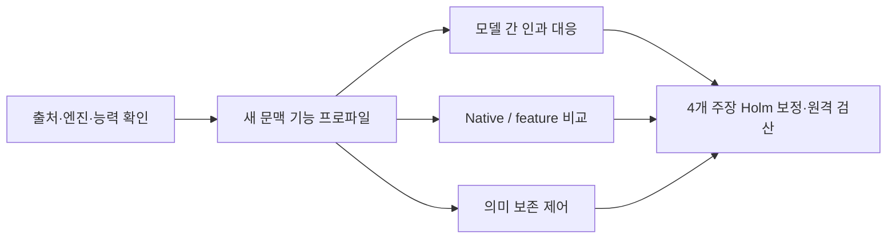

## 새 후속 실험 설계 — Gemma neuron map 연계

**2026-11-04 · DESIGNED_NOT_RUN.** 아래는 새 실험 설계이며 측정 결과가 아니다. 기존 pilot/followup-v2 결과는 아래에 보존했다.

[Jiho Ryou의 Gemma 4 E2B 지도](https://salixkoreensis94-spec.github.io/gemma4-e2b-neuron-map/map/index.html)와 [고정 소스 revision](https://github.com/salixkoreensis94-spec/gemma4-e2b-neuron-map/tree/c2dfd9e7a54c745824ffe2472ab15040ffb8048f)을 검토했다. 지도의 정적 lens, 실제 활성 문맥, transcoder feature, 개입 결과를 구분하고, 이를 WSP2에서 확인한 정답 방향 혼입·과제 능력 부족·semantic proxy 한계와 연결했다.

**핵심 질문:** 새 문맥에서 추정한 기능은 어휘·답 표현·개입 크기를 통제한 인과 효과를 예측하는가? 그 대응을 이용해 사실과 의미를 보존하면서 출력을 바꿀 수 있는가?

| 주 주장 | 비교 | 주요 통제 |
|---|---|---|
| H1 | semantic 정렬 vs activation 정렬 | 정답 상태·답 코드·언어 안의 인과 효과, 새 source family |
| H2 | semantic+causal 정렬 vs activation 정렬 | causal-only·random·no-op, F에서만 혼합 가중치 선택 |
| H3 | transcoder feature vs native neuron의 효과 예측 | 동일 차분 개입·raw-MLP norm·후보 예산, fidelity gate |
| H4 | prompt+개입 정책 vs prompt-only | 문체와 사실 보존의 공동 성공, 의미·유창성 비열등성 |

Engineering32 / readiness64 / discovery96 / fit96 / test320 / OOD96의 **704 source family**를 계획했다. 전체16변형은 같은 family로 묶고, 핵심 인과 실험은 균형8변형·Gemma source8개·Qwen target16개부터 시작한다. 표본 목표와 예산은 검정력·처리량의 보장이 아니며, 시험을 열기 전에 확인한다. Transcoder 가중치/엔진 확보와 추가 학습은 별도 의존성·비용 gate를 통과해야 한다. 기존 지도의 사후 결과를 새 확증 결과로 바꾸지 않는다.

[전체 설계·수식·중단 규칙](reports/followup-v3-gemma-map/DESIGN.md) · [원문 검토와 재현 한계](reports/followup-v3-gemma-map/REFERENCE_REVIEW.md) · [실행 설정 초안](configs/followup_v3_gemma_map.json) · [참조 파일·고정 해시](artifacts/followup-v3-gemma-map/reference_manifest.json)

---

